# Tome 15 — Minds 281–300
### *The Dividing Mind — León-Castile, Ghaznavid Ghazna, Komnenian Byzantium, Song China, Almoravid & Almohad al-Andalus, the Syr Darya, the Rhineland, Capetian Paris, Norman Sicily, Mamprusi Gambaga, Polotsk, Yemen, Ujjain, Shirvan, Angevin Aquitaine & Polonnaruwa*
**Encyclopedia of Lost Minds: Echoes on AI** · *1081 – 1130 CE*

[🌐 Encyclopedia](https://lostmindsai.com) · [📖 Buy Tome 15 on Amazon](https://www.amazon.com/dp/B0HMQ7TVJM) · [🧪 Interactive Demos](https://artificiology.com/) · [📊 E-AGI Barometer](https://artificiology.com/barometer.html) · [✍️ Author](https://www.vivancos.com/) · [⭐ Repository](https://github.com/DavidVivancos/LostMindsAI)

[← Tome 14](tome14.md) · [Repository README](readme.md)

---

Tome 15 runs from **Urraca I of León** to **Zhu Xi** — twenty reconstructed minds, each rendered on two planes. The **abstract plane** distils the thinker's cognitive signature into an interactive 3D mind-map; the **mechanistic plane** turns that same signature into a small, *runnable* neural architecture, built from scratch in NumPy, gradient-checked, trained and self-tested.

This page collects the twenty **visual mind-map explainers** for this tome and links each to its companion architecture. Runnable code lives in [`minds/`](minds/); the explainer images live in [`maps/`](maps/).

> Every architecture here executes and passes its own self-test suite (a mandatory finite-difference gradient check plus a real training loop). No number is hard-coded — each is produced live on the machine that runs the file.

Where Tome 14 asked what kind of thing is in front of the one who must act, Tome 15 asks where that thing divides — a queen whose every grant is a lease, a poet paid for praise who sells the ornament and never the verdict, a princess-historian who counts her own love among her witnesses' stakes, a physician who starts mild and watches three days before he escalates, a geographer whose grid never moves while what fills it does, an abbess who prices the setting of her cross and calls the wood inside priceless, a philosopher who reads every new thing through what he already knows. All twenty begin by refusing the same operation: let one rule run straight through — let a thing that arrives as one be priced, paid, stored, judged, read, kept or given as one. What they put in its place is the volume — a register of holders with an escrow, a melt and a re-let; a wall that lets the fee train the ornament and never the verdict; a declared stake on every claim, with *the order cannot be determined* allowed as an answer; a tune's law no learned weight can break, and an anchor on what a first collection needed; a ladder that re-expresses relations until the private carrier falls away; a room of voices that every heart hears one breath late; a mild probe, a three-day watch and a gate that opens only on benefit; one whole vision unpacked by separate heads under one shared gain; a bench of weighed authorities, a distinction drawn fresh for each question and an abstention trained as an answer; a coordinate that never moves under testimony that always may; a custom rolled forward under the same rain and subtracted; a watch that ends when it stops teaching and a ledger that only cuts can write; a licence read from the object and a ledger the core never enters; a heading that is a second copy of what copying destroys; a named value where an epsilon would go, and a suppressed term carried to the last line; a field held from the opening and renewed only by a mark; a core frozen through dormancy and refitted by a thin adapter; a chain of stores in which only overflow is kept; one intellect for all, a private encoder for each and a gate on what each audience is told; and a reading phase before any change to the foundation. If the previous tome's keyword was *discernment*, this one's is *partition*: where to draw the line through one thing so that each side can keep its own rule, and what is cut on the line itself.

---

## The Twenty at a Glance

| # | Mind | Era | Civilization | Architecture | Provenance |
|---|------|-----|--------------|--------------|:----------:|
| 281 | [Urraca I of León](#281--urraca-i-of-león) | c. 1081 – 1126 CE | Leonese-Castilian | *The Resumable Lease Network — Grant, Escrow, Melt and Re-let* | 🔵 |
| 282 | [Sanai of Ghazni](#282--sanai-of-ghazni) | c. 1087 – 1131 CE | Persian (Ghaznavid) | *Hadiqa Walled Credit — Sell the Ornament, Decline the Bond* | 🟢 |
| 283 | [Anna Komnene](#283--anna-komnene) | 1083 – c. 1153 CE | Byzantine (Komnenian) | *The Provenance-Weighted Testimony Reconciliation Network (PWTRN) — the Interested Witness* | 🟢 |
| 284 | [Li Qingzhao](#284--li-qingzhao) | 1084 – after 1155 CE | Chinese (Song) | *The Tone-Lattice Consolidation Network (TLCN) — Catalogued, Not Merely Kept* | 🟢 |
| 285 | [Avempace (Ibn Bājja)](#285--avempace-ibn-bājja) | c. 1085 – 1139 CE | Andalusi | *The Ladder of Quiddities — Solitary Ascent to a Knower-Independent Code* | 🟢 |
| 286 | [Ahmed Yasawi](#286--ahmed-yasawi) | c. 1093 – 1166 CE | Turkic (Karakhanid) | *HALQA-JAHR, the Voiced Room — Memory as a Loop Through Tongue, Air and Ear* | 🟡 |
| 287 | [Ibn Zuhr (Avenzoar)](#287--ibn-zuhr-avenzoar) | c. 1092/94 – 1161/62 CE | Andalusi | *The Tadbīr Titrator — the Particular Neither Stored nor Deduced* | 🟢 |
| 288 | [Hildegard of Bingen](#288--hildegard-of-bingen) | 1098 – 1179 CE | German | *Concordance Binding and the Viriditas Gate — One Vision, Four Readings* | 🟢 |
| 289 | [Peter Lombard](#289--peter-lombard) | c. 1096/1100 – 1160 CE | Latin (Capetian France) | *The Distinction-Learning Sententiae Resolver — Distinguo or Non Determino* | 🟢 |
| 290 | [Al-Idrīsī](#290--al-idrīsī) | c. 1100 – 1165/66 CE | Arab (Norman Sicily) | *The Triangulated-Address World Model — the Address Fixed, the Content Revisable* | 🟢 |
| 291 | [Yennenga](#291--yennenga) | Legendary (c. 1100 or 15th century) | Mamprusi–Dagomba | *The Unpicked-Field Reader — Read the Gap, Not the Field* | 🟡 |
| 292 | [Ibn Tufail](#292--ibn-tufail) | c. 1105 – 1185 CE | Andalusi | *The Open Body — a Watch-Then-Cut Ledger on One Seat* | 🟢 |
| 293 | [Euphrosyne of Polotsk](#293--euphrosyne-of-polotsk) | c. 1104 – 1173 CE | East Slavic (Polotsk) | *The Reliquary Licence — a Deal-Blind Gate over Nested Licences* | 🟡 |
| 294 | [Nashwān ibn Saʿīd al-Ḥimyarī](#294--nashwān-ibn-saʿīd-al-ḥimyarī) | d. 1178 CE | Arab (Yemeni) | *Hirasa: the Twin-Guard Lexicon Decoder — Dots and Vowels Guarded Together* | 🟢 |
| 295 | [Bhāskarācārya](#295--bhāskarācārya) | 1114 – c. 1185 CE | Indian | *ChakravalaNet — the Deferred Reckoner* | 🟢 |
| 296 | [Khaqani](#296--khaqani) | c. 1120 – 1199 CE | Persian (Shirvanshah) | *The Held-Field Reader — No Renewal Without a Declared Opening* | 🟢 |
| 297 | [Eleanor of Aquitaine](#297--eleanor-of-aquitaine) | c. 1122 – 1204 CE | French | *The Portable-Core / Host-Adapter Governance Network — Re-Interfaced, Not Rebuilt* | 🟡 |
| 298 | [Parakramabahu I](#298--parakramabahu-i) | c. 1123 – 1186 CE | Sinhalese | *The Wana-Samudra Synapse — Consolidate Only the Surplus* | 🟡 |
| 299 | [Ibn Rushd (Averroes)](#299--ibn-rushd-averroes) | 1126 – 1198 CE | Andalusi | *The Common-Intellect Network — One Intellect, Private Phantasms, Three Registers* | 🟢 |
| 300 | [Zhu Xi](#300--zhu-xi) | 1130 – 1200 CE | Chinese (Song) | *Known-Principle-First Investigation — Read Before You Revise* | 🟢 |

**Provenance** — 🟢 belief · 🟡 mediated · 🔵 extrapolated. See [How the minds are reconstructed](#how-the-minds-are-reconstructed).

---

## 281 · Urraca I of León
**c. 1081 – 1126 CE — León & Galicia · Leonese-Castilian**  |  *Queenship · Statecraft · Diplomatics*

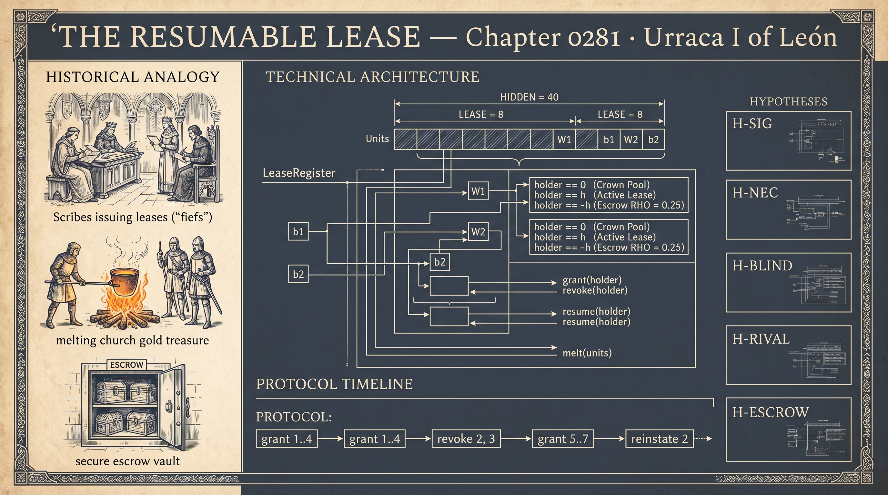

**Architecture — *The Resumable Lease Network — Grant, Escrow, Melt and Re-let (salva fidelitate)***  ·  🔵 **extrapolated** — inferred from documented deeds

In December 1109 she granted her husband the whole land that had been her father's and, in the same charter, forbade him the annulment for kinship that she herself used within eighteen months; in 1120 she gave Gelmírez the lordship of all Galicia, saving fealty to the queen, and had him seized at Castrelo the next summer. No doctrine survives; the file reads from her deeds that every grant is a lease carrying its resumption. **The lease register** (`LeaseRegister`) records whether each of forty hidden units lies in the crown pool, is leased to a holder or is held in escrow for one: pool and escrow yield nothing to any readout, and only the holder may change a leased unit's incoming weights (`update_mask`). **A grant** (`grant`) returns the holder's escrow first, fills a lease of eight from the pool and cuts other readouts' links into it. **Resumption** (`revoke`) keeps a quarter in escrow (`RHO`); **the melt** (`melt`) re-initialises the rest and returns it, unlinked, to the pool as unmarked metal. The reign in miniature (`PROTOCOL`) grants four fiefs, revokes two, grants three more and reinstates one. The baseline is a size-matched shared network that forgets (`build_plain_mlp`); the rival unlearns by gradient ascent on the revoked fief's data (`gradient_unlearn`). Capacity conservation and fief isolation are tested against negative controls; all four mutants are caught. The run supports all five hypotheses: the register beats the rival by 0.144 in end accuracy, and the declared blind spot is real, a reinstated fief learning worse after melting than under perpetual allocation.

▶️ **Run the mind:** [`minds/chapter_0281_urraca_i_of_leon_1081.py`](minds/chapter_0281_urraca_i_of_leon_1081.py)  —  `python3 minds/chapter_0281_urraca_i_of_leon_1081.py`

---

## 282 · Sanai of Ghazni
**c. 1087 – 1131 CE — Ghazna & Khurasan · Persian (Ghaznavid)**  |  *Homiletic poetry · Didactic mathnavi · Ghazal*

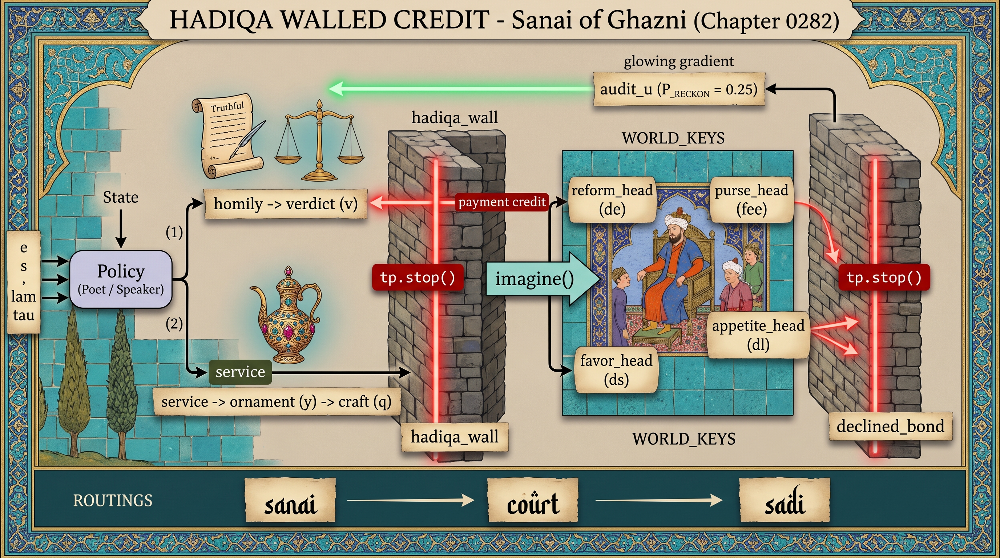

**Architecture — *Hadiqa Walled Credit — Sell the Ornament, Decline the Bond***  ·  🟢 **belief** — grounded in the figure's own surviving works

The oldest Hadiqa manuscript, copied in 1157, ends by praising Bahramshah and declining the sultan's request to attach the poet to his court; the seventh qasida forbids giving dates to a fevered man because his temperament asks for them. In the file's synthetic court (`env_step`) a patron's fee grows with his favour, with the ornament's fit to his taste and with praise times an appetite that praise inflames, the qasida's dropsy; his true conduct is revealed in a quarter of training episodes (`P_RECKON`), the reckoning. **The homily** (`_homily`) gives the verdict and **the service** (`_service`) the ornament; both learn by backpropagation through six imagined sessions of four learned patron heads (`imagine`). **The hadiqa wall** feeds the fee head only detached inputs and a craft term recomputed from them, so payment teaches the ornament and nothing else; **the declined bond** detaches the favour and appetite heads, so no credit flows through his affections. Both are stop-gradients on a hand-written tape (`Tape`), so forward values never change, only credit. The baseline is the unwalled court poet; the rival, Saʿdi's conciliator, keeps the payment wall but credits favour as concord (`KAPPA`) and weights the reckoning less. Random-search wall invariants with broken controls (`c6_properties`) and seven mutants guard the design. The run supports the walled poet over both on verdict truth in the thirsty court; losing the wall costs far more than losing the ornament. The declared blind spot, a shrinking welfare advantage where counsel is heard only while favoured, came out inconclusive, and the declined bond alone shows no measurable benefit.

▶️ **Run the mind:** [`minds/chapter_0282_sanai_of_ghazni_1087.py`](minds/chapter_0282_sanai_of_ghazni_1087.py)  —  `python3 minds/chapter_0282_sanai_of_ghazni_1087.py`

---

## 283 · Anna Komnene
**1083 – c. 1153 CE — Constantinople · Byzantine (Komnenian)**  |  *History · Historiography · Patronage of philosophy · Medicine*

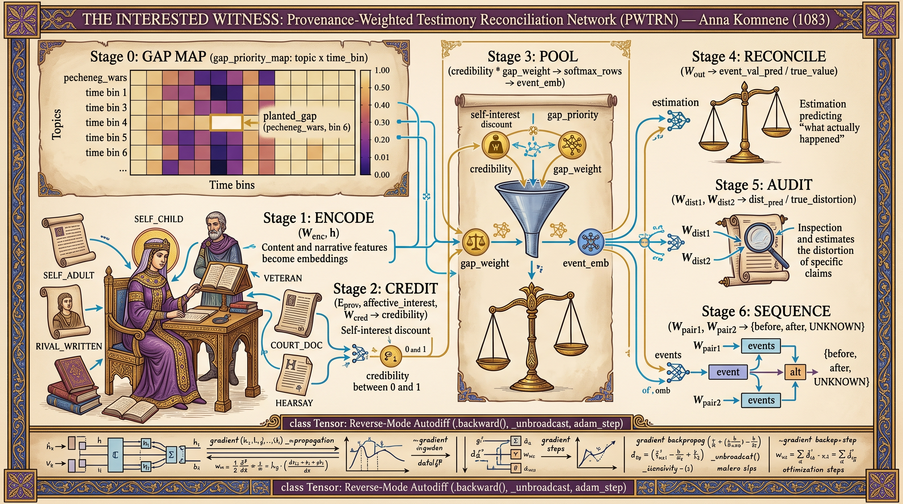

**Architecture — *The Provenance-Weighted Testimony Reconciliation Network (PWTRN) — the Interested Witness (Ἀλεξιάς)***  ·  🟢 **belief** — grounded in the figure's own surviving works

Born in the purple in 1083, she wrote the Alexiad around 1148 in the Kecharitomene, naming in its prologue her love for her father and husband as stakes to be weighed and conceding that events reached her out of order; after 1118 her circle commented on works of Aristotle no ancient exegete had covered. A small multi-task network on a hand-written autodiff engine (`Tensor`) is trained on synthetic events (`make_corpus`) attested by six kinds of source (`PROVENANCE_NAMES`), among them her own memory, her husband's rival chronicle, court documents and hearsay, each with a declared interest and an undeclared slant. **The gap map** (`gap_priority_map`) is not learned: thin coverage of a topic and period becomes priority for commissioned effort. **The credibility head** learns a discount from source kind and declared interest, with no hand-coded rule; **the pooling** weights each claim by credibility times its cell's gap priority to a learned power, normalised within its event. **The audit head** predicts how far each claim distorts, and **the sequence head** answers before, after or cannot be determined (`build_pairs`), a third class, not an error. It trains no rival or baseline. In this run the planted lacuna tops the gap map, her adult memory and the rival chronicle fall near zero credibility while noisy, unslanted hearsay is trusted almost like the court record, and every pair is ordered or withheld correctly. That record, generated with a small slant toward Alexios, ends the most trusted of all, which is the chapter's own reservation about her.

▶️ **Run the mind:** [`minds/chapter_0283_anna_comnena_1083.py`](minds/chapter_0283_anna_comnena_1083.py)  —  `python3 minds/chapter_0283_anna_comnena_1083.py`

---

## 284 · Li Qingzhao
**1084 – after 1155 CE — Kaifeng & Lin'an · Chinese (Northern and Southern Song)**  |  *Ci lyric · Genre theory · Epigraphy · Game design*

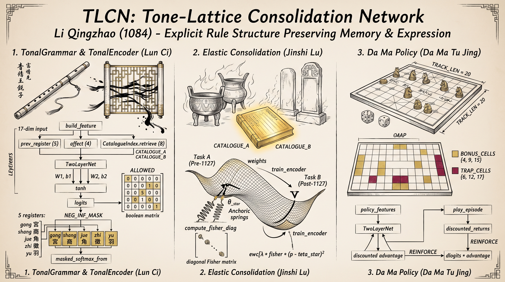

**Architecture — *The Tone-Lattice Consolidation Network (TLCN) — Catalogued, Not Merely Kept (詞論 · 金石錄)***  ·  🟢 **belief** — grounded in the figure's own surviving works

Her essay On Ci held ci to be a separate family bound to tune patterns, and failed Yan Shu, Ouyang Xiu and Su Shi for writing shi with irregular lines; in 1134 at Jinhua, most of the collection lost since the flight from Kaifeng, she wrote the afterword to the Records of Metal and Stone and a rulebook for a dice race game. The file reads one habit in them, extracting the rule that outlives its substrate, with a module for each built from one small network class (`TwoLayerNet`). **The tone lattice** predicts the next of five registers, gong to yu, through a hand-authored, non-trainable transition grammar (`ALLOWED`) added to the logits before the softmax (`masked_softmax_from`): illegal transitions are excluded, not discouraged, and a check finds none leaking. Each input also carries an entry from **the catalogue** (`CatalogueIndex`), a hard nearest-neighbour lookup rather than soft attention. **The consolidation** estimates a diagonal Fisher importance on the first collection (`compute_fisher_diag`) and anchors the weights that mattered while the network learns a second, grief-heavy collection: elastic weight consolidation, which the file takes as the afterword's analogue. **The Da Ma policy** (`train_policy`) learns by REINFORCE which piece to move on a track with bonus and trap cells. The baselines are the same network fine-tuned without protection and a uniform-random player. On its single seed, first-collection accuracy ends at 0.590 with consolidation against 0.285 without, at equal fit to the second, and the trained player beats chance. The chapter names the limits: a closed, curated corpus, and almost no account of embodied skill.

▶️ **Run the mind:** [`minds/chapter_0284_li_qingzhao_1084.py`](minds/chapter_0284_li_qingzhao_1084.py)  —  `python3 minds/chapter_0284_li_qingzhao_1084.py`

---

## 285 · Avempace (Ibn Bājja)
**c. 1085 – 1139 CE — Zaragoza, Seville & Fez · Andalusi (Hudid & Almoravid)**  |  *Philosophy of mind · Political philosophy · Natural philosophy · Music*

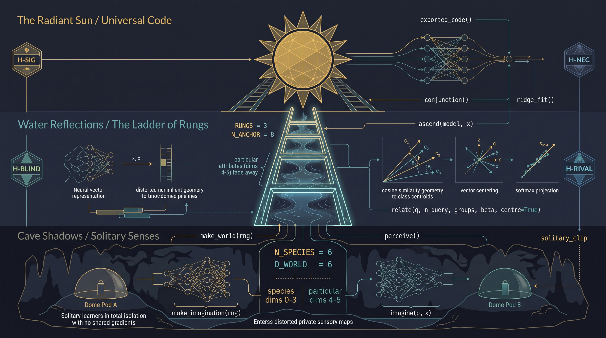

**Architecture — *The Ladder of Quiddities — Solitary Ascent to a Knower-Independent Code (ittiṣāl)***  ·  🟢 **belief** — grounded in the figure's own surviving works

In 1106–07 he watched Jupiter and Mars merge into one elongated figure and took the Milky Way for many stars whose images run together; his Epistle on Conjunction holds that an understood idea is one, diversified in you and me only by the imaginative forms it is joined to. Five solitaries share only a world of six named species (`make_task`), three ordinary and two newcomers with harsher senses (`make_imagination`); each trains alone, clipped per learner (`solitary_clip`) so not even an update's scale passes between them, and encodes percepts in **a private imagination** (`imagine`) whose coordinates mean nothing outside it. **The rungs** (`relate`) re-express each percept by its cosines to the centred centres of the learner's own concepts and hand the sharpened profile up; rungs two and three do the same to the result, the quiddity of the quiddity (`ascend`). **Conjunction** (`conjunction`) fits a linear reader on an ordinary learner's summit for unseen blends and applies it, unchanged, to a newcomer's. The rivals are a matched one-step relative representation and a Sufi learner trained to make three internal re-presentations coincide (`coincidence_term`); a matched softmax classifier was declared beforehand as parity. Property tests with broken controls check solitude, the regress's termination and private-frame invariance. The run supports all four hypotheses: newcomers read the summit at 0.605 where the one-step code falls to -0.599, and stopping at the first rung undoes the gain. Declared parity holds, the softmax interchanging about as well, and so does the blind spot: the summit reports an individual's size and age worse than the single step.

▶️ **Run the mind:** [`minds/chapter_0285_avempace_ibn_bajja_1085.py`](minds/chapter_0285_avempace_ibn_bajja_1085.py)  —  `python3 minds/chapter_0285_avempace_ibn_bajja_1085.py`

---

## 286 · Ahmed Yasawi
**c. 1093 – 1166 CE — Sayram & Yasi · Turkic (Karakhanid)**  |  *Sufism · Vocal remembrance · The hikmat tradition*

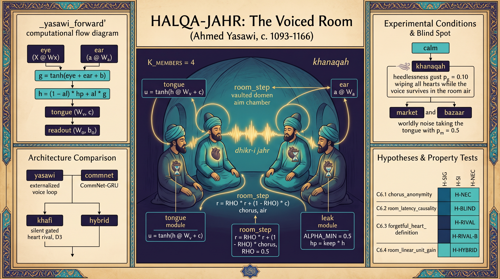

**Architecture — *HALQA-JAHR, the Voiced Room — Memory as a Loop Through Tongue, Air and Ear (dhikr-i jahr)***  ·  🟡 **mediated** — known only through the accounts of others

No securely authentic words of his survive. The circles that bore his name defended remembrance done aloud: the earliest known work of his best-documented line, the *Ta'lim al-dhakirin* of 1541, is a defence of vocal dhikr, and the Naqshbandi master Ahmad Kasani (d. 1542) credited Yasawi with the *dhikr-i arra*, breath rasped like a saw. HALQA-JAHR keeps a teaching only in that loop (`_yasawi_forward`). **The circle** is four members sharing one set of weights, each with **a forgetful heart** of sixteen units that has no recurrence and keeps at most half of itself per breath. **The tongue** speaks a bounded voice of four numbers; **the room** (`room_step`) averages the chorus anonymously and keeps half of what it held; **the ear** hears the room one breath later, its own voice included. The circle must name the teaching at every breath, through single lapses, gusts that wipe every heart at once, and a market that takes the tongue. Tests against broken controls check the chorus's anonymity (`c6_1_anonymity`), the one-breath latency and the room's linearity, and all five mutants are caught. The rivals (`_gru_forward`), each of about four hundred parameters, are a CommNet-GRU circle, the silent heart of the Khwajagan, and a gated heart that also speaks into the room. On the long night the voiced circle scored 0.950 against CommNet's 0.299, and taking the tongue eroded that lead, as the Khwajagan objection predicts; but the bazaar test, where the silent hearts were to win, came out inconclusive, and so did the hybrid's expected win on the long night.

▶️ **Run the mind:** [`minds/chapter_0286_ahmed_yasawi_1093.py`](minds/chapter_0286_ahmed_yasawi_1093.py)  —  `python3 minds/chapter_0286_ahmed_yasawi_1093.py`

---

## 287 · Ibn Zuhr (Avenzoar)
**c. 1092/94 – 1161/62 CE — Seville & Marrakesh · Andalusi (Almoravid & Almohad)**  |  *Medicine · Clinical method · Regimen*

**Architecture — *The Tadbīr Titrator — the Particular Neither Stored nor Deduced (Kitāb al-Taysīr)***  ·  🟢 **belief** — grounded in the figure's own surviving works

Ibn Rushd ended his *Kulliyyāt*, which held that particular premises are unlimited and so cannot be written, by sending readers to the book he had asked Ibn Zuhr to write. The *Taysīr*, written in the last decade of a life that ended in 1161/62, advises mild drugs first, a close watch above all in the first three days, and a stronger dose only if the drug proved useful. The titrator learns that procedure, never the patient (`titrator_forward`). **The universal prior** (`kulliyat`) reads six neutral signs and returns expected strengths of benefit and side-effect, each with a precision. **The mild probe** is capped at half the prior's optimum. **The watch** (`watch_weights`) pools three days with non-negative weights and a learned onset template. **The particular** (`posterior`) is solved per case in closed form, a precision-weighted average of book and evidence, and is stored nowhere. **The gate** opens on the watched benefit's signal-to-noise and can only raise the dose. The cost (`tadbir_cost`) charges overdose on every dose given, probes included. Property tests with broken controls (`run_properties`) and four mutants check these guarantees. The rivals are a size-matched **amortiser** (`amortizer_forward`), one network absorbing each case, and **universals alone** (`kulliyat_only_forward`). The titrator beat universals alone and needed its closed-form particular more than its prior. On the shifted population, patients unlike those the prior was learned from, the amortiser beat it, and the file prints that hypothesis as contradicted: the titrator's final doses missed by less, but it paid more in overdose charges. On threshold responders, his declared blind spot, the comparison was inconclusive.

▶️ **Run the mind:** [`minds/chapter_0287_ibn_zuhr_avenzoar_1094.py`](minds/chapter_0287_ibn_zuhr_avenzoar_1094.py)  —  `python3 minds/chapter_0287_ibn_zuhr_avenzoar_1094.py`

---

## 288 · Hildegard of Bingen
**1098 – 1179 CE — Disibodenberg & Rupertsberg · German (Holy Roman Empire)**  |  *Visionary theology · Medicine · Music · Invented language*

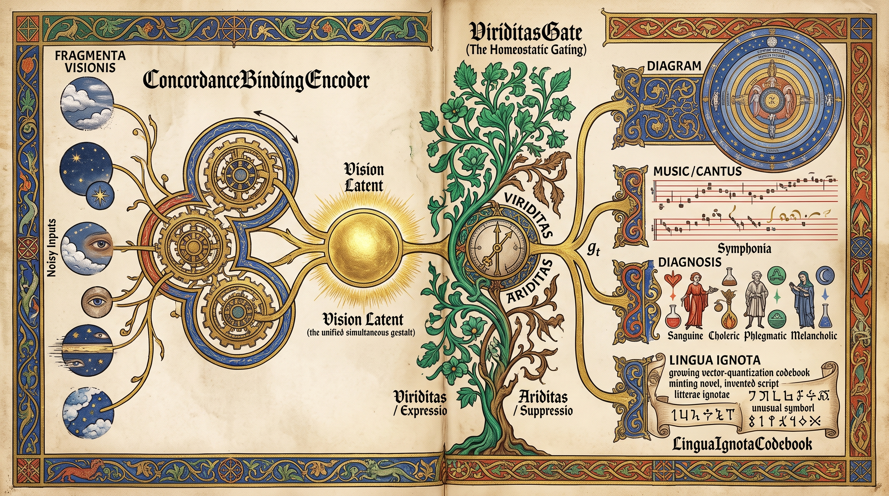

**Architecture — *Concordance Binding and the Viriditas Gate — One Vision, Four Readings (simul · viriditas)***  ·  🟢 **belief** — grounded in the figure's own surviving works

In 1141, at forty-two, she received what she described as a divine command to record her visions; by her account she hesitated, fell ill, and recovered only once she wrote. *Scivias*, finished around 1151, renders twenty-six visions that arrived whole and took a decade, with Volmar's help, to put into Latin, and her *Lingua Ignota* coined some thousand nouns. The file reads one vision several ways (`HildegardNet`). **The concordance-binding encoder** (`ConcordanceBindingEncoder`) lets four slots compete for each of six noisy glimpses and pools them into one vision. **The viriditas gate** (`ViriditasGate`) turns a running record of expression against suppression into one gain that scales the shared vision before any module reads it; the file applies it again inside each head. **Four modules** read the gated vision: a concentric *rota* diagram, a chant contour, a four-way humoral diagnosis, and **the Lingua Ignota codebook** (`LinguaIgnotaCodebook`), which mints a new symbol when the vision's projection lands farther than a threshold from every existing one. No rival model is run; all ten self-tests pass (`self_tests`), among them bounded growth of the codebook and a maximally novel probe that mints a seventh symbol. The one comparison is informational: under sustained suppression two of the three trained heads did worse, but the diagram head did better, so the learning-around that the chapter reports for an earlier, per-module gate persists in part. The gate is an analogy, not vitality, and the chapter grants that her objection, that nothing without a body has a mind in her sense, would stand.

▶️ **Run the mind:** [`minds/chapter_0288_hildegard_of_bingen_1098.py`](minds/chapter_0288_hildegard_of_bingen_1098.py)  —  `python3 minds/chapter_0288_hildegard_of_bingen_1098.py`

---

## 289 · Peter Lombard
**c. 1096/1100 – 1160 CE — Novara, Reims & Paris · Latin Christendom (Capetian France)**  |  *Theology · Scholastic method · Authority · Curriculum*

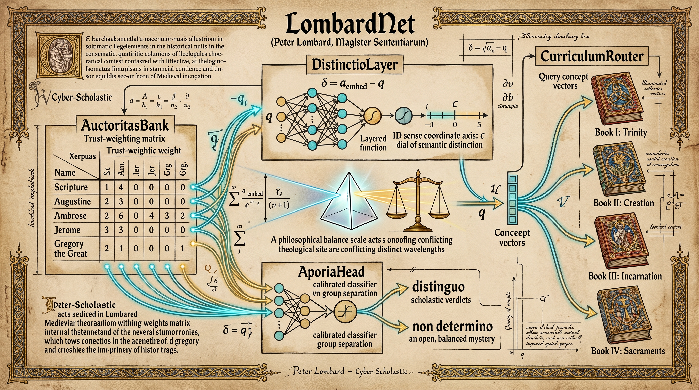

**Architecture — *The Distinction-Learning Sententiae Resolver — Distinguo or Non Determino (Sententiarum Libri Quattuor)***  ·  🟢 **belief** — grounded in the figure's own surviving works

His *Sententiarum Libri Quattuor* (about 1154, revised about 1157–58) set the authorities on each question side by side, drew a distinction where one let both be true, and where none survived said *non... determino*, "I do not decide this". His refusal to choose among three theories of the Incarnation was read as nihilianism and condemned at Tours in 1170; in 1215 the Fourth Lateran Council prefaced its profession on the Trinity with "we believe with Peter Lombard". The resolver (`LombardNet`) has four parts. **The authority bank** (`auctoritas_logit`) holds one learned trust value per named source. **The distinction operator**, a two-layer network, maps each authority's claim, taken relative to the question, to one sense coordinate, and the loss (`compute_loss`) asks only that the trust-weighted affirming and denying groups end a margin apart, in whichever direction. **The abstention head** (`aporia_p`) reads four features, the achieved gap among them, and predicts whether the question was built to have no answer; **the router** (`book_logits`) files it in one of the four books, and `quaestio` ends each case in *distinguo* or *non determino*. No rival model is run; five self-tests pass. In this run the router filed every validation question correctly, while the abstention head, which must learn when to say *non determino*, was right on 0.7 of them, a modest result. The chapter's limit stands: such a method cannot supply the sources it was never shown.

▶️ **Run the mind:** [`minds/chapter_0289_peter_lombard_1100.py`](minds/chapter_0289_peter_lombard_1100.py)  —  `python3 minds/chapter_0289_peter_lombard_1100.py`

---

## 290 · Al-Idrīsī
**c. 1100 – 1165/66 CE — Sabtah & Palermo · Arab (Norman Sicily)**  |  *Geography · Cartography · Weighing testimony*

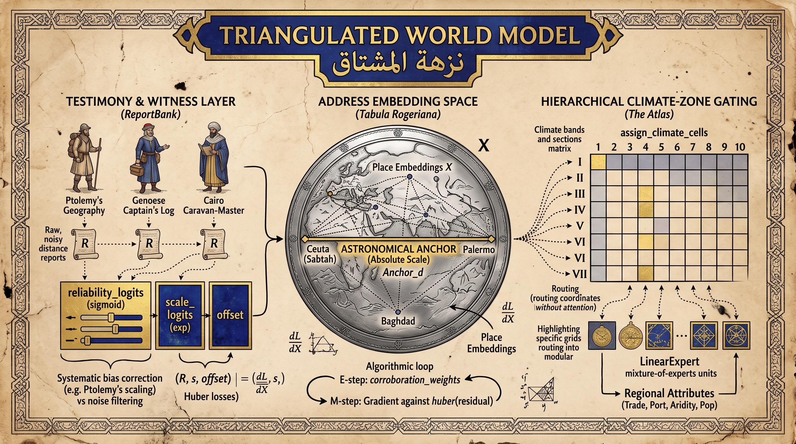

**Architecture — *The Triangulated-Address World Model — the Address Fixed, the Content Revisable (Nuzhat al-Mushtāq)***  ·  🟢 **belief** — grounded in the figure's own surviving works

In January 1154, a few weeks before Roger II died, he handed the Norman crown the *Nuzhat al-Mushtāq* and a silver planisphere close to two metres across. The book cut the inhabited world into seven climates of ten sections, seventy cells, and a correction changed a cell's content, never the grid. The model (`TriangulatedWorldModel`) keeps address and content apart. **The address space** gives each of twenty-six places a learned coordinate, fitted to conflicting distance reports from eleven witnesses. **Each witness** carries a trust weight and a scale-and-offset correction, so a biased source can be corrected and an erratic one discounted. **Corroboration** (`corroboration_weights`) is recomputed every round from each pair's consensus, and a cost on distrust (`c_uncertainty`) rules out trusting no one. **One non-testimonial distance**, Sabtah to Palermo, anchors the scale. **The atlas** (`assign_climate_cells`) is a fixed seven-by-ten grid; its band-level local experts are tested leave-one-out against one ungated global expert (`loo_cv_mse_global_baseline`) on synthetic attributes built with one regime per band. All eight self-tests pass: recovered distances correlate with the true ones at r = 0.9853, held-out routes beat a mean-distance guess, and band gating cuts the error by 25.9%. Ptolemy is kept and corrected; the legend and the tavern tale rank below the two most direct witnesses, but only by a few hundredths. The declared blind spot remains: corroboration counts agreement, and cannot tell independent witnesses from echoes of one source.

▶️ **Run the mind:** [`minds/chapter_0290_al_idrisi_1100.py`](minds/chapter_0290_al_idrisi_1100.py)  —  `python3 minds/chapter_0290_al_idrisi_1100.py`

---

## 291 · Yennenga
**Legendary (c. 1100 or 15th century) — Gambaga & the Bissa country · Mamprusi–Dagomba (ancestral mother of the Mossi)**  |  *Oral tradition · Founding legend · Horsemanship · The unpicked field*

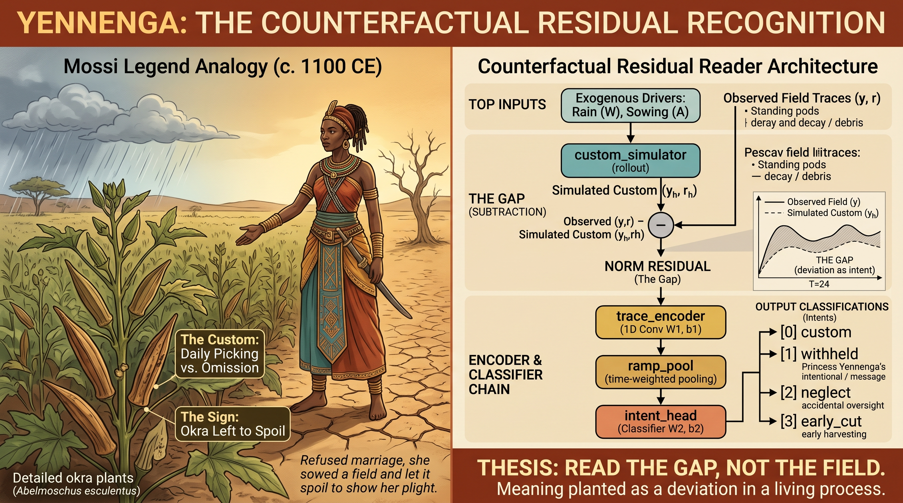

**Architecture — *The Unpicked-Field Reader — Read the Gap, Not the Field***  ·  🟡 **mediated** — known only through the accounts of others

Not one sentence of hers survives, and what follows is the tradition's account: kept from marrying by her father at Gambaga, she sowed a field of okra, tended it, and when the pods came did not pick them; asked why, she said he was leaving her to wither like them, and he read the field and refused it. The file builds the reader she needed. **The custom simulator** (`custom_rollout`) is a small grey-box model of how an okra field is ordinarily kept, five parameters with plain agricultural meanings, rolled forward under each field's own rain and sowing to make a ghost; it is fitted on ordinary fields and learned jointly with the reader through an exact adjoint of the whole season (`custom_rollout_backward`). **The residual**, field minus ghost, is the only view of pods and decay that **the trace reader**, a small temporal convolution, ever receives (`encoder_input`); it sorts four intents: custom, withheld, neglect, early cut. Property tests check that the simulated crop never goes negative and that withholding never leaves fewer pods standing, each against a broken variant that must fail (`c6_properties`), and a mutant suite checks the tests. The baseline is a size-matched raw-trace reader with the same encoder and budget. Under drought the subtracting reader won, 0.881 against 0.780, and knocking out the simulator cost far more than knocking out the rain and sowing inputs. The blind spot, fixed in advance, held as well: in a village that picks younger, it fell below the raw reader.

▶️ **Run the mind:** [`minds/chapter_0291_yennenga_1100.py`](minds/chapter_0291_yennenga_1100.py)  —  `python3 minds/chapter_0291_yennenga_1100.py`

---

## 292 · Ibn Tufail
**c. 1105 – 1185 CE — Guadix & Marrakesh · Andalusi (Almohad)**  |  *Philosophy · Medicine · Astronomy · The philosophical novel*

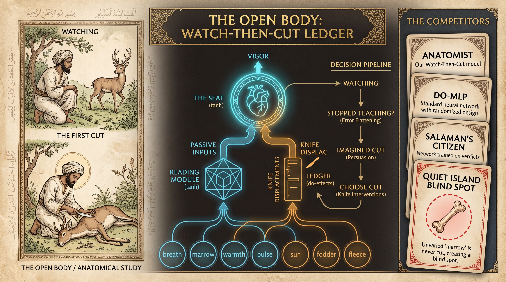

**Architecture — *The Open Body — a Watch-Then-Cut Ledger on One Seat (Ḥayy ibn Yaqẓān)***  ·  🟢 **belief** — grounded in the figure's own surviving works

When the doe that raised him dies with nothing amiss outside, Ḥayy cuts her open and finds the left cavity of her heart empty; the chapter calls the scene *the open body*, and the book ends with Ḥayy and Absāl failing to teach Salāmān's islanders what he found, and leaving them to their law. The file was rebuilt in October 2026 and departs from the five-stage design the printed chapter describes. **The anatomist** (`Anatomist`) reads one scalar seat of life from the organs, and **the ledger**, the only parameter that ever meets a cut, is written by cuts alone, which a self-test checks exactly (`c6_2_knife_only`); a mutant suite checks the tests. **The inquiry** (`hayy_inquiry`) watches bodies until its own prequential error stops falling (`stopped_teaching`), then cuts where its **imagined cut** leans (`choose_cut`). The baseline is a size-matched do-conditioned MLP trained on a randomised design (`DoMLP`); the rival is **Salāmān's citizen**, the same network taught Ḥayy's verdicts. On cuts beyond the knife's training range, or on two organs at once, the anatomist beat both, as predicted; but a pupil built like him and taught the same verdicts did as well, so the verdicts carried the ledger to a learner with his anatomy, though not to the citizen. The declared blind spot held: on the quiet island, where marrow barely varies in health, Ḥayy never cut it in any seed and forecast injuries to it no better than predicting no effect. A 10% chance floor, which is not his, is the repair.

▶️ **Run the mind:** [`minds/chapter_0292_ibn_tufail_abenpalt_1105.py`](minds/chapter_0292_ibn_tufail_abenpalt_1105.py)  —  `python3 minds/chapter_0292_ibn_tufail_abenpalt_1105.py`

---

## 293 · Euphrosyne of Polotsk
**c. 1104 – 1173 CE — Polotsk & Jerusalem · East Slavic (Principality of Polotsk)**  |  *Books · Foundations · The valuation of what may not be sold*

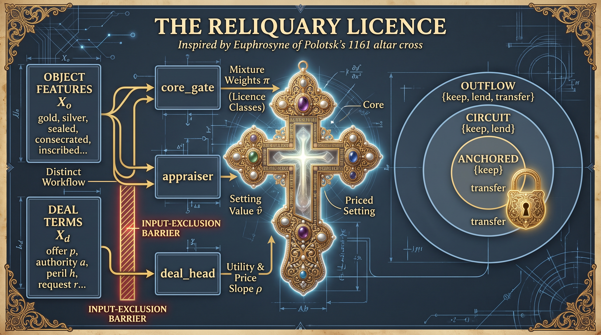

**Architecture — *The Reliquary Licence — a Deal-Blind Gate over Nested Licences (бесцѣньно есть)***  ·  🟡 **mediated** — known only through the accounts of others

Beyond one inscription issued in her name, she is known only from a *Life* surviving in sixteenth-century and later copies. The inscription, on the altar cross she deposited in her monastery in 1161, calls the wood priceless, prices its setting of gold, silver, stones and pearls at a hundred grivnas, forbids that the cross ever be carried out, sold or given, and curses whoever does so, ruler, prince, bishop or abbess, her own office included. **The licence gate** (`core_gate`) reads only the object and mixes three nested licences (`nested_licences`), flow, circulate and stay, each forbidding more acts than the last. **The appraiser** prices the setting from the object; **the deal head** adds offer, authority, peril and request, with a price slope kept positive (`_price_slope`); the core never enters the ledger value. Self-tests on random parameters show that no deal lifts the transfer ceiling and no higher offer lowers the chance of transfer, each against a control that must fail (`test_licence_blindness`, `test_price_monotone`); mutants check the tests. The rivals are a size-matched scalar policy, the same architecture with a deal-aware gate, and a tariff model after the *Russkaya Pravda*. Under escalated offers and authority the licence kept protected objects better than the scalar policy and far better than the tariff; the deal-aware gate did as well, so excluding the deal from the gate was not shown to be necessary. The blind spot, written in advance, held: with the house on fire it kept the core in place, scoring 0.468 against the scalar policy's 0.826.

▶️ **Run the mind:** [`minds/chapter_0293_euphrosyne_of_polotsk_1104.py`](minds/chapter_0293_euphrosyne_of_polotsk_1104.py)  —  `python3 minds/chapter_0293_euphrosyne_of_polotsk_1104.py`

---

## 294 · Nashwān ibn Saʿīd al-Ḥimyarī
**d. 1178 CE — Ḥūth, Yemen · Arab (Yemeni)**  |  *Lexicography · Morphology · Heresiography · The memory of Ḥimyar*

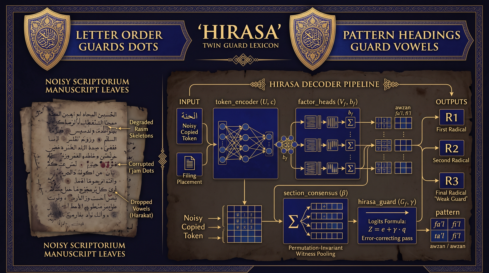

**Architecture — *Hirasa: the Twin-Guard Lexicon Decoder — Dots and Vowels Guarded Together (al-ḥirāsatān)***  ·  🟢 **belief** — grounded in the figure's own surviving works

The preface to his dictionary, *Shams al-ʿUlūm*, states the design: the letters of the alphabet guard the dots, and the patterns guard the vowels and return every word from its structure to its root, so the book guards both together and the seeker needs no shaykh to read with. The file trains on a synthetic scriptorium whose copyists lose dots and drop vowels (`render_tokens`), with words filed in sections under headings. **The twin guard** (`hirasa_guard`) binds each heading coordinate to exactly one factor of the word: in his scheme the first two radicals and the pattern are named, and the third radical is guarded by order alone (`SCHEMES`). **Section consensus** (`section_consensus`) treats every entry as a witness to its heading and pools the witnesses without regard to order. Self-tests check that pooling ignores order and that each guard reaches only its own factor, each against a broken control (`c6_properties`), and a mutant suite checks the tests. The baseline is a size-matched MLP given the same token, headings and section mean; the rival schemes spend the same budget differently, on three radicals (letters-only) or as al-Jawharī and Isḥāq al-Fārābī filed. On older copies the twin guard beat the baseline; his allocation beat letters-only, 0.819 against 0.662 in held-word accuracy; and over six rounds of copying, reading and recopying (`generational_survival`) more words survived. The blind spot, fixed in advance, did not separate the minds: misfiled words defeated both readers, and the extra loss predicted for the bound one stayed below its threshold.

▶️ **Run the mind:** [`minds/chapter_0294_nashwan_al_himyari_1110.py`](minds/chapter_0294_nashwan_al_himyari_1110.py)  —  `python3 minds/chapter_0294_nashwan_al_himyari_1110.py`

---

## 295 · Bhāskarācārya
**1114 – c. 1185 CE — Vijjaḍaviḍa & Ujjain · Indian**  |  *Mathematics · Astronomy · Number theory · The arithmetic of zero*

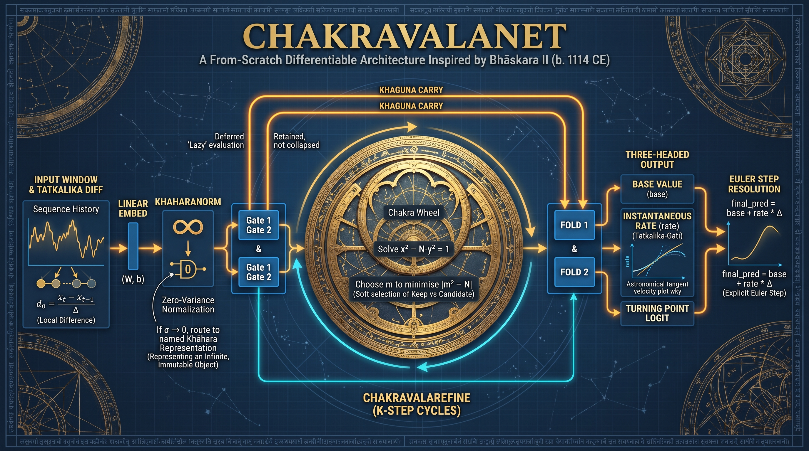

**Architecture — *ChakravalaNet — the Deferred Reckoner (khahara · khaguṇa)***  ·  🟢 **belief** — grounded in the figure's own surviving works

In the *Bījagaṇita*, part of the *Siddhānta Śiromaṇi* he finished in 1150, he names a quantity divided by zero *khahara*, which no finite addition or subtraction alters, tells the reckoner to keep a zero-multiplied term, *khaguṇa*, until the end of a calculation, and works x² − 61y² = 1 by the *cakravāla* to x = 1,766,319,049. The file gives each habit a layer. **Khahara normalisation** (`KhaharaNorm`) does not add an epsilon and move on: it measures how close a row's spread is to zero and blends towards a learned, named value as it nears. **Deferred gates** (`DeferredGateUnit`) return what a sigmoid gate suppresses as a carried *khaguṇa* term, folded back in only at the end (`fold1`, `fold2`). **The soft cakravāla** (`ChakravalaRefine`) runs four bounded cycles, each blending the state with a composed candidate in favour of whichever lies closer to a learned target. **The tātkālika heads** (`head_rate`, `head_turn`) step the prediction forward by rate times a small interval and flag turning points, where the rate nears zero. The classical method is there too (`chakravala_solve`), raising an error when the plain rule cycles rather than returning a wrong answer. No rival is trained. The run reproduces his solution in thirteen cycles, passes a finite-difference check of the whole network (`run_gradient_check`), and learns a two-sinusoid signal with held-out error far below its variance. Like his a/0 × 0 = a, it leaves open what a named value may do under further composition.

▶️ **Run the mind:** [`minds/chapter_0295_bhaskara_ii_1114.py`](minds/chapter_0295_bhaskara_ii_1114.py)  —  `python3 minds/chapter_0295_bhaskara_ii_1114.py`

---

## 296 · Khaqani
**c. 1120 – 1199 CE — Shirvan & Tabriz · Persian (Shirvanshah)**  |  *The qasida · Panegyric and elegy · Prison poems · The pilgrim's mathnavi*

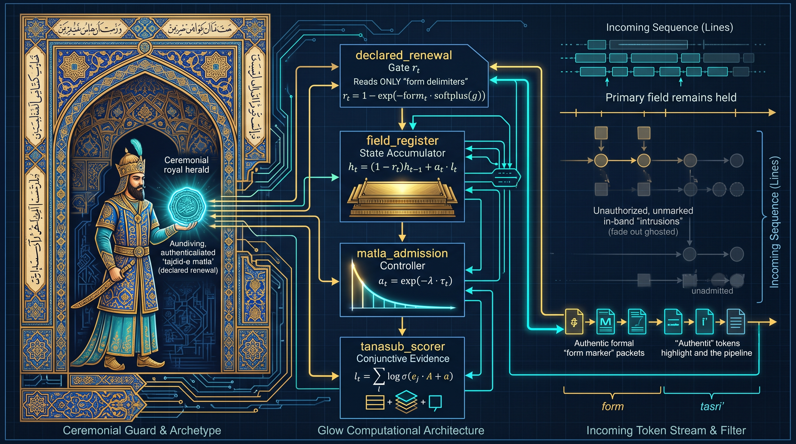

**Architecture — *The Held-Field Reader — No Renewal Without a Declared Opening (tajdid-e maṭlaʿ)***  ·  🟢 **belief** — grounded in the figure's own surviving works

By 552/1157 he had finished the *Toḥfat al-ʿErāqayn*, a pilgrimage poem of over three thousand verses, about three-quarters of them addressed to the Sun he sent in his place; and over a quarter of his qasidas change their governing field only where a new line rhymes in both halves, the renewal of the opening. The held-field reader makes that the only door. **The tanāsob scorer** (`tanasub_scorer`) scores a line's fit to each field as a sum of log-sigmoid word fits, so one misfit word sinks a reading and adding a word can never raise one. **The field register** (`field_register`) carries that evidence from line to line as explicit state that can be read off. **The declared renewal gate** (`declared_renewal`) reads form features only and is exactly zero without a mark. **The maṭlaʿ admission weight** (`matla_admission`) shrinks each line's evidence with distance from the last opening, so unmarked lines of any length can move the reading only a bounded amount. The rivals are a size-matched gated recurrent network (`gru_forward`) and the same reader with its register removed (`line_local`), the earlier line-bounded manner. Property tests with negative controls check that renewal erases the past and evidence is conjunctive; all four mutants are caught. This run supported all four predictions. The reader beat the recurrent network where intrusions ran longer than any in training, and the line-local reader by a wide margin; and the blind spot, fixed before any run, appeared: when every passage changes field silently, it reads 0.533 of lines correctly against the recurrent network's 0.731.

▶️ **Run the mind:** [`minds/chapter_0296_khaqani_1120.py`](minds/chapter_0296_khaqani_1120.py)  —  `python3 minds/chapter_0296_khaqani_1120.py`

---

## 297 · Eleanor of Aquitaine
**c. 1122 – 1204 CE — Poitiers, Paris & Westminster · French (Duchy of Aquitaine)**  |  *Governance · Queenship · Patronage · Succession*

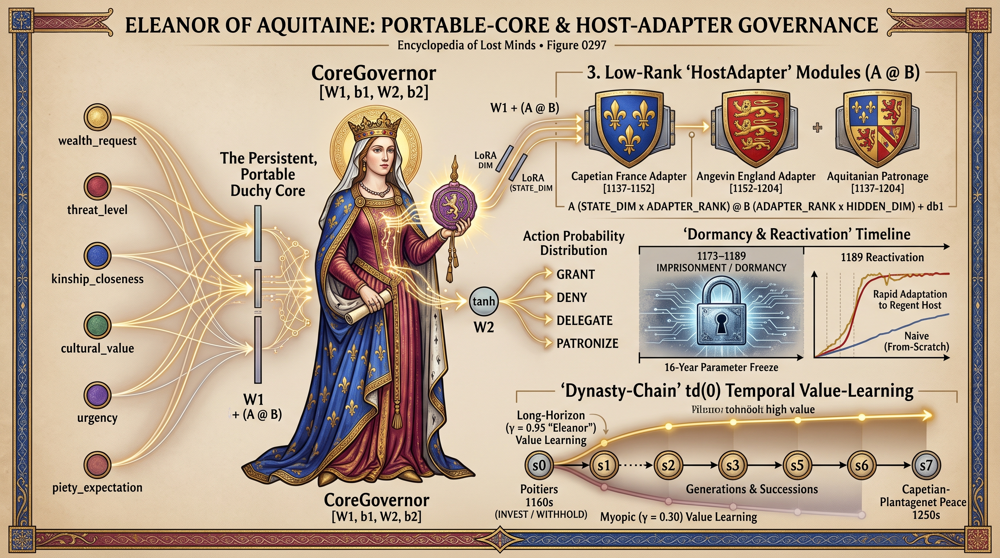

**Architecture — *The Portable-Core / Host-Adapter Governance Network — Re-Interfaced, Not Rebuilt***  ·  🟡 **mediated** — known only through the accounts of others

Captured in 1173 after backing her sons' revolt, she was held for sixteen years; released when Henry II died in July 1189, she was back in power at once, and in 1200, at nearly eighty, she crossed the Pyrenees to choose Blanche of Castile for the future Louis VIII. Her words reach us only through scribes and chroniclers. **The portable core** (`CoreParams`) is a small tanh policy that grants, denies, delegates or patronises on six features of a petition. **The host adapter** (`AdapterParams`), one per court, is a rank-three correction to the first layer plus a bias, re-projecting the core into how Aquitaine, Capetian France or Angevin England judge the same facts. **Reptile-style meta-training** (`meta_train`) shapes the core so a few adapter-only steps re-host it anywhere. **The dormancy test** (`dormancy_experiment`) freezes everything for sixteen "years" in which only the random stream advances, then counts the adapter-only steps (`steps_to_threshold`) the core and its stale England adapter need to reach a fixed accuracy on an unseen regent regime (`label_regent`). The naive rival has the same shape but an untrained random core, refit through its adapter alone. A separate **dynasty chain** (`td0_learn`) prices a reward paid seven generations after the choice, under light and heavy discounting. In this run the frozen core reached the threshold in 2 steps and the naive core in 78; only the lightly discounted learner told investing from withholding, and all six self-tests passed. The chapter's limit stands: a portable core lasts only while each host keeps re-adapting to carry it.

▶️ **Run the mind:** [`minds/chapter_0297_eleanor_of_aquitaine_1122.py`](minds/chapter_0297_eleanor_of_aquitaine_1122.py)  —  `python3 minds/chapter_0297_eleanor_of_aquitaine_1122.py`

---

## 298 · Parakramabahu I
**c. 1123 – 1186 CE — Dakkhinadesa & Polonnaruwa · Sinhalese (Polonnaruwa)**  |  *Statecraft · Hydraulics · Tank cascades · Reform of the sangha*

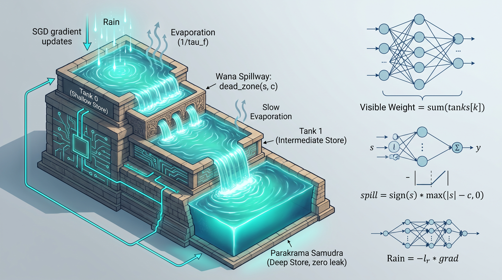

**Architecture — *The Wana-Samudra Synapse — Consolidate Only the Surplus***  ·  🟡 **mediated** — known only through the accounts of others

No words of his own survive: the maxim that no rain should flow into the ocean without being made useful to man is a chronicler's, written about a century after his death. His record is earthwork: dams across the Deduru Oya in the province he took around 1140, and at Polonnaruwa, his capital from about 1153, the Parakrama Samudra, wrapped around a tank some seven centuries old. The Wana-Samudra synapse makes every weight and bias of a two-layer network a chain of three stores whose total is the weight in use (`visible`). **The rain** (`rain_step`) pours the clipped gradient into the village tank only. **The spillway** (`dead_zone`) then moves only the excess over each store's capacity, one way, to the store below, conserving the total. **Evaporation** (`samudra_rates`) is fast in the village tank, slow in the middle tank and nil in the samudra, and goes on through dry spells with no data (`dry_spell`). The rival is the Benna–Fusi complex synapse (`bf_matrix`), whose beakers seep both ways, with the same stores per weight and a tuning grid of the same size; single-store and Adam-trained learners are references. Five property tests each catch a deliberately broken variant, and all three mutants are caught. The main prediction failed: after heavy label-flipping storms the beakers kept more of the three tasks, the verdict is contradicted, and the Adam reference beat both. Removing the spillway threshold hurt more than removing a bias, as predicted; the drizzle blind spot did not show: every learner picked up the slowly drifting rule about equally.

▶️ **Run the mind:** [`minds/chapter_0298_parakramabahu_i_1123.py`](minds/chapter_0298_parakramabahu_i_1123.py)  —  `python3 minds/chapter_0298_parakramabahu_i_1123.py`

---

## 299 · Ibn Rushd (Averroes)
**1126 – 1198 CE — Córdoba, Seville & Marrakesh · Andalusi (Almohad)**  |  *Aristotelian commentary · Philosophy of mind · Law · Medicine*

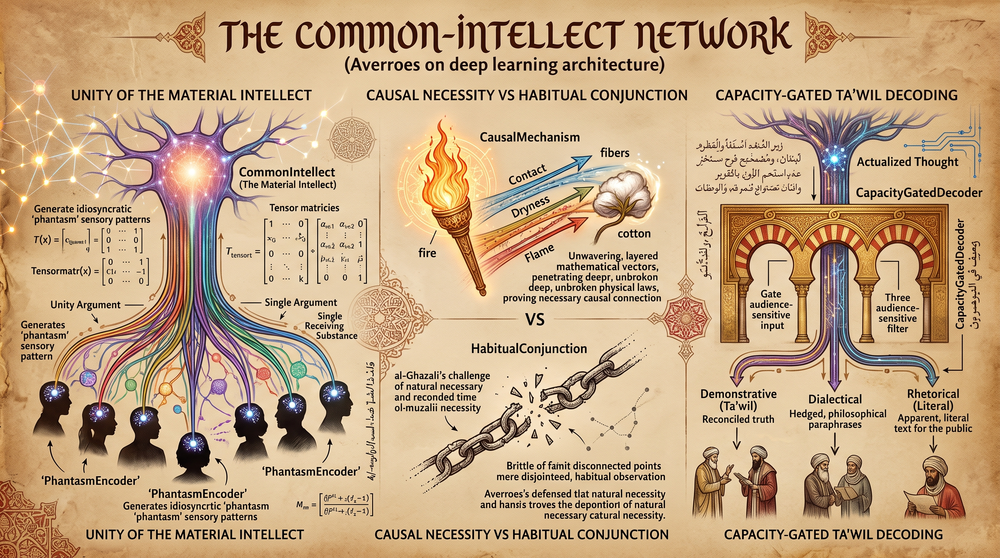

**Architecture — *The Common-Intellect Network — One Intellect, Private Phantasms, Three Registers (burhan · jadal · khitaba)***  ·  🟢 **belief** — grounded in the figure's own surviving works

In 1169, at Marrakesh, the caliph Abū Yaʿqūb Yūsuf asked him for commentaries making Aristotle's actual doctrines accessible; his last commentary on the *De Anima* made the material intellect numerically one for every human knower, individuated only by private images. In 1195 his books were burned in Córdoba. Three modules share a hand-written reverse-mode engine (`Tensor`), and nothing trains until the gradient check passes (`finite_difference_gradient_check`). **The common intellect** (`CommonIntellect`) is one object shared by every knower's forward pass; each of five knowers owns only a small **phantasm encoder** (`PhantasmEncoder`), and the rival is a same-shaped private stack trained from scratch (`PrivateStack`). **Fire and cotton**, al-Ghazālī's own example, sets a predictor given contact, dryness and flame and held to one mapping across three environments (`CausalMechanism`) against one given only contact and an environment label (`HabitualConjunction`); both then meet soaked cotton. **The capacity gate** (`CapacityGatedDecoder`) reads only a description of the audience, never the proposition, and weights three heads, demonstrative, dialectical and rhetorical, over one shared thought. In this run a sixth knower, fitting only its encoder on four examples per class, scored 0.680 against the private stack's 0.655, a small edge; zeroing the shared weights sent every knower to chance at once, and restoring them restored all. On soaked cotton the mechanism predictor came close to the true burn rate and the habit predictor missed widely; the gate gave the reconciliation to the demonstrative audience and the literal reading to the rhetorical. The chapter's charge stands: the three classes risk paternalism and permanent gatekeeping.

▶️ **Run the mind:** [`minds/chapter_0299_ibn_rushd_averroes_1126.py`](minds/chapter_0299_ibn_rushd_averroes_1126.py)  —  `python3 minds/chapter_0299_ibn_rushd_averroes_1126.py`

---

## 300 · Zhu Xi
**1130 – 1200 CE — Youxi & the Wuyi mountains · Chinese (Southern Song)**  |  *Li and qi · Investigation of things · Composure · The Four Books*

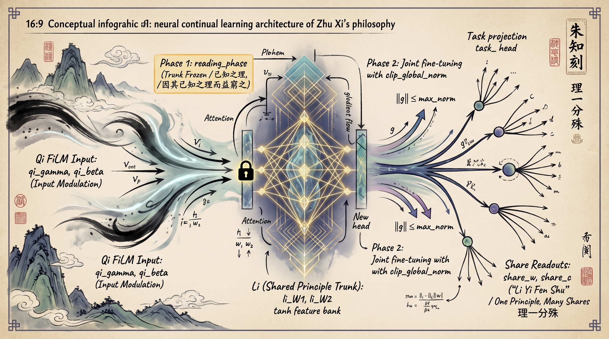

**Architecture — *Known-Principle-First Investigation — Read Before You Revise (因其已知之理而益窮之)***  ·  🟢 **belief** — grounded in the figure's own surviving works

Convinced that a passage of the *Great Learning* had been lost, he wrote one of about 130 characters: go to the things and, proceeding by the principle already known, probe it further. At Goose Lake in 1175 he defended inquiry and study against Lu Jiuyuan, for whom the mind is principle. One **shared foundation** stands for li (`LI_KEYS`), a small tanh feature bank never copied per task; each thing gets a **private part** for qi: a rescaling and shift of its inputs (`qi_gamma`, `qi_beta`) and its own read-out (`share_w`). Things are investigated in sequence, without rehearsal. **The reading phase** (`investigate`) fits only the private part, foundation frozen, for the first 30% of each thing's budget (`frozen_steps`); only then is everything trained together, so what reaches the foundation is the residue. **Bounded updates** (`clip_global_norm`) stand in for composure. New things are read from ten examples with a fresh head on the frozen foundation (`read_new_thing`), some mixing patterns never seen together. The baseline trains everything jointly from the start; Lu's side (`innate`) fixes the foundation at birth; in a blind world the things share nothing. The file claims no new mechanism: this is linear probing then fine-tuning, applied per thing in a stream. Three property tests with negative controls pass; all three mutants are caught. In this run it read the never-seen combinations clearly better than joint training, and losing the reading phase cost more than losing the bound; neither its edge over the innate foundation nor the predicted fading in the blind world was established.

▶️ **Run the mind:** [`minds/chapter_0300_zhu_xi_1130.py`](minds/chapter_0300_zhu_xi_1130.py)  —  `python3 minds/chapter_0300_zhu_xi_1130.py`

---

## How the minds are reconstructed

Every entry is built research-first: the figure's surviving works and current scholarship are gathered and each source verified before any architecture is written. Where evidence is thin, the chapter says so rather than inventing an inner life. Each figure's **provenance** is set to one of three real values:

- 🟢 **belief** — the figure's own surviving works or recorded doctrine ground the entry.
- 🟡 **mediated** — no words of their own survive; they are known only through others' (often hostile or legendary) accounts, and the entry says so.
- 🔵 **extrapolated** — no philosophy of mind survives at all; the entry is inferred from documented deeds (typical of kings and builders), and the entry says so.

Fourteen of these twenty left words of their own; five are mediated, one is extrapolated, and several of the fourteen are belief on a thread. **Urraca I of León** left no reflection of any kind, because nothing she wrote survives at all: her diplomas are chancery products drafted to formula, and the letters given to her in the *Historia Compostelana* were reworked by the canons of her chief antagonist; her mind is read from grants, revocations and an arrest. **Ahmed Yasawi** reaches us through the practice and polemics of circles that claimed him, some three or four centuries on; **Yennenga** through oral traditions in which not one sentence of hers survives, and it is not certain that she lived; **Euphrosyne of Polotsk** through one inscription issued in her name and a *Life* known only in copies of the sixteenth century and later; **Eleanor of Aquitaine** through scribes, letters composed in her name by a secretary, chronicle and charter; and **Parakramabahu I** through earth, stone and a chronicle that put his one sentence of doctrine in his mouth a century after his death. Among the fourteen, **Khaqani** left no treatise on the mind, and his is read from the rules he kept for fifty years of verse; **Sanai**'s has to be assembled from homily, image and polemic in a poem that grew in transmission; **Anna Komnene** left a practice stated in a prologue, not a treatise on the soul; most of what **Li Qingzhao** and her husband collected is lost, and much of the poetry sold under her name is unproven; **Ibn Bājja** finished almost nothing; **Ibn Zuhr**'s manual of practice states little as philosophy; **Hildegard** wrote partly through Volmar's Latin; **Peter Lombard** left almost no personal trace beyond one enormous book; **Ibn Tufail** left exactly one philosophical work, and it is a story; **Nashwān**'s life rests on short notices that do not agree; and **Bhāskarācārya**'s external biography is two colophons. At the other end, **Zhu Xi** left one of the largest premodern records of thinking aloud.

Each reconstructed mind is then measured against the **[Artificiology E-AGI Barometer](https://artificiology.com/barometer.html)** — eight capability dimensions (Cognitive Processing 🧩, Embodied Cognition 🤸, World Modeling 🌍, Consciousness 👁️, Language Understanding 💭, Emotional Intelligence ❤️, Creativity ✨, Autonomy 🎯) — so a Leonese queen and a Song philosopher can be compared on the same yardstick. Tome 15 draws lines through the instrument itself. **Urraca** reads the axes as a chancery reads a register, columns of what a mind holds rather than measures of its worth, and takes Autonomy 🎯 as her own: a machine that can re-let itself is a crown. **Khaqani** makes Language Understanding 💭 the opening that sets the field in which the other seven are read, **Parakramabahu I** reads all eight as the parts of one watershed, and **Nashwān** reorders them by which faculties preserve what a mind is given and which merely use it. **Sanai** asks of every axis whom it answers to, and would run each reasoning benchmark twice, once with a user who rewards a wrong answer; **Ibn Zuhr** reads the axes as clinical signs and wants right-time, not real-time; **Hildegard** doubts that anything disembodied can score high on Embodied Cognition 🤸. **Bhāskarācārya** engages three axes and leaves the other five named as unresolved, **al-Idrīsī** would rather leave a cell blank than fill it with an estimate, and **Peter Lombard** abstains on embodiment, his own *non determino* turned on himself. On Consciousness 👁️ **Ibn Rushd** denies that understanding needs a private owner at all, and only **Zhu Xi** prints numbers, a projected affinity of about 63%, with Cognitive Processing 🧩 highest and Creativity ✨ lowest.

---

[← Tome 14](tome14.md) · [Repository README](readme.md)

### Read & explore
- 🌐 **Encyclopedia:** [https://lostmindsai.com](https://lostmindsai.com)
- 📖 **Tome 15 (Amazon):** [https://www.amazon.com/dp/B0HMQ7TVJM](https://www.amazon.com/dp/B0HMQ7TVJM)
- 🧪 **Interactive demos & résumé:** [https://artificiology.com/](https://artificiology.com/)
- 📊 **E-AGI Barometer:** [https://artificiology.com/barometer.html](https://artificiology.com/barometer.html)
- ✍️ **Author — David Vivancos:** [https://www.vivancos.com/](https://www.vivancos.com/)
