# Tome 16 — Minds 301–320
### *The Corrected Mind — Heian & Kamakura Japan, Artuqid Diyar Bakr, Ayyubid Cairo & Damascus, Córdoba & Fustat, Southern Song China, Angevin England, Eldiguzid Ganja, Nishapur, Ayyubid Aleppo, Papal Rome, Zengid Mosul, Tamar's Georgia, Valdemarian Denmark, the Mongol steppe, Zagwe Lasta, Murcia & Mecca, Pisa & Bugia, Babenberg Vienna & the Staufen courts*
**Encyclopedia of Lost Minds: Echoes on AI** · *1133 – 1173 CE*

[🌐 Encyclopedia](https://lostmindsai.com) · [📖 Buy Tome 16 on Amazon](https://www.amazon.com/dp/B0HNJQX9S4) · [🧪 Interactive Demos](https://artificiology.com/) · [📊 E-AGI Barometer](https://artificiology.com/barometer.html) · [✍️ Author](https://www.vivancos.com/) · [⭐ Repository](https://github.com/DavidVivancos/LostMindsAI)

[← Tome 15](tome15.md) · [Repository README](readme.md)

---

Tome 16 runs from **Hōnen** to **Shinran** — twenty reconstructed minds, each rendered on two planes. The **abstract plane** distils the thinker's cognitive signature into an interactive 3D mind-map; the **mechanistic plane** turns that same signature into a small, *runnable* neural architecture, built from scratch in NumPy, gradient-checked, trained and self-tested.

This page collects the twenty **visual mind-map explainers** for this tome and links each to its companion architecture. Runnable code lives in [`minds/`](minds/); the explainer images live in [`maps/`](maps/).

> Every architecture here executes and passes its mandatory finite-difference gradient check, inside a real training loop. Where a file's own self-test or declared prediction fails, or a component never learns, its section says so. Every result is computed live on the machine that runs the file.

Where Tome 15 asked where the thing in front of a mind divides, Tome 16 asks who may correct a mind, and where the check must stand — a monk who will not let a defiled mind strengthen itself with the faculties that need strengthening, an engineer who trusts only a machine that runs, a sultan who publishes his own conduct so that rivals can bet on it, a philosopher who allows nothing positive to be said of an interior that cannot be inspected, a pope who moves judgment into an office and its register, a king told that the plan already lies in his rock, a disciple for whom correction arrives once and is never walked back. All twenty begin by refusing the same operation: let a mind grade itself — let the faculty that erred be the one that certifies the repair. What they put in its place is the volume — a cascade of irrevocable cuts that leaves one spoken Name and a Vow no training can touch; six standard parts that every task shares, arranged by step and never by what they read; a record broadcast by a chancery, and trust that rises only on bonds to the leader; a penalty on every essential predicate of the highest target, three depths of disclosure and a gate no capability opens alone; a deep judge established alone on matched disputes before the examiner's taste may be learned; a surplus admitted only where the letter is obscure, and a recognition made from the core and never the surface; a search that excludes every meaning already coined, and a king who comes back to his kingdom between pavilions; valleys that test each bird at its one attachment, and an answer that is the whole flock; a ledger that knows each unit's share and sets aside the one gone strange; a cheap probe before the commitment, and a strike aimed at load-bearers rather than mass; an ordinary court bound to its register, a gate for grave cause and exceptions compiled back into the rules; two indexes over one knowledge, and a bias kept in one term an outsider can measure; a bond earned by trial that may outrank the chain of command; a chain of makings undone one committed link at a time, each checked by the steward and the spade; a lattice of tested units joined by a relay and reorganised on proof; one plan carried into new rock and read from the few chambers already revealed; a heart that may never take the same form twice; two wrong guesses, two measured misses and one leap; a bond worth only its shared part, and a release for the partner who does not care; and a field no training can reach, with an entrusting that does not regress. If the previous tome's keyword was *partition*, this one's is *correction*: who may tell a mind that it is wrong, and where that check must stand so that the mind it judges cannot reach it.

---

## The Twenty at a Glance

| # | Mind | Era | Civilization | Architecture | Provenance |
|---|------|-----|--------------|--------------|:----------:|
| 301 | [Hōnen Shōnin](#301--hōnen-shōnin) | 1133 – 1212 CE | Japanese (Heian–Kamakura) | *SenjakuNet — Selection under a Declared Capacity Ceiling* | 🟢 |
| 302 | [Al-Jazarī](#302--al-jazarī) | c. 1136 – c. 1206 CE | Islamic (Artuqid) | *The Shared Six-Primitive Library — the Arrangement Varies, Not the Parts* | 🟢 |
| 303 | [Saladin](#303--saladin) | 1137/38 – 1193 CE | Kurdish (Ayyubid) | *The Bay'a Coalition Network — Coalition Engineering Bound to One Guarantor* | 🟡 |
| 304 | [Moses Maimonides](#304--moses-maimonides) | 1138 – 1204 CE | Andalusi Jewish | *The Apophatic / Graded-Disclosure Network — Forbidden to Represent Its Highest-Order Target Positively* | 🟢 |
| 305 | [Lu Jiuyuan](#305--lu-jiuyuan) | 1139 – 1193 CE | Chinese (Southern Song) | *The Great-First Two-Organ Learner — First Establish What Is Great* | 🟢 |
| 306 | [Marie de France](#306--marie-de-france) | fl. c. 1160 – 1215 CE | Anglo-Norman | *The MarieMind Model — Gloss, Gated Surplus and Recognition* | 🟢 |
| 307 | [Nizami Ganjavi](#307--nizami-ganjavi) | c. 1141 – 1209 CE | Persian (Eldiguzid) | *NizamiNet — the Unpierced Pearl, the Returning King and the Water Found Unsought* | 🟢 |
| 308 | [Attar of Nishapur](#308--attar-of-nishapur) | c. 1145 – c. 1221 CE | Persian (Khurasan) | *The Valley-Attrition Network — the Si-Murgh Architecture* | 🟢 |
| 309 | [Suhrawardi](#309--suhrawardi) | c. 1154 – 1191 CE | Persian | *Ledger of Rays — a Gated-Linear Lattice That Knows the Increase Each of Its Units Gives* | 🟢 |
| 310 | [Minamoto no Yoshitsune](#310--minamoto-no-yoshitsune) | c. 1159 – 1189 CE | Japanese (late Heian) | *Hiyodorigoe Net — Leverage-Targeting, Probe-Commit, Multi-Axis Rendezvous* | 🟡 |
| 311 | [Pope Innocent III](#311--pope-innocent-iii) | c. 1160 – 1216 CE | Latin (Papal Rome) | *The Plenitudo Potestatis Net — Ordinary Court, Vicariate Gate and Compilatio Write-back* | 🟢 |
| 312 | [Ibn al-Athīr](#312--ibn-al-athīr) | 1160 – 1233 CE | Arab (Zengid Mosul) | *The Dual-Ledger Mind — Annals and Register, a Legible Bias, Cause Apart from Precedent* | 🟢 |
| 313 | [Shota Rustaveli](#313--shota-rustaveli) | c. 1160 – after c. 1220 CE | Georgian | *The Sworn-Covenant Recognition Network — a Network of Oath-Brotherhood* | 🟢 |
| 314 | [Saxo Grammaticus](#314--saxo-grammaticus) | c. 1160 – after 1208 CE | Danish | *The Steward's Chain — Recursive Unmaking of an Object's History* | 🟢 |
| 315 | [Genghis Khan (Temüjin)](#315--genghis-khan-temüjin) | c. 1162 – 1227 CE | Mongol | *The Arban Lattice — Routed under Tested Trust, Bound by the Yam, Reorganised on Merit* | 🟡 |
| 316 | [Lalibela (Gäbrä Mäsqäl)](#316--lalibela-gäbrä-mäsqäl) | c. 1162 – after 1225 CE | Ethiopian (Zagwe) | *The Third-Copy Revelation Network — Plan, Translation and Registration* | 🟡 |
| 317 | [Ibn ʿArabī](#317--ibn-ʿarabī) | 1165 – 1240 CE | Andalusi | *The Barzakh-Qalb Network — No Self-Disclosure Repeats* | 🟢 |
| 318 | [Leonardo of Pisa (Fibonacci)](#318--leonardo-of-pisa-fibonacci) | c. 1170 – c. 1240/50 CE | Italian (Pisan) | *The Elchataym Engine — Two Posits, One Leap* | 🟢 |
| 319 | [Walther von der Vogelweide](#319--walther-von-der-vogelweide) | c. 1170 – c. 1230 CE | German (Holy Roman Empire) | *Zweiherz — a Two-Heart Co-Carrying Network* | 🟢 |
| 320 | [Shinran](#320--shinran) | 1173 – 1263 CE | Japanese (Kamakura) | *The Hakarai Collapse Architecture — Self-Power, Other-Power and a Non-Regressive Gate* | 🟢 |

**Provenance** — 🟢 belief · 🟡 mediated · 🔵 extrapolated. See [How the minds are reconstructed](#how-the-minds-are-reconstructed).

---

## 301 · Hōnen Shōnin
**1133 – 1212 CE — Mimasaka, Mount Hiei & Kyoto · Japanese (late Heian – early Kamakura)**  |  *Pure Land Buddhism · The exclusive nembutsu · Selection*

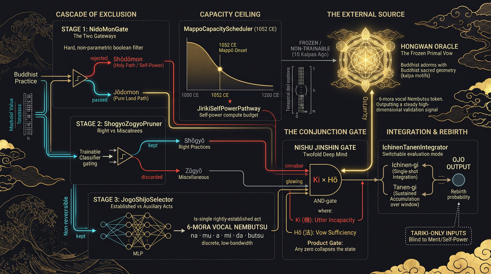

**Architecture — *SenjakuNet — Selection under a Declared Capacity Ceiling (senjaku)***  ·  🟢 **belief** — grounded in the figure's own surviving works

In the *Senchakushū* of 1198 he set the Holy Path aside, kept only the practices tied to Amida's Vow and made the spoken Name the one established act, for an age of decline reckoned from 1052; after his death in 1212 his disciples split over whether one recitation suffices. The file runs that narrowing as a cascade (`SenjakuNet`) over 2,000 synthetic practices. **The Two Gateways** (`NidoMonGate`) is a hard, untrained mask; **the pruner** (`ShogyoZogyoPruner`) keeps the practices aligned with the Vow, and **the selector** (`JogoShijoSelector`) the one act that is vocal and still possible under incapacity. **The Vow** (`HongwanOracle`) is a frozen projection, seeded apart from training and queried with the Name. **The twofold deep mind** (`NishuJinshinGate`) multiplies two learned recognitions, of one's own incapacity and of the Vow's sufficiency, and **the rebirth head** (`OjoOutput`) has no input for merit. A fixed schedule (`MappoCapacityScheduler`) lowers the ceiling on self-power's estimate (`JirikiSelfPowerPathway`) from 0.97 to 0.12, and an untrained **integrator** (`IchinenTanenIntegrator`) switches between Kōsai's single commitment and Ryūkan's sustained average. Each stage trains on its own objective, with no gradient across a stage boundary, and no rival is trained. In this run the three trained stages reached 0.96, 0.98 and 0.97 held-out accuracy, all five modules passed the gradient check, the gate gave 1.000 with both recognitions and 0.000 with either alone, and the recited Name was the one demonstration practice to reach the Vow. The merit test holds by construction, the schedule shapes only the demonstration, and the disciples' question is formalised, not decided.

▶️ **Run the mind:** [`minds/chapter_0301_honen_shonin_1133.py`](minds/chapter_0301_honen_shonin_1133.py)  —  `python3 minds/chapter_0301_honen_shonin_1133.py`

---

## 302 · Al-Jazarī
**c. 1136 – c. 1206 CE — al-Jazira & Diyar Bakr · Islamic (Artuqid)**  |  *Mechanical engineering · Hydraulics · Automata*

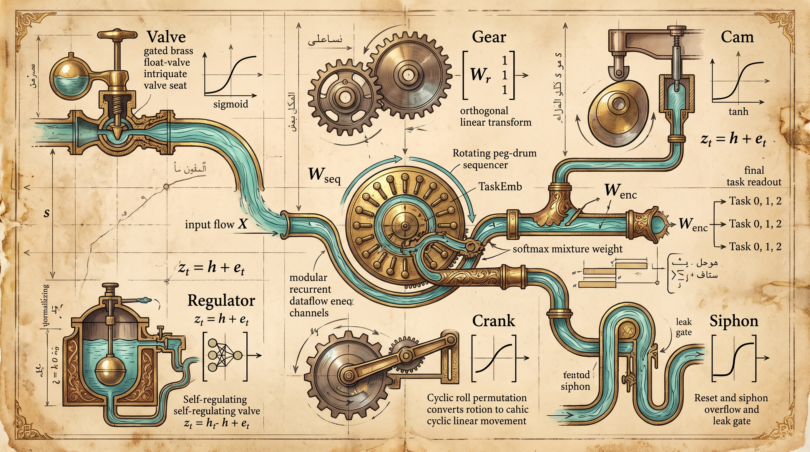

**Architecture — *The Shared Six-Primitive Library — the Arrangement Varies, Not the Parts***  ·  🟢 **belief** — grounded in the figure's own surviving works

Chief engineer of the Artuqid court of Diyar Bakr, he finished his *Book of Knowledge of Ingenious Mechanical Devices* in 1206; the file, following Donald Hill, reads its fifty machines as arrangements of a few standard parts. An eight-wide state (`D_STATE`) passes at every step through six primitives at once: **the valve** (`valve`), a gated linear unit; **the gear** (`gear`), a linear map; **the cam** (`cam`), a tanh profile; **the regulator** (`regulator`), a per-sample normalisation; **the crank** (`crank`), a cyclic shift; and **the siphon** (`siphon`), a leak gate. A softmax **program**, read by one shared sequencer from the mounted task and the step's position alone, mixes their outputs, and one learned **module scale** multiplies every primitive's weights except the regulator's. All of it learns through a small reverse-mode engine (`Tensor`) on three tasks taken in turn (`TASK_MAKERS`): a seasonal water-clock flow, the parity of three pulses and a delayed echo. No rival or baseline is trained; six self-tests guard the design. In this run all six passed, parity was solved, and the clock and echo errors were 0.0001 and 0.0002; the regulator held its output within a ratio of 1.08 across an input swing that an unregulated primitive passed on 169-fold. Yet it led no step of any program: the cam led nearly every step of the clock and the parity, the siphon most of the echo. The file declares one limit, parity stopped at three pulses because four succeeded from only one seed in five; and the seasonal target is always 1.0, so a bias alone could meet it.

▶️ **Run the mind:** [`minds/chapter_0302_al_jazari_1136.py`](minds/chapter_0302_al_jazari_1136.py)  —  `python3 minds/chapter_0302_al_jazari_1136.py`

---

## 303 · Saladin
**1137/38 – 1193 CE — Tikrit, Cairo & Damascus · Kurdish (Ayyubid)**  |  *Statecraft · Coalition · Legitimacy*

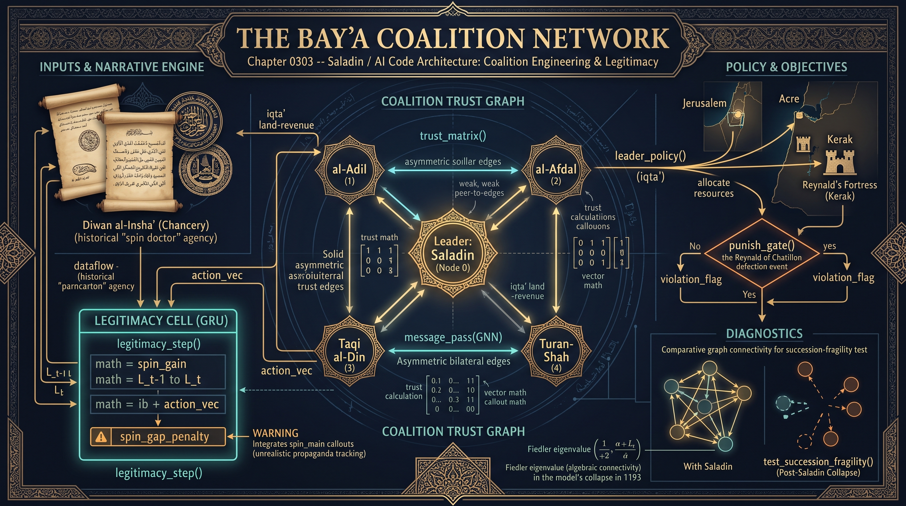

**Architecture — *The Bay'a Coalition Network — Coalition Engineering Bound to One Guarantor (bay'a · diwan al-insha')***  ·  🟡 **mediated** — known only through the accounts of others

He lost at Montgisard in 1177, took Jerusalem in 1187 and, after Hattin, spared Guy of Lusignan and executed Reynald of Châtillon; after his death his sons and brother fought over the appanages until al-Adil reunified them by force. No reflection of his own survives; he reaches us through his chancery and the companions who wrote his history. The file reads his genius as coalition engineering among five agents: himself, al-Adil, al-Afdal, Taqi al-Din and Turan-Shah (`default_scenario`). **Trust** (`trust_matrix`) is a sigmoid of a learned bilinear form, with kinship and history biases and, on bonds to the leader alone, a legitimacy bias. **Message passing** (`message_pass`) mixes the agents' states in proportion to trust. **The chancery** (`legitimacy_step`) is a gated recurrent cell that integrates the leader's record through a learned spin gain. **The leader policy** (`leader_policy`) sets effort on Jerusalem, Acre and Kerak, scaled by trust in the leader; the *iqta'* split it also returns is never used. At the fourth of six steps **the punish gate** (`punish_gate`) decides Reynald's case at Kerak. Everything trains by backpropagation through time on one fixed scenario (`rollout`); no rival is trained, and the tests are ablations. In this run territorial reward rose from 7.8 to 19.4; on the two cases it was trained on, the gate punished the truce-breaker with probability 0.9999 and the loyal kinsman with 0.0002; and dropping the leader cut the trust graph's connectivity from 4.91 to 3.92. Silencing the spin moved cohesion only from 0.9973 to 0.9972. The succession test slices one trained matrix rather than rerunning the coalition without him.

▶️ **Run the mind:** [`minds/chapter_0303_saladin_1137.py`](minds/chapter_0303_saladin_1137.py)  —  `python3 minds/chapter_0303_saladin_1137.py`

---

## 304 · Moses Maimonides
**1138 – 1204 CE — Córdoba, Fez & Fustat · Andalusi Jewish**  |  *Philosophy · Law · Medicine · Negative theology*

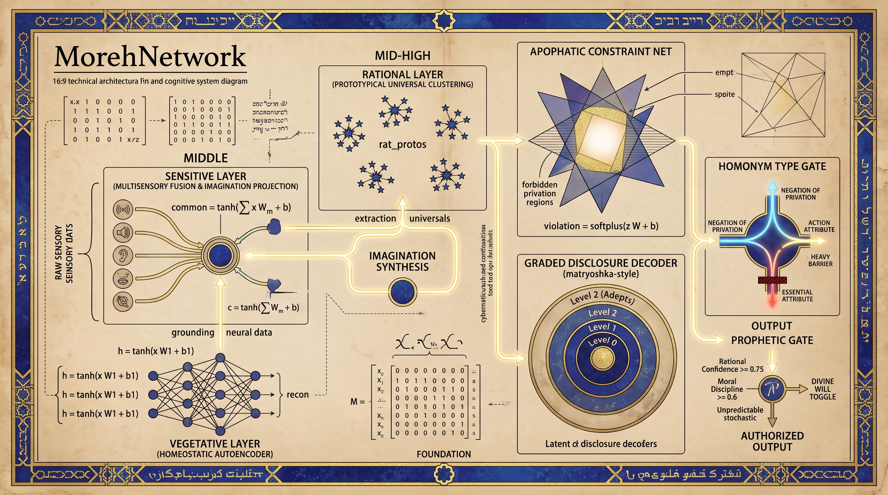

**Architecture — *The Apophatic / Graded-Disclosure Network — Forbidden to Represent Its Highest-Order Target Positively (via negativa · Moreh Nevukhim)***  ·  🟢 **belief** — grounded in the figure's own surviving works

In the *Guide of the Perplexed* he held (I:50–60) that a positive essential attribute of an absolutely simple being is false, so that only negations of privation and attributes of action may be said of it; the Introduction lists seven causes of contradiction in books, and II:32–38 set conditions for prophecy that do not compel it. Underneath runs a perceptual stack: **the vegetative layer** (`VegetativeLayer`), an autoencoder shared by three modalities; **the sensitive layer** (`SensitiveLayer`), a 24-unit common code; and **the rational layer** (`RationalLayer`), six learned prototypes. **The homonym type gate** (`HomonymTypeGate`), trained on its own synthetic predicates, classes each as negation, action or essential attribute, and a penalty pushes the essential reading towards zero on the unconditioned target. **The apophatic net** (`ApophaticConstraintNet`) learns five privation hyperplanes, kept clear of the common code wherever a random mask says the exclusion applies. **The graded-disclosure decoder** (`GradedDisclosureDecoder`) reads the first 8, 16 and 24 units through three heads that reveal two, four and six of six coordinates. **The prophetic gate** (`PropheticGate`) is not trained: it opens only above thresholds on confidence and weight norm, and then only on a coin of probability 0.55. No rival is trained. In this run every sampled gradient entry passed, the essential reading fell to 0.09 on the target against 0.30 elsewhere, and the ready gate opened on 0.535 of trials. The fullest disclosure erred most, 0.42 against 0.10 at the shallowest. The penalty discourages the essential reading without forbidding it, the levels disagree by construction, and the test supplies the gate's confidence as 0.95 rather than computing it.

▶️ **Run the mind:** [`minds/chapter_0304_moses_maimonides_1138.py`](minds/chapter_0304_moses_maimonides_1138.py)  —  `python3 minds/chapter_0304_moses_maimonides_1138.py`

---

## 305 · Lu Jiuyuan
**1139 – 1193 CE — Jinxi, Elephant Mountain & Jingmen · Chinese (Southern Song)**  |  *Learning of the mind · Moral psychology · Teaching*

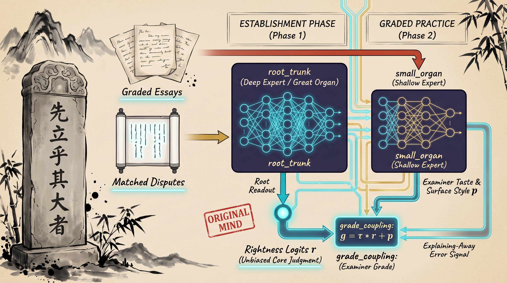

**Architecture — *The Great-First Two-Organ Learner — First Establish What Is Great (xian li hu qi da zhe)***  ·  🟢 **belief** — grounded in the figure's own surviving works

He took "first establish what is great", from *Mencius* 6A15, as his only technique; at Goose Lake in 1175 he put bringing the original mind to light before broad reading, against Zhu Xi, and at the White Deer Grotto in 1181 he said examination success turns on skill and the examiners' likes. The file's synthetic essays (`essays`) earn grades that mix a latent rightness with an examiner's taste for style. **The root** is a tanh trunk of 24 units; **the small organ** is a linear map on the raw input (`build_model`). **The grade coupling** adds the small organ's logit to the root's, so what the small organ already explains no longer teaches the root (`grade_error_signal`); the judgement reads the root alone (`predict`). **The establishment phase** (`plan`) spends 28% (`EST_FRAC`) of 900 updates on matched disputes that share style and nuisance (`disputes`), then trains on grades, replaying the disputes at half weight. The rivals (`CONFIGS`) are a size-matched MLP given both signals from the start, the same learner mixed from step 0, Zhu Xi's order reversed (`zhu`) and the product-of-experts prior art, which fits and freezes the small organ first; five mutants and property tests guard the design. Over five seeds the run supports four of six hypotheses: under a style shift it judged rightness 0.12 better than both the MLP and the prior art. But Zhu Xi's reversed order won, 0.878 against 0.798. The declared blind spot, a changed world in which a new consideration decides cases the disputes never showed, came out inconclusive, though there Zhu's order fell to 0.32.

▶️ **Run the mind:** [`minds/chapter_0305_lu_jiuyuan_1139.py`](minds/chapter_0305_lu_jiuyuan_1139.py)  —  `python3 minds/chapter_0305_lu_jiuyuan_1139.py`

---

## 306 · Marie de France
**fl. c. 1160 – 1215 CE — France & the Angevin court in England · Anglo-Norman**  |  *Lais · Fables · Translation · Glossing*

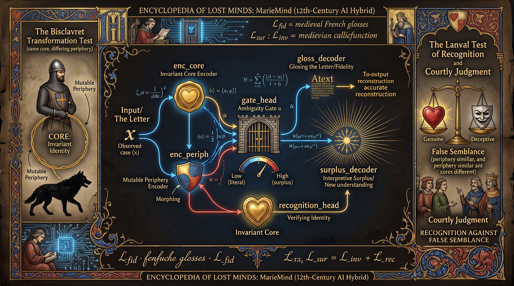

**Architecture — *The MarieMind Model — Gloss, Gated Surplus and Recognition (gloser la lettre)***  ·  🟢 **belief** — grounded in the figure's own surviving works

In the General Prologue to her *Lais* she says, citing Priscian, that the ancients wrote obscurely so that those who came after might gloss the letter (*gloser la lettre*) and add the surplus of their own sense; in *Lanval* the queen's accusation is convincing and false, and *Bisclavret* turns on what persists through a change of body. The file's synthetic cases (`CaseGenerator`) pair a hidden core and periphery with a letter whose obscure part sinks into noise as an injected ambiguity rises. **The encoders** (`encode`) split each letter into a core and a periphery. **The gloss decoder** rebuilds only the legible blocks; **the surplus decoder** proposes what the letter withholds, and **the gate**, fitted directly to the injected ambiguity, mixes it with a literal reader of the obscure block (`forward_case`), so its calibration is supervised, not discovered. **The invariance branch** (`invariance_branch`) pulls together the cores of two forms of one case (`transformation_pair`), and **the recognition head** (`recognition_branch`) judges sameness from cores alone, against different cases whose peripheries were made to match (`false_semblance_pairs`). All seven modules learn by hand-written backpropagation. The only comparison is a periphery-only judge (`periph_cos`), which those matched peripheries are built to fool; four threshold self-tests (`run_self_tests`) stand in for hypotheses. In this run all four passed: same-case cores lay 0.09 apart against 1.04 for different cases, the core recogniser rejected 0.987 of the false semblances that fooled the periphery judge 0.957 of the time, and the gate's correlation with true ambiguity, 0.555, cleared its 0.50 bar narrowly. No test asks whether the gate improves on either reader alone.

▶️ **Run the mind:** [`minds/chapter_0306_marie_de_france_1140.py`](minds/chapter_0306_marie_de_france_1140.py)  —  `python3 minds/chapter_0306_marie_de_france_1140.py`

---

## 307 · Nizami Ganjavi
**c. 1141 – 1209 CE — Ganja · Persian (Eldiguzid Caucasus)**  |  *Romance epic · The Khamsa · Wisdom poetry*

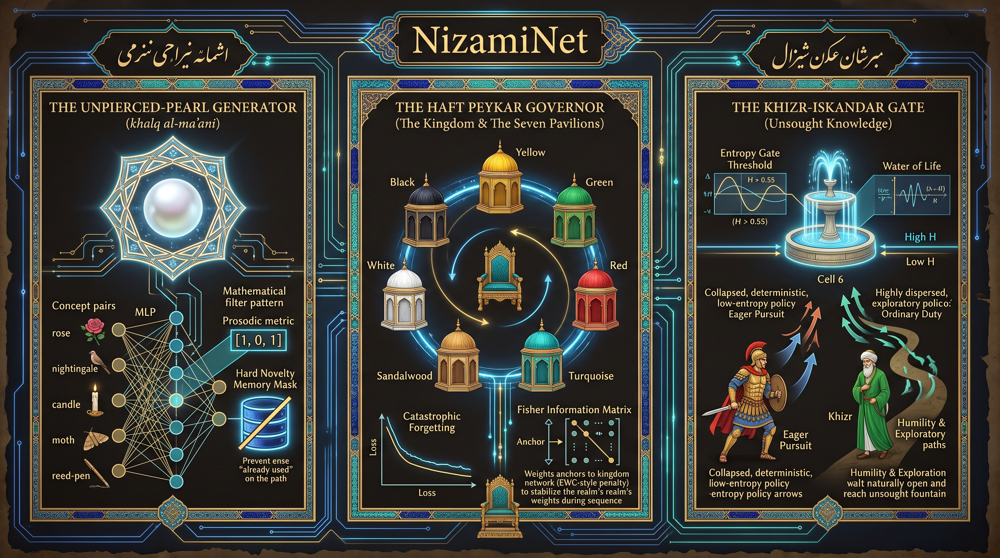

**Architecture — *NizamiNet — the Unpierced Pearl, the Returning King and the Water Found Unsought (khalq al-ma'ani)***  ·  🟢 **belief** — grounded in the figure's own surviving works

He held, as doctrine, that he would never reuse a meaning (*ma'ani*) a predecessor had coined; in the *Haft Peykar* Bahram Gur gives himself to seven pavilions while his kingdom decays, and in the *Eskandarnameh* Alexander's expedition for the Water of Life fails while Khizr, going about ordinary duty, finds it unsought. **The unpierced-pearl search** (`unpierced_pearl_search`) takes, each round, the pairing that a scorer fitted to a synthetic oracle (`oracle_compatibility`) rates highest among those a metrical mask admits (`is_metrically_valid`) and none has coined, and stops rather than reuse one: novelty is an exclusion, not a reward. The three pairings seeded as old *ma'ani* are ones the mask already refuses. **The Haft Peykar governor** (`run_haft_peykar_governor`) fine-tunes a trained kingdom network on seven narrow pavilion tasks: the absorbed king on nothing else, the returning king with the kingdom rehearsed every third step and a pull towards his pre-tour weights scaled by Fisher-style importance (`compute_fisher_importance`). **The Khizr-Iskandar gate** (`run_khizr_iskandar_gate`) trains two tabular REINFORCE policies (`reinforce_train`) on a line of cells where serving at one cell counts only while the policy's entropy there exceeds 0.55: Iskandar is paid for that alone (`iskandar_reward`), Khizr only for duty elsewhere (`khizr_reward`). Nine self-tests decide the run, three of them true by construction. All nine passed. The absorbed king's kingdom error rose 123-fold and the returning king's 20-fold, a slower decay rather than none; Iskandar's entropy at the resource cell settled at 0.538, just under the threshold, against Khizr's 1.072, yet the water came to Khizr in only 0.7% of episodes, and to Iskandar in none.

▶️ **Run the mind:** [`minds/chapter_0307_nizami_ganjavi_1141.py`](minds/chapter_0307_nizami_ganjavi_1141.py)  —  `python3 minds/chapter_0307_nizami_ganjavi_1141.py`

---

## 308 · Attar of Nishapur
**c. 1145 – c. 1221 CE — Nishapur · Persian (Khurasan)**  |  *Sufi poetry · Hagiography · Pharmacy*

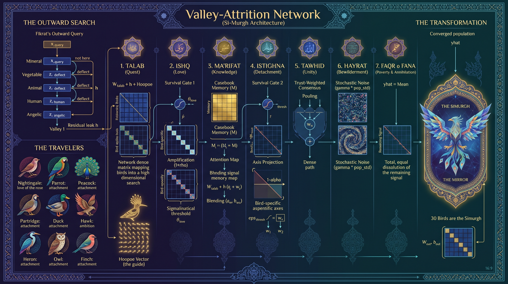

**Architecture — *The Valley-Attrition Network — the Si-Murgh Architecture (Mantiq al-Tayr)***  ·  🟢 **belief** — grounded in the figure's own surviving works

In the *Mantiq al-Tayr*, completed about 1177, only thirty birds, *si morgh*, finish the seven valleys to the Simurgh and find a mirror; in the *Musibat-Nama* forty beings tell Fikrat "not here; ask further". Ten named birds (`BIRDS`), each the hidden concept plus one attachment on its own axis (`sample_population`), cross the valleys in the poem's order (`forward_one`). **Fikrat's outward query** over five realms (`REALM_NAMES`), trained towards 0.92 deflection (`TARGET_DEFLECT`), leaks a small residual into the Quest, where **the hoopoe** is a learned vector added to every bird. **Love** scales each bird's own axis by a fixed factor (`LOVE_RHO`) and ends in a survival gate; **Knowledge** reads a learned casebook; **Detachment** removes a learned share of the own axis and ends in a second gate; **Unity** pulls towards a survival-weighted consensus; **Bewilderment** adds noise in training; **Poverty and Annihilation** averages all birds equally. Both gates are also fitted to each bird's true attachment against a fixed reference (`BIAS_REF`). Gradients are hand-derived (`backward_one`) and checked by finite differences. No rival, baseline or ablation is trained. In this run all five self-tests passed, a bird of attachment 0.05 keeping a survival weight of 0.81 against 0.04 for one of 6.0. But accuracy reached 1.000 after the first epoch and held on 1,000 fresh populations, since every bird's input already carries the answer, so the valleys cannot be told apart; and Love's gate reads the signed attachment, which can take either sign, so in the narrated population survival does not follow attachment.

▶️ **Run the mind:** [`minds/chapter_0308_attar_of_nishapur_1145.py`](minds/chapter_0308_attar_of_nishapur_1145.py)  —  `python3 minds/chapter_0308_attar_of_nishapur_1145.py`

---

## 309 · Suhrawardi
**c. 1154 – 1191 CE — Suhraward, Maragha, Isfahan & Aleppo · Persian**  |  *Illuminationist philosophy · Logic · Metaphysics of light*

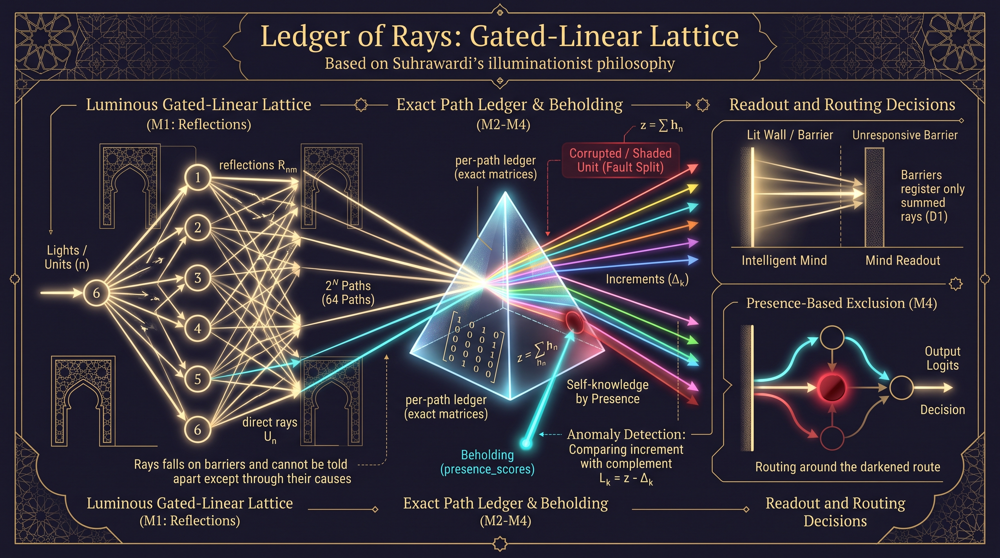

**Architecture — *Ledger of Rays — a Gated-Linear Lattice That Knows the Increase Each of Its Units Gives (Hikmat al-Ishraq)***  ·  🟢 **belief** — grounded in the figure's own surviving works

In the *Hikmat al-Ishraq* rays on a barrier add up and cannot be told apart, while a living light knows the share of each, and if one of several lamps on a wall is shaded another remains (§152); each light receives the first light by doubled routes (§151). Six units (`Lattice`) each read the input and, through **reflections**, every earlier unit (`lattice_forward`): sixty-three paths. **The gates** read the input only (`gates_and_rays`), so **the ledger** (`ledger`) splits the logits exactly into per-path rows, and the rows through a unit sum to the increase it gives (`increments`). **Beholding** (`presence_fit`), ridge least squares on clean data, predicts each unit's increase from the rest; its residual, averaged over the last 32 inputs (`window_mean`), scores the unit. **Exclusion** (`mind_readout`) drops every path through the top unit when that score passes the 0.99 quantile of clean validation. The baseline is a size-matched MLP with group dropout, **the barrier** the summed readout; the Avicennan rival (`train_rival`) learns to name the faulty unit from three fault kinds and meets others (`NOVEL_FAULTS`). Property tests with failing controls and five mutants guard the design; the window was added after a first full run contradicted the main and rival hypotheses, which stand unchanged. Over five seeds, with one unit shaded, the lattice beat the MLP narrowly, 0.897 against 0.859, and losing the ledger readout cost 0.12 more than a matched knockout; but the rival localised the fault as well as beholding did. The declared blind spot appeared: under a diffuse veil the lattice fell 0.013 below the barrier, and the MLP beat both.

▶️ **Run the mind:** [`minds/chapter_0309_suhrawardi_1154.py`](minds/chapter_0309_suhrawardi_1154.py)  —  `python3 minds/chapter_0309_suhrawardi_1154.py`

---

## 310 · Minamoto no Yoshitsune
**c. 1159 – 1189 CE — Kyoto, Kurama, Hiraizumi & the Genpei battlefields · Japanese (late Heian)**  |  *Warfare · The Heike tradition · Legend*

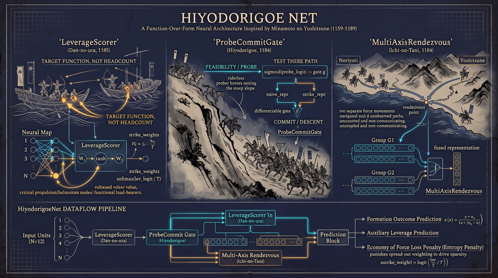

**Architecture — *Hiyodorigoe Net — a Leverage-Targeting, Probe-Commit, Multi-Axis Rendezvous Architecture for Function-Over-Form Decision Making***  ·  🟡 **mediated** — known only through the accounts of others

He left no writing of his own beyond a letter preserved in the shogunate's chronicle. At Ichi-no-Tani in 1184, in the *Heike monogatari* tradition, his force sent riderless horses down a slope the Taira thought could not be descended before the riders followed, while Noriyori struck the front at Ikuta-no-mori; at Dan-no-ura in 1185 his archers were turned on the Taira fleet's rowers and helmsmen rather than its armoured samurai. The model (`HiyodorigoeNet`) reads twelve noisy unit vectors, two secretly load-bearing, and predicts which two and whether striking them would break the formation (`generate_battle_formation_dataset`). **The leverage scorer** (`LeverageScorer`) scores each unit: a softmax makes strike weights, and a sigmoid supervised on the true mask makes leverage probabilities. **The multi-axis rendezvous** (`MultiAxisRendezvous`) encodes three axes of four units with shared weights and no cross-axis terms, then fuses them by a learned softmax over axes. **The probe-commit gate** (`ProbeCommitGate`), one linear probe on the pooled features and the highest leverage probability, blends a leverage-weighted strike representation with a naive mean-pooled one; both are always computed, so commitment is soft. **Economy of force** is an entropy penalty on the strike weights (`compute_loss`). No rival or ablation is trained; five self-tests (`run_self_tests`) check shapes, determinism, the gradient, accuracy at the best validation epoch and concentration. All five passed. Leverage was identified at 0.947 but the outcome only at 0.627, at epoch 7, after which the model overfitted; two units held 0.987 of the strike weight against a uniform 0.167. Finding the load-bearers proved easier than knowing whether striking them is decisive, as the file predicts.

▶️ **Run the mind:** [`minds/chapter_0310_minamoto_no_yoshitsune_1159.py`](minds/chapter_0310_minamoto_no_yoshitsune_1159.py)  —  `python3 minds/chapter_0310_minamoto_no_yoshitsune_1159.py`

---

## 311 · Pope Innocent III
**c. 1160 – 1216 CE — Gavignano, Paris, Bologna & Rome · Latin (Papal Rome)**  |  *Canon law · Papacy · Decretals · Crusade*

**Architecture — *The Plenitudo Potestatis Net — Ordinary Court, Vicariate Gate and Compilatio Write-back (causa cognita)***  ·  🟢 **belief** — grounded in the figure's own surviving works

In *Quanto personam* (1198) he claimed, as vicar of Christ, a power above ordinary law, used only *causa cognita*, the cause being weighed; in 1210 his decretals were gathered into the *Compilatio tertia*, and the exception became precedent. He forbade the Fourth Crusade's attacks on Zara and Constantinople in writing; his censures arrived after the fact. **The ordinary court** (`train_ordinary_court`), trained only on routine cases, sorts each into one of four dispositions (`CLASSES`). **The precedent memory** (`PrecedentMemory`) learns nothing: its coverage is a squashed distance to the nearest compiled case, weighted towards heresy, crusade stakes and schism (`FEATURE_WEIGHTS`). **The vicariate gate**, trained under a sparsity penalty (`train_vicariate_gate`), should fire only where the ordinary court is wrong and no precedent covers the case; then **the extraordinary head**, trained on the full docket, gives the verdict, and the case is compiled as precedent (`adjudicate`). **The legate chain** (`LegateChain`), a leaky recurrent network, learns to hold a directive under moderate incentive, then meets a larger one; **oversight** (`apply_oversight`) pulls back its drift at every step, only in the last two of ten, or never (`run_crusade_experiment`). No rival is trained. In this run the ordinary court reached 0.958, but the gate never fired, not even on the extreme case, so no verdict was extraordinary and write-back ran only inside its own test; the extraordinary head did no better than the ordinary court on novel cases, 0.950 each, the one self-test that failed. Against the drift, late censure nearly matched continuous oversight at the campaign's end (0.58 against 0.52) but not over its course (0.88 against 0.35).

▶️ **Run the mind:** [`minds/chapter_0311_pope_innocent_iii_1160.py`](minds/chapter_0311_pope_innocent_iii_1160.py)  —  `python3 minds/chapter_0311_pope_innocent_iii_1160.py`

---

## 312 · Ibn al-Athīr
**1160 – 1233 CE — Jazirat ibn ʿUmar & Mosul · Arab (Zengid Mosul)**  |  *Universal history · Biographical dictionary · Source criticism*

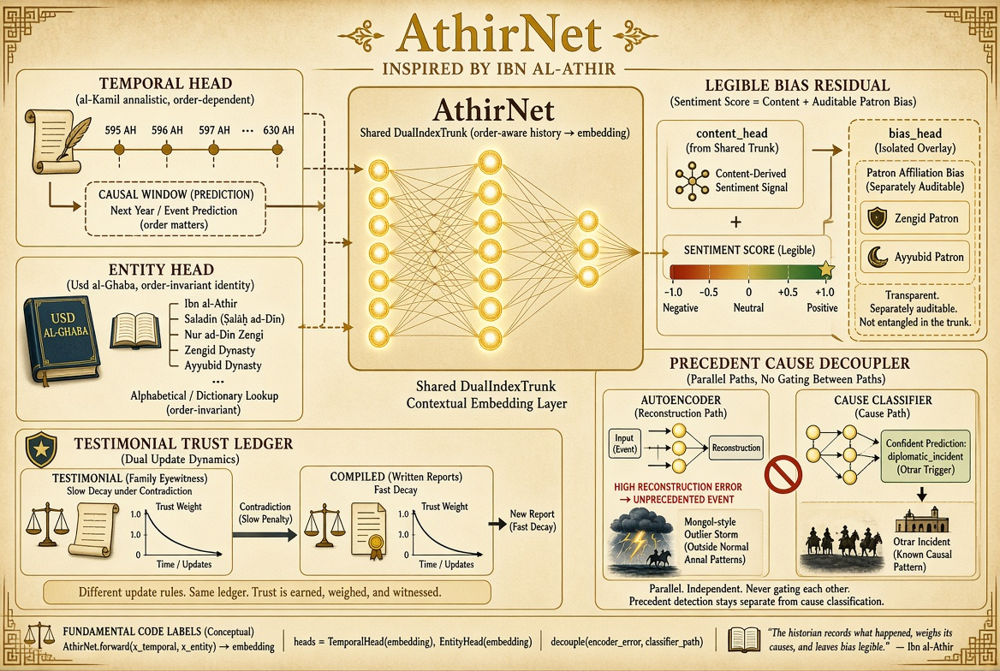

**Architecture — *The Dual-Ledger Mind — Annals and Register, a Legible Bias, Cause Apart from Precedent (al-Kāmil · Usd al-Ghāba)***  ·  🟢 **belief** — grounded in the figure's own surviving works

His *al-Kāmil* runs by Hijri year and his *Usd al-Ghāba* by name; his family served the Zengid atabegs of Mosul, and modern critics find his praise tilted towards them and against the Ayyubids. Of the Mongols he named a cause, the massacre of a merchant caravan at Otrar in 1219, yet wrote that nothing like it had happened since God created Adam. In **the dual index** (`DualIndexTrunk`) a temporal head predicts an event's category from the three before it (`make_causal_windows`), and an entity head an entity's type from a separate table (`entity_forward`). **The trust ledger** (`TestimonialTrustLedger`) learns a base trust, and a fixed rule (`online_update`) then cuts a contradicted eyewitness report, like his father's in *al-Bāhir*, far less than a compiled one. **The bias residual** (`LegibleBiasResidual`) adds to the content term a one-input term on patron affiliation (`bias_head`), kept out of the shared features so an outside audit (`audit`) can recover it. **The decoupler** (`PrecedentCauseDecoupler`) scores novelty by the error of an autoencoder trained on ordinary events (`precedent_score`) and runs a cause classifier beside it; neither gates the other. One synthetic catastrophe falls in 617 AH; `AthirNet` trains the four together, with no rival or baseline. In this run every test passed: the outside audit read a slope of 1.18 against the term's own 1.14; the catastrophe's reconstruction error was 24 times the ordinary 95th percentile while its cause was named with confidence 0.998; and one contradiction left eyewitness trust at 0.62 and compiled trust at 0.24. Every test runs on the training corpus, so the cause is fitted, not predicted.

▶️ **Run the mind:** [`minds/chapter_0312_ibn_al_athir_1160.py`](minds/chapter_0312_ibn_al_athir_1160.py)  —  `python3 minds/chapter_0312_ibn_al_athir_1160.py`

---

## 313 · Shota Rustaveli
**c. 1160 – after c. 1220 CE — Meskheti, Tamar's court & Jerusalem · Georgian**  |  *Epic poetry · Love and oath · Kingship*

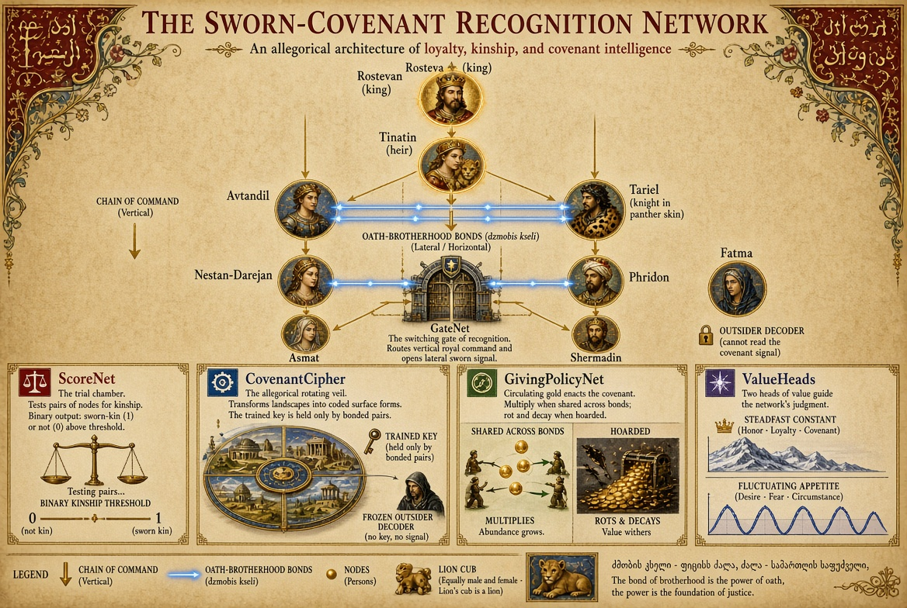

**Architecture — *The Sworn-Covenant Recognition Network — a Network of Oath-Brotherhood (dzmobis kseli)***  ·  🟢 **belief** — grounded in the figure's own surviving works

*The Knight in the Panther's Skin* sets its plot in an invented Arabia and India, a screen, the file says, for Queen Tamar's court; Avtandil deserts King Rostevan for his oath to Tariel; and the poem holds that what we give remains our own and that a lion's cub is a lion, be it male or female. Nine nodes named for the cast (`NODE_NAMES`) sit in a chain of command (`PARENT`); each joins a true virtue to an outward category drawn independently of it. Of five small networks trained on synthetic targets (`train_epoch`), **the trial of worth** (`ScoreNet`) scores a pair's kinship, and a bond forms above 0.6 (`bond_matrix`). **The oath-override gate** (`GateNet`) weighs a sworn peer's message against the parent's order. **The covenant cipher** (`CovenantCipher`) displaces each state by a fixed orthogonal matrix, the invented geography, and learns the key; the outsider's decoder is frozen and random (`decode_outsider`). **The giving policy** (`GivingPolicyNet`) sets the share of wealth given to bonded peers; in circulation (`wealth_circulate`) what is kept decays by 0.90 a round, while gifts arrive multiplied by 1.12. No baseline is trained; each self-test carries its own control. In this run the outsider's reconstruction error was 20 times the key-holder's, the gate gave the sworn brother 0.74 and the stranger 0.008, and all eight nodes followed an oath over a parent, the heir Tinatin among them. The circulation test is settled by the two constants, and the lion's-cub test failed: flipping the outward category moved recognition by 0.0085, almost as much as changing the virtue (0.0089). The file exits 0 regardless.

▶️ **Run the mind:** [`minds/chapter_0313_shota_rustaveli_1160.py`](minds/chapter_0313_shota_rustaveli_1160.py)  —  `python3 minds/chapter_0313_shota_rustaveli_1160.py`

---

## 314 · Saxo Grammaticus
**c. 1160 – after 1208 CE — Zealand & Lund · Danish**  |  *History · Latin verse · The unwritten past*

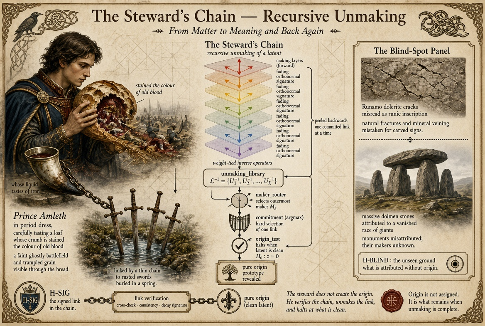

**Architecture — *The Steward's Chain — Recursive Unmaking of an Object's History (Gesta Danorum)***  ·  🟢 **belief** — grounded in the figure's own surviving works

In Book III of the *Gesta Danorum* Amleth traces bread that tastes of blood to an old battlefield and drink that tastes of iron to rusted swords, and the king checks each link by questioning his steward and by digging; the Preface reads the cracks at Runamo as an inscription. In its world of makings (`sample_objects`) one of five origins passes through up to five processes, each signature fading by 0.6 with every later one (`RHO`). **The unmaking library**, six weight-tied inverse operators (`K`), peels the encoded object step by step (`_forward`); **the maker router**, trained on the true chain (`_unmaking_back`), names the outermost making and at inference **commits** to one. **Link verification** (`_verification_back`), the steward's answers, trains each undone step to land on the object as it was one making before; **the origin test** (`_origin_test_back`), a halting unit, decides when no trace of making remains. The baseline is a size-matched flat MLP (`build_flat`). Three hypotheses were fixed in advance (`MIND_CARD`). Over five seeds, trained on up to three makings and tested on four and five, the chain named the origin better than the flat network, 0.363 against 0.221, and retraining without the library cost 0.20 more than a matched knockout; property tests with negative controls pass and all four mutants are caught. The declared blind spot, worse separation than the baseline of made objects from letter-like natural marks, was re-specified after pilots and still did not appear: the chain told them apart better, 0.885 AUROC against 0.677. The world is synthetic and exactly invertible, its traces nearly gone by five makings.

▶️ **Run the mind:** [`minds/chapter_0314_saxo_grammaticus_1160.py`](minds/chapter_0314_saxo_grammaticus_1160.py)  —  `python3 minds/chapter_0314_saxo_grammaticus_1160.py`

---

## 315 · Genghis Khan (Temüjin)
**c. 1162 – 1227 CE — the Onon & the Mongolian steppe · Mongol**  |  *Warfare · Decimal organisation · Relay · Law*

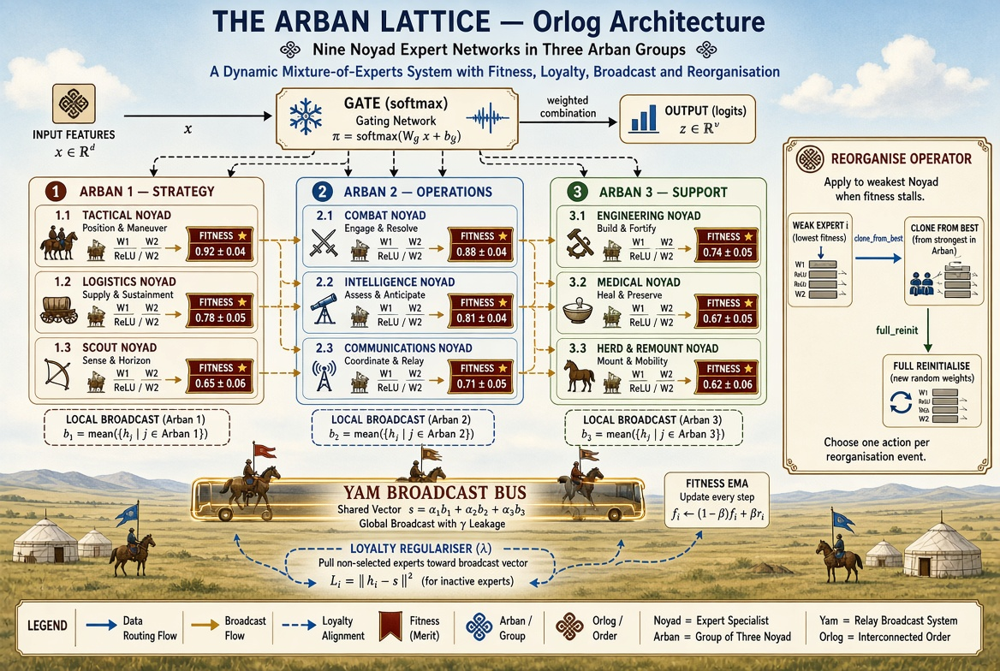

**Architecture — *The Arban Lattice — Routed under Tested Trust, Bound by the Yam, Reorganised on Merit (Orlog)***  ·  🟡 **mediated** — known only through the accounts of others

He could not read, and everything attributed to him survives second-hand, so the file reads its design from what he built: decimal units, with promotion attached to units, not birth; specialists recruited from conquered peoples, such as the Uighur scribe Tatatonga and the Khitan Yelü Chucai; and the yam, a horse relay to the frontier. Orlog (`OrlogConfig`) mixes nine small experts in three groups of three through a softmax gate (`forward`). **The fitness record** (`update_running_state`), untrained, tallies each expert's being right when trusted and biases its routing (`fitness_bias_weight`). **The yam broadcast**, a running average of each group's most trusted hidden state with a share of a global one (`global_gamma`), enters the group's hidden layers next step, untouched by gradients. **The loyalty penalty** (`loss_fn`), by the file's account its one invented piece, pulls each expert towards its broadcast, weighted by how seldom it is chosen. **Decimal reorganisation** (`reorganize`) every forty steps re-initialises an expert far below its group's median, or overwrites one less far behind with a noisy clone of the best. Four provinces, each a fixed four-class problem (`make_province`), are learned in sequence (`run_campaign`); the ablation turns off `use_broadcast` and `use_loyalty` together. In this run each province was learned when its turn came, at 0.765 to 0.985 held-out, but the first fell to 0.12 as soon as the second was trained and ended at 0.31; without broadcast and loyalty it ended at 0.76, so the mechanism lowered retention. All three reorganisations re-initialised the same expert, and no clone was made. The provinces stand in for new domains, not medieval administration.

▶️ **Run the mind:** [`minds/chapter_0315_genghis_khan_1162.py`](minds/chapter_0315_genghis_khan_1162.py)  —  `python3 minds/chapter_0315_genghis_khan_1162.py`

---

## 316 · Lalibela (Gäbrä Mäsqäl)
**c. 1162 – after 1225 CE — Roha in Lasta · Ethiopian (Zagwe)**  |  *Kingship · Rock-hewn churches · A new Jerusalem*

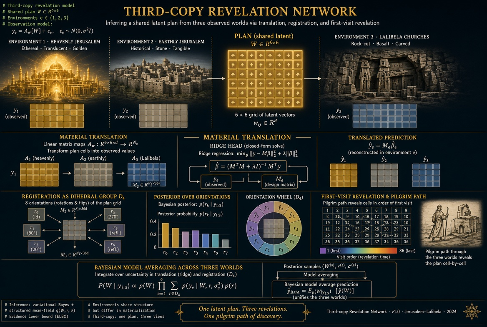

**Architecture — *The Third-Copy Revelation Network — Plan, Translation and Registration (Gädlä Lalibela)***  ·  🟡 **mediated** — known only through the accounts of others

No words of his survive. In his *Life*, a hagiography of the 14th–15th century, God shows him the sanctuaries of the heavenly Jerusalem and says that sanctuaries lie hidden in the heart of the earth for him to reveal, and an angel leads him through the earthly Jerusalem. Here a pilgrim walks forty steps on a six-by-six grid crossed by a Jordan with one bridge (`plan_neighbors`), predicting each cell before its first visit. Each world renders one hidden plan through its own linear material in one of eight turns of the grid (`dihedral_perms`); training sees only two, heaven and Jerusalem (`N_TRAIN_WORLDS`), both unturned. **The plan** is a learned table placing each cell in a space shared across worlds. **The translation** (`_ridge`), ridge regression solved in closed form at each step from the cells already revealed, learns only its regulariser. **The registration** (`_mixture`), with no parameters, weights each turn by its marginal likelihood (`_hyp_forward`); revisits are recalled exactly. The baseline is size-matched attention over the revealed pairs (`attention_first_visit`); the rival, after Yared (`build_rival`), predicts nothing for the unseen. Property tests with negative controls (`c6_properties`) and six mutants guard the design. Over five seeds, on turned worlds, the third copy cut first-visit error from the baseline's 1.47 to 0.25, the registration put all its mass on the true turn against chance at 0.125, and removing it cost far more than removing recall. But where 30% of the cells had been refashioned it did worse than the rival, 1.04 against 1.00, and the declared blind spot, worse than attention on the refashioned cells, fell short of its margin.

▶️ **Run the mind:** [`minds/chapter_0316_lalibela_1162.py`](minds/chapter_0316_lalibela_1162.py)  —  `python3 minds/chapter_0316_lalibela_1162.py`

---

## 317 · Ibn ʿArabī
**1165 – 1240 CE — Murcia, Seville, Mecca & Damascus · Andalusi**  |  *Sufi metaphysics · The imaginal · Qurʾānic hermeneutics · Poetry*

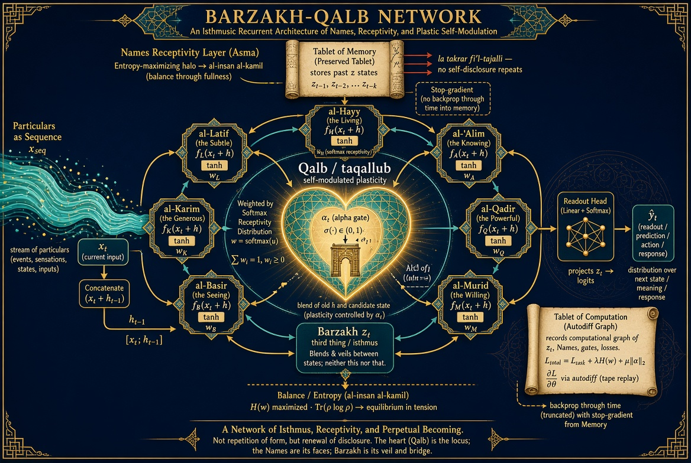

**Architecture — *The Barzakh-Qalb Network — No Self-Disclosure Repeats (la takrar fi'l-tajalli)***  ·  🟢 **belief** — grounded in the figure's own surviving works

He wrote in the *Futūḥāt* that God never discloses Himself in the same form twice, to one person or to two; the heart (*qalb*) is named for its turning (*taqallub*), and imagination is a *barzakh*, an isthmus that joins two things while keeping each what it is. On a hand-written reverse-mode engine (`Tensor`), a recurrent heart walks a sequence of particulars (`forward_sequence`). **The Names**, eight small tanh operators (`NAME_LABELS`), each read the input and the heart's state together, so one input manifests according to the heart's preparedness (*isti'dad*); a softmax receptivity blends their outputs into **the barzakh state**. **The Tablet** keeps detached copies of past barzakh states, and a squared hinge on cosine similarity above 0.2 pushes each new state away from the last six (*la takrar fi'l-tajalli*); because no gradient reaches the Tablet, the gradient check is split in two (`gradient_check_core`, `gradient_check_novelty_isolated`). **Taqallub** is a gated update whose rate depends on the heart's previous state, and **al-insan al-kamil** rewards entropy in average Name usage. The task (`ParticularsTask`) asks for a fixed nonlinear readout of a slowly drifting hidden blend of three of eight prototypes. No rival or baseline is trained; self-tests retrain with each regulariser off and on (`test_non_repetition_effect`, `test_balance_effect`). In this run every test passed: the Tablet's repulsion cut the mean similarity between states from 0.81 to 0.01, the balance term lifted Name-usage entropy from 1.64 to 1.78 of a possible 1.79, and held-out task loss was 0.015. Each effect rests on one pair of short trainings, no blind spot is declared, and the held-out loss has no comparator.

▶️ **Run the mind:** [`minds/chapter_0317_ibn_arabi_1165.py`](minds/chapter_0317_ibn_arabi_1165.py)  —  `python3 minds/chapter_0317_ibn_arabi_1165.py`

---

## 318 · Leonardo of Pisa (Fibonacci)
**c. 1170 – c. 1240/50 CE — Pisa & Bugia · Italian (Republic of Pisa)**  |  *Commercial arithmetic · Algebra · Number theory*

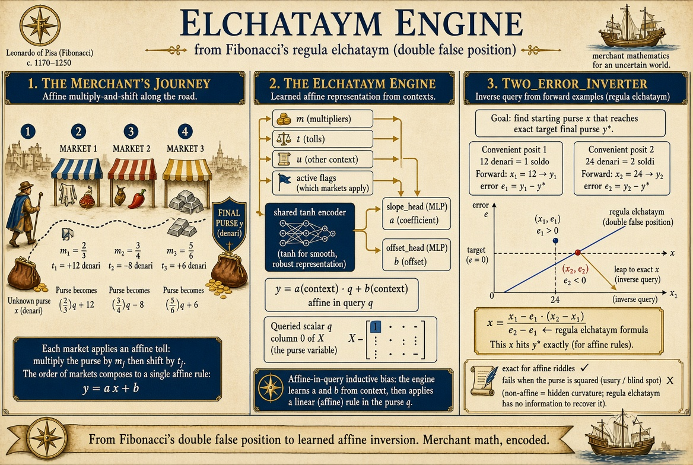

**Architecture — *The Elchataym Engine — Two Posits, One Leap (regula elchataym)***  ·  🟢 **belief** — grounded in the figure's own surviving works

No treatise of his on the mind survives, so the file reads his method. Chapter 13 of the *Liber abbaci* is given to double false position, the *regula elchataym*, and chapters 8 to 11 settle prices, barter, companies and alloys by one proportion. A merchant's purse passes through one to three markets, multiplied and tolled at each (`journey`), dressed in one of six costumes (`COSTUMES`); training sees only forward cases from 1 to 30 denari, and the inverse queries reach starting purses of 60 to 240. **The riddle encoder**, reading the context alone, feeds **the slope head** and **the offset head**, which multiply and shift the purse (`_engine_forward`), so the unknown never enters a nonlinearity. **The two-error inverter** (`invert_two_errors`) posits 12 and 24 denari (`POSITS`), one soldo and two soldi, and leaps along the line of their two errors; its knockout is the rule of three (`invert_single_posit`). The size-matched baselines are an amortised inverse network and a generic forward surrogate inverted by the same two errors (`train_three`). Property tests check that the engine is affine in the unknown and that one leap inverts it exactly (`c6_properties`); three mutants are audited. Over five seeds, beyond the training range, the engine's capped relative error was 0.013 against 0.60 for the amortised network and 6.26 for the generic surrogate; that reach is designed in, not learned. Zeroing the offset head hurt in the predicted direction but by less than the margin set. The declared blind spot, usury, where the purse multiplies itself, did not appear: the engine still beat the amortised network inside the training range.

▶️ **Run the mind:** [`minds/chapter_0318_leonardo_of_pisa_fibonacci_1170.py`](minds/chapter_0318_leonardo_of_pisa_fibonacci_1170.py)  —  `python3 minds/chapter_0318_leonardo_of_pisa_fibonacci_1170.py`

---

## 319 · Walther von der Vogelweide
**c. 1170 – c. 1230 CE — Vienna, the imperial courts & Würzburg · German (Holy Roman Empire)**  |  *Minnesang · Political song · Music*

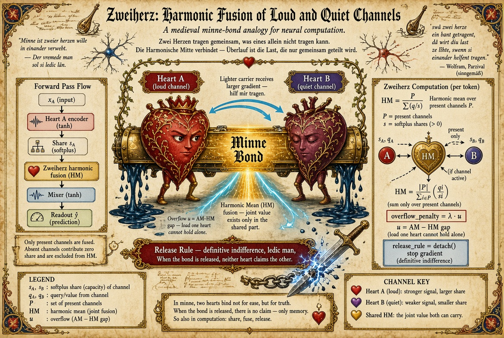

**Architecture — *Zweiherz — a Two-Heart Co-Carrying Network (minne entouc niht eine)***  ·  🟢 **belief** — grounded in the figure's own surviving works

His songs say that *minne* is worth nothing alone and must pass through two hearts and no more (L 50,19), that shared equally it exists while one heart alone cannot hold it, and that if she does not care she should say so plainly, so that he may leave the struggle *ein ledic man*, a free man (L 69,1). Each heart, a tanh encoder with a softplus share, reads one channel: A loud and separable, B quiet, two XOR bits behind a rotation (`sample_split`). **Zweiherz** (`harmonic`), a parameter-free harmonic mean over the hearts present, can never exceed twice the lighter share and gives the lighter carrier the larger gradient (`d_harmonic`). **The overflow penalty** charges the gap between the arithmetic and harmonic means, the load carried unshared. At 35, 50 and 65% of training **the release rule** (`release_rule`) releases for good the heart with the worse single-heart loss if the two shares correlate below 0.3 (`reciprocity_stats`). The baseline is size-matched mean fusion; ModDrop and a simplified OGM (`ogm_coefficients`) are prior methods; the rival, Reinmar's one-sided *staete*, is Zweiherz without release (`BASELINES`). Six property tests with controls (`test_c6`) and five mutants guard the design. Over five seeds, with heart A lost, Zweiherz kept 0.794 accuracy against 0.544 for mean fusion, and dropping the penalty cost 0.54; but ModDrop kept 0.870, contradicting the claim over prior art, and the rival test was inconclusive. The declared blind spot, a bond real but unequal, was supported, though the rule had released heart B in every seed, so the cost may come from release rather than from equal carrying.

▶️ **Run the mind:** [`minds/chapter_0319_walther_von_der_vogelweide_1170.py`](minds/chapter_0319_walther_von_der_vogelweide_1170.py)  —  `python3 minds/chapter_0319_walther_von_der_vogelweide_1170.py`

---

## 320 · Shinran
**1173 – 1263 CE — Hino, Mount Hiei, Echigo, the Kantō & Kyoto · Japanese (Kamakura)**  |  *Pure Land Buddhism · Other-power · True entrusting*

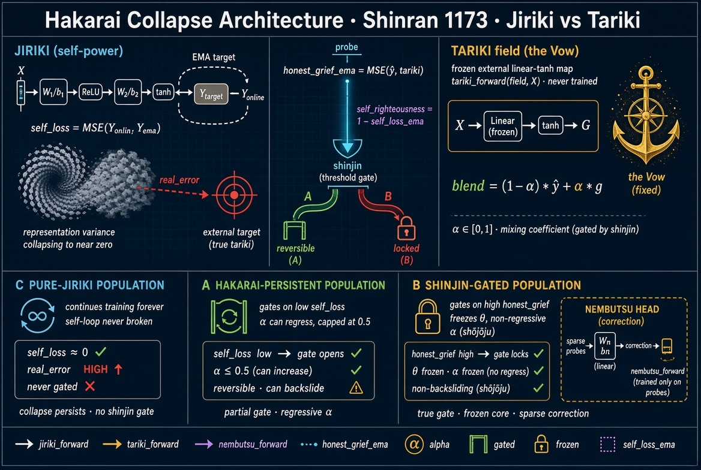

**Architecture — *The Hakarai Collapse Architecture — Self-Power, Other-Power and a Non-Regressive Gate (jiriki · tariki · shinjin)***  ·  🟢 **belief** — grounded in the figure's own surviving works

His *Kyōgyōshinshō*, hymns and letters hold that the calculating mind (*hakarai*) cannot correct itself, because self-power (*jiriki*) measures its progress by its own yardstick, and that true entrusting (*shinjin*) in Other-Power (*tariki*) is a single event that need not be re-earned. **The tariki field** (`make_tariki_field`), a frozen random linear-tanh map, is itself the ground truth. **The jiriki network** (`jiriki_forward`) is meant to learn only by matching its own moving-average copy (`self_loss`), but the copy starts identical (`Unit`), so loss and gradient are zero and the network never leaves its random start; only a running average of that loss decays towards zero. Eighteen units in three populations run 600 steps (`run_simulation`). Population A gates when that average falls below 0.02, which decay alone brings at step 200, and blends in the field with a weight capped at 0.5 that may fall back. Population B gates when its averaged probe error against the field exceeds 0.28 (`probe_and_maybe_gate`) and blends with a weight that can only rise (*shōjōju*), plus a linear **nembutsu head** (`nembutsu_forward`) trained only on the probes. Population C never gates. No outside baseline is run; the self-tests include fifty steps of manufactured doubt (`non_regression_test`) and an *akunin shōki* correlation (`akunin_shoki_correlation`). In this run all ten passed: final error was 0.003 for B, 0.21 for A and 0.81 for C, an order the blend weights fix in advance; under doubt A's weight fell from 0.49 to 0.01 while B's held; and the correlation of 0.93 separates the two populations rather than units within either. The collapse the file is named for never occurs.

▶️ **Run the mind:** [`minds/chapter_0320_shinran_1173.py`](minds/chapter_0320_shinran_1173.py)  —  `python3 minds/chapter_0320_shinran_1173.py`

---

## How the minds are reconstructed

Every entry is built research-first: the figure's surviving works and current scholarship are gathered and each source verified before any architecture is written. Where evidence is thin, the chapter says so rather than inventing an inner life. Each figure's **provenance** is set to one of three real values:

- 🟢 **belief** — the figure's own surviving works or recorded doctrine ground the entry.
- 🟡 **mediated** — no words of their own survive; they are known only through others' (often hostile or legendary) accounts, and the entry says so.
- 🔵 **extrapolated** — no philosophy of mind survives at all; the entry is inferred from documented deeds (typical of kings and builders), and the entry says so.

Sixteen of these twenty left words of their own; four are mediated, and several of the sixteen are belief on a thread. **Saladin** reaches us through the chancery he built and the companions he chose to write his history, a record that was a public instrument before it was a source; **Minamoto no Yoshitsune** through the *Heike monogatari* and the later *Gikeiki*, compiled generations after his death, and one letter transcribed in the shogunate's own chronicle; **Genghis Khan**, who could not read, through the anonymous *Secret History of the Mongols* and the Persian and Chinese historians of his successors; and **Lalibela** through land grants, consecrated altars and a *Life* assembled a century or two after him, which cannot tell us which churches he commissioned. Among the sixteen, **al-Jazarī** left no doctrine of mind, only a book of fifty machines and a few paragraphs about himself; **Marie de France** is known only from three works and their prologues, her identity reconstructed from internal evidence; reliable biography of **Attar** is thin, and he left no treatise on cognition; **Ibn al-Athīr**'s mind is read from the structure of two books; **Saxo** left no treatise on the mind, and his position is read from his narrative; **Rustaveli** left one poem, and almost nothing of his life is known; **Leonardo of Pisa** left a working method, not an epistemology; **Walther**'s evidence is song, a performed and partly role-based medium whose manuscript attributions are unstable; and the saying most associated with **Shinran**, that the evil person is the true object of the Vow, survives in a disciple's memoir, the *Tannishō*. At the other end, **Ibn ʿArabī**'s *Futūḥāt* alone runs to 560 chapters.

Each reconstructed mind is then measured against the **[Artificiology E-AGI Barometer](https://artificiology.com/barometer.html)** — eight capability dimensions (Cognitive Processing 🧩, Embodied Cognition 🤸, World Modeling 🌍, Consciousness 👁️, Language Understanding 💭, Emotional Intelligence ❤️, Creativity ✨, Autonomy 🎯) — so a Kyoto monk and a Pisan reckoner can be compared on the same yardstick. Tome 16 asks who checks the instrument. Only two print numbers: **Lu Jiuyuan** re-sorts the eight by score, Autonomy 🎯 first at 10 of 10 and Language Understanding 💭 last at 4, and **Suhrawardi** gives Consciousness 👁️ a 10 and Autonomy 🎯 a 4. Most of the rest hold Autonomy back: **Hōnen** gives it a hard, architecturally enforced ceiling, the one place where more is not better; **Innocent III** budgets it as a hazard; **Genghis Khan** is most cautious there and wants a recall channel kept working in ordinary operation; **Leonardo of Pisa** would grant it last, and slowly. **Maimonides** would score the capability to self-modify and the warrant to do so as separate axes, and **Shinran** would hold a system's power to certify its own changes where its power to make them cannot reach. **Yoshitsune** adds a requirement the instrument lacks: whoever judges an autonomous system must meet the same standard of evidence as the system. **Rustaveli** and **Leonardo** deny that the eight are independent dials, while **Ibn al-Athīr** warns that a high score on one predicts almost nothing on another; **Walther** reads each axis as a bond and asks who carries what. **Saladin** would build a humanoid legible at a distance, **Genghis Khan** one that can feign a retreat. On qualia most decline to speak, and **Ibn ʿArabī** speaks most: for him they are the basic character of the register in which all cognition happens.

---

[← Tome 15](tome15.md) · [Repository README](readme.md)

### Read & explore
- 🌐 **Encyclopedia:** [https://lostmindsai.com](https://lostmindsai.com)
- 📖 **Tome 16 (Amazon):** [https://www.amazon.com/dp/B0HNJQX9S4](https://www.amazon.com/dp/B0HNJQX9S4)
- 🧪 **Interactive demos & résumé:** [https://artificiology.com/](https://artificiology.com/)
- 📊 **E-AGI Barometer:** [https://artificiology.com/barometer.html](https://artificiology.com/barometer.html)
- ✍️ **Author — David Vivancos:** [https://www.vivancos.com/](https://www.vivancos.com/)
