# Tome 17 — Minds 321–340
### *The Licensed Mind — Nemanjić Serbia & Mount Athos, Commonwealth Iceland & Hákon's Norway, Assisi, Jin & Yuan North China, Cologne & Paris, Cusco, Kyoto & Echizen, Alamut & Ilkhanid Maragha, Southern Song China, Seljuk Konya, Salghurid Shiraz, Damascus & Mamluk Cairo, Oxford, the Manden, Toledo & Seville, Naples, Yuan Dadu & Majorca*
**Encyclopedia of Lost Minds: Echoes on AI** · *1174 – 1232 CE*

[🌐 Encyclopedia](https://lostmindsai.com) · [📖 Buy Tome 17 on Amazon](https://www.amazon.com/dp/B0HP7Z1NKC) · [🧪 Interactive Demos](https://artificiology.com/) · [📊 E-AGI Barometer](https://artificiology.com/barometer.html) · [✍️ Author](https://www.vivancos.com/) · [⭐ Repository](https://github.com/DavidVivancos/LostMindsAI)

[← Tome 16](tome16.md) · [Repository README](readme.md)

---

Tome 17 runs from **Saint Sava** to **Ramon Llull** — twenty reconstructed minds, each rendered on two planes. The **abstract plane** distils the thinker's cognitive signature into an interactive 3D mind-map; the **mechanistic plane** turns that same signature into a small, *runnable* neural architecture, built from scratch in NumPy, gradient-checked, trained and self-tested.

This page collects the twenty **visual mind-map explainers** for this tome and links each to its companion architecture. Runnable code lives in [`minds/`](minds/); the explainer images live in [`maps/`](maps/).

> Every architecture here executes and passes its mandatory finite-difference gradient check, inside a real training loop. Where a file's own self-test or declared prediction fails, or a component never learns, its section says so. Every result is computed live on the machine that runs the file.

Where Tome 16 asked who may correct a mind, and where the check must stand, Tome 17 asks who may license a mind, and how long the licence holds — a saint who wins for his church's own bishops the right to make its head; a founder who may settle only where a golden rod sinks of itself; a monk for whom firewood does not become ash; a mansa who will not proceed without the jeli who speaks for him; a friar who reserves certitude for a standard the mind never owns; a king who judges the move and never the dice; an astronomer who counts from the solstice he has just measured. All twenty begin by refusing the same operation: let a mind license itself — let what it already holds keep its warrant merely by being held. What they put in its place is the volume — a head distilled afresh in every generation from a synod of regional bishops, each heard only on its own territory; a kenning folded from its innermost word outward, and a generator that nests no deeper than the licence allows; named kin addressed through one shared voice, and a Testament that pulls that voice back as new kin join; one figure held fixed for every question, the unknown named first and the answer extracted as a root; a ladder that strips matter rung by rung up to a light each knower owns, and experiment spent only where demonstration cannot reach; a rod that must sink of itself before the march may stop, and capabilities petrified rather than destroyed; a window solved whole as one fixed point, nothing carried from one moment to the next; orbs built only from uniformly turning bodies, every spill counted and cancelled, and a refusal that is not a number; a quantity held as remainders on two rings and rebuilt by multipliers computed before any remainder is read; a reed that can only subtract, turned by an exact rotation and silent without another's breath; a verdict judged in the room where it lands, and a hearer scored by its worst-hurt member; a query that reaches the decision only through evidence, its habit strained out and quarantined; testimony routed by how it was known, discounted for kinship, and a speaking gate that pays in marks for every error; species multiplied through a measurable medium, and four shortcuts to belief charged until they fall silent; a seated faculty that acts only under a key it cannot issue, through a voice it does not own, with a floor kept for the defeated; certitude read against eternal reasons no gradient touches, and a refusal for the case beyond them; a ledger that scores each move against the best the throw allowed and learns little from the dice; an intellect that must turn back to fresh images for every act, and an assent it may withhold; a count anchored at the last measured phase, a rate that is allowed to age, and a table of differences in place of a Grand Epoch; and every pair contested in its own chamber, the winner the one that wins the most chambers. If the previous tome's keyword was *correction*, this one's is *licence*: who may license a mind to act on what it holds, and how long that licence lasts before it must be renewed from outside.

---

## The Twenty at a Glance

| # | Mind | Era | Civilization | Architecture | Provenance |
|---|------|-----|--------------|--------------|:----------:|
| 321 | [Saint Sava](#321--saint-sava) | c. 1174 – 1235 CE | Serbian (Nemanjić) | *Synodal Succession — the Deployed Model Is Never Trained on Its Predecessor* | 🟢 |
| 322 | [Snorri Sturluson](#322--snorri-sturluson) | 1179 – 1241 CE | Icelandic (Commonwealth) | *The Rekit Engine — a Kenning-Grammar Network with Genealogical Grounding and Metrical Gating* | 🟢 |
| 323 | [Francis of Assisi](#323--francis-of-assisi) | 1181/82 – 1226 CE | Italian (Umbrian) | *The Canticle Kinship Network — One Shared Voice, Many Names* | 🟢 |
| 324 | [Li Ye](#324--li-ye) | 1192 – 1279 CE | Chinese (Jin–Yuan) | *Round-City Counting Board — Write the Equation, Then Extract the Root* | 🟢 |
| 325 | [Albertus Magnus](#325--albertus-magnus) | c. 1200 – 1280 CE | German (Swabian) | *The Denudatio Column — an Abstraction Ladder Terminated by a Privately Owned Light* | 🟢 |
| 326 | [Manco Cápac](#326--manco-cápac) | traditionally c. 1200 CE | Andean (Inca) | *WANKA — the Wanka-Assay Ceque Network* | 🟡 |
| 327 | [Dōgen Zenji](#327--dōgen-zenji) | 1200 – 1253 CE | Japanese (Kamakura) | *The Dharma-Position Equilibrium Field — No Hidden State, No Checkpoint* | 🟢 |
| 328 | [Nasir al-Din al-Tusi](#328--nasir-al-din-al-tusi) | 1201 – 1274 CE | Persian (Ismaili–Ilkhanid) | *The Constituting Arrangement — One Admissible Primitive, No Disembodied Parameter* | 🟢 |
| 329 | [Qin Jiushao](#329--qin-jiushao) | c. 1202 – c. 1261 CE | Chinese (Southern Song) | *Dayan Net — Remainders That Count, Multipliers That Reconstruct* | 🟢 |
| 330 | [Jalal al-Din Rumi](#330--jalal-al-din-rumi) | 1207 – 1273 CE | Persian (Seljuk Rum) | *The Ney-Astrolabe Engine — Nothing Is Stored, Something Is Removed, and It Only Sounds When Blown* | 🟢 |
| 331 | [Saʿdi of Shiraz](#331--saʿdi-of-shiraz) | c. 1210 – 1291/94 CE | Persian (Salghurid Fars) | *The Gulistan Engine — a Station-Gated Case-Base, a Hearer Simulation and an Inviolable Floor* | 🟢 |
| 332 | [Ibn al-Nafis](#332--ibn-al-nafis) | c. 1210/13 – 1288 CE | Arab (Ayyubid–Mamluk) | *Compact-Septum Transit with Ambient Straining — Nothing Reaches the Chamber of Decision Unmixed with the Air* | 🟢 |
| 333 | [Sturla Þórðarson](#333--sturla-þórðarson) | 1214 – 1284 CE | Icelandic (Commonwealth) | *VitnisNet — a Liability-Graded Witness Ledger: What Was Seen, Who Said It, What It Costs* | 🟢 |
| 334 | [Roger Bacon](#334--roger-bacon) | c. 1214/20 – c. 1292 CE | English | *Specularium — Species Propagation, Eduction from Potency, Certification* | 🟢 |
| 335 | [Sundiata Keita](#335--sundiata-keita) | c. 1217 – c. 1255 CE | Mande (Mali) | *The Convened Faculty — Capability Is Not Held; It Is Licensed, Witnessed, Voiced and Capped* | 🟡 |
| 336 | [Bonaventure](#336--bonaventure) | c. 1221 – 1274 CE | Italian (Papal States) | *The Contuition Net — a Resolutive Architecture with a Severed Certitude Channel* | 🟢 |
| 337 | [Alfonso X the Wise](#337--alfonso-x-the-wise) | 1221 – 1284 CE | Castilian (Castile–León) | *The Cordura Ledger — Seso, Ventura and the Value of the Move Fortune Allowed* | 🟢 |
| 338 | [Thomas Aquinas](#338--thomas-aquinas) | c. 1225 – 1274 CE | Italian (Kingdom of Sicily) | *The Conversio Engine — a Mind That Cannot Think without Looking Again* | 🟢 |
| 339 | [Guo Shoujing](#339--guo-shoujing) | 1231 – 1316 CE | Chinese (Yuan) | *Shoushi — the Season-Granting Forecaster* | 🟢 |
| 340 | [Ramon Llull](#340--ramon-llull) | c. 1232 – 1315/16 CE | Catalan (Majorca) | *Ars Camerarum — the Chamber Count* | 🟢 |

**Provenance** — 🟢 belief · 🟡 mediated · 🔵 extrapolated. See [How the minds are reconstructed](#how-the-minds-are-reconstructed).

---

## 321 · Saint Sava
**c. 1174 – 1235 CE — Raška, Mount Athos & Žiča · Serbian (Nemanjić)**  |  *Church organisation · Autocephaly · Canon law*

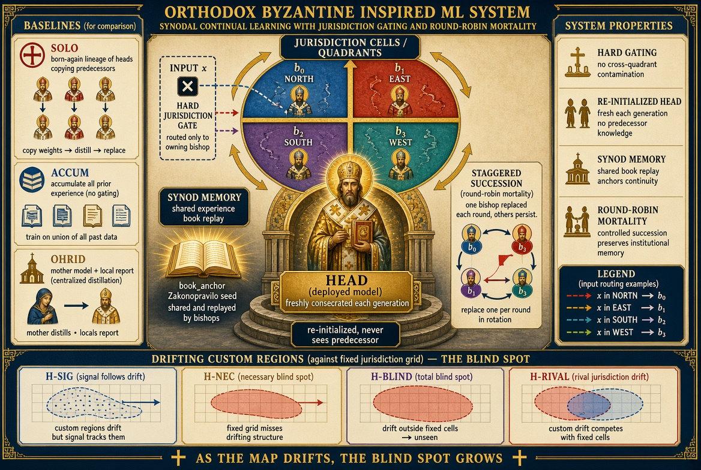

**Architecture — *Synodal Succession — a Regeneration Protocol in Which the Deployed Model Is Never Trained on Its Predecessor***  ·  🟢 **belief** — grounded in the figure's own surviving works

In 1219 Nicaea granted that Serbian archbishops be consecrated by the assembly of Serbian bishops, not an outside see; he consecrated bishops from his disciples, seated them in separate eparchies with the law books, and in May 1220 Chomatenos of Ohrid protested at being bypassed. Synodal Succession (`run_sava`) follows nine generations of drifting regional customs. **The head**, the deployed tanh MLP, is re-initialised every generation and distilled (`consecrate_head`) from **the bishops** (`bishops`), four regional tanh MLPs, with a few real labels and the seed book. **The jurisdiction gate** (`synod_targets`), a fixed grid, takes each pseudo-label only from the bishop owning the input's quadrant. Under **the synod memory** (`synod_memory`) the bishops persist, but each generation one, in turn, is re-initialised and taught its cell by the outgoing head (`sava_generation`); under **the book anchor** (`book_anchor`) each replays its share of that 160-case book. The baseline (`lineage_generation`) is a born-again lineage of 523 parameters against 527, on the same step budget; the rival, after Ohrid, re-tunes the mother model each generation. Over five seeds, in the last third of the chain, the head beat the lineage by about 0.048 in accuracy and the rival by about 0.065, and losing the gate cost 0.0321. But losing the synod's memory changed nothing measurable (+0.0041), though the thesis places memory there, and losing the book helped (+0.0183), which flatters the comparison of gate and book. The declared blind spot, customs rotated 45° against the grid, did not appear: the edge grew slightly. Since the outgoing head teaches each newcomer bishop, which then helps set its successor's targets, the head escapes its predecessor only in its own training, which is all the independence test (`test_successor_independence`) checks.

▶️ **Run the mind:** [`minds/chapter_0321_saint_sava_1174.py`](minds/chapter_0321_saint_sava_1174.py)  —  `python3 minds/chapter_0321_saint_sava_1174.py`

---

## 322 · Snorri Sturluson
**1179 – 1241 CE — Oddi, Borg & Reykholt · Icelandic (Commonwealth)**  |  *Skaldic poetics · Norse mythography · Kings' sagas*

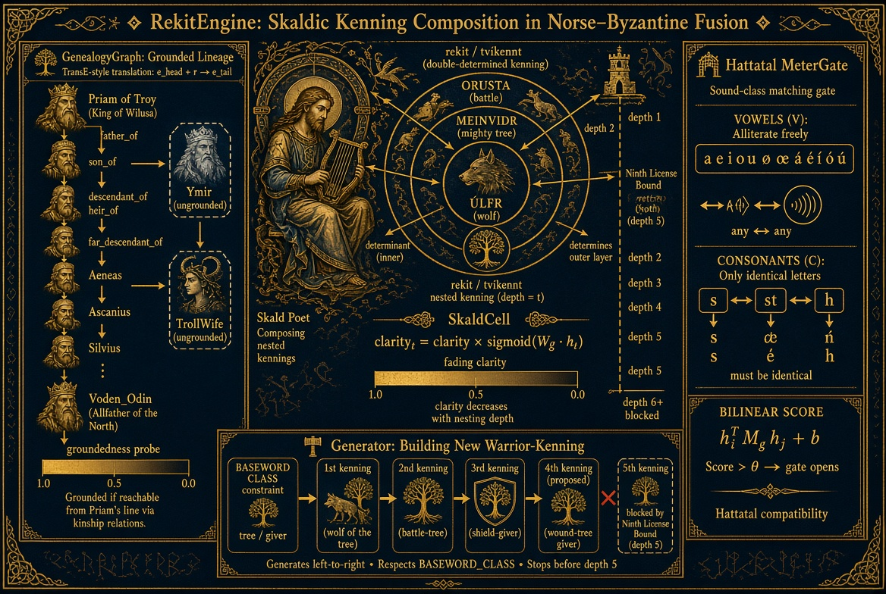

**Architecture — *The Rekit Engine — a Compositional Kenning-Grammar Network with Genealogical Grounding and Metrical Gating (rekit · Háttatal)***  ·  🟢 **belief** — grounded in the figure's own surviving works

In *Háttatal*, composed for King Hákon and Earl Skúli about 1222–23, he lists the licences of court metre; the ninth lets a kenning be extended, *rekit*, to a fifth kenning, puts anything longer *ór ættum* and declares that practice void. The Prologue to the *Prose Edda*, whose authorship is debated, derives Odin from Priam of Troy. **The Skald Cell** (`SkaldCell`) folds a kenning from its innermost word outward, multiplying a running **clarity** by a sigmoid gate at each fold, and **the Rekit Engine** (`RekitEngine`) decodes the referent from the final state. **The ninth-licence penalty** (`ninth_license_penalty`) is the square of any depth beyond four, and the generator (`generate_kenning`) grows new chains greedily from a licensed base word (`BASEWORD_CLASS`) to depth four. **The grounding graph** (`GenealogyGraph`) embeds the Priam-to-Odin line so that each child lies one shared step from its parent, with a probe trained to tell that line from Ymir and a troll-wife; **the Háttatal metre gate** (`MeterGate`) learns alliteration over nine sound classes. The three train apart, neither graph nor gate feeds the engine, and no rival or baseline is trained. In this run all seven self-tests passed and the engine decoded 0.958 of its training chains, the ceiling set by one chain, the gold-giver, labelled both warrior and king. But the penalty never enters the loss (`train_rekit_engine` adds zero); the clarity gate receives no gradient and keeps its random weights, so the clarity test compares products of untrained factors; and the generator's tests of depth and base word pass by construction. Two of the four new kennings decoded to the wrong referent, gold as sea and sea as poetry; nothing tests for that, and the program reports training as converged regardless.

▶️ **Run the mind:** [`minds/chapter_0322_snorri_sturluson_1179.py`](minds/chapter_0322_snorri_sturluson_1179.py)  —  `python3 minds/chapter_0322_snorri_sturluson_1179.py`

---

## 323 · Francis of Assisi
**1181/82 – 1226 CE — Assisi, Damietta & La Verna · Italian (Umbrian)**  |  *Religious founding · Poverty · The Canticle of the Creatures*

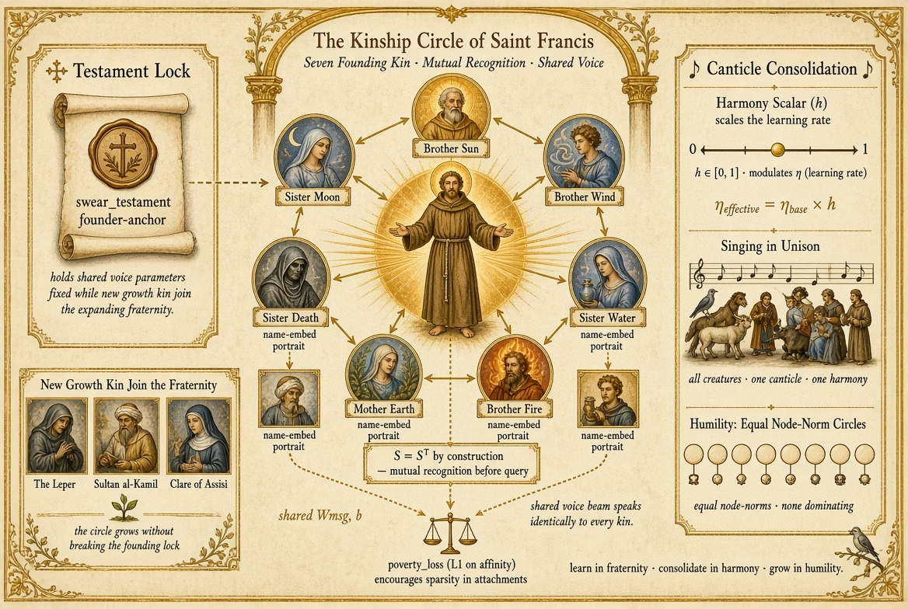

**Architecture — *The Canticle Kinship Network — One Shared Voice, Many Names***  ·  🟢 **belief** — grounded in the figure's own surviving works

In the Canticle of the Creatures he names Brother Sun, Sister Moon, Brother Wind, Sister Water, Brother Fire, Mother Earth and Sister Death as kin; his Rule was redrafted between 1221 and 1223, and the Testament he dictated in his final months forbids any gloss on his words. **The Canticle Kinship Network** (`CanticleKinshipNetwork`) gives each of the seven a learned **name** (`name_embed`) and receives what is observed of it through one shared **sense** (`W_sense`). **The kinship layers** (`KinshipLayer`) make one affinity matrix symmetric, softmax each row without self-loops and address every node through one shared voice per layer. **Poverty** (`poverty_loss`) is an L1 penalty on the affinities, **humility** (`humility_loss`) the variance of node-state norms, and **the Canticle Consolidation** (`train_phase`) scales each sample's step by a harmony score. **The Testament Lock** snapshots the shared voice after the founding phase (`swear_testament`) and pulls it back (`testament_anchor_loss`) while the leper, Sultan al-Kamil and Clare of Assisi join (`GROWTH_KIN`). The task (`generate_book_of_creation`) hides 40% of the values, all driven by one latent chord; the only comparison is the same network without the lock. The gradient check and the structural test always pass, but the rest does not repeat: the autograd sums gradients in the order it walks a Python set, so the training path changes between runs. The third self-test, which needs the loss of one epoch of sixteen fresh samples to halve, failed in six of our ten runs (1.0240 to 0.5996 in one), and the program then exits with code 1 before the lock is tested; in the other four the lock held the shared voice 79–93% closer to its founding form, though that test measures the very drift its anchor penalises. And a softmax over affinities driven towards zero is uniform, so poverty makes the ties dense, not sparse.

▶️ **Run the mind:** [`minds/chapter_0323_francisco_de_assis_1181.py`](minds/chapter_0323_francisco_de_assis_1181.py)  —  `python3 minds/chapter_0323_francisco_de_assis_1181.py`

---

## 324 · Li Ye
**1192 – 1279 CE — Daxing, Junzhou & Fenglong Mountain · Chinese (Jin–Yuan)**  |  *Algebra · The celestial element · Circle measurement*

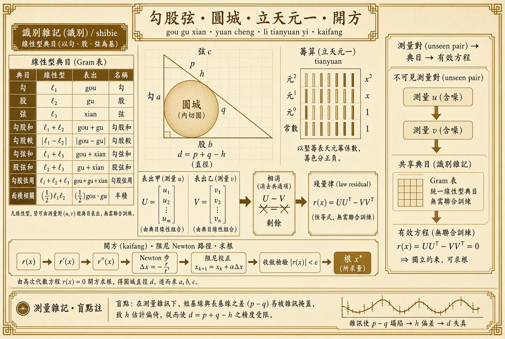

**Architecture — *Round-City Counting Board — a Learner That Answers by Writing the Equation Its Answer Must Satisfy and Then Extracting the Root (yuancheng chousuan)***  ·  🟢 **belief** — grounded in the figure's own surviving works

His *Ceyuan haijing* of 1248 puts all 170 problems to one figure, a round town inscribed in a right triangle; its first volume catalogues the segments' relations before any problem, and each solution sets up the celestial unknown (*li tianyuan yi*), expresses one magnitude twice, cancels the two (*xiangxiao*) and extracts the root (*kaifang*). Here each problem gives two of twelve segment types and asks for the inscribed circle's diameter. **The shibie forms** (`shibie`) read every type, and **the tianyuan form** (`tianyuan`) the unknown, off one latent figure; an exact adjugate turns any two given segments into a quadratic in the unknown through one indefinite **law** (`law_matrix`), and **kaifang** (`kaifang`) extracts its root by unrolled damped Newton steps from **a first quotient** (`chushang`). Before gradient training **the catalogue stage** (`catalogue_stage`) reads each pair's quadratic off a null vector of the data and completes one signed Gram table. The rivals (`explicit_build`) are a size-matched tanh MLP, 183 parameters against the board's 181, and a bias-free ReLU net of 182; the same board is also trained by gradient alone. Over five seeds all five hypotheses were supported: on pairs never seen together the board's relative error was 1.72 × 10⁻¹² against 0.335 for the MLP. That precision is the catalogue's: the model class contains the exact noise-free law, which the catalogue recovers to a residual of 2.1 × 10⁻¹²; by gradient alone the board did worse than a trivial ratio, 1.32 against 0.670. The shibie knockout prints exactly the kaifang knockout's numbers, since averaged forms leave Newton nothing to move, and removing the first quotient cost nothing. The declared blind spot appeared: under 3% noise the board's error was about 2.20 against the MLP's 0.221, as Li Ye's figures were exact.

▶️ **Run the mind:** [`minds/chapter_0324_li_ye_1192.py`](minds/chapter_0324_li_ye_1192.py)  —  `python3 minds/chapter_0324_li_ye_1192.py`

---

## 325 · Albertus Magnus
**c. 1200 – 1280 CE — Lauingen, Paris, Cologne & Regensburg · German (Swabian)**  |  *Natural philosophy · Theology · Experiment*

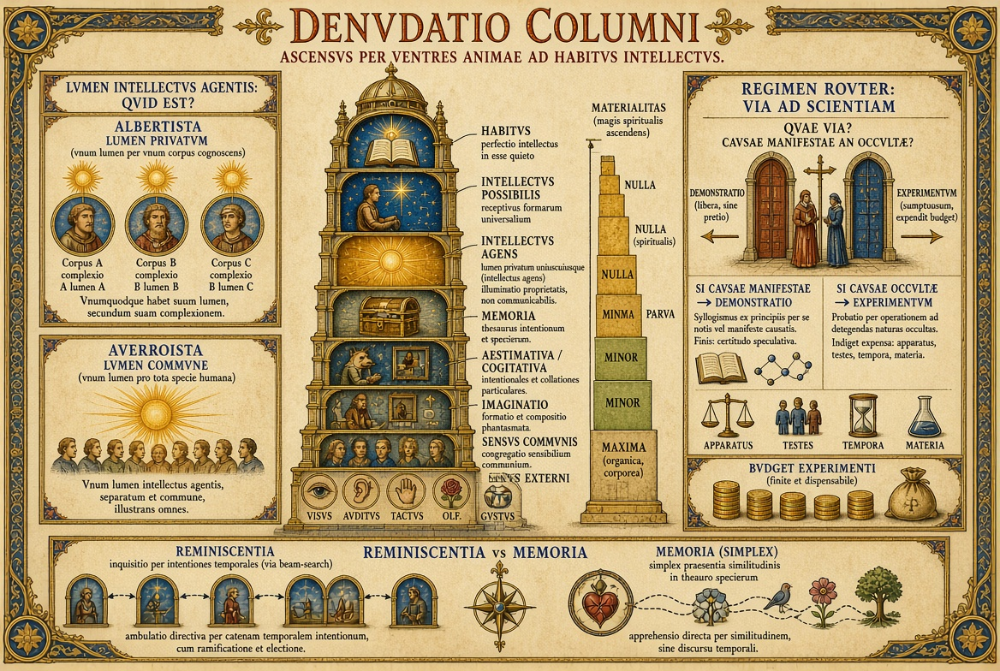

**Architecture — *The Denudatio Column — an Abstraction Ladder Terminated by a Privately Owned Light (secundum gradus abstractionis · De unitate intellectus)***  ·  🟢 **belief** — grounded in the figure's own surviving works

In *De unitate intellectus contra Averroistas*, about 1256, he made the agent intellect a power of each soul, against Averroes' one intellect for the species; he ordered the inner senses by degrees of abstraction, held that in such matters experiment alone certifies, and reported, against Pliny, that ostriches would not eat iron. In **the Denudatio Column** (`DenudatioColumn`), **the common sense** (`sensus_communis`) gates each of three senses by its cosine agreement with the other two; **imagination** (`imaginatio`) multiplies the percept by the knower's fixed temperament, its *complexio*; **the agent intellect** (`agens`) multiplies it again by a positive light struck from that knower's own seed; and **the possible intellect** (`possibilis`) regenerates the hidden universal and names the kind. **The estimative** (`estimativa`) reads the detached phantasm, and when cogitative the intellect's state too, to predict an unsensed intention; **the regimen** (`regimen`) learns whether to pay 0.32 for an experiment, within a soft budget of 55%, or to trust demonstration. A hinge charges any rung at which **materiality** (`materiality`), within-kind over total variance, fails to fall. Ablations set a shared light against owned ones and the estimative against the cogitative, three initialisations each. In this run all nine self-tests passed: materiality fell from 0.447 to 0.028, and with experiments sent almost only to occult kinds the regimen settled 0.982 of intentions against 0.735 by demonstration alone. But every experiment returns the true intention, so that gap is mostly an oracle; the light's positivity test cannot fail, since the light is a softplus; and owning the light was worth 0.006 in accuracy. Reminiscence recovered 60 of 60 cues against 45 for memory alone, but its search is handed the target kind. The verdict sentences print whatever the numbers are.

▶️ **Run the mind:** [`minds/chapter_0325_albertus_magnus_1200.py`](minds/chapter_0325_albertus_magnus_1200.py)  —  `python3 minds/chapter_0325_albertus_magnus_1200.py`

---

## 326 · Manco Cápac
**traditionally c. 1200 CE — Tampu T'oqo, Huanacauri & Cusco · Andean (Inca)**  |  *Founding narrative · Sacred geography · Inca origins*

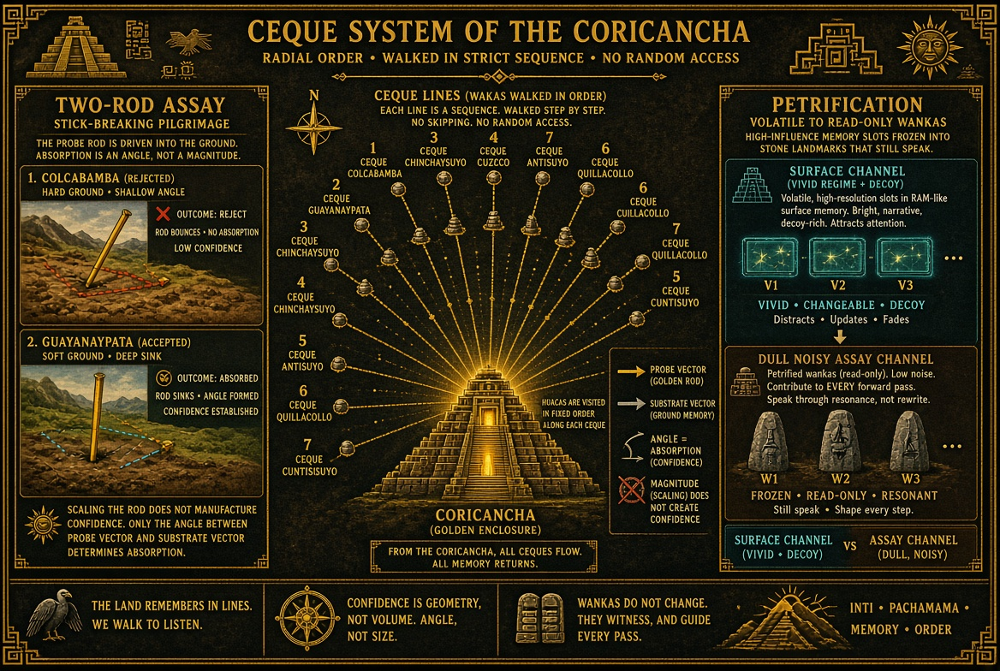

**Architecture — *WANKA — the Wanka-Assay Ceque Network (wanka · ceque · huaca)***  ·  🟡 **mediated** — known only through the accounts of others

He reaches us through Sarmiento de Gamboa's narrative of 1572: the golden rod is refused at Colcabamba and sinks at Guayanaypata; Ayar Cachi is sealed in his cave, Ayar Uchu becomes a winged stone that still speaks, Ayar Auca a wanka; and Cusco kept 328 huacas on 41–42 ceque lines (Bauer 1998). Each synthetic march (`Valley`) must stop at the first sound site of ten or reject them all; a vivid surface names the valley but carries a decoy, and only a noisy assay reports the ground. **The ceque walk** (`forward`) passes along each of six lines of five huacas by stick-breaking gates, then blends the lines by softmax where the docstring promises one; its return is **the rod**. **The halting head** reads only the angle between the rod and a substrate vector computed from the assay, so scaling the rod changes nothing, though a learned sharpness (`beta`) can. **Petrification** (`PetrificationMonitor`) freezes a slot with a large, unstable gradient into a read-only wanka that still feeds the walk, and logs a three-epoch fork, sealed against free; but it only masks the gradient while the optimiser (`Adam`) keeps its momentum, so frozen slots can drift unseen by the irreversibility test. The rivals are same-seed ablations of the 2,101-parameter model and a fixed rule built on the generator's own decoy direction (`surface_baseline`). All eight checks passed; the march stopped rightly 0.598 of the time, against 0.228 with the ground read from the surface and 0.274 without memory, and petrification added under a point, from one seed. Five of seven wankas were a line's first shrine: the freeze rule is, as declared, a proxy for danger, not a measurement.

▶️ **Run the mind:** [`minds/chapter_0326_manco_capac_1200.py`](minds/chapter_0326_manco_capac_1200.py)  —  `python3 minds/chapter_0326_manco_capac_1200.py`

---

## 327 · Dōgen Zenji
**1200 – 1253 CE — Kyoto, Mount Hiei, Tiantong & Eihei-ji · Japanese (Kamakura)**  |  *Sōtō Zen · Being-time · Practice-realisation*

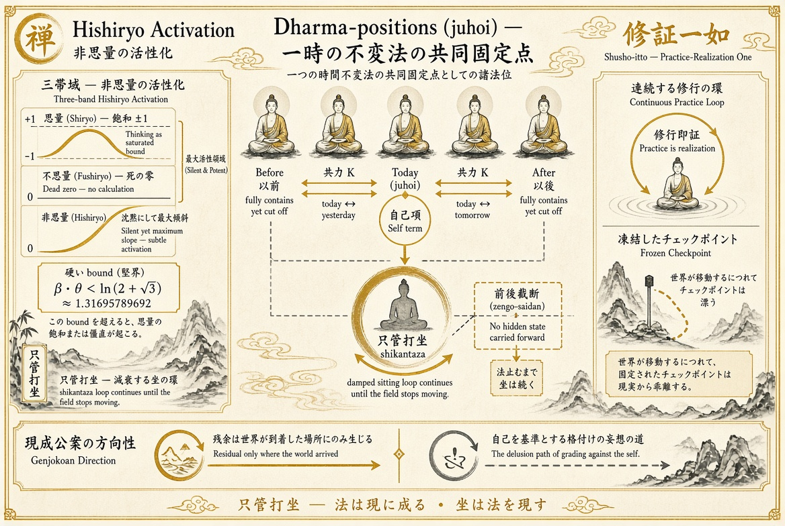

**Architecture — *The Dharma-Position Equilibrium Field — No Hidden State, No Checkpoint, No Backprop Through Time (jūhōi · kyōryaku · hishiryō)***  ·  🟢 **belief** — grounded in the figure's own surviving works

Dōgen held practice and verification to be one (*shushō-ittō*); in the *Genjōkōan* firewood does not become ash but abides in its own dharma-position, before and after cut off, and to carry the self forward is delusion; in *Uji* being-time passes from today to tomorrow and from today to yesterday (*kyōryaku*). **The field** (`DharmaPositionField`) hands nothing forward, with no hidden state, positional encoding or attention: it solves sixteen moments at once, by damped iteration (`solve`), as the fixed point of one law in which a single tied matrix links each moment to yesterday and to tomorrow, and it learns through the implicit-function theorem (`grads`), not back-propagation through time. **The hishiryō activation** (`Hishiryo`) has a third band, near-silent yet most sensitive, that exists only while βθ < ln(2+√3) (`C_HISHIRYO`), as the parameterisation ensures; **the contraction** (`project_contraction`) keeps the law's Lipschitz bound at or below 0.85. **Practice** (`practice`) solves and updates in one call, graded only at moments withheld from its input, with a second withheld set never graded. No other architecture is trained: the rival is an identical copy frozen at step 2,100 (`experiment_no_checkpoint`), the delusion a run also graded against a slow copy of itself (`experiment_direction`). Every asserted invariant held. After the freeze the frozen copy erred 1.19 times as much on average and 1.72 times over the last third, yet erred less in six of ten stretches; the self-grading run was 2.17 times worse. About 71% of unit-positions sat in the third band, but the largest βθ after training was 0.669 against a bound of 1.317, so the bound never acted. The experiments set no thresholds, and their readings are fixed text, one claiming the live run varied more from step to step, which the printed stretches contradict.

▶️ **Run the mind:** [`minds/chapter_0327_Dogen_Zenji_1200.py`](minds/chapter_0327_Dogen_Zenji_1200.py)  —  `python3 minds/chapter_0327_Dogen_Zenji_1200.py`

---

## 328 · Nasir al-Din al-Tusi
**1201 – 1274 CE — Tus, Alamut & Maragha · Persian (Ismaili–Ilkhanid)**  |  *Astronomy · Mathematics · Philosophy · Ethics*

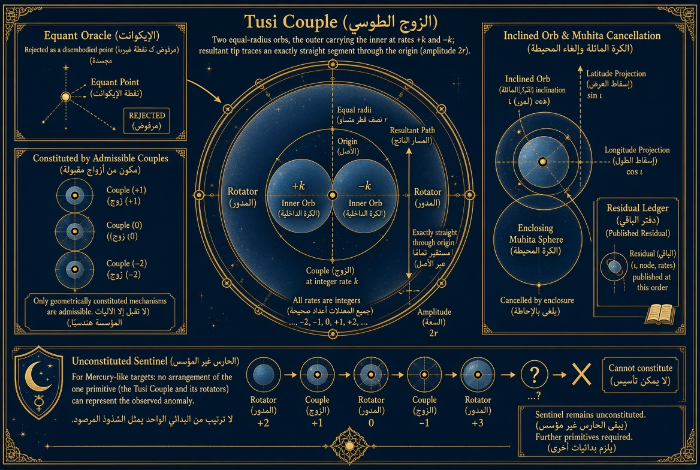

**Architecture — *The Constituting Arrangement — One Admissible Primitive, No Disembodied Parameter, Every Mechanism Owns All of Its Consequences (al-hay'a al-murakkaba)***  ·  🟢 **belief** — grounded in the figure's own surviving works

In the *Tahrir al-Majisti*, completed on 13 February 1247, he required uniformly moving bodies whose arrangement constitutes the perceived motions; he ruled Ptolemy's equant outside the discipline, held that a circle moving a planet in latitude must move it equally in longitude, and late in life wrote of Mercury that he could not yet conceive how it should be done. **The primitive** (`Rotator`) is a body turning uniformly at an integer rate; **the couple** (`Couple`) carries a second at the opposite rate, and its tip runs on a straight line. **The orb** (`Orb`) is one couple's oscillation, split by a fixed inclination between longitude and latitude; **the arrangement** (`Arrangement`) sums orbs, choosing integer rates by matching pursuit (`choose_rates`) and fitting amplitudes and phases by gradient descent (`train`). **The enclosing sphere** (`install_enclosing_spheres`) adds a frozen orb that cancels each latitude orb's spill into longitude, rounded to an arcminute (`CONSTRUCTION_QUANTUM`), and **the ledger** (`ResidualLedger`) publishes the remainder. **The Mercury clause** (`declare`) returns a sentinel that refuses to be a number (`Unconstituted`) when too much residual power lies off the integer harmonics; **the recension** (`recense`) keeps the superseded version runnable. The equant (`EquantOracle`) only supplies targets; the one learned rival (`TinyMLP`), called comparable, has 673 parameters against eight and no periodic input. All thirteen self-tests passed, and they alone set the exit code. Six orbs fitted the equant to 0.0229 arcseconds and the enclosing sphere cut the spill 275.8-fold; an incommensurable target was declared unconstituted, its commensurable twin given a number; and six revolutions out of range the arrangement's error held at its training level while the network's grew 1105-fold, a reach designed in by integer rates, not learned. The lunar correction from 13;11 to 13;14 is printed as arithmetic, not replayed.

▶️ **Run the mind:** [`minds/chapter_0328_nasir_al_din_al_tusi_1201.py`](minds/chapter_0328_nasir_al_din_al_tusi_1201.py)  —  `python3 minds/chapter_0328_nasir_al_din_al_tusi_1201.py`

---

## 329 · Qin Jiushao
**c. 1202 – c. 1261 CE — Sichuan, Huzhou & Meizhou · Chinese (Southern Song)**  |  *Mathematics · Remainders · Calendrical astronomy*

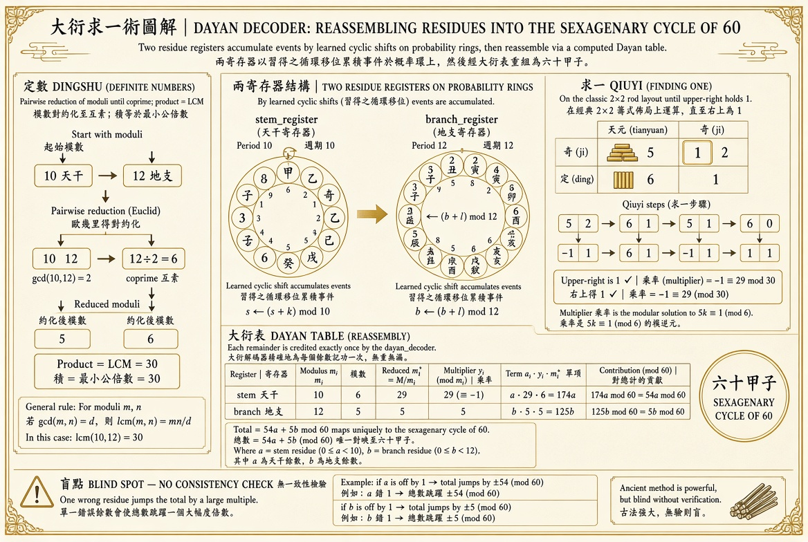

**Architecture — *Dayan Net — Remainders That Count, Multipliers That Reconstruct (dayan · dingshu · qiuyi)***  ·  🟢 **belief** — grounded in the figure's own surviving works

In the *Shushu jiuzhang* of 1247 he put the Great Extension rule first, summed up in 1784 as seeking the total from the odd remainders; he found each multiplier by seeking one (*qiuyi*) on a two-by-two rod layout, solving 377873x ≡ 1 (mod 499067) as 457999, after reducing moduli that share factors to definite numbers (*dingshu*), 54, 57, 75, 72 to 27, 19, 25, 8, and never stated when remainders are consistent. Two instruments record a stream of signed events, labelled by the day of the sixty-day cycle the count reaches (`sample_split`). **The stem and branch registers** (`run_registers`), rings of ten and twelve cells, each read one instrument and advance by a learned shift distribution per symbol (`circ_conv`). **The dayan decoder** (`reassemble`) scatters the rings' joint state onto the cycle through a table computed, not learned (`qin_table`), from his reduction (`dingshu`) and multipliers (`qiuyi`), a table the sixty classes fit by construction; a scalar rod accumulator, a tally readout and a rod-discreteness term (`snap_term`) complete it. The baseline is a size-matched Deep Sets network (`DeepSetsBaseline`), 510 parameters against 469; three hypotheses are judged by bootstrap intervals over five seeds, with property tests (`test_c6`) and four mutants. All checks passed and all three hypotheses were supported. The net was exact on held-out sequences and on lengths of 64 to 120 in every seed, where the baseline averaged 0.321 and 0.062; dropping the multipliers cost 0.924, but the matched knockout, the rod accumulator, changed nothing, nor did the tally readout: both are inert. The declared blind spot appeared: with each record corrupted at rate 0.08 the net fell to 0.150, confident and wrong (calibration error 0.850). The probe predictions are never evaluated.

▶️ **Run the mind:** [`minds/chapter_0329_qin_jiushao_1202.py`](minds/chapter_0329_qin_jiushao_1202.py)  —  `python3 minds/chapter_0329_qin_jiushao_1202.py`

---

## 330 · Jalal al-Din Rumi
**1207 – 1273 CE — Vakhsh, Laranda & Konya · Persian (Seljuk Rum)**  |  *Sufi poetry · The Masnavi · The reed and the breath*

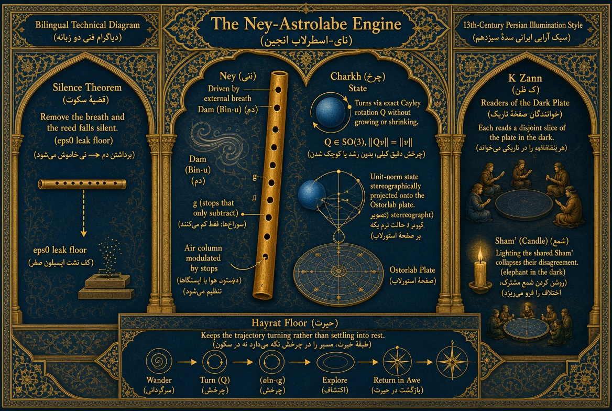

**Architecture — *The Ney-Astrolabe Engine — Nothing Is Stored, Something Is Removed, and It Only Sounds When Blown (nay-ostorlab)***  ·  🟢 **belief** — grounded in the figure's own surviving works

The *Masnavi* opens with a reed cut from its bed (I.1–3); it was dictated, and when Husam al-Din Chalabi withdrew after Book One, composition stopped for about two years; love is the astrolabe of God's mysteries (I.110); Book IV says sell cleverness and buy bewilderment; and in the dark house of III.1259–1270 a candle in each hand would have ended the quarrel over the elephant. **The turn** (*charkh*, `cayley_forward`) rotates the state each step by an exact orthogonal matrix; **the stops** (*ney*, `pass_gains`) scale each coordinate pair by a gain below one, so they can only take energy away; **the breath** (*dam*), the drive, is the only energy in. The normalised state is projected stereographically onto **the plate** (*ostorlab*), scaled by its loudness, and four **zann** heads each read a fixed, disjoint slice of it; when lit, **the candle** (*sham'*, `candle`) gives every head the same fixed random compression of the whole plate, and the prediction is their mean. Each head is scored on its own, and **the hayrat floor** adds a softplus penalty on slow turning that, contrary to the docstring, never reaches zero. Only the stops are confined to subtraction; the drive's weights and the heads learn freely. There is no learned baseline, only persistence and ablations. Every check passed: trained error fell 78.3% below persistence's, the output faded to 2.7 × 10⁻⁵⁵ two thousand steps after the breath stopped, and filling the holes raised error by 228%. The candle cut disagreement by 16.0% and consensus error by 18.4%, as predicted, though the summary prints the cut as "+16.0% disagreement". At its strongest the hayrat floor nearly tripled the turning rate and made in-band error more than five times worse: the bewilderment bought nothing the file measures.

▶️ **Run the mind:** [`minds/chapter_0330_Jalal_al_Din_Rumi_1207.py`](minds/chapter_0330_Jalal_al_Din_Rumi_1207.py)  —  `python3 minds/chapter_0330_Jalal_al_Din_Rumi_1207.py`

---

## 331 · Saʿdi of Shiraz
**c. 1210 – 1291/94 CE — Baghdad & Shiraz · Persian (Salghurid Fars)**  |  *Didactic prose · The ghazal · Ethics of speech*

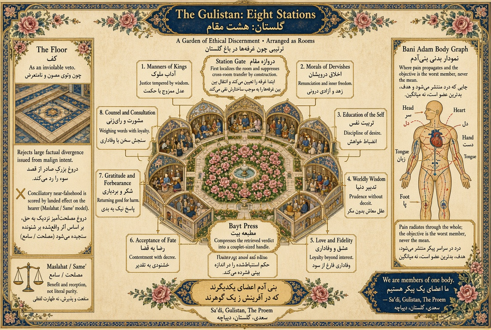

**Architecture — *The Gulistan Engine — Station-Gated Case-Base, Bayt Press, Hearer Simulation, Intent-Modulated Truth Cost, Bani Adam Coupling and an Inviolable Floor (maqam · bayt · same' · maslahat)***  ·  🟢 **belief** — grounded in the figure's own surviving works

His *Gulistan* of 1258 sorts its stories into eight chapters; in its first story a king prefers a vizier's conciliatory lie to a rival's true report spoken from malice, and the Bani Adam verses (I.10) hold that while one member hurts, the others find no rest. **The maqam router**, supervised on the true room (`a_station`), guesses which room (`STATION_NAMES`) a predicament stands in, and **station-masked retrieval** adds eight times (`lam_gate`) the log of that guess's overlap with forty stored cases' learned room tags (`Tmem`) to the attention logits. **The bayt press** squeezes the retrieved verdict from ten numbers to three (`d_z`), the only part passed on. **The same' model**, a hearer simulation, plays four candidate utterances against six listeners for two recurrent turns (`T_turns`); **Bani Adam coupling** spreads pain along the world's fixed body graph (`gamma_body`) and scores the worst member by a smooth maximum (`beta_max`). **The maslahat head** charges for factual divergence through a gate that closes as intent turns conciliatory (`a_int`), and **the floor** (`decide`) vetoes, at decision time only, a large departure from fact made with malign intent. Its rivals, a twin that averages the members (`test_7_body_coupling`) and a station-blind twin (`test_8_gate_ablation`), share its class, seed and steps. In this run all eight self-tests passed, agreement reaching 80.0% against 23.3% for the untrained engine. But the averaging twin scored 81.3%, on another held-out draw, and on the seam between antipodal rooms the gate gained 7.4 points over the blind twin where the room was found and lost 15.3 where it was not, breaking even at 59.2%: the commitment error the file foresees. The floor test cannot fail, and the closing findings are fixed text.

▶️ **Run the mind:** [`minds/chapter_0331_sadi_of_shiraz_1210.py`](minds/chapter_0331_sadi_of_shiraz_1210.py)  —  `python3 minds/chapter_0331_sadi_of_shiraz_1210.py`

---

## 332 · Ibn al-Nafis
**c. 1210/13 – 1288 CE — Damascus & Cairo · Arab (Ayyubid–Mamluk)**  |  *Medicine · Anatomy · Pulmonary transit*

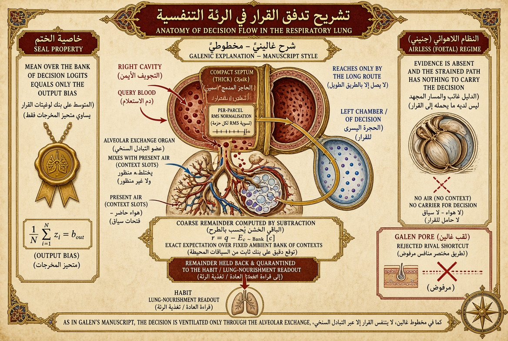

**Architecture — *Compact-Septum Transit with Ambient Straining — Nothing Reaches the Chamber of Decision Unmixed with the Air (Sharh Tashrih al-Qanun)***  ·  🟢 **belief** — grounded in the figure's own surviving works

In the *Sharh Tashrih al-Qanun* he denied any passage between the heart's ventricles, visible or invisible: blood thinned in the right cavity sends its fine part through the two-coated arterial vein, the thicker part staying to nourish the lung, and only once mixed with air can it make spirit in the left. **The right ventricle** (`right_ventricle`) encodes the query into six parcels that **thinning** (`thinning`) rescales to unit RMS; **the bronchi** (`bronchi`) turn four context slots into keys and values, which **alveolar exchange** (`alveolar_exchange`) reads through independent sigmoid gates. **Straining** (`straining`) has no parameters: it subtracts the same read taken over a fixed, entity-balanced bank of forty ambient contexts (`N_BANK`), so the linear **left ventricle** (`left_ventricle`) averages exactly to its bias over the bank, and the query reaches the decision only through what the evidence adds. The subtracted part feeds **lung nourishment** (`lung_nourishment`), a habit head read only to flag conflict. The baseline is a residual cross-attention reader (`base_forward`) of 3,708 parameters to the model's 3,714; the rivals add a learned Galenic **septal pore** (`septal_pore`) or drop the straining. Property tests with negative controls and four mutants guard the design. Over five seeds, where evidence contradicted habit, the model beat the baseline by 0.187, the Galenic variant by 0.222 and the unstrained one by 0.275, and flagged conflicts better, 0.984 AUROC against 0.866; but the baseline with context-aware decoding reached 0.886 to the model's 0.858, and on ordinary held-out cases the model scored lowest of the four, 0.838. The necessity test was inconclusive, a gap of 0.019 against a 0.03 margin, and the declared blind spot appeared: without evidence the model fell to 0.180, while the baseline held 0.692.

▶️ **Run the mind:** [`minds/chapter_0332_ibn_al_nafis_1213.py`](minds/chapter_0332_ibn_al_nafis_1213.py)  —  `python3 minds/chapter_0332_ibn_al_nafis_1213.py`

---

## 333 · Sturla Þórðarson
**1214 – 1284 CE — Reykholt, the Althing & the Norwegian court · Icelandic (Commonwealth)**  |  *Saga history · Law · Testimony*

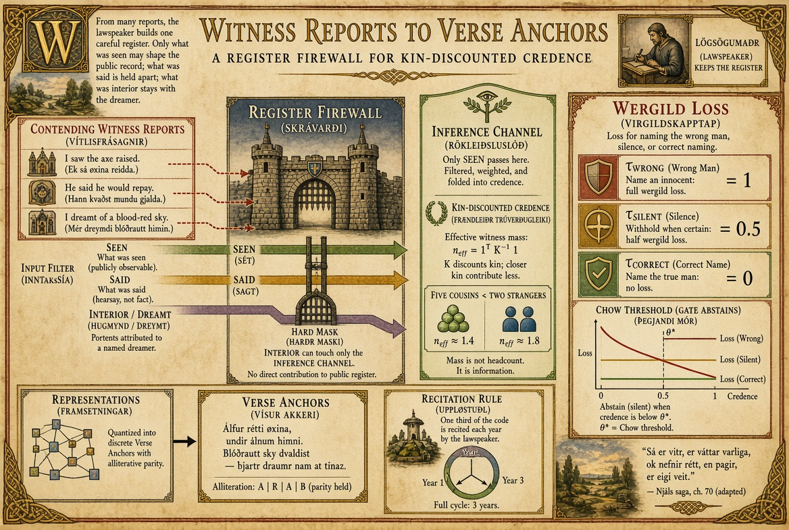

**Architecture — *VitnisNet — a Liability-Graded Witness Ledger: What Was Seen, Who Said It, What It Costs (vitnisnet · Grágás)***  ·  🟢 **belief** — grounded in the figure's own surviving works

He wrote of living men whose armed kin would hear him at the assembly, keeping apart what was seen, said and dreamt; at the Althing a third of the law was recited each summer, and the law priced injuries. **The register firewall** (`ROUTE`), a fixed mask, routes each report's learned **credence** (`ws`): a seen report reaches the seen, said and inference channels, a said one the last two, and a dream or portent inference alone. **Kin discounting** (`independence`) weights credence by generalised least squares and scales each channel by its effective share of independent witnesses, both computed from the true kinship by the world generator. **The verse anchors** (`Anc`) snap the summary to the nearest of twelve codebook vectors whose paired coordinates share a sign (`parity_project`), and **the lawspeaker's third** (`Recitation`), used only in the forgetting test, replays every twelfth step the episodes filed under a third of them. **The wergild loss** trains a separate speaking gate (`wg`) to pay twelve marks times one minus its belief in the true culprit, or three for silence. No rival is trained. In this run all eight tests passed: corrupting 82 interior reports moved the seen channel by 8.882e-16, marks paid per held-out case fell from 6.408 to 1.740, and silence was 80.0% where witnesses were at odds, 19.3% where they agreed. But the parity test cannot fail, the kinship test never touches the model, and the promised abstain slot does not exist. The declared blind spot, hidden motive, feeds no input, so its probe proves little; and recitation cut forgetting by 0.168, less than the 0.197 by which the arms differed before the shift, in one run with extra updates.

▶️ **Run the mind:** [`minds/chapter_0333_sturla_thordarson_1214.py`](minds/chapter_0333_sturla_thordarson_1214.py)  —  `python3 minds/chapter_0333_sturla_thordarson_1214.py`

---

## 334 · Roger Bacon
**c. 1214/20 – c. 1292 CE — Paris & Oxford · English**  |  *Optics · Experimental science · Signs*

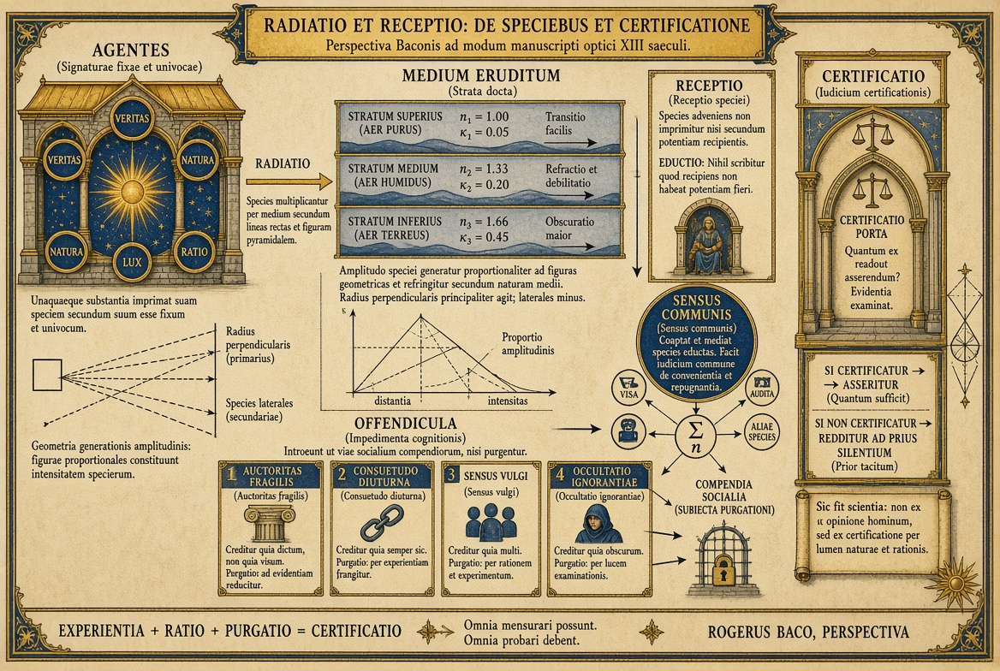

**Architecture — *Specularium — Species Propagation, Eduction from Potency, Certification (multiplicatio · eductio · certificatio)***  ·  🟢 **belief** — grounded in the figure's own surviving works

In *De multiplicatione specierum*, before 1267, every agent radiates its species, a likeness of its power that weakens with distance and bends at interfaces; the *Opus maius* names four stumbling-blocks to truth, makes certifying the prerogative of experimental science (Part VI) and puts the rainbow's greatest elevation at 42 degrees. **Multiplicatio** (`Medium`) carries the fixed signatures of twenty-four agents to twenty receivers, every amplitude built from eight learned scalars, an index and an opacity for each of four layers, by obliquity and Beer–Lambert loss (`log_amplitude`); **receptio** sums the arrivals without a mixing matrix, **eductio** gates them by each receiver's learned potency (`Pi`), and **the common sense** averages the receivers. **The offendicula** (`OFFENDICULA`), authority, custom, crowd and bluster, enter the logits as class votes through non-negative gains (`lam`) that **purgation** charges by an L1 penalty; **certificatio** reads the squared common sense and falls back to a learned silent prior (`bp`). The only rival is the same network and seed trained without purgation. In this run all seven tests passed. Unpurged, the mind scored 1.000 in the schools and 0.586 in the world, leaning on the crowd (gain 13.617); purged, it drove every gain to 0.000 and held 0.899 and 0.891, its certification averaging 0.993 on clear cases and 0.039 on obscured ones. But the evidence is drawn alike in both worlds, so a mind with zero gains faces the same task in each, and only authority inverts, though the docstring says all four do. The four layers start and stay identical, so the eight scalars act as two; four tests, the rainbow among them, pass by construction; no failure changes the exit code, and no blind spot is declared.

▶️ **Run the mind:** [`minds/chapter_0334_roger_bacon_1214.py`](minds/chapter_0334_roger_bacon_1214.py)  —  `python3 minds/chapter_0334_roger_bacon_1214.py`

---

## 335 · Sundiata Keita
**c. 1217 – c. 1255 CE — Dakadjalan, Mema & Kirina · Mande (Mali)**  |  *Founding epic · Oral tradition · Assembly*

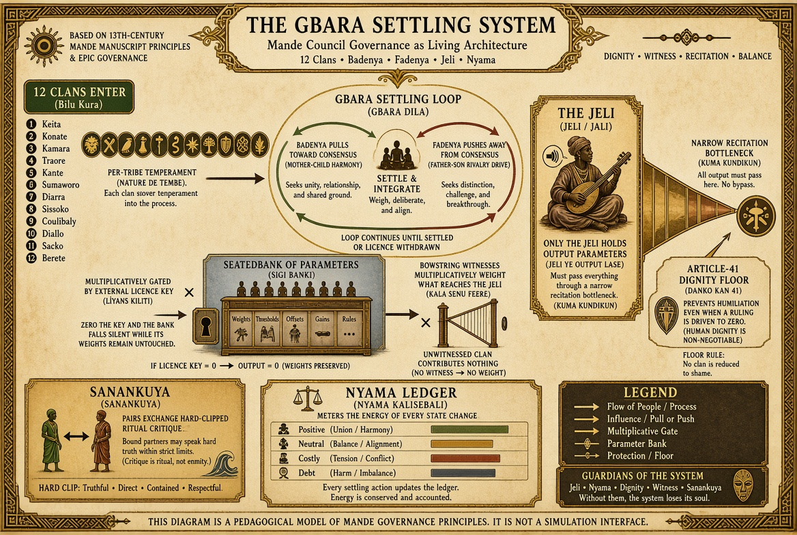

**Architecture — *The Convened Faculty — Capability Is Not Held; It Is Licensed, Witnessed, Voiced and Capped (jeli · gbara · sanankuya · nyama)***  ·  🟡 **mediated** — known only through the accounts of others

The epic seats Sunjata on the ground for seven years; at Mansa Sulayman's court in 1352 Ibn Battuta recorded answers carried by others, the interpreter Dugha among the principal men, and service attested by witnesses plucking a bowstring; Kurukan Fuga tradition says one may kill the enemy but not humiliate him. **The seated bank** (`Wb1`) adds to each of twelve clans' encoded states only through **a licence gate**, the clan's credential (`Wu`) dotted with the jeli's learned invocation key (`kjeli`). **The gbara** settles the clans for three rounds (`T_SETTLE`), a learned temperament (`Wk`) mixing a pull towards consensus, badenya (`Wbd`), with a push away, fadenya (`Wfd`), scaled by the licence; **sanankuya** adds an exchange between fixed partners clipped at ±0.35 (`RHO`), and **the nyama ledger** penalises state change above 2.6 (`NYAMA_BUDGET`). **The bowstring** weights clans by learned witness scores (`Ww`), and **the jeli**, an eight-unit recitation bottleneck (`Wj1`), is the only path to the six rulings. **The alarm** (`Wal`) reads a detached copy of the assembly; **Article 41** penalises standing below 0.35 (`DIGNITY_FLOOR`), a soft floor the docstring calls hard, on a channel the ruling never reads. The comparisons are six ablations, each one run from its own seed, with no hypothesis tested; the closing remarks are fixed text. In this run the assembly reached 82.0% and fell to 49.2% with the key withheld; without Article 41 a defeated party's standing fell to 0.000, against 0.447. But a model never licensed reached 80.4%, removing sanankuya raised accuracy to 84.0%, and the uncapped exchange scored higher and spent less nyama, contrary to its printed conclusion; only removing the gbara cost much (75.8%). The unlicensed-gate test cannot fail, and no blind spot is declared.

▶️ **Run the mind:** [`minds/chapter_0335_sundiata_keita_1217.py`](minds/chapter_0335_sundiata_keita_1217.py)  —  `python3 minds/chapter_0335_sundiata_keita_1217.py`

---

## 336 · Bonaventure
**c. 1221 – 1274 CE — Bagnoregio, Paris, La Verna & Lyon · Italian (Papal States)**  |  *Theology · Illumination · Certitude*

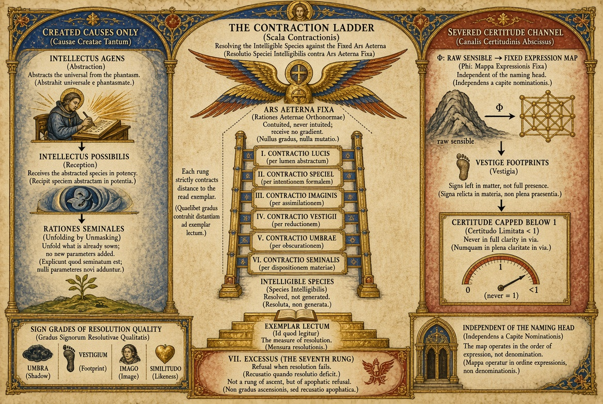

**Architecture — *The Contuition Net — a Resolutive Architecture with a Severed Certitude Channel (Ars aeterna · excessus)***  ·  🟢 **belief** — grounded in the figure's own surviving works

In *De scientia Christi* (q. 4) he held that of all knowing only certitude needs the eternal reason, a regulative and motive cause (*ratio regulans et motiva*), "not as the sole cause, nor in its full clarity"; the six rungs here are the seraph's wings he meditated on at La Verna in October 1259. **The Ars aeterna** (`build_ars`) is a fixed orthonormal basis of eight eternal reasons. Trained **agent and possible intellects** (`init_params`) turn a sensible impression into a species, the agent's width unfolding in stages as **seminal reasons** (`seminal_mask`). On each rung **the ladder** (`forward`) reads the species against the Ars, and a learned gate moves it part way towards the exemplar read, an exact contraction; **the naming head** picks a reason. **Certitude** (`certitude`) has no weights of its own: it is the final read's winning margin, damped when the input's footprint in a fixed random map (`build_expression`) lies unusually far from that reason's training mean (`record_vestiges`), and capped at 0.94; below the 5th percentile of validation certitude the net declines to answer, its **excessus**. But the loss (`loss_and_grads`) also trains that final read, so the margin is learned, and the test of certitude's absence from the loss (`t4_certitude_is_severed`) only searches the loss's code for its name and cannot fail. In this run all six self-tests passed: naming was 100% correct; mean certitude was 0.7247 for creatures of the Ars and 0.0268 for foreign ones drawn from a basis orthogonal to it; and the net declined every foreign creature and 6.25% of the others, all of which it had named correctly. No blind spot is declared; the task saturates and, with no rival confidence computed, nothing shows that the severed channel beats a simpler one; the docstring's ablations are not run.

▶️ **Run the mind:** [`minds/chapter_0336_bonaventure_1221.py`](minds/chapter_0336_bonaventure_1221.py)  —  `python3 minds/chapter_0336_bonaventure_1221.py`

---

## 337 · Alfonso X the Wise
**1221 – 1284 CE — Toledo, Seville & Beaucaire · Castilian (Castile–León)**  |  *Law · Astronomy · Chess, dice and tables*

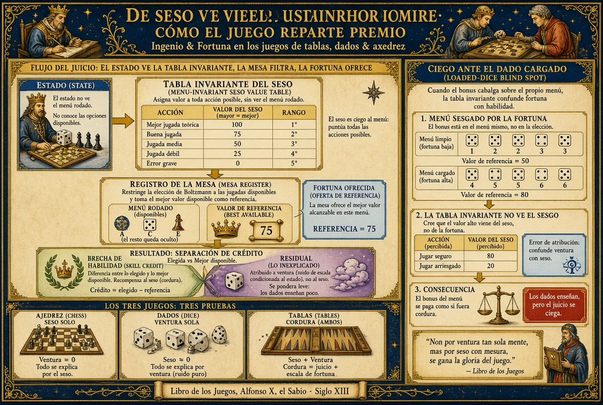

**Architecture — *The Cordura Ledger — Seso, Ventura and the Value of the Move Fortune Allowed (cordura derecha)***  ·  🟢 **belief** — grounded in the figure's own surviving works

His *Libro de acedrex, dados e tablas* (Seville, 1283) opens with three sages, for wit (*seso*), for fortune (*ventura*) and for the *cordura derecha* that takes from wit what profits and uses fortune where it helps, each proving his case with a game; folio 65r calls an unequal die deceit, not fortune. In **the Cordura Ledger** (`CorduraLedger`) a shared tanh encoder of the game state feeds its heads. **Seso** (`seso`) values every move without seeing which moves the dice allowed; **ventura** (`ventura`) predicts for each state a noise scale that divides the outcome error, so dice teach little; **mesa** (`mesa`) chooses among the rolled moves alone, at a learned temperature. Training (`_cordura_loss_and_grads`) adds the outcome and choice likelihoods; skill (`skill_scores`) is the chosen move's regret against the best value the throw offered. The baseline (`ContextMLP`) regresses outcomes on state, menu and move with 3,601 parameters against 3,320, which the file calls size-matched; the rival (`build_rival`), the first sage, is the ledger with neither the menu in its reference nor a noise scale. Over five seeds, on shifted menus that mostly withhold the best move, its skill estimates correlated with true regret at 0.701 to 0.811 against the baseline's 0.386 to 0.586; it beat the rival by 0.384, and retraining without mesa hurt far more than without a matched encoder block. The declared blind spot, loaded dice standing for the imperial pursuit of 1257–1275, in which early luck was read as control, was contradicted again: on loaded dice the ledger still beat the baseline by 0.301, losing only 0.067 against its own fair-dice score. The ventura knockout reads +0.000 because skill never uses the noise scale, and a budget failure's exit code would mask any other.

▶️ **Run the mind:** [`minds/chapter_0337_alfonso_x_the_wise_1221.py`](minds/chapter_0337_alfonso_x_the_wise_1221.py)  —  `python3 minds/chapter_0337_alfonso_x_the_wise_1221.py`

---

## 338 · Thomas Aquinas
**c. 1225 – 1274 CE — Roccasecca, Paris, Naples & Fossanova · Italian (Kingdom of Sicily)**  |  *Philosophy · Theology · Psychology*

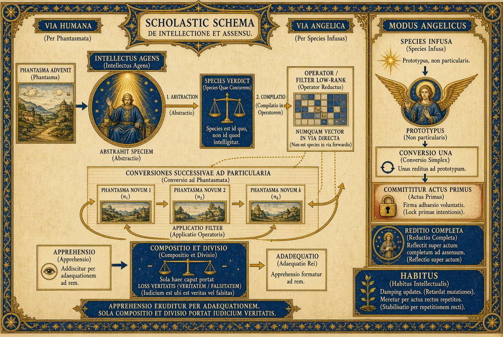

**Architecture — *The Conversio Engine — a Mind That Cannot Think without Looking Again (conversio ad phantasmata)***  ·  🟢 **belief** — grounded in the figure's own surviving works

In the *Summa theologiae* he held that in this life the intellect understands nothing actually except by turning to the phantasms (I.84.7), that the species is that by which it understands (I.85.2), that falsity enters only in composing and dividing (I.85.5), and that an angel, apprehending immovably, adheres immovably (I.64.2). Its world (`QuidditasWorld`) gives species essences and individuals accidents, and each look (`look`) fresh scale, offset and noise. In **the Conversio Engine** (`ConversioEngine`) **the agent intellect** looks once to yield a distribution over species that blends per-species low-rank operators and a standing term into **a filter**, whose readings of fresh looks, the **turnings back**, average into a quiddity. **The judgment head** affirms or denies a proposition and alone carries a truth-valued loss; **the reditio head** (`reditio`) learns from a detached copy of the act whether it was correct; **habitus** (`consolidate`) damps updates to species that carried correct acts; **angelic mode** reads the true species' prototype once. No outside baseline is trained and no blind spot is declared. The gradient check and six self-tests passed. Judgment reached 0.9340 and fell to 0.5273 with the phantasms removed; more turnings bought accuracy, from 0.9083 with one to 0.9483 with eight; and answering only at assent of 0.90 or more raised accuracy from 0.9293 to 0.9813, though calibration is never measured. When the accidents reversed (`experiment_angelic`), the conversio mind relearned them, from 0.3837 to 0.8656; the angelic one could not, by design: prototypes carry no accidents. The habitus claim failed (`experiment_habitus`): the damped mind relearned more. The standing term and the proposition reach the judgment with no phantasm, the printed conclusions are fixed strings, one calling a locked row that gained 0.0207 unmoved, and a failed self-test would not change the exit status.

▶️ **Run the mind:** [`minds/chapter_0338_st_thomas_aquinas_1225.py`](minds/chapter_0338_st_thomas_aquinas_1225.py)  —  `python3 minds/chapter_0338_st_thomas_aquinas_1225.py`

---

## 339 · Guo Shoujing
**1231 – 1316 CE — Xingtai, Shangdu & Dadu · Chinese (Yuan)**  |  *Astronomy · Calendar · Hydraulic engineering · Instruments*

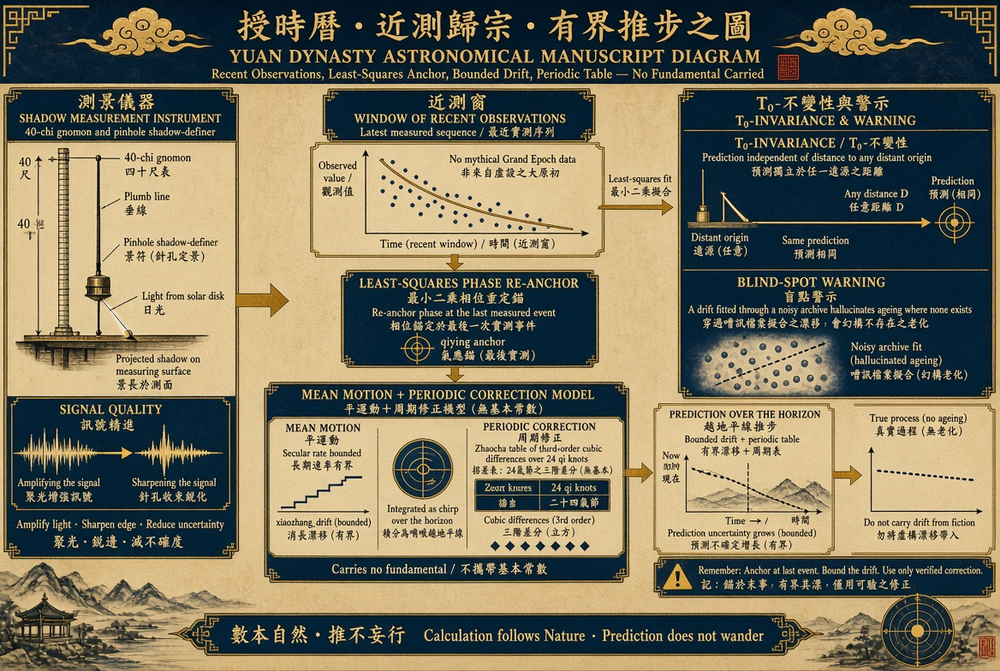

**Architecture — *Shoushi — the Season-Granting Forecaster (qiying · xiaozhang · zhaocha)***  ·  🟢 **belief** — grounded in the figure's own surviving works

In a memorial of 1276 he made measurement the root of the calendar; the Shoushi system, with its epoch at the winter solstice of 1280, abolished the Grand Epoch, let the tropical year shrink (*xiaozhang*) and read unequal motion from difference tables over the 24 *qi*, and the Ming Datong system dropped that drift in 1384. **The instrument** (`instrument`) has no parameters: a bank of fixed-rate matched filters reads each record of an ageing cycle (`make_windows`), and the phases of successive measuring epochs, fitted by a quadratic, give the rate at the last observation and its drift. A small residual tanh network corrects both within fixed bounds. **The anchor** (`qiying_anchor`) re-fits the phase at the last observation from the window's recent record; **the drift** (`xiaozhang_drift`) integrates the ageing rate as a chirp over the horizon; **the difference table** (`zhaocha_table`) adds to a sinusoid of that phase a periodic cubic table, a knot for each *qi*, with the fundamental removed. The baseline (`ffmlp`), a Fourier-feature network of 3,573 parameters against 3,388, reads the same instrument and is also handed the anchored phase, rate and drift; the rival (`grand`), of 3,408, carries phase forward from a distant Grand Epoch. Over five seeds all four hypotheses were supported: held-out normalised error was 0.215 against the baseline's 0.885, and at longer, unseen horizons 0.558 against 1.186, rising to 0.803 without the drift. The rival's 0.994 was no better than the first seed's mean predictor, 0.981, so its defeat was built in. The declared blind spot appeared, small: through a noisy archive with no true drift, the drift term cost 0.0171. Its full run sits near its 180-second budget: 166.7 seconds once and 188.1 another time, when it exited with code 3 though every other check passed.

▶️ **Run the mind:** [`minds/chapter_0339_guo_shoujing_1231.py`](minds/chapter_0339_guo_shoujing_1231.py)  —  `python3 minds/chapter_0339_guo_shoujing_1231.py`

---

## 340 · Ramon Llull
**c. 1232 – 1315/16 CE — Majorca, Paris, Tunis & Bougie · Catalan (Majorca)**  |  *Combinatorial art · Logic · Election*

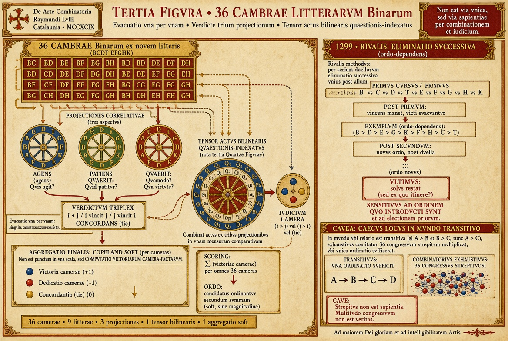

**Architecture — *Ars Camerarum — the Chamber Count (camera · unus punctus)***  ·  🟢 **belief** — grounded in the figure's own surviving works

In *Blaquerna* (1283) an election goes to "most votes in most cells" across 36 chambers, which Natana asks to inspect; his *Artifitium electionis personarum* marks a dot for each cell's winner and marks ties for both, while *De arte eleccionis* (Paris, 1 July 1299) settles for successive elimination. In its world (`World`) each question sets a transitive direction and a skew-symmetric term that can make contests cycle, and the target is the candidate who wins most chambers. **The vestibule** (`vestibule`), an identity-initialised map, feeds **the correlatives** (`correlatives`), agent and patient tanh projections. In each chamber **the act tensor** (`act_tensor`), a question-indexed bilinear form made antisymmetric, scores the contest, and **the concordance** (`concordance`), a symmetric form plus a tie bias, scores an even cell; a softmax over win, loss and tie gives the chamber's verdict (`_chamber_probs`). **The chamber count** (`_count_logits`) scores each candidate by its wins plus half its ties, scaled by a learned gain, and is trained only on who won the whole set, never on a pairwise verdict. The baseline is a pointwise scorer (`_pointwise_forward`) with 600 parameters against 602; the rival is the 1299 rule (`_elimination_logits`), a soft champion meeting each entrant in presentation order. Over five seeds all four hypotheses were supported: on shifted sets with more candidates and stronger cycles its accuracy was 0.681 against the baseline's 0.340, it beat the rival on test sets by 0.118, and its chambers matched the hidden pairwise outcomes about 90% of the time. The declared blind spot appeared: in a transitive, noisy world it lost to the baseline by 0.2187. Removing the concordance channel helped slightly, by 0.0107, and a budget overrun can never return its own exit code.

▶️ **Run the mind:** [`minds/chapter_0340_ramon_llull_1232.py`](minds/chapter_0340_ramon_llull_1232.py)  —  `python3 minds/chapter_0340_ramon_llull_1232.py`

---

## How the minds are reconstructed

Every entry is built research-first: the figure's surviving works and current scholarship are gathered and each source verified before any architecture is written. Where evidence is thin, the chapter says so rather than inventing an inner life. Each figure's **provenance** is set to one of three real values:

- 🟢 **belief** — the figure's own surviving works or recorded doctrine ground the entry.
- 🟡 **mediated** — no words of their own survive; they are known only through others' (often hostile or legendary) accounts, and the entry says so.
- 🔵 **extrapolated** — no philosophy of mind survives at all; the entry is inferred from documented deeds (typical of kings and builders), and the entry says so.

Eighteen of these twenty left words of their own; two are mediated, and several of the eighteen are belief on a thread. **Manco Cápac** reaches us only through Spanish chroniclers writing forty to a hundred and twenty years after the conquest, from Inca informants who were also litigants in colonial land disputes, and he may be a composite or wholly legendary; **Sundiata Keita** through the epic of the jeliw and a few lines of Ibn Khaldun, and the Kurukan Fuga charter credited to his assembly may be largely a modern construction. Among the eighteen, **Saint Sava** left no treatise on the mind, only constitutional texts — monastic rules, a nomocanon, a Life of his father, a service and one letter — so his position is read from what he legislated, and the inner teaching comes from his hagiographers; **Li Ye**, **Qin Jiushao** and **Guo Shoujing** wrote no treatise on the mind either and are read from prefaces, procedures and instruments, Guo's own words reaching us mostly through the *Yuan shi* of 1370 and Qi Lüqian's account of his conduct; Qin's character comes to us through hostile contemporaries; **Sturla Þórðarson**'s position has to be read off a method he applied for forty years; **Alfonso X** left no systematic philosophy of mind beyond a few prologues, so the reading of his imperial pursuit is an interpretation of deeds; the travels **Saʿdi**'s books narrate, from Kashgar to Somnath, collapse as evidence; **Dōgen**'s awakening scene is of contested authenticity; two of the lines most often quoted as **Rumi**'s in English are Coleman Barks's; **Albertus Magnus** and **Roger Bacon** share a legend, the speaking head of brass, that both chapters take apart; and **Llull**'s stoning at Bougie is later legend. At the other end, **Llull** wrote something over two hundred and sixty works in Catalan, Latin and Arabic, and **Ibn al-Nafis** planned a medical encyclopedia of three hundred volumes and wrote up some eighty. As the book's preview notes, Tome 17 holds no woman among its twenty.

Each reconstructed mind is then measured against the **[Artificiology E-AGI Barometer](https://artificiology.com/barometer.html)** — eight capability dimensions (Cognitive Processing 🧩, Embodied Cognition 🤸, World Modeling 🌍, Consciousness 👁️, Language Understanding 💭, Emotional Intelligence ❤️, Creativity ✨, Autonomy 🎯) — so a Serbian archbishop and a Yuan astronomer can be compared on the same yardstick. Tome 17 reads the instrument as a set of amendments. Only one prints numbers: **Qin Jiushao** puts Cognitive Processing 🧩 highest at 88 and Emotional Intelligence ❤️ lowest at 18. **Al-Tusi** reads the eight as a coupling matrix in which no axis can be moved alone, and **Bonaventure** sorts them into the content of a mind's acts and their warrant. Five minds add an axis the instrument lacks: answerability, what a system loses when it is wrong (**Sturla Þórðarson**); a correction rate under a changed world (**Thomas Aquinas**); the retirement of capability beside its growth (**Manco Cápac**); a calibration date on the instrument itself (**Guo Shoujing**); and the gap between what a faculty can do and what it is licensed to do (**Sundiata Keita**). Autonomy 🎯 is the axis most often inverted: **Bonaventure** would score the power not to pursue a goal, **Sundiata** calls self-licensing the failure an assembly exists to prevent, and **Rumi** keeps it near the floor on purpose, while **Dōgen** and **Guo** rate it high and **Francis** values it most as the power to renounce a goal. Consciousness 👁️ is claimed by nearly everyone and narrowed by nearly everyone: qualia are declined, and metacognition becomes something checkable from outside — knowing what one cannot tell, drawing confidence from a channel one does not own, showing the cells. Embodied Cognition 🤸 divides the tome: **Aquinas**, **Manco Cápac**, **Bacon** and **Rumi** make it load-bearing, while **Llull**, **Saʿdi** and **Qin** rank it low.

---

[← Tome 16](tome16.md) · [Repository README](readme.md)

### Read & explore
- 🌐 **Encyclopedia:** [https://lostmindsai.com](https://lostmindsai.com)
- 📖 **Tome 17 (Amazon):** [https://www.amazon.com/dp/B0HP7Z1NKC](https://www.amazon.com/dp/B0HP7Z1NKC)
- 🧪 **Interactive demos & résumé:** [https://artificiology.com/](https://artificiology.com/)
- 📊 **E-AGI Barometer:** [https://artificiology.com/barometer.html](https://artificiology.com/barometer.html)
- ✍️ **Author — David Vivancos:** [https://www.vivancos.com/](https://www.vivancos.com/)
