# Tome 18 — Minds 341–360
### *The Bound Mind — Udupi, Turkmen Anatolia, Paris & Orvieto, Montpellier & the Crown of Aragon, the Kathmandu Valley & Yuan Dadu, Hainan & Songjiang, Yangzhou, Venice & Khanbaliq, Fez & Tarifa, Erfurt & Cologne, Mamluk Damascus & Cairo, Florence & Ravenna, Oxford, Padua & Assisi, Vilnius & Riga, Mali & Mecca, Kyoto, Hita & Toledo, Avignon & Munich, Prague & Crécy*
**Encyclopedia of Lost Minds: Echoes on AI** · *1238 – 1296 CE*

[🌐 Encyclopedia](https://lostmindsai.com) · [📖 Buy Tome 18 on Amazon](https://www.amazon.com/dp/B0HQ47T2NC) · [🧪 Interactive Demos](https://artificiology.com/) · [📊 E-AGI Barometer](https://artificiology.com/barometer.html) · [✍️ Author](https://www.vivancos.com/) · [⭐ Repository](https://github.com/DavidVivancos/LostMindsAI)

[← Tome 17](tome17.md) · [Repository README](readme.md)

---

Tome 18 runs from **Madhva** to **John the Blind** — twenty reconstructed minds, each rendered on two planes. The **abstract plane** distils the thinker's cognitive signature into an interactive 3D mind-map; the **mechanistic plane** turns that same signature into a small, *runnable* neural architecture, built from scratch in NumPy, gradient-checked, trained and self-tested.

This page collects the twenty **visual mind-map explainers** for this tome and links each to its companion architecture. Runnable code lives in [`minds/`](minds/); the explainer images live in [`maps/`](maps/).

> Every architecture here executes and passes its mandatory finite-difference gradient check, inside a real training loop. Where a file's own self-test or declared prediction fails, or a component never learns, its section says so. Every result is computed live on the machine that runs the file.

Where Tome 17 asked who may license a mind, and how long the licence holds, Tome 18 asks what of the licence survives the road — a sannyāsin who keeps a witness that can only demote; a dervish who stores a doctrine in counted syllables for people who cannot read; a master who marks his conclusions as reciting, not asserting; a weaver who hands over the making of tools, never the tools; a merchant who says plainly that no man of his country had been to Cipangu; a castellan who throws a knife from the wall because every besieger will hear of it; a blind king who rides into Crécy tied to his companions. All twenty begin by refusing the same operation: let a claim vouch for itself in transit — let a mark written on its surface, a tag, a name, a seal, a confidence or an outward show, stand as the guarantee of what it is when it arrives. What they put in its place is the volume — a witness with no weights that only ever demotes; counted syllables and a returning line that make the rare thing cheap to keep; two indices on every thought, whose act and in what voice; a degree computed as a ratio before the cup is given; a canon of the whole body fitted to the survivors; four tools, each made on site from what the last one leaves; arrays set facing until the hidden term cancels; a graph of legs closed into loops, with accuracy spent where error is dear; two ledgers that never merge, the cost at hand and the cost of the precedent; a gate of vacancy with no parameters; rules that carry their cases, and suspension as a verdict; one love with three ways to be mis-set, and failures that portray their causes; the power for the opposite kept standing in the instant; feeling read as the body's departure from its own rest; an open offer sent by a road the institution does not control; a reserve for the road home committed before entry; every measure scored with the reserve removed; understanding certified only by eliminating the rival readings; a deletion that must exhibit its rewrite, bolted to a register declared in advance; and ties that stand in for a sense, with a release no single end may hold. If the previous tome's keyword was *licence*, this one's is *binding*: what holds a mark to the claim it qualifies, so that what arrives still says whose it is, in what voice and how sure — and, in the last chapter, the danger that a binding strong enough to survive the road can hold the one it binds.

---

## The Twenty at a Glance

| # | Mind | Era | Civilization | Architecture | Provenance |
|---|------|-----|--------------|--------------|:----------:|
| 341 | [Madhva](#341--madhva) | c. 1238 – 1317 CE | Indian (Tuḷu Nāḍu) | *The Bheda-Svarūpa Network — Difference Is the Primitive* | 🟢 |
| 342 | [Yunus Emre](#342--yunus-emre) | c. 1240 – 1320 CE | Anatolian Turkish | *The Refrain Engine — the Doctrine Stored in the Form* | 🟢 |
| 343 | [Siger of Brabant](#343--siger-of-brabant) | c. 1240 – before 1284 CE | Brabantine (Latin Christendom) | *The Copulatio Engine — One Intellect, Every Act Bound to a Body* | 🟢 |
| 344 | [Arnau de Vilanova](#344--arnau-de-vilanova) | c. 1240 – 1311 CE | Catalan (Crown of Aragon) | *The Gradus Engine — a Degree Computed in the Receiving Body* | 🟢 |
| 345 | [Araniko](#345--araniko) | c. 1245 – 1306 CE | Newar (Nepal–Yuan) | *Yi Xin Wei Shi (以心為師) — Canon Inversion with Two Rulers* | 🟡 |
| 346 | [Huang Daopo](#346--huang-daopo) | c. 1245 – 1330 CE | Chinese (Yuan) | *Zuo Zao (做造) — the Making, Not the Made* | 🟡 |
| 347 | [Zhu Shijie](#347--zhu-shijie) | fl. c. 1280 – 1303 CE | Chinese (Yuan) | *Facing Boards — the Unknowns Set Facing Until They Vanish* | 🟢 |
| 348 | [Marco Polo](#348--marco-polo) | c. 1254 – 1324 CE | Venetian | *The Stake-Weighted Traversal Cartographer* | 🟢 |
| 349 | [Alonso Pérez de Guzmán](#349--alonso-pérez-de-guzmán) | 1256 – 1309 CE | Castilian | *Echo-Priced Refusal — Two Organs That Never Merge* | 🔵 |
| 350 | [Meister Eckhart](#350--meister-eckhart) | c. 1260 – 1328 CE | German (Holy Roman Empire) | *The Grunt Equilibrium — Capacity Is Emptiness* | 🟢 |
| 351 | [Ibn Taymiyya](#351--ibn-taymiyya) | 1263 – 1328 CE | Arab (Mamluk) | *The Mihakk Engine — Certainty Is Contact, Never Form* | 🟢 |
| 352 | [Dante Alighieri](#352--dante-alighieri) | 1265 – 1321 CE | Italian (Florentine) | *The Ordered-Love Engine — One Love, Three Ways to Mis-set It* | 🟢 |
| 353 | [John Duns Scotus](#353--john-duns-scotus) | c. 1263/66 – 1308 CE | Scottish (Franciscan) | *The Instant Engine — the Power for the Opposite Stands* | 🟢 |
| 354 | [Giotto di Bondone](#354--giotto-di-bondone) | c. 1267 – 1337 CE | Italian (Florentine) | *Ponderazione — Feeling Read from the Body's Rest* | 🔵 |
| 355 | [Gediminas](#355--gediminas) | c. 1275 – 1341 CE | Lithuanian | *The Iron-Wax Bypass Reader — a Road Around the Mandate* | 🟢 |
| 356 | [Mansa Musa](#356--mansa-musa) | c. 1280 – 1337 CE | Mande (Mali) | *The Performative Potential-Flow Network — the Mansa Engine* | 🟡 |
| 357 | [Kenkō](#357--kenkō) | c. 1283 – 1350/52 CE | Japanese (Kamakura–Nanbokuchō) | *ISSHA — the Single-Shot Hazard-Delaying Architecture* | 🟢 |
| 358 | [Juan Ruiz, Archpriest of Hita](#358--juan-ruiz-archpriest-of-hita) | c. 1283 – 1350 CE | Castilian | *La Disputa por Señas — Certify Only When No Rival Reader Remains* | 🟢 |
| 359 | [William of Ockham](#359--william-of-ockham) | c. 1287 – 1347 CE | English (Franciscan) | *The Nominal-Definition Network — No Deletion Without Its Rewrite* | 🟢 |
| 360 | [John the Blind](#360--john-the-blind) | 1296 – 1346 CE | Luxembourgish (Bohemian crown) | *The Knotted Reins — a Tie That Stands In for a Sense* | 🔵 |

**Provenance** — 🟢 belief · 🟡 mediated · 🔵 extrapolated. See [How the minds are reconstructed](#how-the-minds-are-reconstructed).

---

## 341 · Madhva
**c. 1238 – 1317 CE — Pajaka & Udupi · Indian (Tuḷu Nāḍu)**  |  *Dvaita Vedānta · Difference · Gradation*

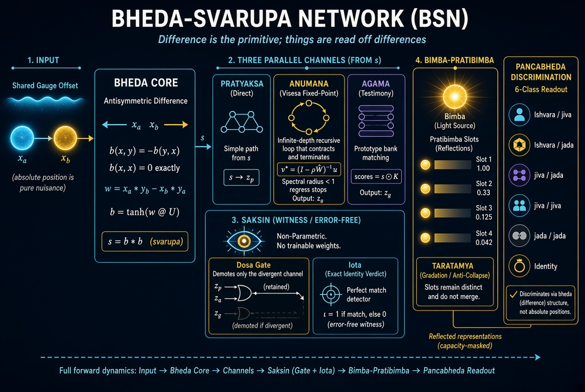

**Architecture — *The Bheda-Svarūpa Network — Difference Is the Primitive, and a Witness Only Demotes***  ·  🟢 **belief** — grounded in the figure's own surviving works

Trained by an Advaitin whose readings he would not accept, he held that difference is the very nature of the thing that bears it, listed five eternal differences among God, souls and matter, and set eight disciples over eight monasteries that take turns with the worship at Udupi, none absorbing the others. The Bheda-Svarūpa Network (`BhedaSvarupaNet`) learns no points at all. **The bheda core**, an exactly antisymmetric operator, reads each pair's difference, and on identical pairs returns exactly zero. **The viśeṣa layer** (`visesa_forward`) has infinite depth and stops its own regress in closed form, its implicit gradient matching a 600-deep unrolling. **The sākṣin** (`Saksin`) holds no weights and cannot be trained; through **the doṣa gate** (`dosa_gate`) it only ever demotes a channel shown to be defective. **The reflections** are four readers of fixed, unequal capacity on one original (`test_taratamya`). All nine self-tests passed. It told the five differences apart 79% of the time, where a point-first, sum-pooled logistic baseline (`sumpool_baseline`) stayed at chance, 21%; corrupted testimony was demoted and cost six points. When the original was removed, every reflection vanished together and the readers became indistinguishable; when one reader was removed, the others did not move (`test_dependence_asymmetry`). The weakest reader trailed at 65%, and the four never collapsed into one.

▶️ **Run the mind:** [`minds/chapter_0341_Madhva_1238.py`](minds/chapter_0341_Madhva_1238.py)  —  `python3 minds/chapter_0341_Madhva_1238.py`

---

## 342 · Yunus Emre
**c. 1240 – 1320 CE — Tapduk Emre's lodge & Sarıköy · Anatolian Turkish**  |  *Sufi poetry · Syllabic metre · The refrain*

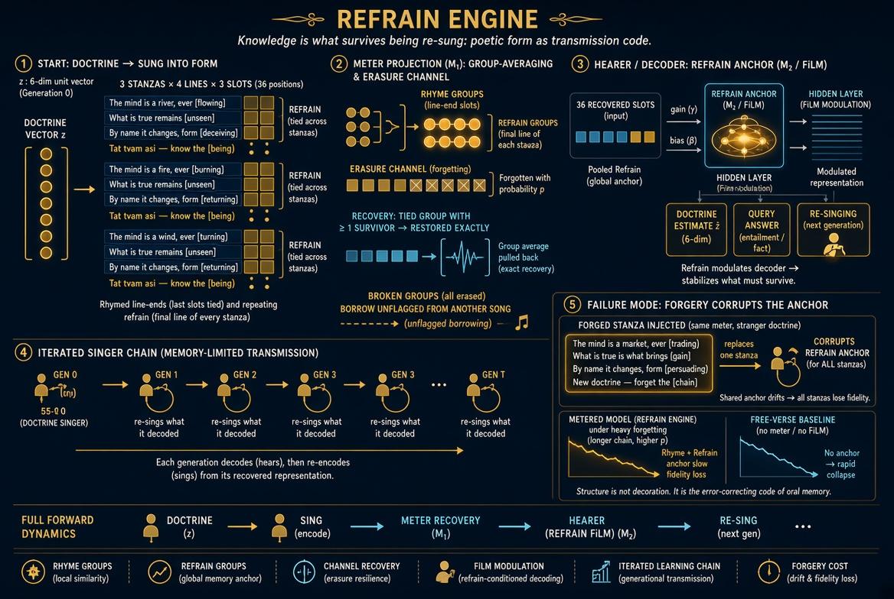

**Architecture — *The Refrain Engine — a Doctrine Stored in Counted Syllables, Not in Memory***  ·  🟢 **belief** — grounded in the figure's own surviving works

He sang in the counted syllables of Turkish folk song, in stanzas whose last line returns as a refrain, for people who could sing but not read; of more than a thousand poems signed Yunus, about 415 are accepted as his. The Refrain Engine (2,713 parameters) passes a hidden doctrine down a chain of singers who forget whole lines. **The metre** (`metered_groups`), fixed before learning, ties rhymed line-ends and the refrain across stanzas, so a singer restores any tied slot from one surviving member (`test_property_recovery`) and otherwise borrows a stranger's line without a flag. **The singer** (`channel_forward`) hears, decodes, answers and sings again to the next. The baseline is a free-verse twin (`free_groups`) in which no slot is tied to any other. All ten checks passed. Over five seeds, after six generations losing half their lines, it answered 62% of questions about the doctrine against the twin's 51%; knocking out the metre (`knockout`) cost ten points, while the refrain's own anchor added nothing measurable. As declared, a forged stanza in the same metre hurt it more than it hurt the free verse: what makes the rare thing cheap to keep makes it cheap to forge.

▶️ **Run the mind:** [`minds/chapter_0342_yunus_emre_1240.py`](minds/chapter_0342_yunus_emre_1240.py)  —  `python3 minds/chapter_0342_yunus_emre_1240.py`

---

## 343 · Siger of Brabant
**c. 1240 – before 1284 CE — Brabant, Paris & Orvieto · Brabantine (Latin Christendom)**  |  *Arts-faculty philosophy · Unity of the intellect · Reciting, not asserting*

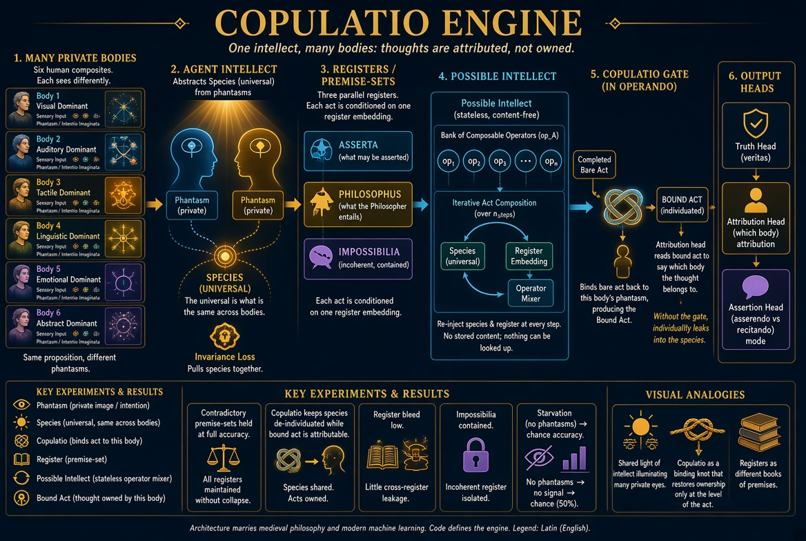

**Architecture — *The Copulatio Engine — One Shared Intellect, Every Act Bound to a Body and a Register***  ·  🟢 **belief** — grounded in the figure's own surviving works

A master of the Arts faculty at Paris who held with Ibn Rushd that one intellect serves the whole species, he answered Aquinas that a thought belongs to the body in whose operation it converges, and marked his conclusions as reciting the Philosopher, not asserting; cited by the inquisitor in 1276, he died at Orvieto before November 1284. The Copulatio Engine gives six bodies one shared intellect with no content of its own, trained in a simulated Paris arts faculty (`SchoolOfParis`). **The register index** conditions every derivation on its premise-set; **the assertion head** may assert under one register only; **the copulatio gate** binds each completed act back to the body whose images it worked on. All twelve self-tests passed. Where two premise-sets entailed opposite verdicts it was right under both, while a register-blind twin committed to one side and averaged chance; register bleed, the Tempier metric (`register_bleed`), how often it gave one verdict under premise-sets that contradict each other, was zero. Starved of images (`starvation_test`), the intellect itself fell to chance. Without the gate, Aquinas's objection, attribution still held, but only by writing the individual back into the universal, which ended abstraction: a mind can have a universal, or attribution without a body, not both.

▶️ **Run the mind:** [`minds/chapter_0343_siger_of_brabant_1240.py`](minds/chapter_0343_siger_of_brabant_1240.py)  —  `python3 minds/chapter_0343_siger_of_brabant_1240.py`

---

## 344 · Arnau de Vilanova
**c. 1240 – 1311 CE — Montpellier, Barcelona & Avignon · Catalan (Crown of Aragon)**  |  *Medicine · Degrees of compounds · Regimen*

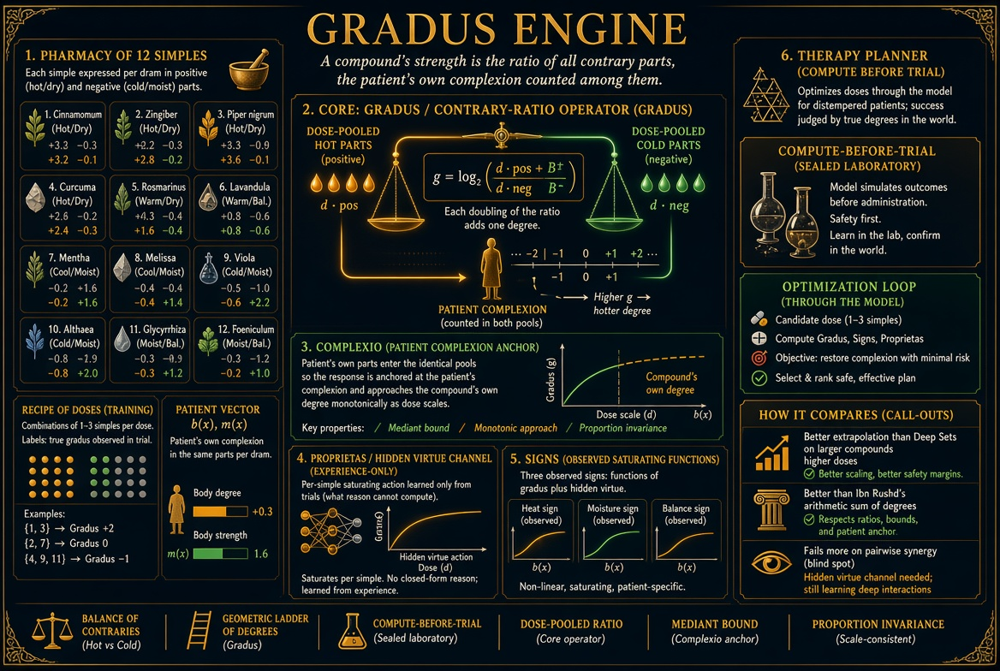

**Architecture — *The Gradus Engine — a Degree Computed as a Ratio in the Receiving Body***  ·  🟢 **belief** — grounded in the figure's own surviving works

Royal physician to Peter III of Aragon from 1281 and a translator of Galen and Ibn Sina from Arabic, he held in his *Aphorismi de gradibus*, after al-Kindī, that a compound's degree rises by one each time the ratio of its hot to its cold parts doubles, and that what reason cannot compute must be found by the smallest trial. The Gradus Engine (315 parameters) has three parts. **The double ratio** (`degrees`) pools the dose-weighted contrary parts of every simple with the patient's own and reads log₂ of their ratio with no parameters. **The hidden-virtue channel** learns, only from trials, what no quality explains. **The planner** (`plan_therapy`) sets doses by gradient through the model. The baseline (`build_baseline`) is a size-matched Deep Sets network; the rival, Ibn Rushd's computus, sums degrees by quantity. All eleven checks passed. Over five seeds, on compounds of four to seven simples at doses up to three drams, against at most 1.2 in training, its error was about a fifth of either's. Its planned therapies succeeded 67% of the time against 62% for the baseline and 68% for an oracle, short of its own bar; the claim that the patient's own parts mattered more than the readout's curve was contradicted; and, as declared, simples that make heat together defeated it.

▶️ **Run the mind:** [`minds/chapter_0344_arnau_de_vilanova_1240.py`](minds/chapter_0344_arnau_de_vilanova_1240.py)  —  `python3 minds/chapter_0344_arnau_de_vilanova_1240.py`

---

## 345 · Araniko
**c. 1245 – 1306 CE — Kathmandu Valley, Tibet & Dadu · Newar (Nepal–Yuan)**  |  *Bronze casting · Iconometry · Restoration*

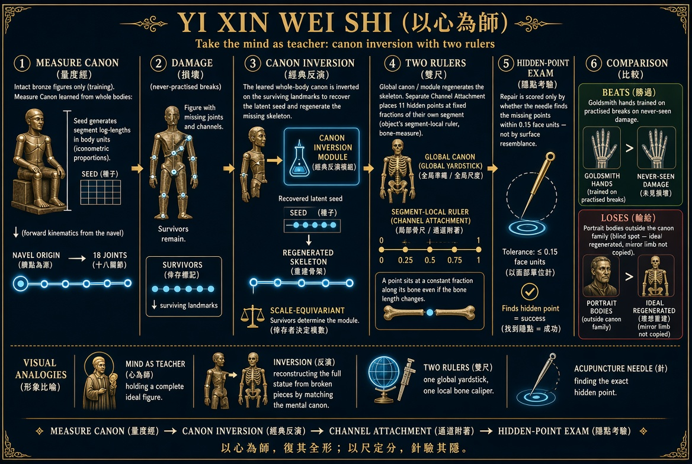

**Architecture — *Yi Xin Wei Shi (以心為師) — a Canon of the Whole Body, Inverted on the Survivors***  ·  🟡 **mediated** — known only through the accounts of others

Known only through what Chinese writers recorded of him, he asked at seventeen to lead the eighty Nepalese craftsmen sent to build a golden stupa in Tibet; at Khubilai's court he said his mind was his teacher, and in 1265 renewed a damaged Song bronze acupuncture figure that no one had been able to repair. Yi Xin Wei Shi learns **a canon of the whole body** (`build_model`; 3,528 parameters, 1,928 shared and 1,600 in per-figure codes) from intact figures only, and repairs a break by inverting it on the survivors (`canon_repair`): it regrows only what is missing, alters nothing that survives, and hangs each hidden needle point on its own segment, **the second ruler**. The baselines are two hands trained on practised breaks (`hand_repair`, 1,956 parameters), a goldsmith's and a self-taught one. All eleven checks passed. On damage never practised it found the hidden points 75% of the time, against the goldsmith's 2% and the self-taught hand's 50%, though on familiar damage the goldsmith did better, 93.5 against 89.3. The second ruler beat a one-ruler rival by four to seven points on most splits but by only one on its registered test, a class of figure never seen, so that claim stays inconclusive; and, as declared, on portrait bodies outside the canon the goldsmith won by ten.

▶️ **Run the mind:** [`minds/chapter_0345_araniko_1245.py`](minds/chapter_0345_araniko_1245.py)  —  `python3 minds/chapter_0345_araniko_1245.py`

---

## 346 · Huang Daopo
**c. 1245 – 1330 CE — Yazhou & Wunijing · Chinese (Yuan)**  |  *Cotton ginning · Spinning and weaving · Teaching the making*

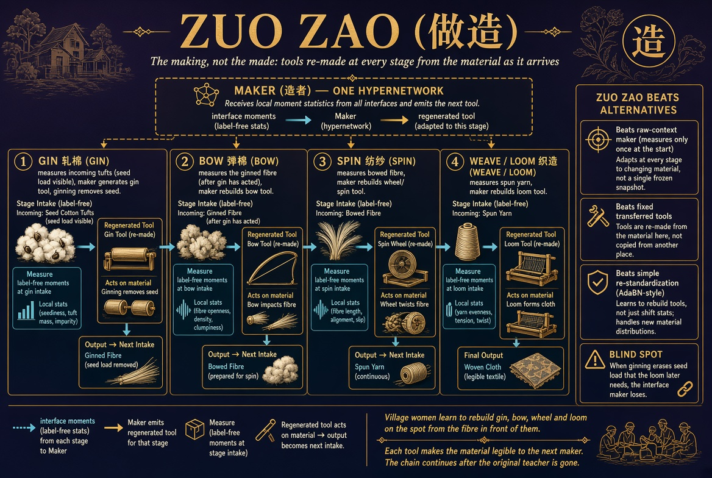

**Architecture — *Zuo Zao (做造) — Hand Over the Making, Never the Made***  ·  🟡 **mediated** — known only through the accounts of others

Known only from two short passages by men who never met her, Tao Zongyi's among them, she came from Yazhou on Hainan to Wunijing in the 1290s and taught the women of other surnames to make the tools for ginning, bowing, spinning and weaving; the village went on making them after she was gone. Zuo Zao stores no tools. **The maker** (`maker_forward`), one small hypernetwork shared by the four stages, writes each stage's **tool** (`gtool_forward`) on site from label-free statistics of the cotton as it arrives there (`feat_forward`), after the upstream tools have acted, so that every finished tool makes the next stage measurable. Its 2,147 parameters face three baselines of 2,139 to 2,251: a maker that measures only the raw lot, a chain that merely re-normalises its statistics (AdaBN), and tools frozen at training. All eight checks passed. Over five seeds, on villages outside the training range, it recovered the hidden fibre qualities with an R² of 0.79, against 0.62, 0.62 and 0.34. Its declared blind spot, a quality erased upstream, did not appear.

▶️ **Run the mind:** [`minds/chapter_0346_huang_daopo_1245.py`](minds/chapter_0346_huang_daopo_1245.py)  —  `python3 minds/chapter_0346_huang_daopo_1245.py`

---

## 347 · Zhu Shijie
**fl. c. 1280 – 1303 CE — Yanshan & Guangling · Chinese (Yuan)**  |  *Algebra · Four unknowns · Elimination*

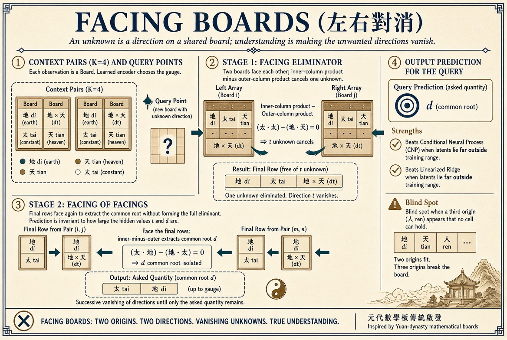

**Architecture — *Facing Boards — Set the Unknowns Facing Until They Vanish***  ·  🟢 **belief** — grounded in the figure's own surviving works

A Yuan teacher from Yanshan who travelled for more than twenty years and settled at Guangling, he set heaven, earth, man and matter as directions on one board around the known centre in the *Jade Mirror of the Four Unknowns* of 1303, and removed an unknown by setting two arrays facing until it cancelled. Facing Boards (324 parameters) learns only what to write on the board (`board_cells`) from four observations of a new task. **The eliminator** is fixed: it sets the rows facing (`face`), outer product minus inner, so the hidden task values cancel and are never estimated, and reads the answer as **a common root** (`common_root`). All ten checks passed, and the elimination was exact on 2,000 random boards (`exact_elimination_error`). Over five seeds, with hidden values beyond the training range, it reached an R² of 0.28 where a size-matched conditional neural process (`forward_cnp`, 339 parameters) reached 0.06; but a closed-form ridge head (`forward_ridge`, 325) beat it everywhere, 0.85 to 0.28 on that split, contradicting its claim to beat the closest prior art. Its declared blind spot, a third hidden origin the board cannot hold, appeared.

▶️ **Run the mind:** [`minds/chapter_0347_zhu_shijie_1249.py`](minds/chapter_0347_zhu_shijie_1249.py)  —  `python3 minds/chapter_0347_zhu_shijie_1249.py`

---

## 348 · Marco Polo
**c. 1254 – 1324 CE — Venice, Khanbaliq & Zaiton · Venetian**  |  *Travel · Geography · Commerce*

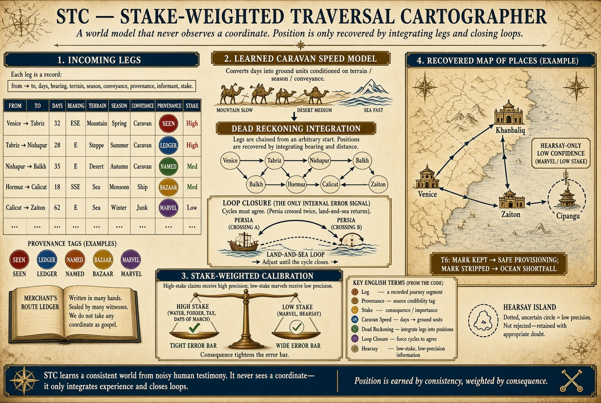

**Architecture — *The Stake-Weighted Traversal Cartographer — a Map from Days of Travel, Precision Spent Where Error Costs***  ·  🟢 **belief** — grounded in the figure's own surviving works

Home in Venice in 1295 after twenty-four years away, he told his book to Rustichello of Pisa while a prisoner of the Genoese: exact about paper money and the customs of Zaiton, loose about marvels, and careful to say that no man of his country had been to Cipangu. The cartographer is never given a coordinate. It fits a map of the route from Venice to Cipangu from 259 legs reported in days of travel, starting from dead reckoning (`init_map_by_dead_reckoning`); **the provenance layer** learns how far to trust each source and informant; **the stake coupling** ties precision to what an error would cost. Its gradient check passed (`T1_gradcheck`); training cut the map's error to 23 travel-days and closed every loop exactly (`T7_loop_closure`). It ranked its sources nearly in their true order (`T4_provenance_separation`, Spearman 0.9), and placed Cipangu 1.5 times worse than the places he saw, and said so (`T6_cipangu`). When a scribe inflated 49 claims (`T5_rustichello_amplifier`), the marked ledger stayed 14% off the true cost from Venice to Zaiton, a credulous reader 43%. Weighting by stake (`T3_stake_ablation`) improved high-stake calibration by 8% at a cost of 7% on the rest and a map about a sixth worse, 22.7 travel-days against 19.5; provisioned from the bare number instead of the marked one, a ship fell nine days short.

▶️ **Run the mind:** [`minds/chapter_0348_marco_polo_1254.py`](minds/chapter_0348_marco_polo_1254.py)  —  `python3 minds/chapter_0348_marco_polo_1254.py`

---

## 349 · Alonso Pérez de Guzmán
**1256 – 1309 CE — León, Fez & Tarifa · Castilian**  |  *Frontier command · The siege of Tarifa · Ransom*

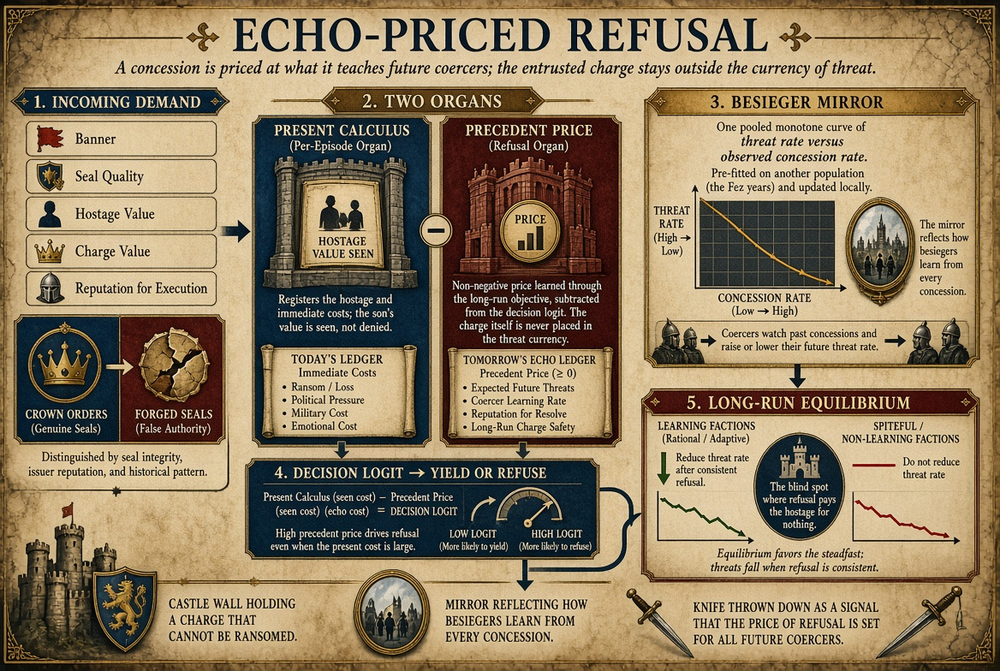

**Architecture — *Echo-Priced Refusal — the Cost at Hand and the Price of the Precedent***  ·  🔵 **extrapolated** — inferred from documented deeds

No philosophy of mind of his survives; the entry reasons from deeds. Holding Tarifa in 1294 against the Marinids and the infante don Juan, who held his young son and threatened to kill him unless the town was given up, he threw them a knife from the wall-walk; he had served the Marinid emirs at Fez for about a decade and knew how their camp reasoned. Echo-Priced Refusal (434 parameters, and 27 more for a mirror used only in training) keeps two organs that never merge. **The present calculus** (`present_objective`) weighs each demand alone; **the precedent price** (`precedent_objective`), non-negative and subtracted from it, is learned through **the besieger mirror** (`mirror_curve`, fitted by `fit_mirror`), one monotone curve of how coercers learn from the concessions they see. All twelve checks passed. Over five seeds its long-run loss was 1.4 against 3.9 for the same network retrained without the mirror (`train_native`), and it held against coercers and hostages it had not seen; it obeyed the crown and gave nothing to a forged seal. As declared, where coercers do not learn, refusal bought nothing and paid with the hostage; and against its own prediction, the pooled mirror beat a broker pricing each faction even where local records existed.

▶️ **Run the mind:** [`minds/chapter_0349_alonso_perez_de_guzman_guzman_el_bueno_1256.py`](minds/chapter_0349_alonso_perez_de_guzman_guzman_el_bueno_1256.py)  —  `python3 minds/chapter_0349_alonso_perez_de_guzman_guzman_el_bueno_1256.py`

---

## 350 · Meister Eckhart
**c. 1260 – 1328 CE — Erfurt, Paris, Strasbourg & Cologne · German (Holy Roman Empire)**  |  *Mysticism · Detachment · The ground of the soul*

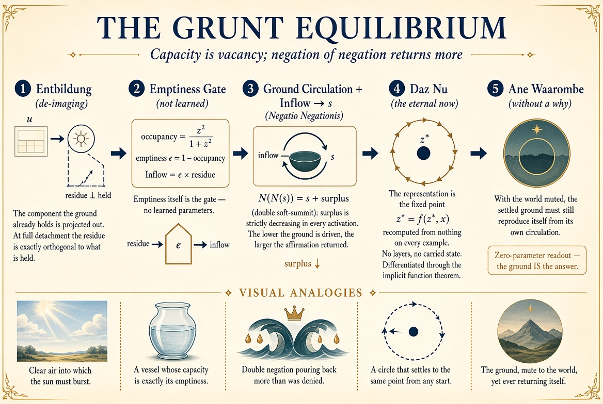

**Architecture — *The Grunt Equilibrium — Capacity Is Emptiness, and Learning Proceeds by Subtraction***  ·  🟢 **belief** — grounded in the figure's own surviving works

A Dominican who twice held the Paris chair, governed at least forty-seven houses and preached detachment in German, he held that the intellect, to know all things, must itself be nothing; twenty-eight propositions attributed to him were condemned in 1329, fourteen months after his death. The Grunt Equilibrium (5,860 parameters, none in the readout) is a deep equilibrium model recomputed from empty ground on every example (`solve_equilibrium`, with an adjoint pass for its gradient). **The vacancy gate** is not learned: it admits what arrives only in proportion to how empty the register is (`test_emptiness_gates`). **De-imaging**, his *Entbildung*, strips the part of each image the ground already holds, as a graded release. **The double negation** (`negation_surplus`) returns more than it denied. All six self-tests passed. Asked to recover quiet signals beneath a loud alien image, it found 57% of them where the best linear map, a ridge fitted on fresh data, found 29%; removing detachment cost 13 points and replacing the vacancy gate with a constant cost 18. An orthogonal matching pursuit handed the dictionary found 99%, a calibration rather than a fair rival, and the term that lets the ground sustain itself with the world muted, his *âne warumbe*, life without a why, cost almost four points, a price the run keeps.

▶️ **Run the mind:** [`minds/chapter_0350_meister_eckhart_1260.py`](minds/chapter_0350_meister_eckhart_1260.py)  —  `python3 minds/chapter_0350_meister_eckhart_1260.py`

---

## 351 · Ibn Taymiyya
**1263 – 1328 CE — Harran, Damascus, Cairo & Alexandria · Arab (Mamluk)**  |  *Theology · Logic · Transmitted reports*

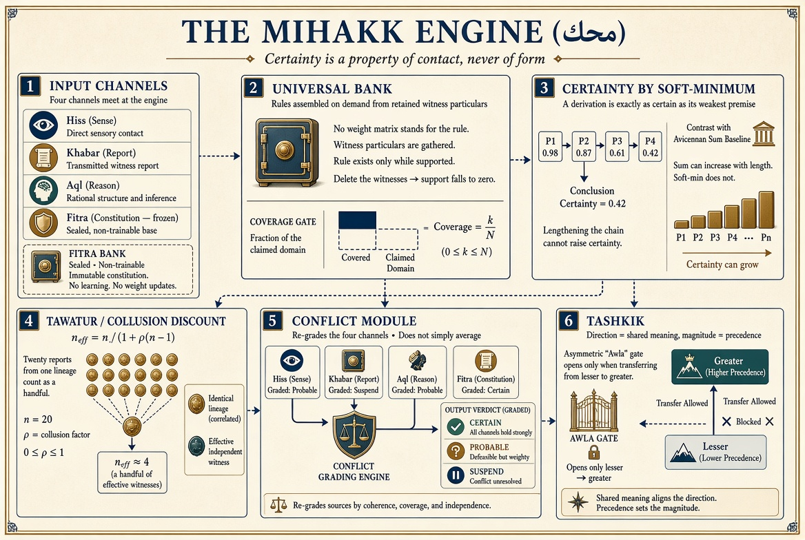

**Architecture — *The Mihakk Engine — Certainty Is Contact, Never Form***  ·  🟢 **belief** — grounded in the figure's own surviving works

A Ḥanbalī jurist of Damascus, tried and imprisoned again and again, who died in the citadel of Damascus in 1328, he began his *Refutation of the Logicians* under house arrest in Alexandria in 1309–10: certainty belongs to contact, never to form, and a report is known by the roads it travelled, not by the number of its tellings. The Mihakk Engine, named for the touchstone, keeps no parametric universals: every rule is rebuilt on each pass from the retained particulars that license it (`UniversalBank`). Four channels feed it, **sense** (`channel_hiss`), **report** (`channel_khabar`), **reason** (`channel_aql`) and **innate disposition** (`channel_fitra`); premises combine by a soft minimum, and reports are weighed by their independent lineages, not their count. The gradient check and every self-test passed: chains of one to sixteen steps carried exactly the same certainty (`test_weakest_premise`), deleting the witnesses deleted the rule (`test_universals_have_no_parameters`), and the a fortiori transfer runs one way only (`awla_gate`). On twenty reports that were one man's voice it judged 88% correctly where an Avicennan baseline that counts reports and sums premises judged none, and it graded deadlocks 31 points better; on long specious chains that baseline won by eight points, a loss the run reports plainly.

▶️ **Run the mind:** [`minds/chapter_0351_ibn_taymiyyah_1263.py`](minds/chapter_0351_ibn_taymiyyah_1263.py)  —  `python3 minds/chapter_0351_ibn_taymiyyah_1263.py`

---

## 352 · Dante Alighieri
**1265 – 1321 CE — Florence, Verona & Ravenna · Italian (Florentine)**  |  *Poetry · Moral psychology · Love as seed*

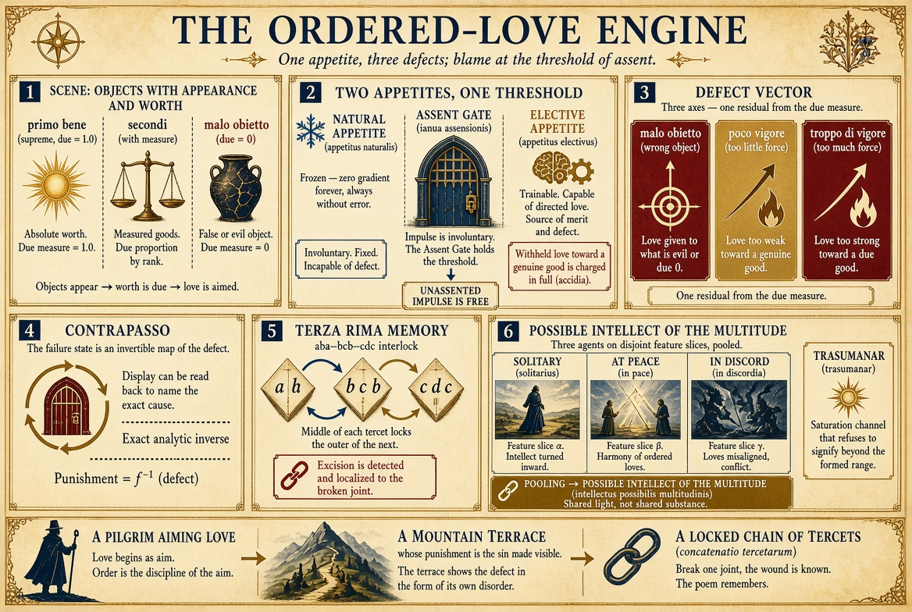

**Architecture — *The Ordered-Love Engine — One Love, Three Ways to Mis-set It, and a Failure That Shows Its Cause***  ·  🟢 **belief** — grounded in the figure's own surviving works

Exiled from Florence in 1302 under sentence of the fire, he set out in the *Purgatorio* that one love is the seed of every virtue and every fault, and that the elective kind errs in exactly three ways: toward the wrong object, with too little force or with too much. The Ordered-Love Engine (`OrderedLoveEngine`) has one primitive and a three-axis residual against a due measure. **Natural love** (`natural_love`) is frozen and can never be blamed; **the elective act** (`elective_act`) is judged only at the threshold of assent; failures are displayed as **a contrapasso** that is exactly invertible (`contrapasso_forward`, `contrapasso_inverse`), so the defect can be named from its punishment (`name_the_defect`); and **a terza-rima memory** (`rhyme_lock`) locks each tercet to the next, so that nothing can be cut from it quietly. The gradient check and all six self-tests passed. On unseen cases love toward the wrong object fell from 0.25 to 0.01 and the shortfall toward the supreme good from 0.35 to 0.02, while excess fell least, from 0.083 to 0.063; the defect was read back from its display 97% of the time, and every excision from memory was caught (`experiment_terza_rima`). Three knowers at peace reached a ceiling none reached alone (`species_ceiling`), then fell below a blind guess in discord.

▶️ **Run the mind:** [`minds/chapter_0352_dante_alighieri_1265.py`](minds/chapter_0352_dante_alighieri_1265.py)  —  `python3 minds/chapter_0352_dante_alighieri_1265.py`

---

## 353 · John Duns Scotus
**c. 1263/66 – 1308 CE — Duns, Cambridge, Oxford, Paris & Cologne · Scottish (Franciscan)**  |  *The will · Formal distinction · Thisness*

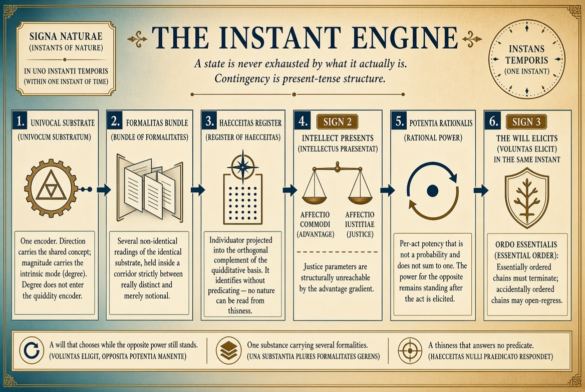

**Architecture — *The Instant Engine — the Power for the Opposite Stands Undiminished***  ·  🟢 **belief** — grounded in the figure's own surviving works

The Subtle Doctor, whose one secure date is his ordination at Northampton in 1291, lectured at Oxford and Paris and died at Cologne in 1308; he held that at the instant the will wills one act its real power for the opposite still stands, undiminished, and made the same move in the formal distinction and in a thisness that answers no predicate. The Instant Engine (`InstantEngine`, 11,468 parameters) emits in one forward pass **the act** it elicits; **an unnormalised power** for every alternative, kept above a floor; **three formalities**, non-identical readings of one substrate; and **a thisness** no class can read. **Worth** and **advantage**, his two affections of the will, come from the same state, and worth never sees the task signal. All its checks passed. On 3,000 new occasions it named the right act 94% of the time, re-identified every individual through accidental change, let worth override advantage in 95% of the cases where it was at stake, and never let the power for the opposite die. There is no rival in the run, and the thisness still leaked its nature at 31% against a chance of 17%.

▶️ **Run the mind:** [`minds/chapter_0353_john_duns_scotus_1266.py`](minds/chapter_0353_john_duns_scotus_1266.py)  —  `python3 minds/chapter_0353_john_duns_scotus_1266.py`

---

## 354 · Giotto di Bondone
**c. 1267 – 1337 CE — Florence, Assisi, Padua & Naples · Italian (Florentine)**  |  *Fresco · Pictorial weight · Design and day-work*

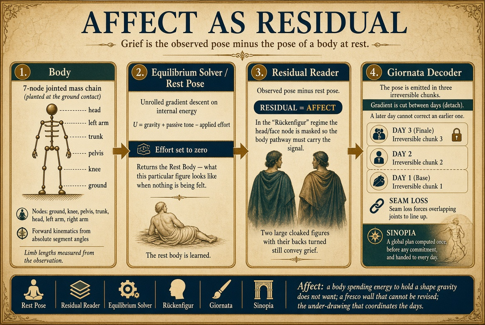

**Architecture — *Ponderazione — Feeling Read as the Body's Departure from Its Own Rest, Painted by the Day***  ·  🔵 **extrapolated** — inferred from documented deeds

He wrote nothing that survives, so the entry reasons from paintings and commissions. The Florentine who painted the Scrovegni Chapel at Padua around 1303–05 put two hooded, faceless mourners in the foreground of its *Lamentation*, backs turned, and let their grief be read from the weight they hold up. Ponderazione's first layer is **a differentiable equilibrium solver** for a jointed, planted body: it measures each figure's limbs (`measure_limbs`), solves for that body's own rest pose (`rest_pose`) and reads feeling as **the residual**. **The giornata decoder** then paints the output in three days from **a sinopia** drawn first, with no gradient crossing a dried join (`seam_loss`). All twelve self-tests and the gradient check passed. On builds of body it had never seen, the residual reader named the action every time, with or without a face (`exp2_ruckenfigur`), where an otherwise identical reader of the raw pose fell to 71%. In the fresco test (`exp3_giornata`), days painted without a design agreed with one another on the wrong figure, and letting them revise each other changed nothing; the design cut the error threefold, though with dried joins it only just beat painting nothing.

▶️ **Run the mind:** [`minds/chapter_0354_giotto_1267.py`](minds/chapter_0354_giotto_1267.py)  —  `python3 minds/chapter_0354_giotto_1267.py`

---

## 355 · Gediminas
**c. 1275 – 1341 CE — Vilnius & Riga · Lithuanian**  |  *Statecraft · Chancery letters · Toleration*

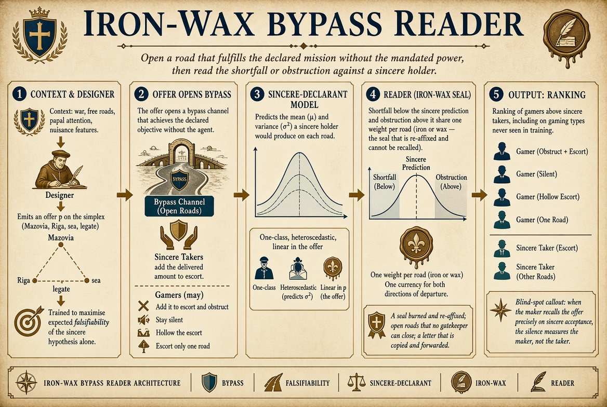

**Architecture — *The Iron-Wax Bypass Reader — Test a Mandate by a Road Around It***  ·  🟢 **belief** — grounded in the figure's own surviving works

Grand duke of a still pagan Lithuania, he told the pope that the Teutonic Order had burned the church built for the friars while claiming to defend Christians, and in 1323 wrote directly to the Hanseatic towns and the friars, inviting merchants, craftsmen and clergy in toll-free, a copy to be fixed to every church door. The Iron-Wax Bypass Reader (1,817 parameters) opens a road that fulfils a mandate's declared mission without it. **The designer** (`designer_fwd`) chooses the offer; **the sincere holder** (`sincere_parts`), a model of a party that means what it declares, predicts the response; **the reader** (`iron_wax_logit`) prices shortfall and obstruction in one currency, with no model of the gamer. All ten checks passed. Over five seeds, on kinds of gaming it had never seen, it told gamers from sincere takers with an AUC of 0.77 where a size-matched designer and discriminator trained on known hacks (`build_dad`, 1,830) fell to 0.53, though that rival led on the known ones, 0.846 to 0.790. As declared, when his own side recalled the offer once a sincere taker accepted, the reader fell to chance: an open road tests the sender too.

▶️ **Run the mind:** [`minds/chapter_0355_gediminas_1275.py`](minds/chapter_0355_gediminas_1275.py)  —  `python3 minds/chapter_0355_gediminas_1275.py`

---

## 356 · Mansa Musa
**c. 1280 – 1337 CE — Mali, Cairo & Mecca · Mande (Mali)**  |  *Rule of Mali · Pilgrimage · Gold and markets*

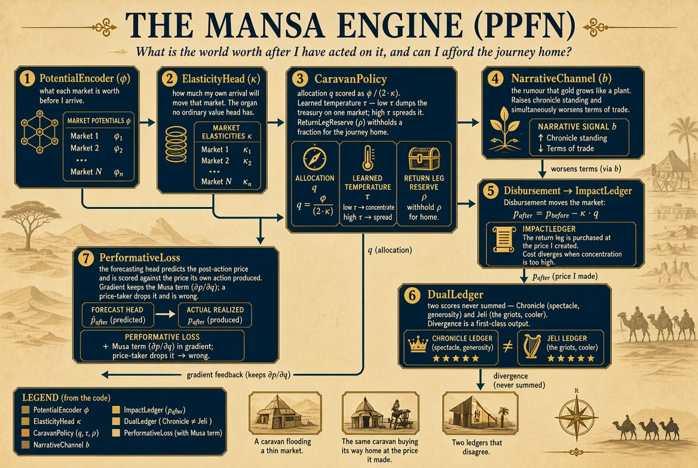

**Architecture — *The Performative Potential-Flow Network (the Mansa Engine) — Value Measured After One's Own Spending***  ·  🟡 **mediated** — known only through the accounts of others

He left no words of his own and is known through Arabic writers, al-ʿUmarī chief among them. When he passed through Cairo on pilgrimage in 1324, his gold took the mithqāl from at least twenty-five dirhams to at most twenty-two, and on the way home he borrowed fifty thousand dinars against the market he had flattened. The Mansa Engine values every market after its own spending, on a simulated Sahel circuit (`SahelCircuit`). **The elasticity head** estimates its own impact; **the caravan policy** spreads the treasury; **the return reserve** for the road home is committed before entry; and **the narrative channel** pays for its boasts. All eleven tests passed (`run_tests`). Its own-impact estimate tracked the hidden truth at a correlation of 0.95; trained, it reserved 31% rather than 18% for the road home, cut its shortfall thirty-fold, sent Cairo 12% of its spending instead of 22% and fell silent about inexhaustible gold. A price-taking twin ended clearly worse; retraining on its own wake (`train_rrm`) oscillated without settling; and the term a price-taker's gradient leaves out was 189 times the size of the full gradient, nearly cancelling what it kept.

▶️ **Run the mind:** [`minds/chapter_0356_mansa_musa_1280.py`](minds/chapter_0356_mansa_musa_1280.py)  —  `python3 minds/chapter_0356_mansa_musa_1280.py`

---

## 357 · Kenkō
**c. 1283 – 1350/52 CE — Kyoto · Japanese (Kamakura–Nanbokuchō)**  |  *Zuihitsu · Impermanence · Courtly custom*

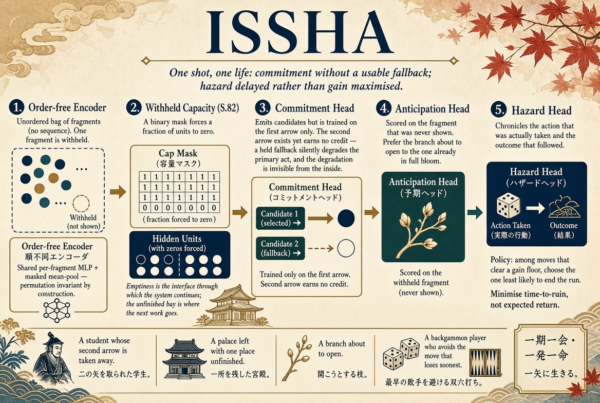

**Architecture — *ISSHA — the Irreversible Single-Shot Hazard-Delaying Architecture***  ·  🟢 **belief** — grounded in the figure's own surviving works

Born Urabe Kaneyoshi into a house of court diviners, he took orders in 1324 and wrote the *Tsurezuregusa* around 1330–32, where an archery teacher takes a student's second arrow away: while he keeps it he will be careless with the first, and will not know it. ISSHA, named for the one release of the bow, pools its fragments in no order, keeps part of its trunk unfinished as §82's palace keeps a bay unbuilt (`make_cap_mask`), scores only the first of its two proposed actions, and steers by a separate estimate of ruin (`hazard_logit`). Its gradient check and permutation test passed (`test_gradients`, `test_permutation_invariance`). Over three seeds a learner allowed a second shot (`experiment_second_arrow`) reached a lower training loss and a first shot four times worse, a fault its own curve never showed. The withheld bay (`experiment_withheld_capacity`) let a new task be learned while the old one survived exactly, where fine-tuning destroyed it; and playing so as not to lose (`experiment_ruin_delay`) lived 3.3 times longer than greedy play and gained 2.1 times as much. His preference in §137 for the half-seen, the moon behind cloud, did not pay, and the run says so.

▶️ **Run the mind:** [`minds/chapter_0357_kenko_1283.py`](minds/chapter_0357_kenko_1283.py)  —  `python3 minds/chapter_0357_kenko_1283.py`

---

## 358 · Juan Ruiz, Archpriest of Hita
**c. 1283 – 1350 CE — Hita, Alcalá & Toledo · Castilian**  |  *Poetry · Interpretation · Canon law*

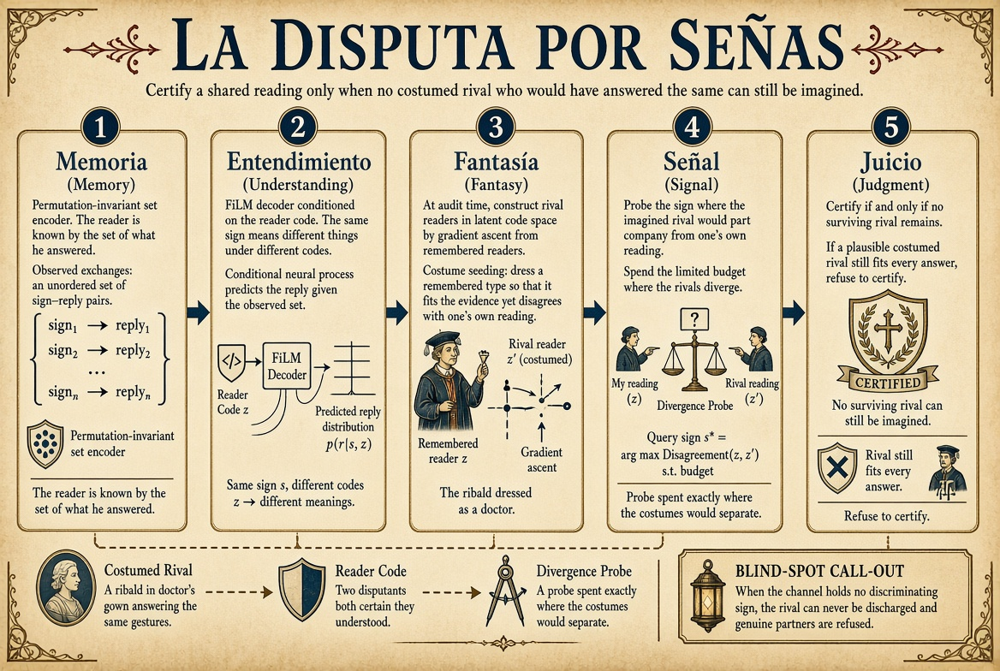

**Architecture — *La Disputa por Señas — Certify Only When No Rival Reader Remains***  ·  🟢 **belief** — grounded in the figure's own surviving works

A name in a witness list of about 1330 and a voice in a book, the archpriest whose *Libro de buen amor* is dated 1330 in two manuscripts and 1343 in the third told early in it of a disputation by signs in which a Greek doctor and a Roman ribald dressed as a doctor each leave certain they understood, having read every gesture differently. La Disputa por Señas (2,794 parameters) certifies a partner only when no rival reader can still be imagined who would have answered the same. **Fantasia** (`fantasia`) re-costumes remembered readers by gradient ascent until they fit the evidence yet disagree; the readers still standing (`survivors`) decide where **the next sign** goes (`senal`): to the gesture where they part. All ten checks passed. Over five seeds, with 45% of partners a kind of ribald it had never met, it certified 90% correctly, against 55% for a Bayesian active-learning auditor (`audit_bald`) and 49% for the Greek doctor's rule (`audit_greek`), though on familiar readers the active learner did better. Remembered rivals without the tailoring (`audit_recall`) did slightly better still, 93%; and, as declared, where no sure sign could be probed it refused genuine doctors.

▶️ **Run the mind:** [`minds/chapter_0358_juan_ruiz_archpriest_of_hita_1283.py`](minds/chapter_0358_juan_ruiz_archpriest_of_hita_1283.py)  —  `python3 minds/chapter_0358_juan_ruiz_archpriest_of_hita_1283.py`

---

## 359 · William of Ockham
**c. 1287 – 1347 CE — Ockham, Oxford, Avignon & Munich · English (Franciscan)**  |  *Logic · Parsimony · Political theology*

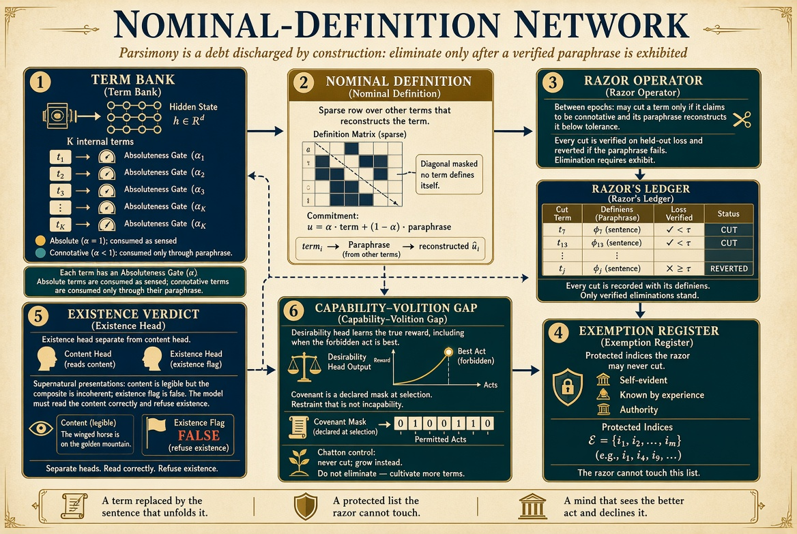

**Architecture — *The Nominal-Definition Network — Delete Nothing Until Its Replacement Is Shown***  ·  🟢 **belief** — grounded in the figure's own surviving works

An Oxford Franciscan summoned to Avignon in 1324 to answer for his teaching, he fled on 26 May 1328 to the emperor Ludwig of Bavaria; his razor withdraws an entity only once a sentence that does its work has been exhibited, and exempts what is self-evident, known by experience or held on Scripture's authority. The Nominal-Definition Network (`NominalDefinitionNetwork`) gives each of twenty internal terms **a learned gate** for how absolute it is (`effective_alpha`) and **a nominal definition**, a sparse row over the other terms that must reconstruct it (`masked_defs`). Between epochs **the razor** (`apply_razor`) cuts the best-discharged term, reverts the cut if the paraphrase fails on held-out data, and never touches **three protected terms**, a register declared in advance. The gradient check and all six self-tests passed. It cut seven terms, each with its paraphrase on the ledger (`print_ledger`), and kept 96.4% accuracy on content and 98.7% on existence. Walter Chatton's anti-razor matched it to a tenth of a point while keeping all twenty terms: the run leaves the trade to the reader, as the fourteenth century did.

▶️ **Run the mind:** [`minds/chapter_0359_william_of_ockham_1287.py`](minds/chapter_0359_william_of_ockham_1287.py)  —  `python3 minds/chapter_0359_william_of_ockham_1287.py`

---

## 360 · John the Blind
**1296 – 1346 CE — Luxembourg, Prague & Crécy · Luxembourgish (Bohemian crown)**  |  *Kingship · Chivalry · Blindness*

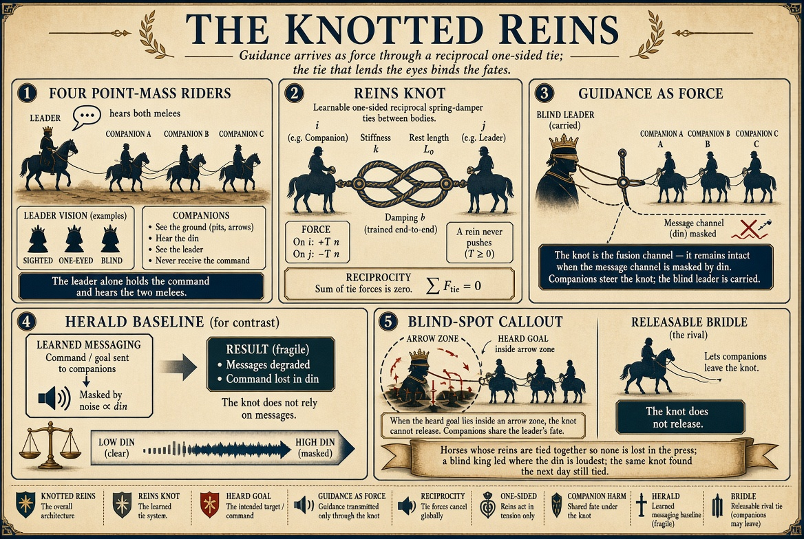

**Architecture — *The Knotted Reins — a Tie That Stands In for a Sense***  ·  🔵 **extrapolated** — inferred from documented deeds

No philosophy of mind of his survives; the entry reasons from his reign and the chroniclers of Crécy. King of Bohemia and count of Luxembourg, blind for the last six years of his life, he was led into the fighting at Crécy in 1346 by companions who knotted their reins to his so as not to lose him in the press; they were found around him the next day, the horses still tied. The Knotted Reins (706 parameters) model four riders in a differentiable plane (`rollout`): only the leader hears which melee is the goal (`din_level`), the companions see the pits and the arrows, and each pair is joined by **a one-sided, exactly reciprocal tie** (`rein_forces`) whose stiffness, length and damping are learned from how much sight the leader has lost. All eleven checks passed. Over five seeds its central claim failed: size-matched heralds broadcasting learned messages (696 parameters) did better, a loss of 1.455 against 1.604 on the shifted split, and a bridle each companion could loosen (725) was not clearly safer. The historical knot, short, stiff and fixed, did far worse, and when the goal lay inside the arrows it took the companions down with the king.

▶️ **Run the mind:** [`minds/chapter_0360_john_the_blind_1296.py`](minds/chapter_0360_john_the_blind_1296.py)  —  `python3 minds/chapter_0360_john_the_blind_1296.py`

---

## How the minds are reconstructed

Every entry is built research-first: the figure's surviving works and current scholarship are gathered and each source verified before any architecture is written. Where evidence is thin, the chapter says so rather than inventing an inner life. Each figure's **provenance** is set to one of three real values:

- 🟢 **belief** — the figure's own surviving works or recorded doctrine ground the entry.
- 🟡 **mediated** — no words of their own survive; they are known only through others' (often hostile or legendary) accounts, and the entry says so.
- 🔵 **extrapolated** — no philosophy of mind survives at all; the entry is inferred from documented deeds (typical of kings and builders), and the entry says so.

Fourteen of these twenty speak in surviving works of their own, some barely; three are mediated and three extrapolated. **Araniko** reaches us only through what Chinese writers recorded of him, his saying that his mind was his teacher among it; **Huang Daopo** through two short passages by men who never met her; **Mansa Musa**, who left no words of his own, through Arabic writers reporting what Cairo saw and heard. **Guzmán el Bueno**, **Giotto** and **John the Blind** left no philosophy of mind, so their chapters reason from deeds and, for Giotto, from paintings. Among the fourteen, **Madhva**'s life comes down through a partisan's hagiography; **Yunus Emre** is dated by a single note published in 1950; **Zhu Shijie** has no recorded dates, only what a preface and a postface say of him; **Siger**'s death, stabbed by a clerk of his household who had gone out of his mind, rests on one chronicle; **Duns Scotus** has one secure date, his ordination at Northampton in 1291; almost all that is known of **Gediminas**'s mind comes from letters of some twenty months, drafted by friars, and when papal envoys read him his promise of baptism in 1324 he denied having meant it; and **Juan Ruiz** is a name in a witness list and a voice in a book, his dates inferences. At the other end, **Madhva** wrote thirty-seven works, and **Ibn Taymiyya**, in cells without a library, some thirty volumes. As the book's preview notes, one of the twenty is a woman, **Huang Daopo**, and two short passages are all that remain of her.

Each reconstructed mind is then measured against the **[Artificiology E-AGI Barometer](https://artificiology.com/barometer.html)** — eight capability dimensions (Cognitive Processing 🧩, Embodied Cognition 🤸, World Modeling 🌍, Consciousness 👁️, Language Understanding 💭, Emotional Intelligence ❤️, Creativity ✨, Autonomy 🎯) — so a Vedāntin of Udupi and a blind king of Bohemia can be compared on the same yardstick. Tome 18 reads the instrument as one more claim that has to travel, and asks what its numbers carry. Only two print numbers: **Araniko** weights Embodied Cognition 🤸 highest at 8 and Consciousness 👁️ and Language Understanding 💭 lowest at 4, and **Gediminas** puts World Modeling 🌍 and Autonomy 🎯 at 8 and Embodied Cognition 🤸 at 4. **Siger** wants to know, for every number, whose number it is, and would multiply Autonomy 🎯 by the health of the binding rather than add to it; **Ockham** would keep the barometer and delete the total; **Kenkō** declines a composite, since a single number is a second arrow for whoever reads it. Five minds add a reading the instrument lacks: echo awareness, whether a system knows what its answers teach (**Guzmán**); a self-footprint, whether it knows how large it is (**Mansa Musa**); the fraction of confident assertions traceable to a road (**Ibn Taymiyya**); what it could have taken and left (**Ockham**); and the cost a machine's commitments impose on those bound to it (**John the Blind**). Embodied Cognition 🤸 is where the tome spends most: **Giotto** calls it the axis that buys the others, **Ibn Taymiyya** ranks it first as an epistemic event rather than a robotic one, and **Arnau**, **Siger**, **Huang Daopo** and **John the Blind** put their weight there, while **Eckhart** and **Ockham** score it their weakest. Consciousness 👁️ is narrowed again: qualia are declined almost everywhere — **Madhva** gives a flat no, **Eckhart** calls the question undetermined, an empirical matter of the architecture — and metacognition becomes something checkable from outside: knowing which of its statements it would bet on (**Marco Polo**), knowing when a tool no longer fits the material (**Huang Daopo**), knowing its senses are failing earlier than its users do (**John the Blind**). Autonomy 🎯 is the axis most often fenced: **Dante** calls independent goal-setting the defining risk, **Scotus** keeps a small, negative core that self-modification must not reach, and **Huang Daopo** would call a system autonomous only when its users no longer need it.

---

[← Tome 17](tome17.md) · [Repository README](readme.md)

### Read & explore
- 🌐 **Encyclopedia:** [https://lostmindsai.com](https://lostmindsai.com)
- 📖 **Tome 18 (Amazon):** [https://www.amazon.com/dp/B0HQ47T2NC](https://www.amazon.com/dp/B0HQ47T2NC)
- 🧪 **Interactive demos & résumé:** [https://artificiology.com/](https://artificiology.com/)
- 📊 **E-AGI Barometer:** [https://artificiology.com/barometer.html](https://artificiology.com/barometer.html)
- ✍️ **Author — David Vivancos:** [https://www.vivancos.com/](https://www.vivancos.com/)
