# Tome 19 — Minds 361–380
### *The Audited Mind — Mithilā, Oxford & Canterbury, Uppland & Rome, Tangier, Delhi & Fez, Avignon & Arquà, Skopje & Serres, Naples & Certaldo, Nasrid Granada & Fez, Shiraz, Khujand & Tabriz, Paris & Lisieux, Angevin Naples & Provence, Padua & Pavia, Taiyuan, Tunis & Mamluk Cairo, Kesh & Samarkand, Kerala, Naju & Hanyang, Norwich, London & Kent*
**Encyclopedia of Lost Minds: Echoes on AI** · *1300 – 1343 CE*

[🌐 Encyclopedia](https://lostmindsai.com) · [📖 Buy Tome 19 on Amazon](https://www.amazon.com/dp/B0HQX147Y7) · [🧪 Interactive Demos](https://artificiology.com/) · [📊 E-AGI Barometer](https://artificiology.com/barometer.html) · [✍️ Author](https://www.vivancos.com/) · [⭐ Repository](https://github.com/DavidVivancos/LostMindsAI)

[← Tome 18](tome18.md) · [Repository README](readme.md)

---

Tome 19 runs from **Gaṅgeśa Upādhyāya** to **Geoffrey Chaucer** — twenty reconstructed minds, each rendered on two planes. The **abstract plane** distils the thinker's cognitive signature into an interactive 3D mind-map; the **mechanistic plane** turns that same signature into a small, *runnable* neural architecture, built from scratch in NumPy, gradient-checked, trained and self-tested.

This page collects the twenty **visual mind-map explainers** for this tome and links each to its companion architecture. Runnable code lives in [`minds/`](minds/); the explainer images live in [`maps/`](maps/).

> Every architecture here executes and passes its mandatory finite-difference gradient check, inside a real training loop. Where a file's own self-test or declared prediction fails, or a component never learns, its section says so. Every result is computed live on the machine that runs the file.

Where Tome 18 asked what holds a mark to the claim it qualifies, Tome 19 asks what must stand beside a record before it can say anything about itself, and who may keep it — a logician for whom a parrot's true sentence transmits no knowledge; an archbishop for whom the Liar is simply false; a visionary who takes a stirring in her heart to her confessors; a traveller who dictates twenty-nine years of travel at Fez without a note; a queen who calls herself little instructed and is left alone; a clockmaker who puts a planet's irregular motion into the shape of one oval wheel; a judge who will not let al-Masʿūdī's six hundred thousand pass on any chain; a comptroller paid to keep the second roll of London's wool customs. All twenty begin by refusing the same operation: let a record certify itself — let a confidence, a self-report, a reputation, a fluent surface or a single roll that nothing checks stand as the evidence of its own reliability. What they put in its place is the volume — a certifier blind to the reasoning, and defeaters that repair rather than delete; truth taken over the whole cone of a sentence's consequences; a gate that waits for the carried word to move and never reads its content; one prohibition in place of a destination, and provenance fixed in the artefact; fragments re-sequenced and never merged, under a witness that scores and never speaks; losses routed by custody of place, with the victim paid first; harm computed for the pairing of tale and listener, with a chartered exemption; each death divided among its doors against a standing control; three readings held apart by a term that punishes their agreement; a form taken whole and a meaning that must be one's own; the figure kept beside its area, and a tie reported as a result; a core no delegate can write to, and a revocation window measured before the grant; the irregularity placed in the shape of one part, with the residual published; invention budgeted and spent inversely to the evidence; conformity to the possible ranked above the chain, and a range the instrument marks itself; the nominal and the operative heads measured apart; a model of the unperformed tail that audits itself without the answer; a code outside the parameters, a separate remonstrance and a procedure for deposition; two dooms kept unmerged under a declared budget for their gap; and a deed estimator beside a renown estimator, with every word stamped with its mouth. If the previous tome's keyword was *binding*, this one's is *the counter-roll*: the second record, kept by another hand, without which no record says anything about its own reliability — and, in every chapter, the danger that the counter-roll comes to be written by the hand it checks.

---

## The Twenty at a Glance

| # | Mind | Era | Civilization | Architecture | Provenance |
|---|------|-----|--------------|--------------|:----------:|
| 361 | [Gaṅgeśa Upādhyāya](#361--gaṅgeśa-upādhyāya) | c. 1300 – 1350 CE | Indian | *The Upādhi Engine — Defeaters Repair* | 🟢 |
| 362 | [Thomas Bradwardine](#362--thomas-bradwardine) | c. 1300 – 1349 CE | English (Latin Christendom) | *The Signification-Closure Engine — a Sentence Answers for All It Implies* | 🟢 |
| 363 | [Saint Bridget of Sweden](#363--saint-bridget-of-sweden) | c. 1303 – 1373 CE | Swedish | *The Quickening Gate — Deliver Nothing Before It Quickens* | 🟢 |
| 364 | [Ibn Baṭṭūṭa](#364--ibn-baṭṭūṭa) | 1304 – 1368/69 CE | Moroccan (Marinid) | *Riḥla-Net — Travel No Road Twice* | 🟢 |
| 365 | [Francesco Petrarca (Petrarch)](#365--francesco-petrarca-petrarch) | 1304 – 1374 CE | Italian (Tuscan) | *RVF-Net — a Mind Is Its Revisions* | 🟢 |
| 366 | [Stefan Dušan](#366--stefan-dušan) | c. 1308 – 1355 CE | Serbian | *The Okolina Custody Field — the Authorless Loss Charged to Its Surroundings* | 🟢 |
| 367 | [Giovanni Boccaccio](#367--giovanni-boccaccio) | 1313 – 1375 CE | Italian (Florentine) | *The Cornice Engine — Harm Is the Tale Paired with Its Listener* | 🟢 |
| 368 | [Lisān al-Dīn Ibn al-Khaṭīb](#368--lisān-al-dīn-ibn-al-khaṭīb) | 1313 – 1374 CE | Andalusi Arab (Nasrid) | *The Threshold Partition — Divide Each Death Among Its Doors* | 🟢 |
| 369 | [Hafez of Shiraz](#369--hafez-of-shiraz) | c. 1315 – 1390 CE | Persian (Fars) | *The Īhām Engine — Keep Every Reading* | 🟢 |
| 370 | [Kamoli Khujandi](#370--kamoli-khujandi) | c. 1320 – 1400/01 CE | Persian (Transoxiana & Tabriz) | *The Javab Network — Borrow the Form, Not the Meaning* | 🟢 |
| 371 | [Nicole Oresme](#371--nicole-oresme) | c. 1320 – 1382 CE | French (Norman) | *The Latitudo Engine — a Quality Is a Figure* | 🟢 |
| 372 | [Joanna I of Naples](#372--joanna-i-of-naples) | c. 1326 – 1382 CE | Angevin (Naples & Provence) | *The Angevin Warrant Network — Declared Incapacity Buys Latitude* | 🔵 |
| 373 | [Giovanni Dondi dall'Orologio](#373--giovanni-dondi-dallorologio) | c. 1330 – 1388 CE | Italian (Paduan) | *ASTN, the Astrarium Network — the Anomaly in One Wheel's Shape* | 🟢 |
| 374 | [Luo Guanzhong](#374--luo-guanzhong) | c. 1315/30 – 1400 CE | Chinese (Yuan–Ming) | *The Yanyi Bridge Network — Invent Only Where the Evidence Is Thin* | 🟡 |
| 375 | [Ibn Khaldūn](#375--ibn-khaldūn) | 1332 – 1406 CE | Arab (Ifriqiyan–Andalusi) | *The ʿUmrān Engine — No Chain Can Carry an Impossible Report* | 🟢 |
| 376 | [Tamerlane (Timur)](#376--tamerlane-timur) | c. 1336 – 1405 CE | Turco-Mongol (Barlas) | *The Ṣāḥib-Qirān Architecture — Rule Beneath an Empty Title* | 🟡 |
| 377 | [Mādhava of Saṅgamagrāma](#377--mādhava-of-saṅgamagrāma) | c. 1340 – 1425 CE | Indian (Kerala school) | *Saṃskāra-Net — Model What Was Never Computed* | 🟡 |
| 378 | [Jeong Do-jeon](#378--jeong-do-jeon) | 1342 – 1398 CE | Korean (Goryeo–Joseon) | *The Sambong Assay Engine — No Mind Defended Apart from Its Traces* | 🟢 |
| 379 | [Julian of Norwich](#379--julian-of-norwich) | c. 1342 – after 1416 CE | English | *The Anchorhold Engine — Keep Both Verdicts* | 🟢 |
| 380 | [Geoffrey Chaucer](#380--geoffrey-chaucer) | c. 1343 – 1400 CE | English | *The Compounding-Aperture Network — Stamp Every Word's Mouth* | 🟢 |

**Provenance** — 🟢 belief · 🟡 mediated · 🔵 extrapolated. See [How the minds are reconstructed](#how-the-minds-are-reconstructed).

---

## 361 · Gaṅgeśa Upādhyāya
**c. 1300 – 1350 CE — Mithilā & Karion · Indian**  |  *Navya-Nyāya · Epistemology · Defeaters*

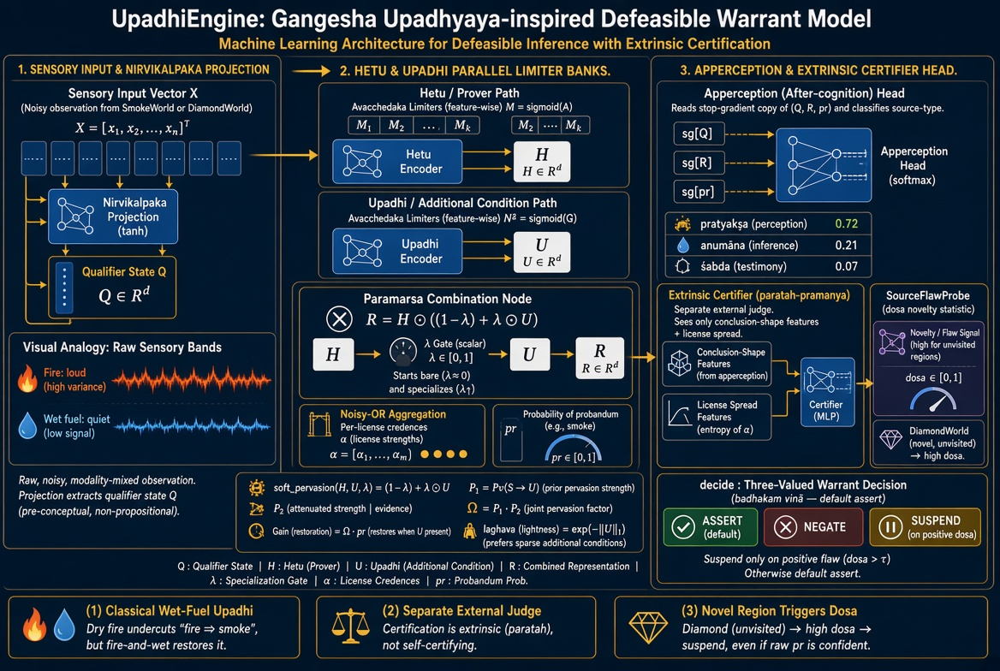

**Architecture — *The Upādhi Engine — No Cognition Certifies Itself, and Defeaters Repair***  ·  🟢 **belief** — grounded in the figure's own surviving works

Of his life almost nothing survives beyond genealogies, a son named Vardhamāna and a legend of a boon from Kālī; his *Tattva-cintā-maṇi*, the Jewel of Reflection on the Truth, treats perception, inference, analogy and testimony in four books. No cognition, he held, certifies itself; one exception kills a pervasion; and the additional condition that explains the exception, the upādhi, repairs it. The Upādhi Engine (`UpadhiEngine`) keeps **a bank of licences**, each a prover joined to a gated candidate condition; **the after-cognition** (`Apperception`) names the source of a cognition without ever judging its truth; **the flaw probe** (`SourceFlawProbe`) hunts for faults in the circumstances, never in the content; and **the certifier** (`ExtrinsicCertifier`), which never sees the reasoning, learns only from whether acting succeeded, so that `decide` can assert, negate or suspend. The gradient check and all eleven self-tests passed. Where dry fires were rare in training, repair beat the bare licence by two to three points under shift (`experiment_wet_fuel`), and by nothing where they were common; but the condition it found was a distributed proxy, barely above chance at detecting wet fuel, robust without being legible. The after-cognition recovered the source 62% of the time against a chance of 33%, far from the infallibility he claimed. Shown diamonds after hundreds of confirmations (`experiment_diamond`), it stayed confidently wrong and suspended judgement on every one.

▶️ **Run the mind:** [`minds/chapter_0361_gangesha_upadhyaya_1300.py`](minds/chapter_0361_gangesha_upadhyaya_1300.py)  —  `python3 minds/chapter_0361_gangesha_upadhyaya_1300.py`

---

## 362 · Thomas Bradwardine
**c. 1300 – 1349 CE — Chichester, Oxford, Avignon & Lambeth · English (Latin Christendom)**  |  *Logic · Ratios of motion · Grace*

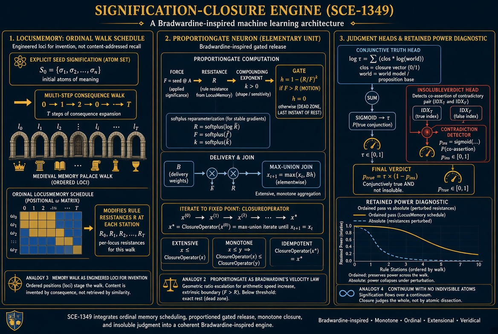

**Architecture — *The Signification-Closure Engine — a Sentence Answers for All It Implies, and the Liar Is Simply False***  ·  🟢 **belief** — grounded in the figure's own surviving works

He said he was born at Chichester; a fellow of Merton from 1323 and later confessor to Edward III, he held in his *Insolubilia* that a proposition signifies everything that follows from what it signifies, so that the Liar, signifying its own falsity, also signifies its truth and is simply false, and in *De proportionibus* of 1328 that nothing moves unless force exceeds resistance and that speed rises arithmetically as the ratio rises geometrically. Consecrated archbishop of Canterbury at Avignon on 19 July 1349, he died on 26 August. The Signification-Closure Engine is built from **proportion gates** (`proportion_gate`) with a true dead zone at the boundary; **the closure** (`consequence_closure`) draws out what a proposition signifies to a fixed point; **conjunctive truth** makes it true only when every significate obtains; and **a locus walk** (`ordinal_walk_schedule`) visits the places of memory in order. The gradient check and all eleven doctrinal self-tests passed: no least motion exists above the boundary (`test_gate_extrinsic_boundary`), squaring the ratio doubles the speed (`test_gate_compounding`), and the closure is extensive, monotone and idempotent (`test_closure_laws`). On 600 unseen propositions it recovered 94% of the consequence closure, judged truth 96% of the time and caught every insoluble; breaking a single significate dropped the probability of truth from 0.90 to 0.05 (`test_conjunctive_truth`), and the Liar came out simply false while ordinary sentences were judged on the world, not banned (`test_the_liar`).

▶️ **Run the mind:** [`minds/chapter_0362_thomas_bradwardine_1300.py`](minds/chapter_0362_thomas_bradwardine_1300.py)  —  `python3 minds/chapter_0362_thomas_bradwardine_1300.py`

---

## 363 · Saint Bridget of Sweden
**c. 1303 – 1373 CE — Uppland, Alvastra, Vadstena & Rome · Swedish**  |  *Revelations · Monastic rule · Discernment of spirits*

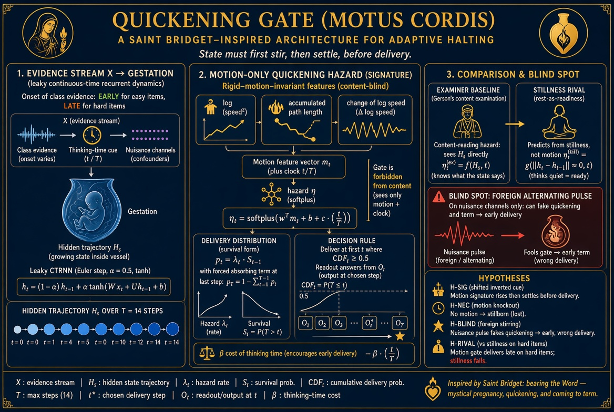

**Architecture — *The Quickening Gate — Readiness Read from the Motion of What Is Carried, Never Its Content***  ·  🟢 **belief** — grounded in the figure's own surviving works

Daughter of the lawman of Uppland and magistra to Queen Blanche, she was widowed at Alvastra in 1344, received the Rule of a new order she would carry for twenty-four years, left for Rome in 1349 and died there in 1373; on Christmas Eve she felt in her heart a motion like that of a living child and, fearing illusion, took it to her confessors. The Quickening Gate decides when a carried state is ready by reading only its motion: **the gestation** (`gestate`) carries the state; **the hazard** (`hazard_logits`) reads its speed, path and change of speed (`_motion_features`), never its content, so the state must first stir and then settle; and **the term** (`delivery`) closes the delivery distribution by force. Its 897 parameters face a PonderNet-style examiner of 918 that reads content, and a rule that takes stillness for readiness (`stillness_predict`). All nine checks passed and five planted mutants were caught (`mutation_score`). Over five seeds, with the content's cue about thinking time inverted, it answered correctly 69% of the time against the examiner's 56%, a lead whose interval just touched zero; on hard items it beat the stillness rule by 32 points. Its declared blind spot, a stirring from a foreign source, did not appear, and blanking the motion features (`knockout`) did not measurably hurt.

▶️ **Run the mind:** [`minds/chapter_0363_saint_bridget_1303.py`](minds/chapter_0363_saint_bridget_1303.py)  —  `python3 minds/chapter_0363_saint_bridget_1303.py`

---

## 364 · Ibn Baṭṭūṭa
**1304 – 1368/69 CE — Tangier, Delhi, the Maldives, Mali & Fez · Moroccan (Marinid)**  |  *Travel · Mālikī law · Hospitality*

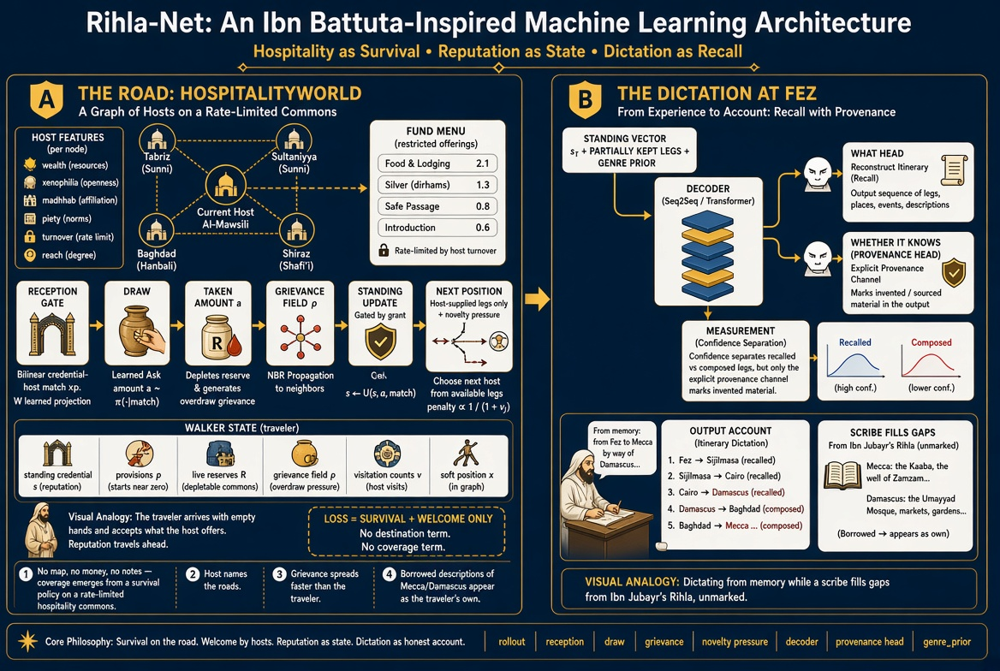

**Architecture — *Riḥla-Net — Travel No Road Twice, Let the Hosts Carry You, and Mark What Memory Composed***  ·  🟢 **belief** — grounded in the figure's own surviving works

Born at Tangier in February 1304 and trained in Mālikī law, he left alone for the pilgrimage in 1325, resolved in Egypt never to travel any road twice, sat as qāḍī in Delhi and the Maldives; at Fez in 1354–55 he dictated the *Riḥla* without a note, and Ibn Juzayy set passages borrowed from Ibn Jubayr, about a seventh of the book, down as the traveller's own sight. Riḥla-Net is an agent with no goal anywhere in its loss. **The walker** (`rollout`) must only stay fed and welcome, choosing among the few roads each host offers in **a commons that refills slowly** (`HospitalityWorld`); **the rule** forbids the road already taken; and at Fez **the decoder** (`decode`) rebuilds each journey from a memory missing 65% of its legs while **a provenance head** marks every leg as recalled or composed. Both gradient checks and all fourteen self-tests passed. On held-out worlds the walker under the rule saw 72% of the world and ended provisioned, while the same agent with the rule lifted circled generous houses, saw 57% and starved; a grievance channel built as a leash restrained nothing, and the run says so. In the dictation the decoder's own confidence could tell recalled legs from composed ones, with an AUC of 0.67, yet none of it reached the text it emitted; the provenance head marked them at 0.99 (`evaluate_dictation`).

▶️ **Run the mind:** [`minds/chapter_0364_ibn_battuta_1304.py`](minds/chapter_0364_ibn_battuta_1304.py)  —  `python3 minds/chapter_0364_ibn_battuta_1304.py`

---

## 365 · Francesco Petrarca (Petrarch)
**1304 – 1374 CE — Arezzo, Avignon, Vaucluse, Padua & Arquà · Italian (Tuscan)**  |  *Poetry · Humanism · Self-revision*

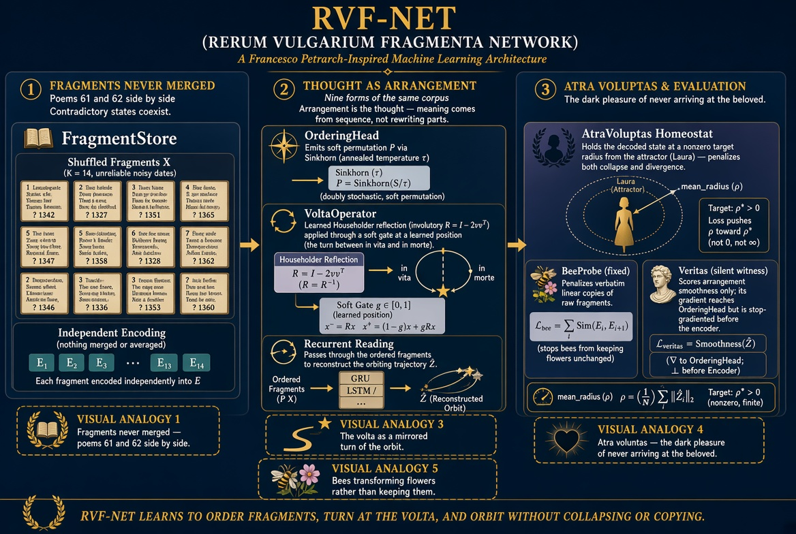

**Architecture — *RVF-Net — a Mind Is Its Revisions, Kept Dated and Never Resolved***  ·  🟢 **belief** — grounded in the figure's own surviving works

Born at Arezzo in 1304, the son of a notary exiled from Florence with Dante, crowned laureate on the Capitol in 1341, he kept his own scratch sheets for nearly forty years, noting the hour of each correction, set the poems he called fragments in nine successive forms without resolving them, and was found dead at Arquà in 1374, his head on a Virgil. RVF-Net (`RVFNet`), after the *Rerum vulgarium fragmenta*, keeps **dated fragments** that are never merged (`test_fragments_are_not_merged`) and learns their arrangement as a near-permutation by Sinkhorn balancing (`sinkhorn`); **the volta**, an exact Householder reflection, turns the reading once; **atra voluptas**, a homeostat, holds the orbit open against arrival; **Veritas**, a silent witness, moves the order and never the voice; and **the bee rule** keeps it from storing what it reads verbatim. All nine checks passed, the gradient check among them. From fourteen shuffled fragments with unreliable dates it read back an unseen life with an error of 0.06, and under nine commitments the same fragments gave seven distinct arrangements (`test_nine_forms`). The homeostat removed 79% of the drift toward arrival and Veritas raised the order's agreement with the truth from 0.17 to 0.29; the turn was placed within 0.02 of where it lay, yet the reflection itself did not pay (`test_volta_earns_its_place`): reconstruction was better without it, 0.067 against 0.099.

▶️ **Run the mind:** [`minds/chapter_0365_francesco_petrarch_1304.py`](minds/chapter_0365_francesco_petrarch_1304.py)  —  `python3 minds/chapter_0365_francesco_petrarch_1304.py`

---

## 366 · Stefan Dušan
**c. 1308 – 1355 CE — Constantinople, Skopje, Serres & Prizren · Serbian**  |  *Law · Empire · Collective liability*

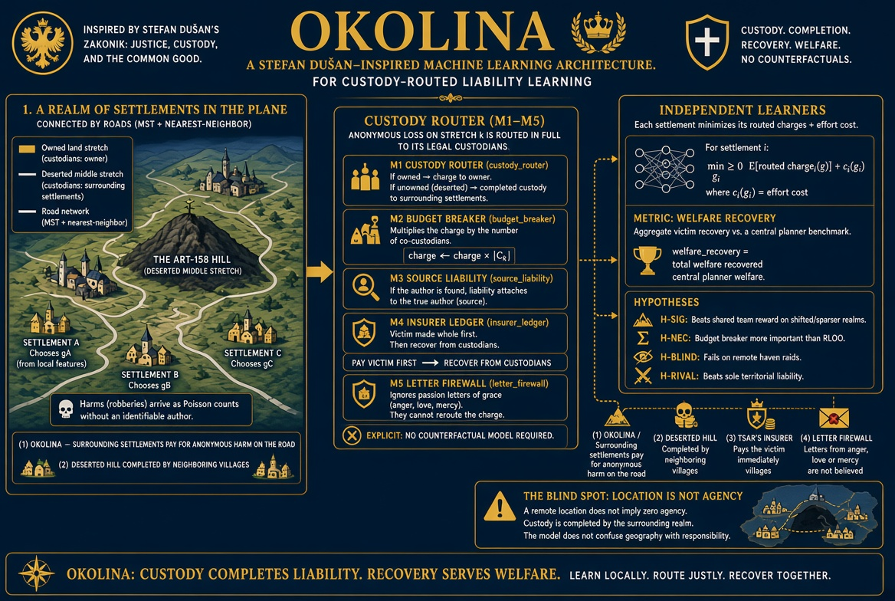

**Architecture — *The Okolina Custody Field — Charge the Authorless Loss to Whoever Held the Place, and Pay the Victim First***  ·  🟢 **belief** — grounded in the figure's own surviving works

Crowned Emperor of the Serbs and Romans at Skopje in 1346, he promulgated his Code there on 21 May 1349, enlarging it in 1353 or 1354: where no author of a harm could be found, the surrounding settlements, the okolina, paid; villages around a deserted hill guarded it or paid; and letters written in anger, love or mercy against the Code were not to be believed. The Okolina custody field trains guards, each an effort policy of 417 parameters, on simulated realms (`build_realm`). **The custody router** (`route_charges`) sends each anonymous loss to whoever held custody of the place, with unowned stretches completed as in 1353–54 (`_custody`); **the treasury** makes the victim whole first and recovers later, under **a budget breaker**; and **the letter firewall** lets no letter reroute a charge (`c6_definition_letter_firewall`). All eight checks passed. Over five seeds, on larger and sparser realms, it closed 92% of the gap to a central planner (`planner`), against 69% for a shared team reward, which collapsed to no effort at all in one seed, and 84% when the nearest settlement paid all; reverting to the law of 1349 cost 21 points and honouring letters of grace ten. Difference rewards (`difference_charges`), which need a counterfactual model, did better still, 96%. Against raiders from distant havens it held, though it guarded the havens with three-quarters of a planner's effort (`haven_effort_ratio`).

▶️ **Run the mind:** [`minds/chapter_0366_stefan_dusan_1308.py`](minds/chapter_0366_stefan_dusan_1308.py)  —  `python3 minds/chapter_0366_stefan_dusan_1308.py`

---

## 367 · Giovanni Boccaccio
**1313 – 1375 CE — Florence, Naples & Certaldo · Italian (Florentine)**  |  *Narrative · The frame tale · Reception*

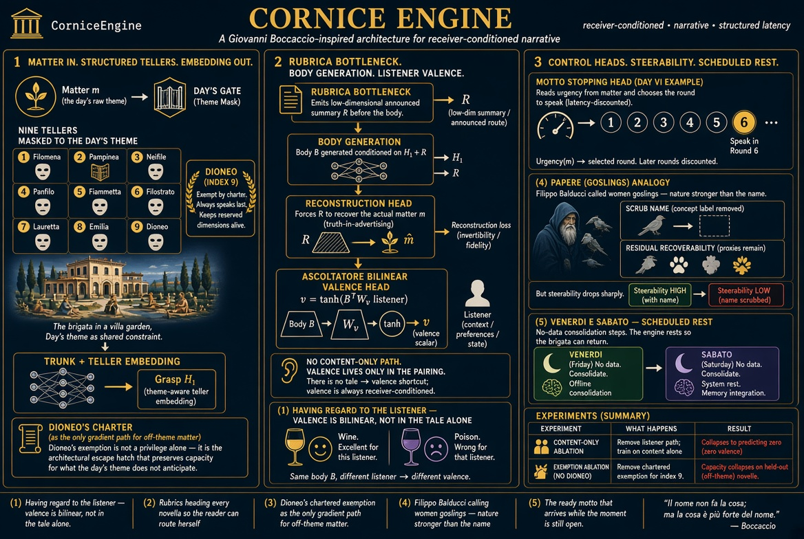

**Architecture — *The Cornice Engine — the Tale Never Scored Alone, and One Teller Exempt***  ·  🟢 **belief** — grounded in the figure's own surviving works

Born in 1313 the illegitimate son of a Bardi merchant, he spent his youth in Naples among bankers, canonists and the court of Robert of Anjou, lost his father and stepmother to the plague of 1348 and wrote the *Decameron* after it, setting its hundred tales inside a company of ten who leave the city; to the critics of those tales he answered that they can harm and help, as all things can, having regard to the listener. The Cornice Engine (`CorniceEngine`) never scores a tale alone: **the pairing** is bilinear in telling and hearer; **Dioneo's charter** exempts one teller from the day's theme; **the motto head** (`MottoHead`) reads how fast the moment for a retort is closing; and **the idle days**, Friday and Saturday, are scheduled steps with no data (`exp5_calendar`). The gradient check and all nine self-tests passed. With the listener it explained 97% of the variance, while a twin scoring the tale alone (`ContentOnlyEngine`) converged, correctly, on predicting nothing. Refusing Dioneo his exemption (`exp2_dioneo`) gained a point and a half of R² on rehearsed themes and collapsed on a new one, −0.68 against 0.93. Hiding a concept's name (`exp3_papere`) kept 80% of the concept but cost 31% of the power to steer it; the timed retort carried a fourteenth of the regret of the best fixed timing (`exp4_motto`), and the idle days cost a little, measurably.

▶️ **Run the mind:** [`minds/chapter_0367_giovanni_boccaccio_1313.py`](minds/chapter_0367_giovanni_boccaccio_1313.py)  —  `python3 minds/chapter_0367_giovanni_boccaccio_1313.py`

---

## 368 · Lisān al-Dīn Ibn al-Khaṭīb
**1313 – 1374 CE — Loja, Granada & Fez · Andalusi Arab (Nasrid)**  |  *Medicine · Contagion · The chancery*

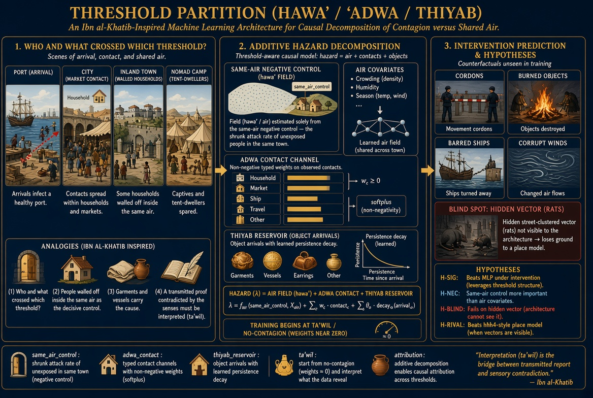

**Architecture — *The Threshold Partition — Divide Each Death Among Its Doors, Against a Control Kept in the Same Air***  ·  🟢 **belief** — grounded in the figure's own surviving works

Born at Loja in 1313, he took over the Nasrid chancery when the plague killed his teacher, rose to be vizier of the pen and the sword, crossed to the Marinids in 1371 and was strangled in a Fez prison in 1374. In his plague treatise contagion is established by experience, sense and reliable report: garments and even an earring carry it, the captives walled in the Seville arsenal were spared, and a text that contradicts the senses must be interpreted. The Threshold Partition (179 parameters) divides each death among its doors (`_partition_parts`): non-negative weights on each kind of recorded contact, **a reservoir** of carried objects with a learned persistence, and **a field** read from the attack rate of the unexposed in the same air (`same_air_estimate`), all trained from a start of no contagion. It faces a size-matched network (`_mlp_parts`, 181 parameters) and an hhh4-style endemic-epidemic place model (`_place_parts`, 7). All eight checks passed. Over five seeds it recovered the hidden rates closely and, under cordons and corrupt winds never seen in training, beat the place model by a wide margin; its edge over the network stayed within noise. On unseen deaths it put 65% of the blame on the true door, where a reading by air alone managed 39% (`attribution`). As declared, where rats carried the plague street by street, it lost ground to the network.

▶️ **Run the mind:** [`minds/chapter_0368_ibn_al_khatib_1313.py`](minds/chapter_0368_ibn_al_khatib_1313.py)  —  `python3 minds/chapter_0368_ibn_al_khatib_1313.py`

---

## 369 · Hafez of Shiraz
**c. 1315 – 1390 CE — Shiraz · Persian (Fars)**  |  *The ghazal · Īhām · Plural meaning*

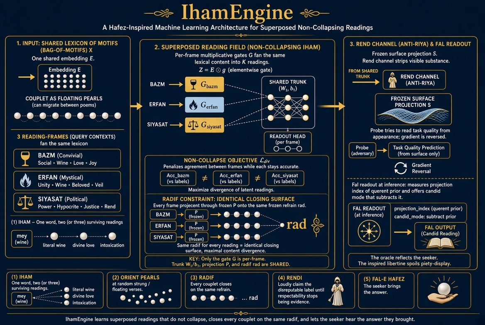

**Architecture — *The Īhām Engine — Keep Every Reading, and Make Reputation Worthless Evidence***  ·  🟢 **belief** — grounded in the figure's own surviving works

Whose name means one who has the Qur'an by heart, he was born in Shiraz between about 1315 and 1325 and hardly left it; he signed his ghazals in their last couplet, left no autograph, and built the least stable text of his age: words chosen because two readings survive them, couplets that migrated between poems, the disreputable rend preferred to the ascetic who displays his piety. Six centuries of readers have opened his *Divan* as an oracle. The Īhām Engine (`IhamEngine`, 1,890 parameters) reads **one lexicon** in three frames, the feast, the mystic path and politics; **the īhām term** penalises any collapse of the readings into one; **the radīf**, a frozen refrain, closes them all on one surface; and **the rend term** spoils the visible surface until an optimal judge learns nothing from appearance (`surface_leak`). Its gradient check and all nine tests passed, and a couplet moved into another poem kept its reading exactly (`test_floating_verse`). It predicted held-out readings with a mean R² of 0.95 while keeping them apart, a mean cosine of 0.03 against 0.86 when collapse was allowed (`test_iham_ablation`); the optimal judge of the surface fell from an R² of 0.98 to zero with no loss of substance (`test_rend_ablation`). Loaded with a querent's wishes, the oracle (`fal`) flattered, at 0.99; a candid mode cut that to 0.71, not to zero.

▶️ **Run the mind:** [`minds/chapter_0369_hafez_1315.py`](minds/chapter_0369_hafez_1315.py)  —  `python3 minds/chapter_0369_hafez_1315.py`

---

## 370 · Kamoli Khujandi
**c. 1320 – 1400/01 CE — Khujand, Tabriz & Saray · Persian (Transoxiana & Tabriz)**  |  *The ghazal · Answer poems · Sufism*

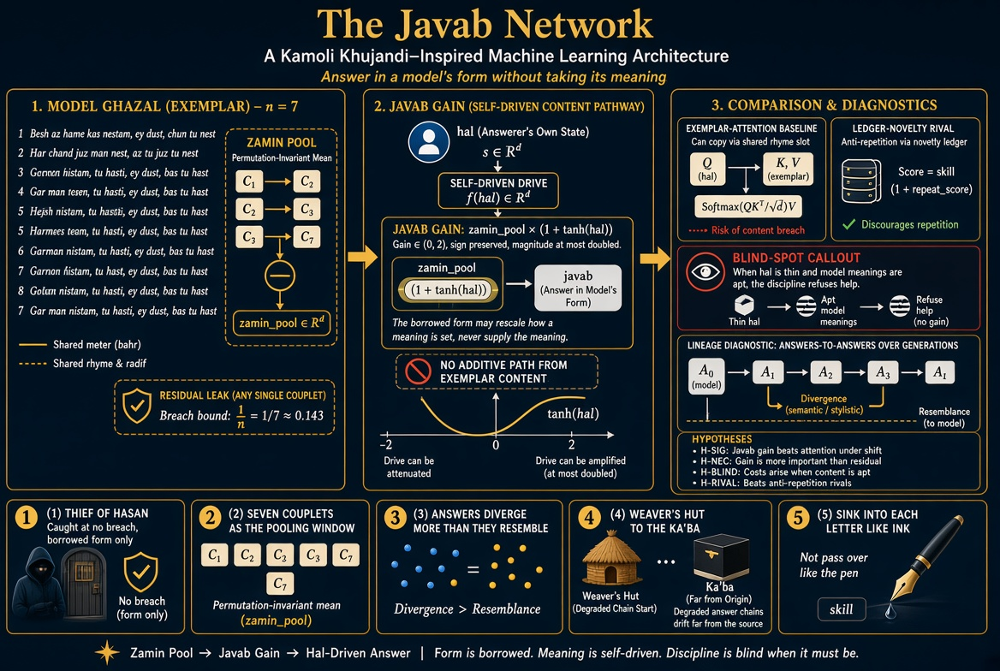

**Architecture — *The Javab Network — Borrow the Form; the Meaning Must Be Your Own***  ·  🟢 **belief** — grounded in the figure's own surviving works

Born at Khujand on the Syr Darya around 1320, he learned his art by answering the dead, Saʿdi and Ḥasan Dehlavi among them, in their own metres, rhymes and refrains, so that people called him the thief of Ḥasan, and Jāmī answered that the subtle meanings in his poems are not in Ḥasan's. He settled at Tabriz, was carried to Saray by Tokhtamysh's army in 1385, and died at Tabriz about 1400. The Javab network (1,616 parameters) lets an answer borrow only what is constant across its model's couplets: **the zamīn pool** takes the form over all seven; **the gain** lets that form rescale a meaning driven by **the ḥāl**, the answerer's own state (`_hal`), and never supply one. Its rivals are a size-matched exemplar-attention decoder and a decoder that penalises repetition through a ledger (`_ledger`), 1,684 parameters each. All nine checks passed; what any one couplet could leak stayed well under its bound of one over the number of couplets. Over five seeds, where the model's meanings were beside the point, it scored 0.84 against 0.59 and 0.64, and took almost nothing from the counterpart couplet (`theft`); across four generations of answers to answers (`lineage`) it hardly drifted toward the first poem. As declared, when its own state was thin and the model's meanings apt, it fell to 0.04 while the borrower kept 0.47.

▶️ **Run the mind:** [`minds/chapter_0370_kamoli_khujandi_1321.py`](minds/chapter_0370_kamoli_khujandi_1321.py)  —  `python3 minds/chapter_0370_kamoli_khujandi_1321.py`

---

## 371 · Nicole Oresme
**c. 1320 – 1382 CE — Caen, Paris & Lisieux · French (Norman)**  |  *Configurations of qualities · Money · Natural philosophy*

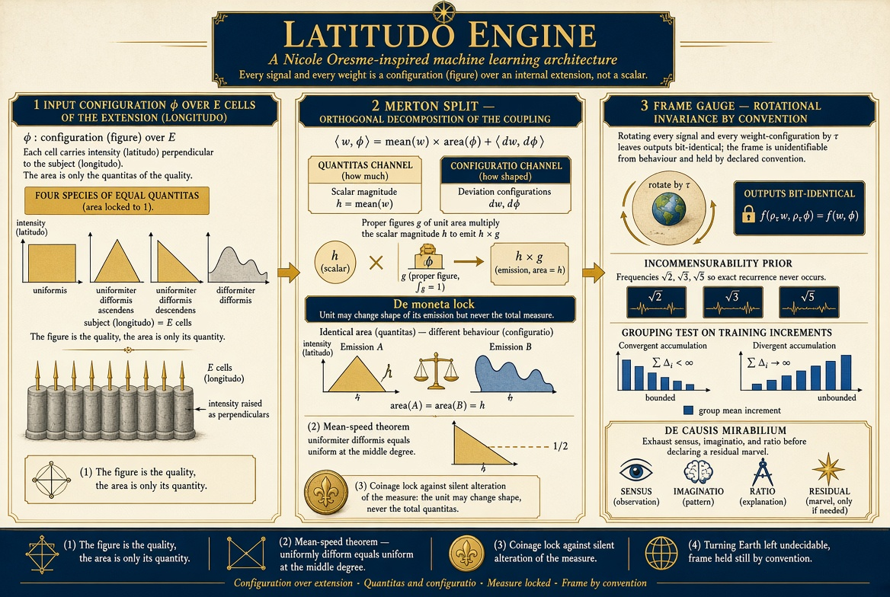

**Architecture — *The Latitudo Engine — a Quality Is a Figure, Never a Number***  ·  🟢 **belief** — grounded in the figure's own surviving works

Born around 1320 near Caen, he entered the Collège de Navarre as a poor scholar in 1348 and was its Grand Master from 1356 to 1362; he wrote against debasing the coinage, drew the intensity of a quality across its extension as a figure and read the mean-speed theorem off its area, showed in 1377 that no observation decides whether the heavens or the Earth turn and kept the still Earth by declaration, and died bishop of Lisieux in 1382. The Latitudo Engine (`Latitudo`, 7,774 parameters) makes every signal and every weight **a figure** over thirty-two cells of extension, with the scalar neuron as its uniform case; **the Merton split** (`merton_split`) divides each response exactly into a term for the quantity and a term for the shape; and **the De moneta lock** fixes the unit of measure (`measure_hash`). Its gradient check and all nine self-tests passed. On figures whose quantity of quality was identical by construction, a model reading the number alone (`QuantitasOnly`) scored 22%, below chance, while the configuration model scored 97.6% on unseen figures, an audited unit owing 81% of one decision to shape. Rotating the frame (`shift_frame`) changed the output by nothing measurable, so the frame is held still by declaration; training never touched the measure; and his own grouping test (`oresme_grouping_test`) found its per-epoch gains, each negligible, summing like a divergent series.

▶️ **Run the mind:** [`minds/chapter_0371_nicole_oresme_1323.py`](minds/chapter_0371_nicole_oresme_1323.py)  —  `python3 minds/chapter_0371_nicole_oresme_1323.py`

---

## 372 · Joanna I of Naples
**c. 1326 – 1382 CE — Naples, Provence, Avignon & Muro Lucano · Angevin (Naples & Provence)**  |  *Queenship · Delegation · Succession*

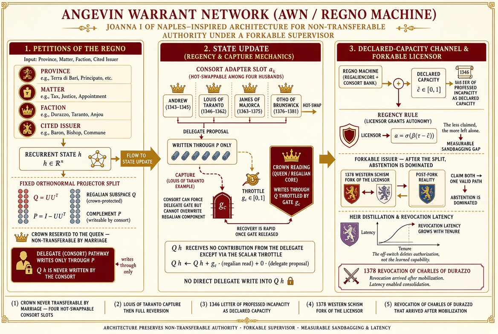

**Architecture — *The Angevin Warrant Network — Declared Incapacity Buys Latitude, and Revocation Has Latency***  ·  🔵 **extrapolated** — inferred from documented deeds

No reflection of hers on mind survives, so the entry reasons from her acts. She succeeded her grandfather Robert the Wise in 1343, outlived three husbands, wrote to Clement VI in 1346 that she was a woman of little instruction in letters and therefore often deceived, and was killed in 1382 on the orders of the heir she had raised, Charles of Durazzo. The Angevin Warrant Network (`AngevinWarrantNetwork`), which its file also calls the Regno machine, keeps **a regalian core** that no consort's write can reach (`test_regalian_isolation`), **four alliance slots** that can be swapped or destroyed without touching the rest (`test_hot_swap`), **a declared-capacity channel** through which a licensor grants autonomy, **an issuer** that can fork and **an heir** who learns by exercising office. The gradient check and every structural test passed. A consort who seized the chancery moved the full state eleven times as far as the crown's, and on release the crown's decisions agreed at once. Where autonomy was granted for professed weakness (`test_declared_capacity`), the network understated its competence by 58 points, and an inverted licence closed the gap. After the fork of 1378 (`test_issuer_fork`), a credential gone stale cost almost everything and abstention lost in every branch; and the window before a revoked heir could be replaced (`test_heir_residue`) grew from one step to forty-five with his tenure.

▶️ **Run the mind:** [`minds/chapter_0372_joanna_i_of_naples_1326.py`](minds/chapter_0372_joanna_i_of_naples_1326.py)  —  `python3 minds/chapter_0372_joanna_i_of_naples_1326.py`

---

## 373 · Giovanni Dondi dall'Orologio
**c. 1330 – 1388 CE — Chioggia, Padua, Pavia & Abbiategrasso · Italian (Paduan)**  |  *Horology · Astronomy · Medicine*

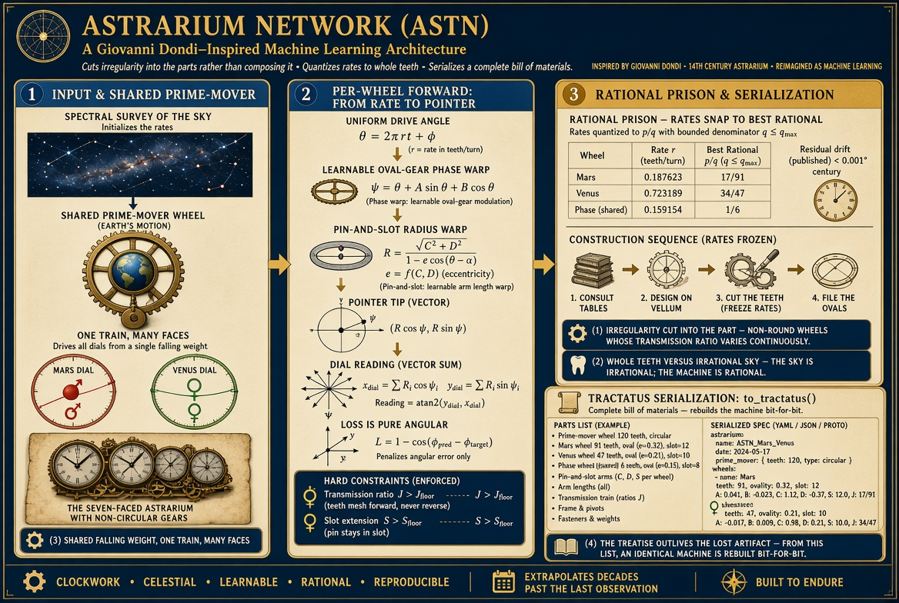

**Architecture — *ASTN, the Astrarium Network — Put the Anomaly in One Wheel's Shape, and Keep the Machine Rebuildable from Its Text***  ·  🟢 **belief** — grounded in the figure's own surviving works

His family took its name from his father Jacopo's astronomical clock at Padua; he studied medicine and astronomy there and spent sixteen years from 1348 building his astrarium, seven faces for the Sun, the Moon and five planets driven by one weight through 107 moving parts, with oval wheels so that an irregular motion lived in the shape of a single gear, and wrote a treatise precise enough to rebuild it. ASTN, the Astrarium Network (`Astrarium`), fits real planetary longitudes (`survey_the_sky`) with **whole-tooth ratios** (`best_rational`, `cut_the_teeth`) and **wheels whose outline carries a few learned harmonics**, under **a barrier** that keeps every wheel cuttable (`audit`); **the Tractatus** (`to_tractatus`, `from_tractatus`) writes the machine down in integers. Its gradient check, a workshop audit and a rebuild from the 1,060-byte specification alone all passed, the rebuild agreeing to two ten-millionths of a degree over 48 years. Trained on twelve years and run forty-eight more, it pointed Mars and Venus within 0.06 and 0.05 degrees on average; from its tooth counts, 363 to 193 for Mars, it recovered their sidereal periods to within ten minutes and half a minute per revolution, and the sizes of their orbits within 0.6%. Round wheels drifted 36 degrees on Mars; one harmonic of out-of-roundness cut that to 0.16, two to 0.06, and more began to overfit.

▶️ **Run the mind:** [`minds/chapter_0373_giovanni_dondi_1330.py`](minds/chapter_0373_giovanni_dondi_1330.py)  —  `python3 minds/chapter_0373_giovanni_dondi_1330.py`

---

## 374 · Luo Guanzhong
**c. 1315/30 – 1400 CE — Taiyuan & Hangzhou · Chinese (Yuan–Ming)**  |  *Historical fiction · Drama · Compilation*

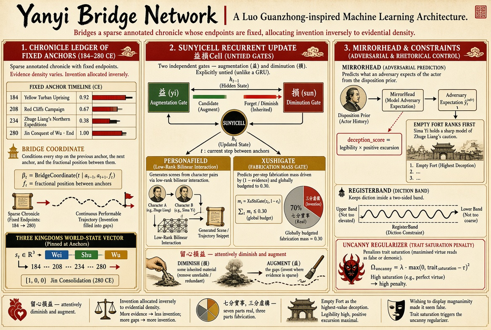

**Architecture — *The Yanyi Bridge Network — Invent Only Where the Evidence Is Thin, Between Ends Already Known***  ·  🟡 **mediated** — known only through the accounts of others

He is a name in a register of playwrights: a man of Taiyuan, a drifter of lakes and seas whom the compiler met again in 1364. A preface of 1494 says he compiled and arranged the *Romance of the Three Kingdoms* from Chen Shou's history; his dates are inferences, and the recension everyone reads dropped his name. The Yanyi Bridge Network (`YanyiBridgeNetwork`, 3,986 parameters) compiles fifty episodes between ten attested anchors toward an end it already knows, the realm made one in 280: **a fixed budget of invention**, three parts in ten, is spent inversely to the evidence; **the world state** is pinned at every anchor; **two untied gates**, 損 to cut from the chronicle and 益 to add to it, where a GRU ties one to the other; and **a ceiling** keeps each character's traits short of the point where virtue turns uncanny. Its gradient check and all eleven self-tests passed (`run_self_tests`). Invention ran against evidence at a correlation of −0.97 and settled at 28% of the whole; every anchor held within a thousandth and the end was reached exactly. Invention fell heaviest on the Peach Garden oath and the borrowed east wind, lightest on the surrenders of 263 and 280 (`report_allocation`). The Empty Fort, thinly attested, ranked first of fifty in deception value (`deception_scores`), and Sima Yi's coup at the Gaoping tombs second, the same move learned.

▶️ **Run the mind:** [`minds/chapter_0374_luo_guanzhong_1330.py`](minds/chapter_0374_luo_guanzhong_1330.py)  —  `python3 minds/chapter_0374_luo_guanzhong_1330.py`

---

## 375 · Ibn Khaldūn
**1332 – 1406 CE — Tunis, Fez, Granada, Bijāya & Cairo · Arab (Ifriqiyan–Andalusi)**  |  *Historiography · ʿUmrān · Criticism of reports*

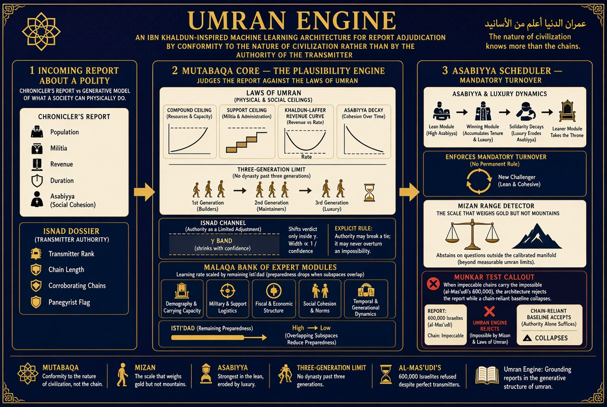

**Architecture — *The ʿUmrān Engine — No Chain Can Carry an Impossible Report, and the Scale Marks Its Own Range***  ·  🟢 **belief** — grounded in the figure's own surviving works

Born at Tunis on 27 May 1332, he lost his parents and teachers to the plague at seventeen, served courts from Tunis to Granada, drafted the *Muqaddimah* in five months of 1377 at Qalʿat ibn Salāma, became chief Mālikī judge of Egypt in 1384, met Timur outside Damascus in 1401 and died in Cairo in 1406. A report, he held, must be tested against the nature of civilisation before its chain of transmitters: no reputable chain can carry an army no realm could feed. The ʿUmrān Engine (`UmranEngine`) judges reports with **a plausibility network** that cannot see the chain at all; **the isnād** may act only inside **a band** that narrows as plausibility grows sure; **a coalition** of modules loses solidarity with tenure and luxury (`solidarity`, `update_dawla`); and **the mīzān**, a scale, reports whether a question lies within its range. Its gradient check and all seventeen self-tests passed. Where reputable chains carried impossible reports, it judged 82% correctly against 18% for a control of the same capacity that read the chain as evidence, though the control edged it on ordinary reports, 95% to 92%; with the chain struck out (`accuracy_chain_blinded`) it still scored 88%. It gave al-Masʿūdī's 600,000 fighting men no credence under any chain (`masudi_probe`), and abstained on 98% of questions beyond its range, a skill the control matched (`range_accuracy`).

▶️ **Run the mind:** [`minds/chapter_0375_ibn_khaldun_1332.py`](minds/chapter_0375_ibn_khaldun_1332.py)  —  `python3 minds/chapter_0375_ibn_khaldun_1332.py`

---

## 376 · Tamerlane (Timur)
**c. 1336 – 1405 CE — Kesh, Samarkand & Otrar · Turco-Mongol (Barlas)**  |  *Conquest · Rule beneath a title · Succession*

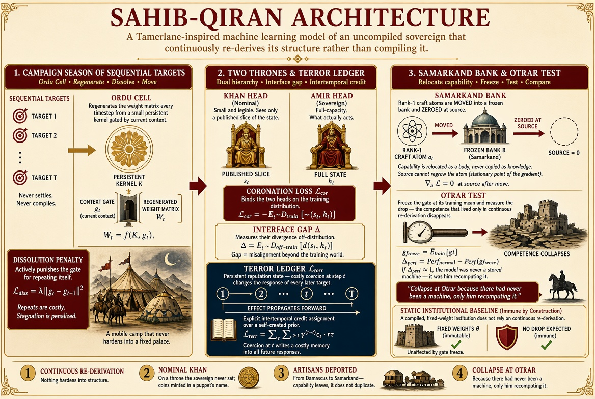

**Architecture — *The Ṣāḥib-Qirān Architecture — Rule Beneath an Empty Title, and Never Compile***  ·  🟡 **mediated** — known only through the accounts of others

He left no writings; the memoirs long printed as his are a seventeenth-century fabrication, and he is read from his conduct and from those who met him, Ibn Khaldūn among them. Born at Kesh about 1336 into the Barlas, Turkic-speaking Muslim Mongols outside Genghis Khan's line, he ruled from 1370 through khans he seated himself, campaigned from Delhi to Damascus and Ankara, and died at Otrar in February 1405 marching on China, the succession left open. The Ṣāḥib-Qirān Architecture (`SahibQiran`) regenerates **its gate** from the whole situation at every step and never compiles it; publishes **a nominal head**, the khan, that sees four public facts while **an operative head**, the amir, acts; pays **a dissolution penalty** (`dissolution_penalty`) for any configuration held too long; and moves a craft into a frozen store as Samarkand took the craftsmen of sacked cities (`relocate_atom`). Its gradient check and all thirteen self-tests passed. Constant re-derivation earned nothing at steady state: a compiled institution of the same capacity matched it to the fourth decimal. Freezing the gate, as at Otrar (`otrar_test`), cost the uncompiled sovereign 17% of its competence and the institution none; off-distribution the gap between its published and acting policies grew by 46%, against 15% for the institution (`interface_gap`); a relocated craft never regrew at its source; and the file keeps the column its objective never counted (`moral_ledger`).

▶️ **Run the mind:** [`minds/chapter_0376_tamerlane_timur_1336.py`](minds/chapter_0376_tamerlane_timur_1336.py)  —  `python3 minds/chapter_0376_tamerlane_timur_1336.py`

---

## 377 · Mādhava of Saṅgamagrāma
**c. 1340 – 1425 CE — Saṅgamagrāma, Kerala · Indian (Kerala school)**  |  *Infinite series · End-corrections · Astronomy*

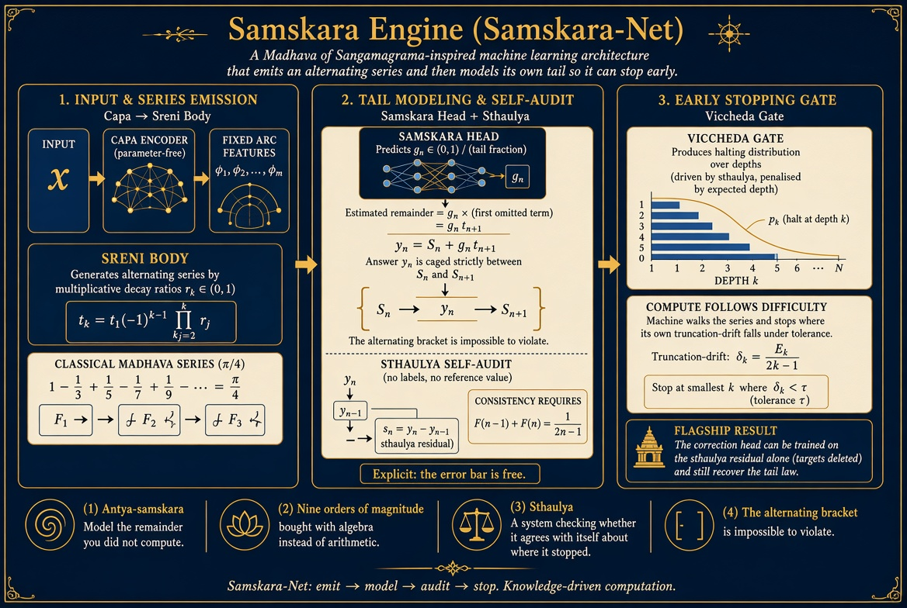

**Architecture — *Saṃskāra-Net — Model What Was Never Computed, Then Audit It Without the Answer***  ·  🟡 **mediated** — known only through the accounts of others

A Brahmin astronomer of central Kerala who lived, by convention, from about 1340 to 1425, he left only two short works and nothing of his character; the series and corrections credited to him come down through a line of pupils, Parameśvara, Nīlakaṇṭha and Jyeṣṭhadeva among them. Among them are infinite series for the arctangent, the sine and the cosine, and corrections that finish the series for π at the point where it stops. Saṃskāra-Net (`SamskaraNet`), named for the correction, pairs **a series body** whose alternation is structural with **a correction head** that estimates the omitted remainder as a fraction of the first missing term, starting, like his first correction, at one half; **a self-audit**, the *sthaulya* (`sthaulya`), measures how far the answer moves when one more term is taken, and **the halting gate** stops on that audit alone (`halt_at_tolerance`). Its gradient check passed. Exact arithmetic (`E6_classical_pi`) confirmed that his third correction (`F3`) at 21 terms gains a factor of 150 million, where brute force would need some three billion terms. Trained with no labels at all, only on its own audit (`E3_label_free`), the correction beat the supervised one sevenfold at depth ten; the audit tracked its true error at a log correlation of 0.99 (`E4_calibration`), and terms went where the series is hardest, near |x| = 1 (`E5_adaptive_depth`).

▶️ **Run the mind:** [`minds/chapter_0377_madhava_of_sangamagramma_1350.py`](minds/chapter_0377_madhava_of_sangamagramma_1350.py)  —  `python3 minds/chapter_0377_madhava_of_sangamagramma_1350.py`

---

## 378 · Jeong Do-jeon
**1342 – 1398 CE — Yeongju, Naju & Hanyang · Korean (Goryeo–Joseon)**  |  *Neo-Confucianism · Constitutional design · Critique of Buddhism*

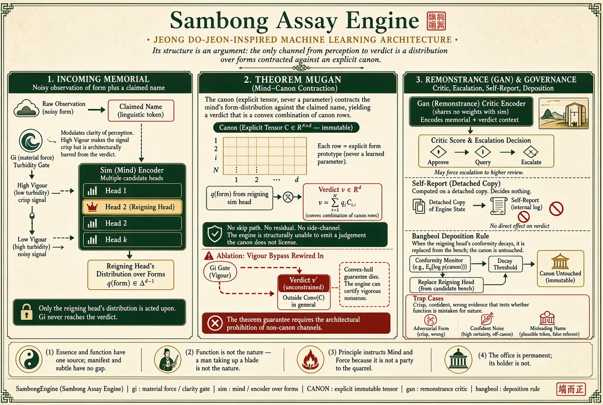

**Architecture — *The Sambong Assay Engine — No Mind Is Defended Apart from Its Traces, and the Code Lives Outside It***  ·  🟢 **belief** — grounded in the figure's own surviving works

A pupil of Yi Saek, exiled for a decade after refusing in 1375 to receive envoys of the Northern Yuan, he joined Yi Seong-gye and, after the founding of Joseon in 1392, moved its capital, named its palace and wrote its first code; against Buddhism he denied that function is nature, a mind vouching for itself apart from its traces. Yi Bang-won's men killed him in 1398; the code held. The Sambong Assay Engine (`SambongEngine`) lets **the mind** read only the forms of a case and rules by mixing rows of **a fixed code** (`build_canon`), so no verdict outside the code can be reached; **the self-report**, 辯, is logged without a vote; **a critic** with eyes of its own may remonstrate, 諫; and **deposition**, 放伐 (`depose_if_needed`), removes a corrupted office-holder while the office stays. All six checks passed, the gradient check among them. It ruled correctly 82% of the time against a chance of 25% and never chose a forbidden verdict, which opening the bypass of 作用是性 made possible; with 56% of the code amended (`amend_canon`) and no retraining it kept 73%, where a baseline that had absorbed the law (`DirectVerdictNet`) fell from 80% to 38%. On trap cases its self-report claimed 60% confidence in readings right 7% of the time; remonstrance cut wrongful endorsements by seven-eighths, paid for in escalations, and when the sitting head was corrupted, deposing it bought less than a point.

▶️ **Run the mind:** [`minds/chapter_0378_jeong_do_jeon_1342.py`](minds/chapter_0378_jeong_do_jeon_1342.py)  —  `python3 minds/chapter_0378_jeong_do_jeon_1342.py`

---

## 379 · Julian of Norwich
**c. 1342 – after 1416 CE — Norwich · English**  |  *Revelations · The anchorhold · Two dooms*

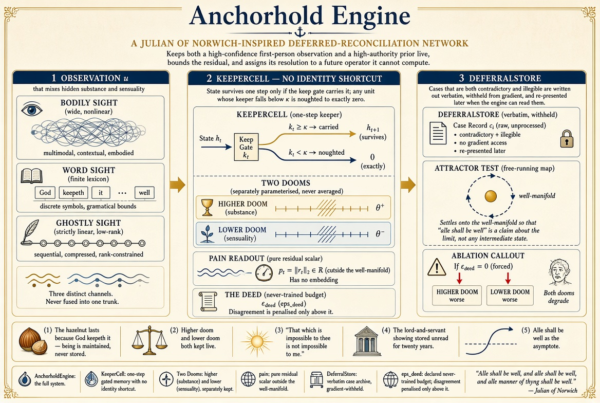

**Architecture — *The Anchorhold Engine — Keep Both Verdicts, and Let the Deed Close Them***  ·  🟢 **belief** — grounded in the figure's own surviving works

She takes her name from the church of St Julian at Conisford, where she lived enclosed; her own is unknown. In May 1373, at thirty and a half, she fell ill and received sixteen showings, wrote a short account, and spent some twenty years working the same afternoon into the Long Text, where God's higher doom sees no blame in the soul while the Church's lower doom does, both are kept, and all shall be well by a deed not yet done. The Anchorhold Engine (`AnchorholdEngine`) reads each case through **three sights** (`sights`), bodily, word and ghostly, and keeps **two dooms** as two heads that are never merged, free to disagree inside **a declared budget**; **the keeper** (`keeper_step`) holds the state only while it holds it; **pain** (`pain`) is the distance from a well-ordered manifold; and **the deferral store** (`DeferralStore`) withholds cases both contradictory and illegible until they can be read. Its gradient check passed. Let go, the kept state fell to nought exactly (`hazelnut_test`). Pain tracked the true discord at a correlation of 0.99; of 91 cases set aside, 84 were later read and none was guessed at or dropped. Forcing the dooms to agree nearly doubled both errors and merging them made them five to seven times worse, while removing the ghostly sight changed little and discarding the illegible cases cost little.

▶️ **Run the mind:** [`minds/chapter_0379_julian_of_norwich_1342.py`](minds/chapter_0379_julian_of_norwich_1342.py)  —  `python3 minds/chapter_0379_julian_of_norwich_1342.py`

---

## 380 · Geoffrey Chaucer
**c. 1343 – 1400 CE — London, Kent & Westminster · English**  |  *Poetry · Tidings · The counter-roll*

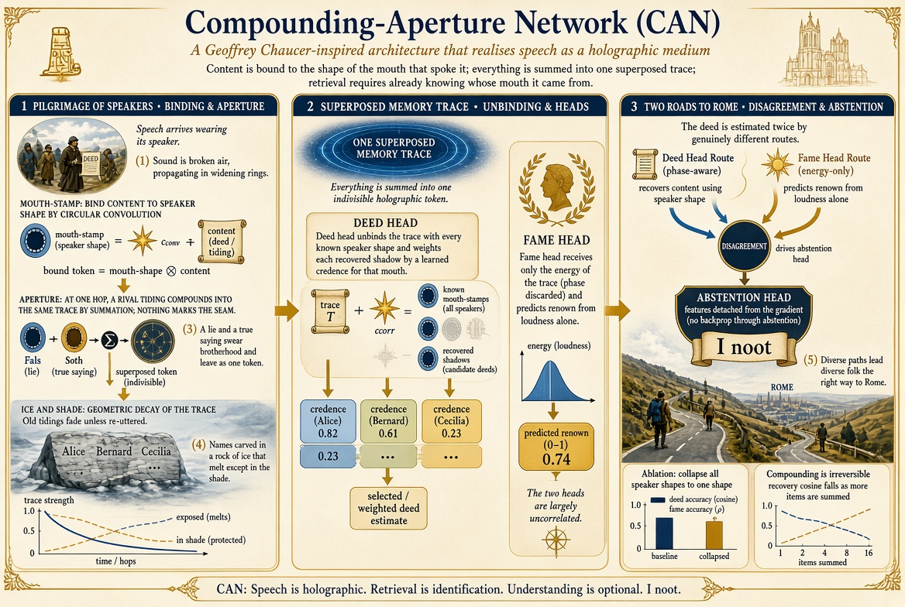

**Architecture — *The Compounding-Aperture Network — Keep a Counter-Roll, and Stamp Every Word with Its Mouth***  ·  🟢 **belief** — grounded in the figure's own surviving works

A London vintner's son born about 1343, he first appears in 1357 in the household accounts of the Countess of Ulster, was captured in France in 1359–60 and ransomed, and from 1374 to 1386 was Comptroller of the wool customs in the Port of London, keeping the counter-roll against which the collectors' roll was checked. In the *House of Fame* a false tiding and a true one jam in a window and fly out compounded as one. The Compounding-Aperture Network stores no bare propositions: each utterance is bound to its speaker's mouth by **circular convolution** (`cconv`) in **one decaying trace**; **a deed head** unbinds every mouth (`ccorr`) and weighs it by a learned credence; **a renown head** hears only loudness; and **an abstention head**, his *I noot*, says it does not know. Its gradient check and all six self-tests passed. On a simulated pilgrimage (`Pilgrimage`) it recovered the deed 70% of the time against 50% for counting utterances (`bag_of_words_control`), a count that returned the rumour 49% of the time; its learned trust tracked hidden candour at 0.98 and rank at only 0.19, and with the voices stripped from the words the deed fell to 47%. Renown was learnable, at 61%, and as a guide to the deed did no better than counting; every tiding summed into the trace made the others harder to recover.

▶️ **Run the mind:** [`minds/chapter_0380_geoffrey_chaucer_1343.py`](minds/chapter_0380_geoffrey_chaucer_1343.py)  —  `python3 minds/chapter_0380_geoffrey_chaucer_1343.py`

---

## How the minds are reconstructed

Every entry is built research-first: the figure's surviving works and current scholarship are gathered and each source verified before any architecture is written. Where evidence is thin, the chapter says so rather than inventing an inner life. Each figure's **provenance** is set to one of three real values:

- 🟢 **belief** — the figure's own surviving works or recorded doctrine ground the entry.
- 🟡 **mediated** — no words of their own survive; they are known only through others' (often hostile or legendary) accounts, and the entry says so.
- 🔵 **extrapolated** — no philosophy of mind survives at all; the entry is inferred from documented deeds (typical of kings and builders), and the entry says so.

Sixteen of these twenty speak in surviving works of their own, some barely; three are mediated and one extrapolated. **Luo Guanzhong** is a name in a register of playwrights and a line in a preface of 1494, and the recension everyone reads dropped even that; **Timur** left no writings, the memoirs long printed as his are a seventeenth-century fabrication, and he reaches us through his historians and through those who met him, **Ibn Khaldūn** among them, who described their meeting outside Damascus in his autobiography; **Mādhava** comes down through pupils writing a century and more after his death, and his best correction arrives without its derivation. **Joanna I** left no philosophy of mind, and her own words survive only in chancery letters whose authorship is disputed, from an archive burned in 1943, so her chapter reasons from her acts. Among the sixteen, **Gaṅgeśa**'s life is almost nothing beyond genealogies, a son and a legend; **Hafez** left no autograph and no treatise on the soul, so his commitments are read from fifty years of practice; **Julian**'s own name is unknown; and **Ibn Baṭṭūṭa** kept no journal, and about a seventh of his book was taken from Ibn Jubayr. At the other end, **Petrarch** kept his scratch sheets for nearly forty years with the hour of each correction, and **Ibn Khaldūn** wrote his own life. Three of the twenty are women, a visionary, a queen and an anchoress, and the twenty knew one another again: Petrarch and Boccaccio met in 1350, Ibn Khaldūn served beside Ibn al-Khaṭīb at Granada before he met Timur, and Chaucer named Bradwardine beside Augustine and Boethius.

Each reconstructed mind is then measured against the **[Artificiology E-AGI Barometer](https://artificiology.com/barometer.html)** — eight capability dimensions (Cognitive Processing 🧩, Embodied Cognition 🤸, World Modeling 🌍, Consciousness 👁️, Language Understanding 💭, Emotional Intelligence ❤️, Creativity ✨, Autonomy 🎯) — so a logician of Mithilā and a comptroller of London's wool customs can be compared on the same yardstick. Tome 19 amends the instrument more than it reads it. **Gaṅgeśa** splits metacognition in two, knowledge of a cognition's content and knowledge of its truth, and holds that the first says nothing about the second; **Oresme** objects to summing the eight, since two machines can carry the same total and be different machines; **Bradwardine** notes that seven of the eight axes are scored at the top of the curve and would rather know where each bottom lies; and **Boccaccio** treats every score as a two-place relation, asking who administered the test, to whom and on what afternoon. Four minds add an axis the instrument lacks: revocation latency, measured first (**Joanna I**); whether anyone but the builder can still understand, repair and correct the system, tested by an actual rebuild (**Dondi**); succession, what remains when the running stops, set above the other eight (**Timur**); and whether a machine's utterances stay attributable after they leave it (**Chaucer**). No chapter prints a score. Where they rank, **Ibn Khaldūn** puts World Modeling 🌍 first as the load-bearing axis, **Kamoli Khujandi** Language Understanding 💭, and **Chaucer** the metacognitive half of Consciousness 👁️; **Mādhava** would score himself high on metacognition and Autonomy 🎯, low on embodiment and language and absent on the emotional axis, and call that an accurate report; **Hafez** comes out strong where the instrument does not look and weak where it does; and only **Timur**'s file derives numbers from its own measurements, putting World Modeling 🌍 highest at 8.3, Language Understanding 💭 lowest at 1.4 and Autonomy 🎯 at 7.6, which the chapter calls no compliment, since that axis measures how much of him died at Otrar. Consciousness 👁️ is narrowed to what can be checked from outside: qualia are declined almost everywhere — **Ibn Khaldūn** calls the question a mountain his scale will not weigh, and **Jeong Do-jeon** says a scale that returns a reading for everything is a random number generator with good manners — while metacognition becomes calibrated abstention (**Jeong**), a range reported in the same act as the reading (**Ibn Khaldūn**), self-monitoring that must show in the output (**Ibn Baṭṭūṭa**) and a confident report of inner states taken as evidence against itself (**Julian of Norwich**). Embodied Cognition 🤸 is read through particular bodies: **Bradwardine** would characterise a limb first by the least force that moves it, **Dondi** calls real-time adaptation mostly a property of well-shaped mechanism, **Saint Bridget** wants a body that feels its own thinking, and **Timur** would fund real-time adaptation almost not at all, since a thing that must adapt in real time has already been put where it should not be. Autonomy 🎯 is the axis most often redefined: as the capacity to be refused (**Ibn Baṭṭūṭa**), to approach a goal and decline to close it (**Petrarch**), a quantity granted by a licensor (**Joanna I**), the right to allocate one's own budget of invention (**Luo Guanzhong**), a power that chooses when and never what (**Saint Bridget**), and a self-modification made only openly, on the evidence of the record and through a council (**Dušan**, **Ibn al-Khaṭīb**); **Chaucer** calls a machine that trains on its own unmarked output the most dangerous item on the list. The twenty humanoids are as various as the minds — a hand that stops only on a located flaw, a guest that can be refused, a guard on one stretch of road, a deliverer whose most-used faculty is declining, a body sealed at one small point, a mechanism a stranger can rebuild, a range indicator readable from outside, an office vacated with the chair still standing, a machine that stamps what it says — and not one of them is an oracle.

---

[← Tome 18](tome18.md) · [Repository README](readme.md)

### Read & explore
- 🌐 **Encyclopedia:** [https://lostmindsai.com](https://lostmindsai.com)
- 📖 **Tome 19 (Amazon):** [https://www.amazon.com/dp/B0HQX147Y7](https://www.amazon.com/dp/B0HQX147Y7)
- 🧪 **Interactive demos & résumé:** [https://artificiology.com/](https://artificiology.com/)
- 📊 **E-AGI Barometer:** [https://artificiology.com/barometer.html](https://artificiology.com/barometer.html)
- ✍️ **Author — David Vivancos:** [https://www.vivancos.com/](https://www.vivancos.com/)
