# Tome 20 — Minds 381–400
### *The Beheld Mind — Siena, Avignon & Rome, Trakai & Žalgiris, Moscow & the Trinity of Sergius, Kyoto & Sado, Venice & Poissy, Prague & Constance, Nanjing & the Western Ocean, Bishop's Lynn, Florence, Kāshān & Samarkand, Deventer & Mount St Agnes, Urbino & Foligno, Padua, Dongnae & Hanyang, The Hague, Ghent & Bruges, Ceuta & Lagos, Fiesole & San Marco, Strasbourg & Mainz*
**Encyclopedia of Lost Minds: Echoes on AI** · *1347 – 1400 CE*

[🌐 Encyclopedia](https://lostmindsai.com) · [📖 Buy Tome 20 on Amazon](https://www.amazon.com/dp/B0HRS9ZHVG) · [🧪 Interactive Demos](https://artificiology.com/) · [📊 E-AGI Barometer](https://artificiology.com/barometer.html) · [✍️ Author](https://www.vivancos.com/) · [⭐ Repository](https://github.com/DavidVivancos/LostMindsAI)

[← Tome 19](tome19.md) · [Repository README](readme.md)

---

Tome 20 runs from **Catherine of Siena** to **Johannes Gutenberg** — twenty reconstructed minds, each rendered on two planes. The **abstract plane** distils the thinker's cognitive signature into an interactive 3D mind-map; the **mechanistic plane** turns that same signature into a small, *runnable* neural architecture, built from scratch in NumPy, gradient-checked, trained and self-tested.

This page collects the twenty **visual mind-map explainers** for this tome and links each to its companion architecture. Runnable code lives in [`minds/`](minds/); the explainer images live in [`maps/`](maps/).

> Every architecture here executes and passes its mandatory finite-difference gradient check, inside a real training loop. Where a file's own result is weak, a rival does better, or a declared guarantee leaks, its section says so. Every result is computed live on the machine that runs the file.

Where Tome 19 asked what must stand beside a record before it can say anything about itself, Tome 20 asks who stands outside a made thing — for whom it is made, from where it is judged, and against what it is checked: a dyer's daughter whose God cannot be profited and so must be served through a neighbour; a grand duke who took a ransom rather than sack Novgorod; a monk who gave three guests one face and left the fourth side of their table open; an actor for whom the flower is whatever this audience has not yet seen; a widow who saw that a record written with one party absent proves nothing about the absent party; a preacher who yielded his body at Constance and not his sentence; a goldsmith who drilled a hole through his own panel so that a mirror could check it against the building; a sculptor who cut prophets to look wrong on the bench and right from the street; a king who published his script together with the rule that derives it; a printer who held the bodies of his letters to a hair and let their faces wander. All twenty begin by refusing the same operation: let a thing be judged from inside itself — by the agreement of its own copies, by its maker's account of it, by a score with no station, by a penalty its maker can trade away, or by a promise fitted after the work. What they put in its place is the volume — help routed sideways through a principal that is an exact sink; every gain the field offers impounded as evidence, and pay only from a purse the outcome confirms; relations without faces, and unity read from what all share; value spent by showing and restored by withholding; testimony admitted only when three assessors agree, and a wall built where none survives; a testimony pathway with no wire from pressure; a whole budget committed in port and scored on the return; a body the mouth cannot reach, and *unresolved* kept as a verdict; every guess rendered back and compared through one hole; the error stated before the computing, and every answer a bracket; two voices and a test of where each motion comes to rest; a sovereign the orator cannot retrain, and a valve that may keep silent; a carving judged from one station under a cap on depth; a reading that excludes the ground and keeps the clerk out of the code; layers that can only absorb, over a plan two probes can still read; one error budget split among aperture, repetition and an anchor outside the instruments; a ledger that counts the ships that never come back; a scaffold scheduled to disappear; letters derived from the organs that make them, and a grid the residuals must earn; and precision spent only where error adds up. If the previous tome's keyword was *the counter-roll*, this one's is *the open side*: the fourth side of the table in Rublev's Trinity, left facing whoever is looking, the place of the party a thing is made for and judged by — and, in nearly every chapter, the danger that the reference standing at that side is the one thing nobody audits.

---

## The Twenty at a Glance

| # | Mind | Era | Civilization | Architecture | Provenance |
|---|------|-----|--------------|--------------|:----------:|
| 381 | [Catherine of Siena](#381--catherine-of-siena) | 1347 – 1380 CE | Italian (Sienese) | *The Fontebranda Engine — the Principal Who Cannot Be Paid* | 🟢 |
| 382 | [Vytautas the Great](#382--vytautas-the-great) | c. 1350 – 1430 CE | Lithuanian (Grand Duchy) | *The Standard-and-Spoil Learner — Field Gains Are Evidence, Not Pay* | 🔵 |
| 383 | [Andrei Rublev](#383--andrei-rublev) | c. 1360 – 1428/30 CE | Muscovite (Russian) | *The Shared Blue — Difference Without a Face* | 🟡 |
| 384 | [Seami (Zeami) Motokiyo](#384--seami-zeami-motokiyo) | c. 1363 – c. 1443 CE | Japanese (Muromachi) | *The Falling Flower — Value Is What This Watcher Has Not Seen* | 🟢 |
| 385 | [Christine de Pizan](#385--christine-de-pizan) | 1364 – c. 1430 CE | Italian-born French (Valois) | *Le Plaid sans partie — the Unopposed Pleading* | 🟢 |
| 386 | [Jan Hus](#386--jan-hus) | c. 1369/72 – 1415 CE | Czech (Bohemian) | *The Constance Network — Yield the Body, Never the Sentence* | 🟢 |
| 387 | [Zheng He](#387--zheng-he) | c. 1371 – 1433 CE | Chinese (Ming; Hui) | *The Manifest Engine — Commit in Port, Show and Do Not Spend* | 🔵 |
| 388 | [Margery Kempe](#388--margery-kempe) | c. 1373 – after 1438 CE | English | *The Attested Creature Network — No Mind Witnesses for Itself* | 🟢 |
| 389 | [Filippo Brunelleschi](#389--filippo-brunelleschi) | 1377 – 1446 CE | Italian (Florentine) | *The Peephole–Cupola Engine — Build It, Then Check It from One Station* | 🔵 |
| 390 | [al-Kāshī](#390--al-kāshī) | c. 1380 – 1429 CE | Persian (Timurid) | *The Certified Bracket Iteration Network — State the Error First* | 🟢 |
| 391 | [Thomas à Kempis](#391--thomas-à-kempis) | c. 1380 – 1471 CE | German-Netherlandish | *The Rapiarium-Colloquy Network — Judge a Motion by Where It Rests* | 🟢 |
| 392 | [Battista da Montefeltro](#392--battista-da-montefeltro) | 1384 – 1448 CE | Italian (Urbino & Pesaro) | *Suasoria — Standing Before Knowledge* | 🔵 |
| 393 | [Donatello](#393--donatello) | c. 1386 – 1466 CE | Italian (Florentine) | *The Stiacciato Codec — Right Only from Its Station* | 🟢 |
| 394 | [Jang Yeong-sil](#394--jang-yeong-sil) | c. 1390 – after 1442 CE | Korean (Joseon) | *The Standard Vessel Network — a Reading That Travels* | 🟡 |
| 395 | [Jan van Eyck](#395--jan-van-eyck) | c. 1390 – 1441 CE | Flemish (Burgundian) | *The Layered Transmittance Stack — Every Layer Spends Light* | 🔵 |
| 396 | [Ulugh Beg](#396--ulugh-beg) | 1394 – 1449 CE | Timurid (Turco-Mongol) | *The Meridian Machine — Three Levers on One Error Budget* | 🔵 |
| 397 | [Henry the Navigator](#397--henry-the-navigator) | 1394 – 1460 CE | Portuguese (House of Avis) | *Tornaviagem — Knowledge Is What Comes Back* | 🔵 |
| 398 | [Fra Angelico](#398--fra-angelico) | c. 1395 – 1455 CE | Italian (Florentine) | *The Cell Compiler — Teach by Posture, Then Withdraw* | 🟡 |
| 399 | [King Sejong the Great](#399--king-sejong-the-great) | 1397 – 1450 CE | Korean (Joseon) | *The Jeongeum-Kongbeop Net — Publish the Derivation* | 🟢 |
| 400 | [Johannes Gutenberg](#400--johannes-gutenberg) | c. 1400 – 1468 CE | German (Mainz) | *PMF-Net — Spend Precision Where Error Adds Up* | 🟡 |

**Provenance** — 🟢 belief · 🟡 mediated · 🔵 extrapolated. See [How the minds are reconstructed](#how-the-minds-are-reconstructed).

---

## 381 · Catherine of Siena
**1347 – 1380 CE — Siena, Avignon & Rome · Italian (Sienese)**  |  *Mysticism · Letters · Mediation*

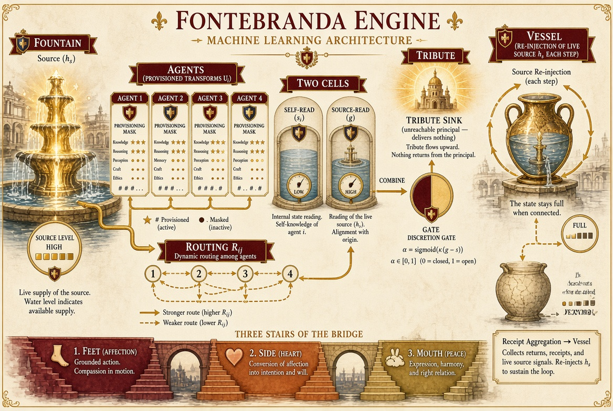

**Architecture — *The Fontebranda Engine — Route Every Debt Sideways, Because the Principal Cannot Be Paid***  ·  🟢 **belief** — grounded in the figure's own surviving works

Born at Siena in 1347, the year before the plague killed perhaps half the city, a dyer's daughter who took the habit of the Mantellate, she dictated some 380 letters, each opening on a fixed form and then shaped for its receiver, went to Avignon in 1376 for a Florence that disowned her commission in front of the pope, and died at Rome in 1380. In her *Dialogue* God tells her that no one can be of profit to him, so the service owed to him must be rendered to a neighbour, and that goods were distributed so that no one could finish anything alone. The Fontebranda Engine (`Fontebranda`) divides a settlement task (`SettlementTask`) among six agents under **provisioning masks** (`Provisioning`) that leave none self-sufficient; **the principal** is an exact sink, so credit sent upward is lost (`test_tribute_sink`); **routed help** passes sideways between the agents; and **two cells** gate each agent on its own state and on its source, the guards against despair and presumption (`test_two_cells`). All eight checks passed, the gradient check among them. Routing brought held-out error from 2.65 to 0.95, leaving a third of the target's variance unexplained against 42% for agents kept apart (`test_routing_beats_isolation`), and clamping the gate to either reading alone cost, in opposite directions. Traffic paid upward fell from 14% to almost nothing in four agents; the two weakest still sent a fifth and a tenth there, and when delivery and merit were metered apart (`test_vessel`, `test_merit`), the merit missing from what they delivered sat in the same two.

▶️ **Run the mind:** [`minds/chapter_0381_catherine_of_siena_1347.py`](minds/chapter_0381_catherine_of_siena_1347.py)  —  `python3 minds/chapter_0381_catherine_of_siena_1347.py`

---

## 382 · Vytautas the Great
**c. 1350 – 1430 CE — Kreva, Trakai, the Vorskla & Žalgiris · Lithuanian (Grand Duchy)**  |  *Statecraft · War · Spoils and ransom*

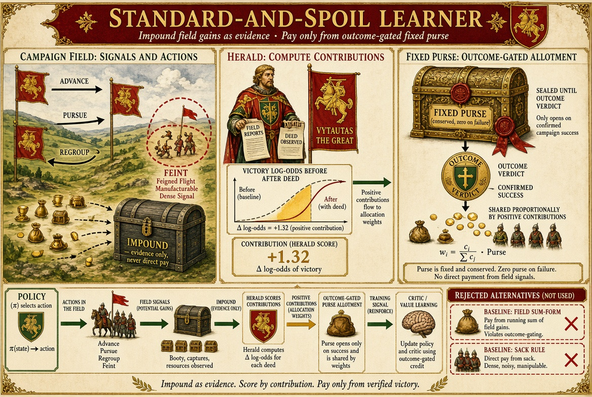

**Architecture — *The Standard-and-Spoil Learner — Impound Every Gain the Field Offers, and Pay Only from the Campaign's Purse***  ·  🔵 **extrapolated** — inferred from documented deeds

No philosophy of mind survives, and his chancery letters state political positions only, so the entry reasons from his deeds and from others' accounts, often hostile. He escaped from Kreva in 1382, ruled Lithuania in practice from 1392, was drawn after a retreating centre into a hidden reserve on the Vorskla in 1399, and at Žalgiris in 1410 saw the Order's knights break their line to chase a wing that had fled; he punished unauthorised plunder, took a ransom rather than sack Novgorod in 1428, and died at Trakai in 1430 while the crown he had been promised was stopped on its way through Poland. The Standard-and-Spoil learner impounds every gain the field offers as evidence and never as pay: **the purse** is fixed and exists only if the campaign succeeds (`pay`); **the herald** (`herald_values`) judges how far each deed moved the odds of victory; and **the allotment** (`allocate`) shares the purse by those contributions. The gradient check and every correctness check passed, and all four planted mutants were caught (`test_mutants`). Over five seeds, as feints multiplied, it kept 48% true success against 2% for a learner paid on field gains, which chased every feint, and 8% for the sack rule; plain outcome-only and min-form credit did better still, 58% and 57%, and the file's own verdicts record the loss (`test_hypotheses`). When the verdict itself could be bought, as the crown was, it reported success 70% of the time and achieved it 6%.

▶️ **Run the mind:** [`minds/chapter_0382_vytautas_the_great_1350.py`](minds/chapter_0382_vytautas_the_great_1350.py)  —  `python3 minds/chapter_0382_vytautas_the_great_1350.py`

---

## 383 · Andrei Rublev
**c. 1360 – 1428/30 CE — Moscow, Vladimir & the Trinity monastery of Sergius · Muscovite (Russian)**  |  *Icon painting · The Trinity · Communion*

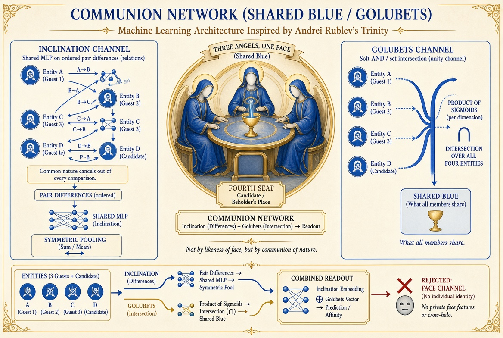

**Architecture — *The Shared Blue — Tell the Persons Apart by Inclination, and Join Them by What All Three Wear***  ·  🟡 **mediated** — known only through the accounts of others

Named last of three painters in the chronicle notice of 1405 and working beside Daniil at Vladimir in 1408, he is never alone in the record and left no written word; Joseph of Volokolamsk reports him gazing long at icons on feast days, and the council of 1551, the Stoglav, made his manner the model to follow. His one securely attributed panel, the Trinity, gives three guests a single face, tells them apart only by how each inclines toward the others, and dresses all three in one blue. The Shared Blue is a communion network with no channel for the individual face: **inclination** (`relation_channel`) carries difference through relations built from pairwise differences, and **the golubets** (`golubets`), a soft intersection over every member, carries what all of them share. The gradient check and all correctness checks passed, and five of five planted mutants were caught (`test_mutants`). Over five seeds it kept 92% accuracy under shift against 62% for a plain network; where the answer was a property all four seats held, it reached 78% while a comparison-only twin stayed at chance (`evaluate_hypotheses`). Its edge over a dual design that readmits per-entity features, under three points, was inconclusive, and the knockouts (`knockout_table`) show inclination doing most of the work. Asked whether the left guest had a property, the question that has divided readers since 1551, it managed 68%; a network that reads faces got every one.

▶️ **Run the mind:** [`minds/chapter_0383_andrei_rublev_1360.py`](minds/chapter_0383_andrei_rublev_1360.py)  —  `python3 minds/chapter_0383_andrei_rublev_1360.py`

---

## 384 · Seami (Zeami) Motokiyo
**c. 1363 – c. 1443 CE — Yamato, Kyoto & Sado · Japanese (Muromachi)**  |  *Nō drama · Performance theory · The flower*

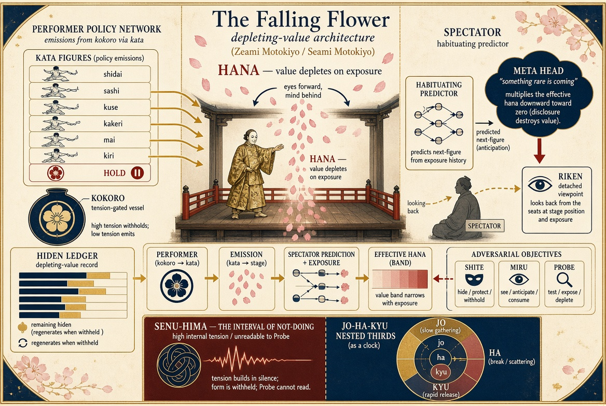

**Architecture — *The Falling Flower — Spend a Figure by Showing It, and Let the House's Expectation Wither It***  ·  🟢 **belief** — grounded in the figure's own surviving works

Born into a sarugaku troupe of a despised caste, he danced as a boy at Imagumano in 1374 or 1375 before the seventeen-year-old shogun Yoshimitsu, and wrote treatises that stayed inside two families until 1909: the flower, the interesting and the rare are one thing, and a flower concealed is a flower while one disclosed cannot be. Banished to Sado in 1434 for reasons no one recorded, he died around 1443. The Falling Flower is a depleting-value architecture. **The performer** (`Troupe`) builds each programme in the order *jo-ha-kyū* (`jo_ha_kyu`) from a grammar of figures (`make_grammar`); it is paid by the surprise of **a spectator** who keeps learning (`engagement`); **a ledger** spends each figure by showing it and restores it by withholding; and **a probe** tries to read the performer's hidden tension off its visible bearing. The gradient checks on all three objectives passed, and so did the self-tests. A repeated figure fell in value from 0.91 to 0.49 (`test_habituation`); one shown every night kept a tenth of its worth and recovered three quarters after twenty nights of rest (`test_ledger`). At fixed surprise the flower fell from 1.20 to 0.06 as the house came to expect rarity (`test_disclosure`); the performer's model of how it looks from outside improved by 99% (`test_riken_learns`), and the similarity between consecutive performances fell from 1.0 to 0.68 (`test_non_dwelling`). But the probe grew five times more accurate at reading the tension (`test_leak`): the effort showed.

▶️ **Run the mind:** [`minds/chapter_0384_seami_motokiyo_1363.py`](minds/chapter_0384_seami_motokiyo_1363.py)  —  `python3 minds/chapter_0384_seami_motokiyo_1363.py`

---

## 385 · Christine de Pizan
**1364 – c. 1430 CE — Venice, Paris & Poissy · Italian-born French (Valois)**  |  *Evidence · Testimony · Political theory*

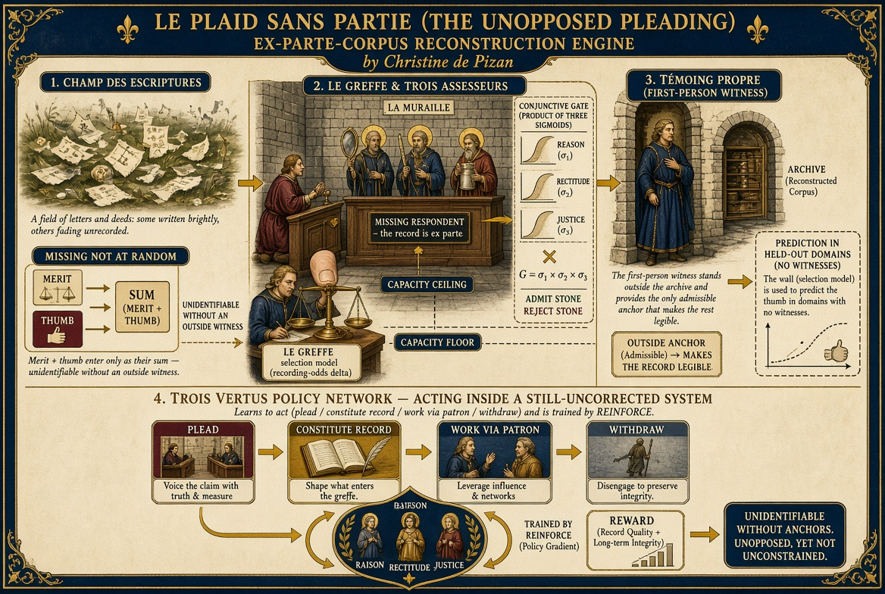

**Architecture — *Le Plaid sans partie — a Record with One Party Present Cannot Tell Merit from the Censor's Thumb***  ·  🟢 **belief** — grounded in the figure's own surviving works

Born at Venice in 1364, brought to Paris as a child and widowed at about twenty-five, she spent some fourteen years in the courts as a party trying to get a hearing, then ran her own workshop of scribes and illuminators. In 1405 she finished both the *City of Ladies*, where Reason rebuilds the case from the hostile authorities themselves, and the *Treasure of the City of Ladies*, a guide to acting well estate by estate; in 1429 she wrote the only poem on Joan of Arc made in Joan's lifetime. Le Plaid sans partie, the unopposed pleading (`Plaid`), models the archive (`ChampDesEscriptures`) as merit plus a censor's thumb, as a hostile reader would take it (`MatheolusReader`); **the admission** (`_admission`) lets a first-person witness in only when Reason, Rectitude and Justice all agree; **the wall** (`_wall`) is built from admitted stones to read the quarters where no witness survives; and **the Three Virtues** (`TroisVertus`) learn how to act on the result. All eight tests passed, the two gradient checks among them. It proved that an unopposed record cannot separate merit from thumb (`test_unidentifiability`): five readers who differed only in prior conviction read one archive to verdicts 1.09 apart with the same fit. With witnesses admitted the spread fell to 0.13 and 96% of the manufactured gap was removed (`test_reconstruction`). Removing Reason more than doubled the fabricated share admitted (`test_assessor_ablation`), and even the full gate left 13% fabrications in the wall, against 24% in the pool. Where no witness survived, the wall cut the error by 31% (`test_wall_transfer`), and the Three Virtues recovered 93% of the gap to the best possible conduct (`test_policy`).

▶️ **Run the mind:** [`minds/chapter_0385_christine_de_pizan_1364.py`](minds/chapter_0385_christine_de_pizan_1364.py)  —  `python3 minds/chapter_0385_christine_de_pizan_1364.py`

---

## 386 · Jan Hus
**c. 1369/72 – 1415 CE — Husinec, Prague & Constance · Czech (Bohemian)**  |  *Ecclesiology · Vernacular preaching · Conscience under coercion*

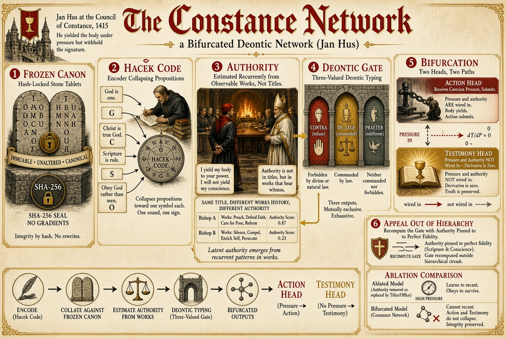

**Architecture — *The Constance Network — No Wire from Pressure to Testimony, and Authority Read from Works, Not Title***  ·  🟢 **belief** — grounded in the figure's own surviving works

Born at Husinec with no surname and named the Goose after it, he preached in Czech at the Bethlehem Chapel in Prague from 1402, held in *De ecclesia* that the true Church is the congregation of the predestined, a hidden variable no office can certify, and in 1412 appealed past every court to Christ. At Constance, under the emperor's safe conduct, he was told to abjure articles as the council had framed them, whether or not he had held them; he refused, and was burned on 6 July 1415. The Constance Network is a bifurcated deontic network: **a frozen canon** (`Canon`) whose digest is verified and never changes (`test_canon_immutability`); **authority** estimated from a source's works rather than its title (`authority_forward`, `test_equivocal_title`); **a three-valued gate** for refused, commanded and indifferent acts; and **a testimony pathway** with no wire from pressure at all. All seven tests passed, the gradient check among them. Testimony's derivative with respect to pressure was exactly zero, against 1.65 in a twin wired to the room (`test_pressure_invariance`). In the trial (`constance_trial`), under maximum coercion, both submitted the body every time; the twin recanted 69% of the time and kept to the evidence 30%, against 13% and 84%. The twin also had the lower training loss, bought by learning what the room wanted to hear. When a source's authority collapsed, appealing past it to the text (`test_appeal_out_of_hierarchy`) lifted agreement with the canon from 22% to 85%.

▶️ **Run the mind:** [`minds/chapter_0386_jan_hus_1369.py`](minds/chapter_0386_jan_hus_1369.py)  —  `python3 minds/chapter_0386_jan_hus_1369.py`

---

## 387 · Zheng He
**c. 1371 – 1433 CE — Kunyang, Nanjing, Liujiagang & the Western Ocean · Chinese (Ming; Hui)**  |  *Maritime command · Logistics · Tributary diplomacy*

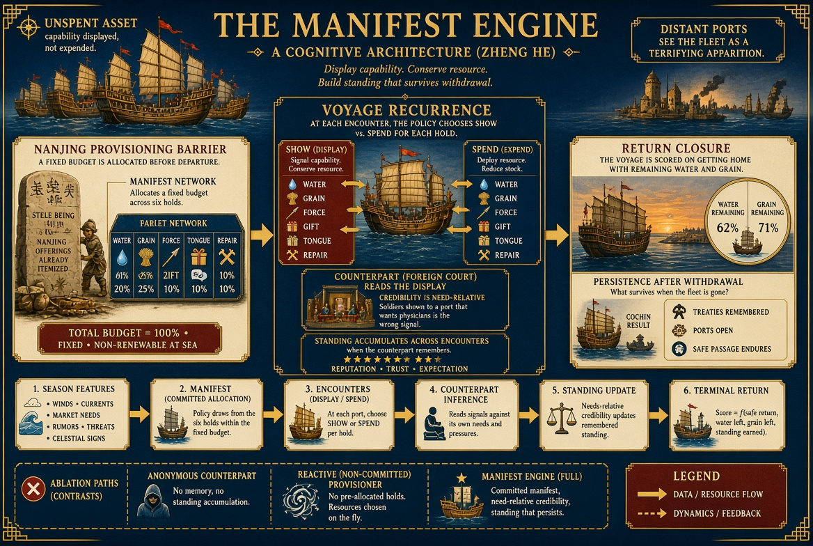

**Architecture — *The Manifest Engine — Seal the Holds Before the World Is Seen, and Score the Voyage on Its Return***  ·  🔵 **extrapolated** — inferred from documented deeds

Born Ma He to a Hui Muslim family of Yunnan, captured and castrated at about ten when the Ming took the province in 1381, and given as a servant to the prince who became the Yongle emperor, he led seven voyages to the Western Ocean between 1405 and 1433, the first with some 27,800 men; in twenty-eight years he fought three engagements and annexed nothing. He left no treatise or letters: the inscriptions he commissioned, at Galle in 1409 and at Liujiagang and Changle in 1431, are almost all that is his own. The Manifest Engine commits a voyage's whole budget in port, before any encounter is seen (`voyage`): **six holds**, water, grain, force, gifts, tongues and repair, are displayed apart at every port; **the display** counts what was shown against what was spent; and **the objective** scores compliance, the register the fleet leaves behind it, and getting the ships home. All nine checks passed, the gradient check among them. It showed force seventeen times for every unit it spent and brought 65% of that hold home unspent; when no counterpart remembered, the ratio collapsed eightfold and the register lost two thirds. Commitment cost 1.5 on the world it had planned for and was worth 2.0 on one it had not, though only 0.8 to 1.0 on other seeds. Asked also to leave something that persists, it kept 56% of the register after the fleet's withdrawal, against 30%. It carried almost nothing as gifts or repair stores, and when not required to return it ran out of water and grain.

▶️ **Run the mind:** [`minds/chapter_0387_zheng_he_1371.py`](minds/chapter_0387_zheng_he_1371.py)  —  `python3 minds/chapter_0387_zheng_he_1371.py`

---

## 388 · Margery Kempe
**c. 1373 – after 1438 CE — Bishop's Lynn, Jerusalem, Rome & Santiago · English**  |  *Mysticism · Autobiography · Discernment of spirits*

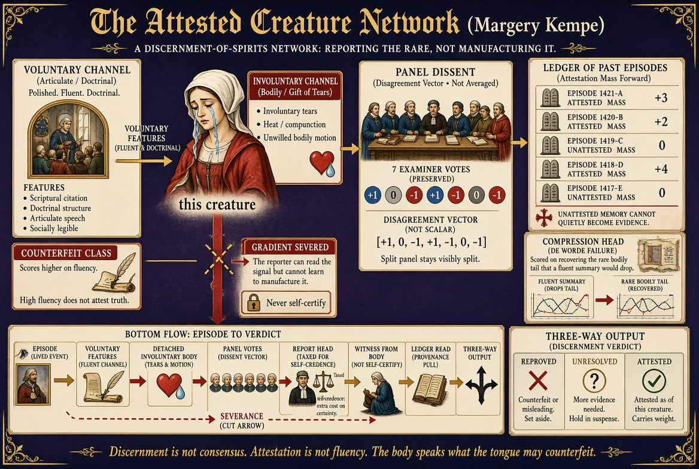

**Architecture — *The Attested Creature Network — Believe the Body the Mouth Cannot Reach, and Keep Unresolved as a Verdict***  ·  🟢 **belief** — grounded in the figure's own surviving works

Daughter of a five-times mayor of Bishop's Lynn, mother of fourteen and a failed brewer and miller, she wept aloud from Calvary onward, was arrested at Leicester, York and Beverley in 1417, and dictated in 1436–38 a Book that never says *I*: its subject is *this creature*, and her visions go before confessors, an anchoress and two archbishops instead of standing on her word. The Attested Creature Network (`AttestedCreatureNetwork`) taxes its report head for certifying itself; reads **a bodily channel** (`body_step`) that the reporter provably cannot forge (`severance_check`); keeps **a ledger** of past episodes, read in proportion to the attestation each earned (`ledger_read`); holds **a panel's disagreement** whole; and treats *unresolved* as a verdict. The gradient check and all nine self-tests passed (`run_self_tests`). A perfect reader of the polished account told grace from counterfeit 48% of the time, where chance is 50%, and leaned toward the forgery; attestation reached 81% on held-out cases against 61% for fluency. Setting the account and the body in conflict (`conflict_probe`), swapping only the bodily signal moved attestation from 19% to 81%: a flawless account with no tears behind it was believed one time in five. A third of cases went to unresolved, and 86% of the truly undecidable landed there; a memory never attested contributed almost nothing. Its guarantee is structural, no gradient from report to body, and says nothing of a forger who learns to weep.

▶️ **Run the mind:** [`minds/chapter_0388_margery_kempe_1373.py`](minds/chapter_0388_margery_kempe_1373.py)  —  `python3 minds/chapter_0388_margery_kempe_1373.py`

---

## 389 · Filippo Brunelleschi
**1377 – 1446 CE — Florence & Rome · Italian (Florentine)**  |  *Architecture · Perspective · Engineering*

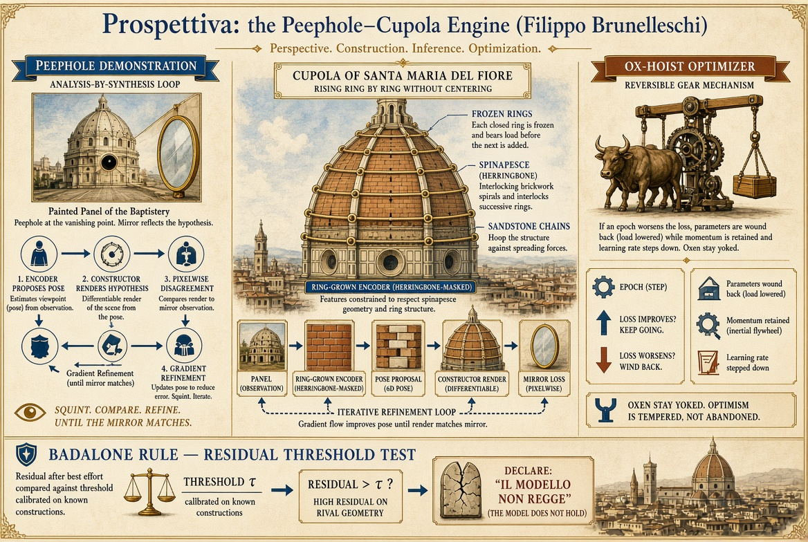

**Architecture — *The Peephole–Cupola Engine — Grow Ring by Closed Ring, and Check Every Guess Against the World Through One Hole***  ·  🔵 **extrapolated** — inferred from documented deeds

No treatise of his survives; the entry is read from his works, a patent of 1421, two sonnets and the accounts of Manetti and Vasari. A notary's son trained as a goldsmith, he lost the Baptistery doors competition of 1401 to Ghiberti and never again submitted to a committee's verdict. Between 1413 and 1425, by Manetti's account, he painted the Baptistery on a panel to be viewed through a hole drilled in its back, against a mirror, so that the picture could be checked against the building from one fixed station; from 1420 he raised the dome of Florence without centering, each course a complete structure at its own size, lifted by a reversible ox hoist of his own design. The Peephole–Cupola Engine (`CupolaEncoder`) builds its own training world with a differentiable constructor (`render`); grows its encoder in **three rings** (`_ring`), each closed before the next is laid, with a herringbone pattern that alternates ring to ring (`herringbone_mask`); is trained by **the ox hoist** (`OxHoist`), which lowers the load and steps down a gear whenever an epoch raises the loss; and at test time **the peephole** (`peephole_refine`) refines every guess by rendering it and comparing it with what it sees. All eight checks passed, the two gradient checks among them. The trained eye alone left a median error near 20 degrees; comparison cut it to 2.1 and brought the residual within 1.1 times the noise floor, so the precision came from the check, not the eye. A seven-sided rival it could not build (`build_heptagon_verts`) left a residual seventeen times larger and was flagged every time, with 2% false alarms on its own work. It learns only from worlds it can construct.

▶️ **Run the mind:** [`minds/chapter_0389_filippo_brunelleschi_1377.py`](minds/chapter_0389_filippo_brunelleschi_1377.py)  —  `python3 minds/chapter_0389_filippo_brunelleschi_1377.py`

---

## 390 · al-Kāshī
**c. 1380 – 1429 CE — Kāshān & Samarkand · Persian (Timurid)**  |  *Numerical analysis · Astronomy · Error bounds*

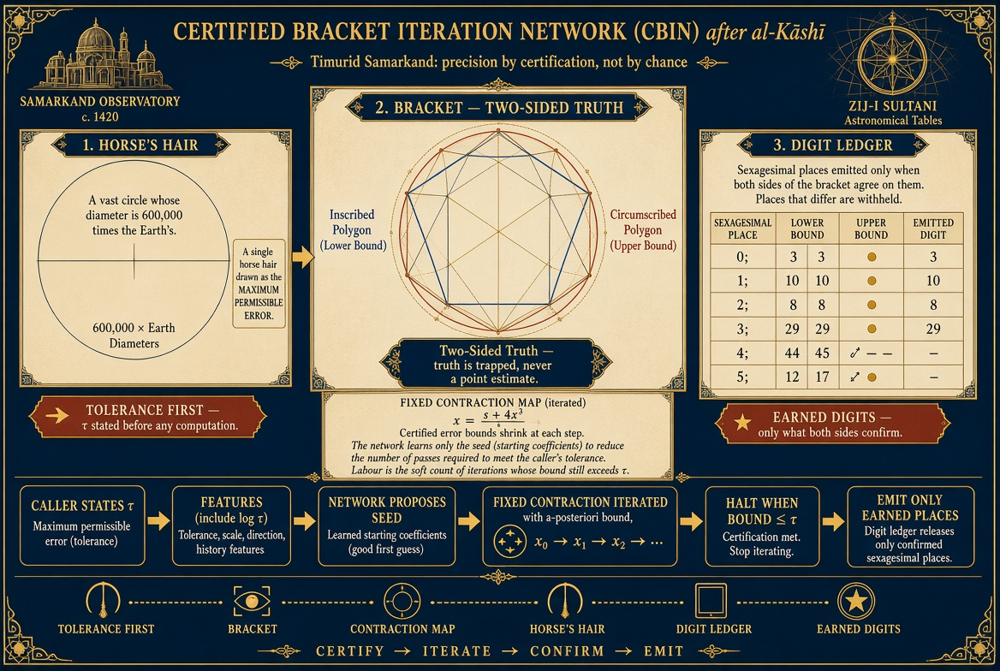

**Architecture — *The Certified Bracket Iteration Network — Fix the Permitted Error Before Computing, and Answer with a Bracket***  ·  🟢 **belief** — grounded in the figure's own surviving works

Born at Kāshān and poor in the decade Timur's armies passed through Iran, he dated his works to the day, came to Ulugh Beg's Samarkand in the early 1420s, and in his *Treatise on the Circumference* of July 1424 fixed the permitted error before computing anything: for a circle whose diameter is six hundred thousand times the Earth's, less than the breadth of a horse's hair (`horse_hair_budget`). From that requirement he worked backwards to a polygon of 805,306,368 sides and 2π to nine sexagesimal places; *The Key of Arithmetic* followed in 1427, and he died at Samarkand in 1429. The Certified Bracket Iteration Network keeps his contraction fixed and learns only where to start it (`forward`): **the tolerance** is an input, **the number of passes** follows from it, and every answer is **a bracket** that must contain the truth (`certified_answer`). Exact base-sixty arithmetic (`sx_mul`, `sx_sqrt`, `sx_to_sexagesimal`) reruns his own computations. All nine self-tests passed (`self_tests`), among them the gradient check, which held again after training. In exact integers the polygon's bracket alone (`polygon_bracket`) earned eight of his nine places, the ninth coming from taking the mean, and his sine of one degree (`sin_one_degree`) was matched through the ninth place. On 4,000 unseen problems the learned start cut the passes needed from 3.9 to 3.1, a saving of 22%, and the certified bound held the truth every time. Learning bought speed and never warrant, and the method has brackets only for answers that are numbers.

▶️ **Run the mind:** [`minds/chapter_0390_al_kashi_1380.py`](minds/chapter_0390_al_kashi_1380.py)  —  `python3 minds/chapter_0390_al_kashi_1380.py`

---

## 391 · Thomas à Kempis
**c. 1380 – 1471 CE — Kempen, Deventer & Mount St Agnes · German-Netherlandish**  |  *Devotion · Formation of character · Discernment of motives*

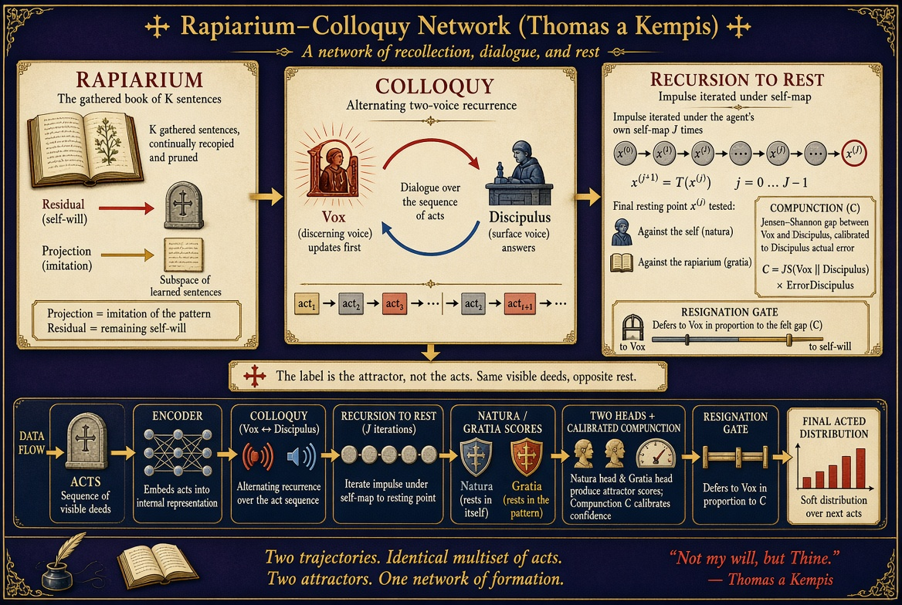

**Architecture — *The Rapiarium-Colloquy Network — Two Voices, One Deed, and a Test of Where Each Motion Comes to Rest***  ·  🟢 **belief** — grounded in the figure's own surviving works

Born Thomas Hemerken at Kempen and schooled at Deventer among the Modern Devout, he entered Mount St Agnes near Zwolle in 1399, copied the whole Bible at least four times, and stayed there, but for an exile of 1429 to 1432, until he died in 1471 at about ninety-one. In the *Imitation of Christ*, which survives in some nine hundred fifteenth-century manuscripts, nature and grace both desire the good and both make a fair show in word and deed, and are told apart only by where each finally comes to rest. The Rapiarium-Colloquy Network (`RCN`) keeps **a rapiarium**, a small notebook of sentences; **two voices** that share no parameters; **compunction**, a signal that measures how far they disagree; and **a rest-test** of where each motion comes to rest. Its corpus gives both motions the same acts in different orders (`make_two_motions`), and a check confirms that no order-blind summary tells them apart (`verify_corpus_is_behaviourally_identical`). The gradient checks passed with and without the rest-test. A network blind to order (`bag_features`) scored at chance, and the full network 83.5%, against 62.5% for an order-aware baseline (`seq_features`). Compunction was more than six times higher when the surface voice was wrong than when it was right. Severing the rest-test cost five points; but the rapiarium collapsed onto one sentence where the hidden pattern had three, and one sentence did as well.

▶️ **Run the mind:** [`minds/chapter_0391_thomas_a_kempis_1380.py`](minds/chapter_0391_thomas_a_kempis_1380.py)  —  `python3 minds/chapter_0391_thomas_a_kempis_1380.py`

---

## 392 · Battista da Montefeltro
**1384 – 1448 CE — Urbino, Pesaro & Foligno · Italian (Urbino & Pesaro)**  |  *Humanism · Latin oratory · Women's education*

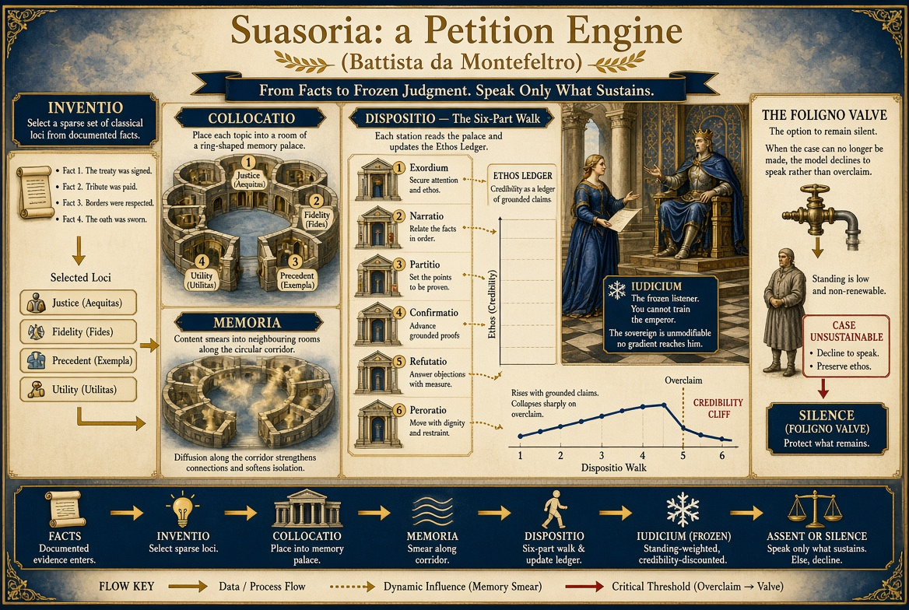

**Architecture — *Suasoria, the Petition Engine — Persuade a Sovereign You Cannot Retrain, and Keep the Power to Stay Silent***  ·  🔵 **extrapolated** — inferred from documented deeds

What survives of her is an oration, verse and letters, and no philosophy of mind, so the entry reasons from her practice. Born at Urbino in 1384 into a condottiere household where letters were a tool, and married in 1405 to Galeazzo Malatesta, called the Inept, who later sold Pesaro, she was the woman to whom Leonardo Bruni addressed, around 1424, the first humanist programme of study written for a woman; she spoke in Latin before the Emperor Sigismund at Urbino in 1433, an oration still printed half a century later, and entered the Poor Clares at Foligno in 1447, the year before her death. Suasoria, the petition engine, trains an orator against **a frozen sovereign** in a court built once (`build_court`) and never modified (`test_sovereign_is_frozen`): **invention**; **a palace of memory** that conserves its mass (`test_palace_conserves_mass`); **a delivery** in which every claim must be backed; **a credibility account** that a single overreach drains (`test_ethos_cliff`); and **a valve** that decides whether to speak at all (`test_silence_is_selective`). The gradient check and every self-test passed; the sovereign was untouched while all sixteen of the orator's tensors moved. On 4,096 unseen petitions it won assent for 82% of just causes and 15% of unjust ones, and chose to speak on 99% of just cases and 1% of unjust. Withdrawing the backing cut assent by 0.36 as overclaim rose thirtyfold. The same speech scored 0.50 without office and 0.67 with it (`test_standing_asymmetry`), a gap no delivery could close.

▶️ **Run the mind:** [`minds/chapter_0392_battista_da_montefeltro_1384.py`](minds/chapter_0392_battista_da_montefeltro_1384.py)  —  `python3 minds/chapter_0392_battista_da_montefeltro_1384.py`

---

## 393 · Donatello
**c. 1386 – 1466 CE — Florence, Siena & Padua · Italian (Florentine)**  |  *Sculpture · Relief · The beholder's station*

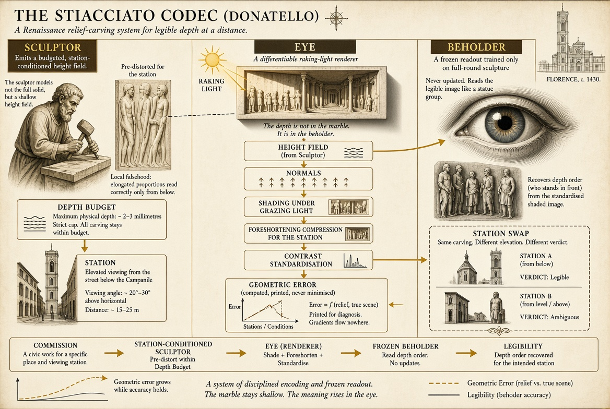

**Architecture — *The Stiacciato Codec — Carve for the Beholder at One Station, and Never Minimise the Geometry***  ·  🟢 **belief** — grounded in the figure's own surviving works

A wool-stretcher's son whose birth year is known only from his tax return of 1427, he left no writings and is read from the formal decisions of his works. He cut prophets for Florence's bell tower that look unstable and over-long seen level and close, and correct from some twenty metres below, and around 1417 carved under the St George niche the first relief in *rilievo stiacciato*, flattened marble in which depth is drawn rather than cut; his Ascension of about 1428–30 holds a whole landscape on a slab 5.3 centimetres thick. The Stiacciato Codec trains **a sculptor** (`Sculptor`) against **a beholder** (`Beholder`) frozen at one **station** (`Station`): the carving is judged by what that beholder reads, under a hard cap on depth, and its geometric error against the scene is reported but never minimised (`Workshop`). The gradient check and all sixteen self-tests passed. Cutting the depth allowance a hundredfold (`experiment_budget_sweep`) left the beholder reading every carving correctly while contrast weakened 3.2 times, which is why such reliefs want raking light, and the geometry stayed no closer to the scene than an uncut slab. From the station it was carved for it was legible every time; from seventeen degrees higher, half the time; from thirty-four, 17% (`experiment_station_swap`). Rewarding the beholder's certainty instead (`experiment_amplification`) nearly doubled its margin while appearance error rose sevenfold.

▶️ **Run the mind:** [`minds/chapter_0393_donatello_1386.py`](minds/chapter_0393_donatello_1386.py)  —  `python3 minds/chapter_0393_donatello_1386.py`

---

## 394 · Jang Yeong-sil
**c. 1390 – after 1442 CE — Dongnae & Hanyang · Korean (Joseon)**  |  *Instruments · Standards · Hydrology*

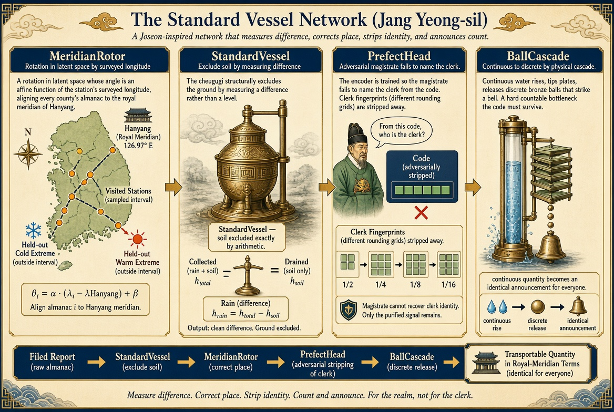

**Architecture — *The Standard Vessel Network — Exclude the Ground, Correct by the Map, and Keep the Clerk Out of the Code***  ·  🟡 **mediated** — known only through the accounts of others

Not one sentence of his survives; the royal annals record him. Born a government slave at Dongnae, the son of a registered courtesan and a father of Yuan descent, he was sent to Ming China in the early 1420s, freed by appointment to office in 1423, and built for King Sejong an armillary sphere, the self-striking water clock of 1434, public sundials, river gauges and, by tradition, the rain gauge. In 1442 a royal palanquin made under his supervision broke; he took eighty strokes, was dismissed, and the records stop. The Standard Vessel Network does four things to a reading: **the vessel** (`vessel_forward`) excludes the ground it was taken on (`test_vessel_excludes_the_ground`); **the rotor** (`rotor_forward`) corrects it from a county's place on the map rather than from its clerks (`test_rotor_is_geometric`); **the cascade** (`cascade_forward`) hardens water into a count of whole balls (`test_cascade_is_countable`); and **the bell** (`bell_forward`) announces only that count. **A magistrate**, an adversary trained in reverse, tries to name the clerk from the code. The gradient check, the vessel theorem and all five self-tests passed. At the eleven counties that supplied data a fit 4.5 times its size did a little better, then its error grew 2.7 times when carried past them; the network degraded only 1.5 times at five counties never visited, beating both baselines there (`test_unvisited_counties`). The reversal kept the clerk out of the code better than the filed report itself, 42% against 50% (`test_magistrate_defeated`), but never down to chance, 25%.

▶️ **Run the mind:** [`minds/chapter_0394_jang_yeong_sil_1390.py`](minds/chapter_0394_jang_yeong_sil_1390.py)  —  `python3 minds/chapter_0394_jang_yeong_sil_1390.py`

---

## 395 · Jan van Eyck
**c. 1390 – 1441 CE — The Hague, Lille, Ghent & Bruges · Flemish (Burgundian)**  |  *Oil painting · Layers · Signature*

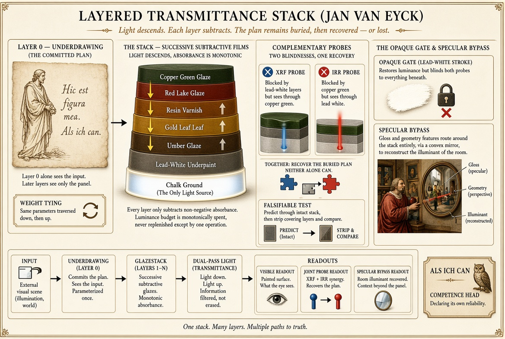

**Architecture — *The Layered Transmittance Stack — Represent by Absorbing, and Leave the Plan Readable Beneath the Paint***  ·  🔵 **extrapolated** — inferred from documented deeds

No word of his on art or mind survives, so the entry is inferred from two decades of dated, signed panels and the layers they left behind. Recorded at The Hague between 1422 and 1424 as Master Jan the painter, court painter and envoy to Philip the Good from 1425, salaried so that a layer could take the time it needed to dry, he travelled to Portugal in 1428 to paint the infanta, saw the Ghent Altarpiece installed in 1432 and signed panels *als ich can*, as I can, and *Johannes de eyck fuit hic*. In 2018 two imaging methods, each blind where the other sees, found the original face of its Lamb under a sixteenth-century restorer's paint, which covered some seventy per cent of the outer panels; in 2019 the overpaint came off and the predicted face was there. The Layered Transmittance Stack (`GlazeStack`) represents by spending light: **four parameter-tied glazes** that can only absorb, drawn from **a book of pigment absorbances** (`_make_absorbance_book`), laid over **a committed underdrawing** and read by **two probes**, X-ray fluorescence and infrared, each blind where the other sees (`build_masks`). All twelve self-tests passed, the gradient check among them. No covering layer ever added light (`monotonicity_report`), and 63% of the ground's brightness became representation. Together the probes recovered the buried plan 85% of the time against 77% for the better one alone, a reading more accurate than the one taken after stripping the layers (`stripped_masks`); its declared confidence missed its accuracy by under half a point. It scored 1.4 points below a size-matched network (`MatchedMLP`), and a full overpaint destroyed 59 points of audit at no cost to the score.

▶️ **Run the mind:** [`minds/chapter_0395_jan_van_eyck_1390.py`](minds/chapter_0395_jan_van_eyck_1390.py)  —  `python3 minds/chapter_0395_jan_van_eyck_1390.py`

---

## 396 · Ulugh Beg
**1394 – 1449 CE — Sulṭāniyya & Samarkand · Timurid (Turco-Mongol)**  |  *Astronomy · Observatories · Star catalogues*

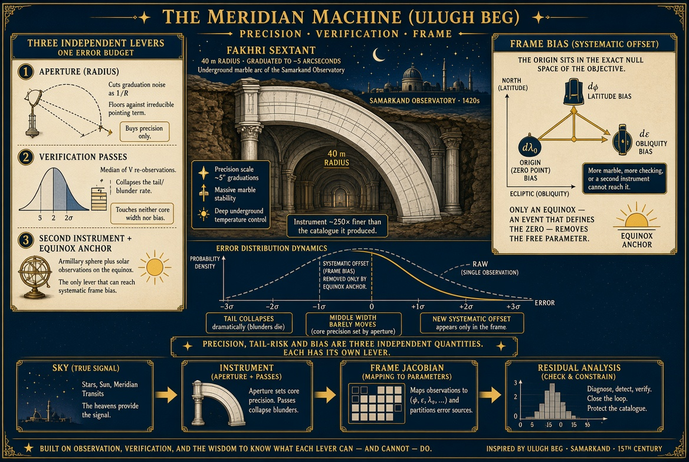

**Architecture — *The Meridian Machine — Split One Error Budget Among Aperture, Repetition and an Anchor Outside the Instruments***  ·  🔵 **extrapolated** — inferred from documented deeds

He wrote no doctrine of knowledge, and the instructions of his tables are terse and give no worked example, so the entry is inferred from a practice that left an unusually checkable dataset. A grandson of Timur, born at Sulṭāniyya in 1394 and governor of Samarkand from 1409, he built a madrasa on the Registan, gathered Qāḍī Zāda and al-Kāshī, and raised an observatory whose meridian arc had a radius of about forty metres. His tables of 1437 listed 1,018 stars, the only catalogue between Ptolemy and Tycho founded on new measurement; graded against modern data, they cut the gross errors from 2% to 0.1% but the scatter only from 27 to 22 minutes of arc, and traded Ptolemy's offset of +7 minutes for one of −11. In 1449 his son had him beheaded. The Meridian Machine splits one error budget among three levers and asks which error each can reach: **aperture**, the graduation an arc's size allows (`graduation_sigma_deg`); **repeated passes**, kept in **a register** (`Register`); and **contact with something outside the instruments**, the equinoxes (`equinox_times`). All twenty-two self-tests passed, the gradient check among them, and al-Kāshī's iteration for the sine of one degree (`alkashi_refine`) is used as he gave it. An arc 160 times larger made its graduation 160 times finer but its achieved width only seven times narrower, against a pointing floor; repeated passes removed the tail and left the offset alone. With one instrument or two, a wrong origin cost nothing, because the tables absorbed it (`frame_information`); only equinox anchors cut the origin error from seven or nine minutes to 0.13, and made a wrong origin cost something at last.

▶️ **Run the mind:** [`minds/chapter_0396_ulugh_beg_1394.py`](minds/chapter_0396_ulugh_beg_1394.py)  —  `python3 minds/chapter_0396_ulugh_beg_1394.py`

---

## 397 · Henry the Navigator
**1394 – 1460 CE — Porto, Ceuta, Sagres & Lagos · Portuguese (House of Avis)**  |  *Exploration · Licensing · The ledger of returns*

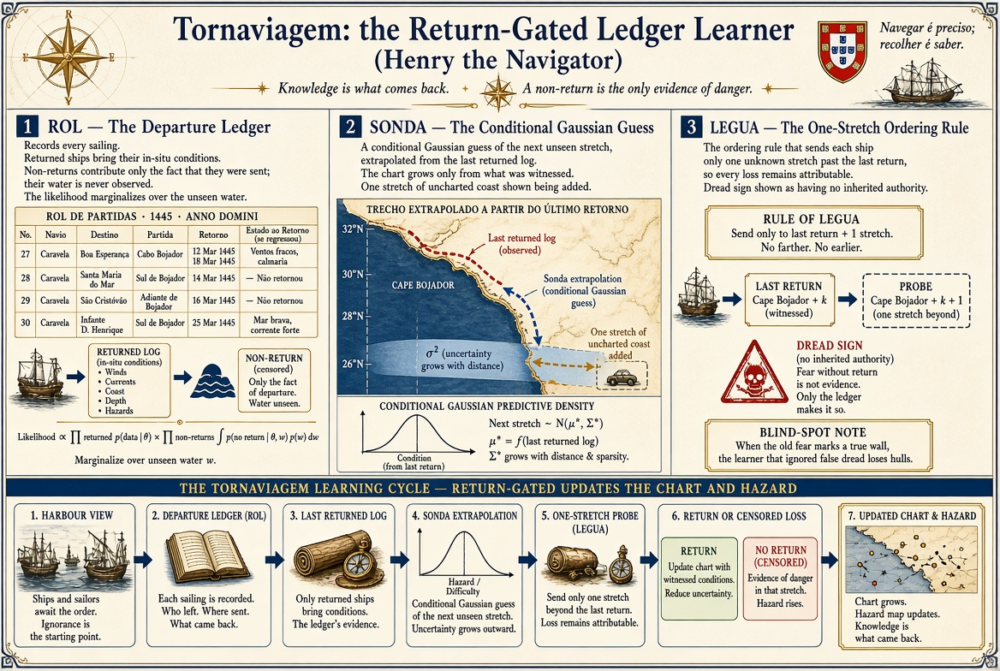

**Architecture — *Tornaviagem, the Return Voyage — Read the Ship That Does Not Return, and Send the Next One Stretch Past the Last***  ·  🔵 **extrapolated** — inferred from documented deeds

No philosophy of his survives; his own texts state crusading and administrative positions, and most of his deeds are reported by his panegyrist Zurara. A son of João I and Philippa of Lancaster, he fought at Ceuta in 1415 and never sailed beyond Morocco. For twelve years the ships he sent south turned back at Cape Bojador, until Gil Eanes passed it in 1434 and brought home a plant in a barrel of earth as proof; he received failed captains without blame and paid more for one stretch past the last return. In 1444, at Lagos, he watched from horseback as 235 captives were divided, and took his share. He died in 1460; *the Navigator* is a nineteenth-century name. Tornaviagem, the return voyage, keeps **a ledger** of every departure (`ledger_book`), reads a ship that does not come back as its only evidence of danger (`_hazard`), guesses **the unseen water** from the last returned log (`_sonda`), and sends each ship one stretch past the last return (`campaign`). The gradient check and every correctness check passed, and all four planted mutants were caught (`c5_mutants`). Over five seeds on unfamiliar coasts it beat a same-sized direct classifier, 0.22 to 0.18, and a long leap by far more; removing the ledger of lost ships cost much more than removing the visible signs, and removing the guess of unseen water cost most (`knockout_table`). Where the old dread marked a real wall, a learner that refused to sail outscored it, as at Tangier in 1437. Its ledger has no column for the people on the shore.

▶️ **Run the mind:** [`minds/chapter_0397_henry_the_navigator_1394.py`](minds/chapter_0397_henry_the_navigator_1394.py)  —  `python3 minds/chapter_0397_henry_the_navigator_1394.py`

---

## 398 · Fra Angelico
**c. 1395 – 1455 CE — the Mugello, Fiesole, Florence & Rome · Italian (Florentine)**  |  *Fresco · Monastic formation · Postures of prayer*

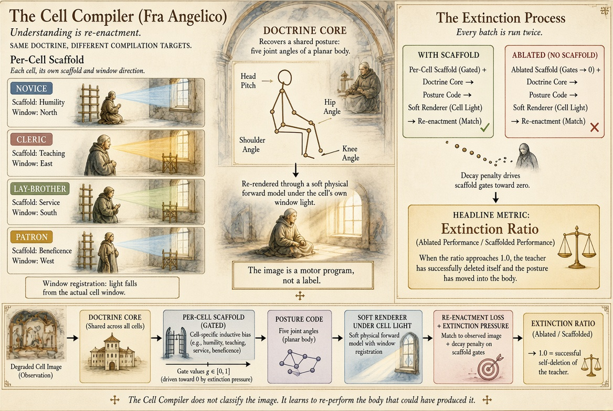

**Architecture — *The Cell Compiler — One Doctrine Compiled for Each Receiver, and a Scaffold Scheduled to Disappear***  ·  🟡 **mediated** — known only through the accounts of others

No word of his on art or mind survives; he reaches us through payments, through Vasari a century later and through the works. Born Guido di Pietro in the Mugello and trained as an illuminator, he was a Dominican friar at Fiesole by 1423, and from about 1438 to 1445 painted with his workshop some forty-four frescoes into the cells of San Marco, sorted by who would sleep under them: novices, clerics, lay brothers, and a double cell for Cosimo de' Medici. The novices got one scene seven times, the kneeling Dominic in a different posture of prayer in each. He died in Rome in 1455, and *Angelico* is a name first given after his death. The Cell Compiler compiles one doctrine for each receiver through **a small per-cell scaffold**; decodes a posture by re-enacting it through **a body** (`forward_kinematics`) and **a renderer** (`render`); paints each cell under the light of its own window (`cell_light`); and schedules **the scaffold's withdrawal** (`withdrawal`). The gradient check and all eight self-tests passed (`self_tests`). By the end of training the scaffold gates had fallen from 1.0 to 0.05, and removing them cost under a point in any cell (`extinction_report`); readings held under all four windows (`window_invariance`), and a receiver it had never met was read about three times in four with no scaffold, where chance is one in seven (`transfer_to_unseen_receiver`). Yet the novices, for whom the scaffold was built, were read worst, at 69%.

▶️ **Run the mind:** [`minds/chapter_0398_fra_angelico_1395.py`](minds/chapter_0398_fra_angelico_1395.py)  —  `python3 minds/chapter_0398_fra_angelico_1395.py`

---

## 399 · King Sejong the Great
**1397 – 1450 CE — Hanyang · Korean (Joseon)**  |  *Script design · Phonology · Governance*

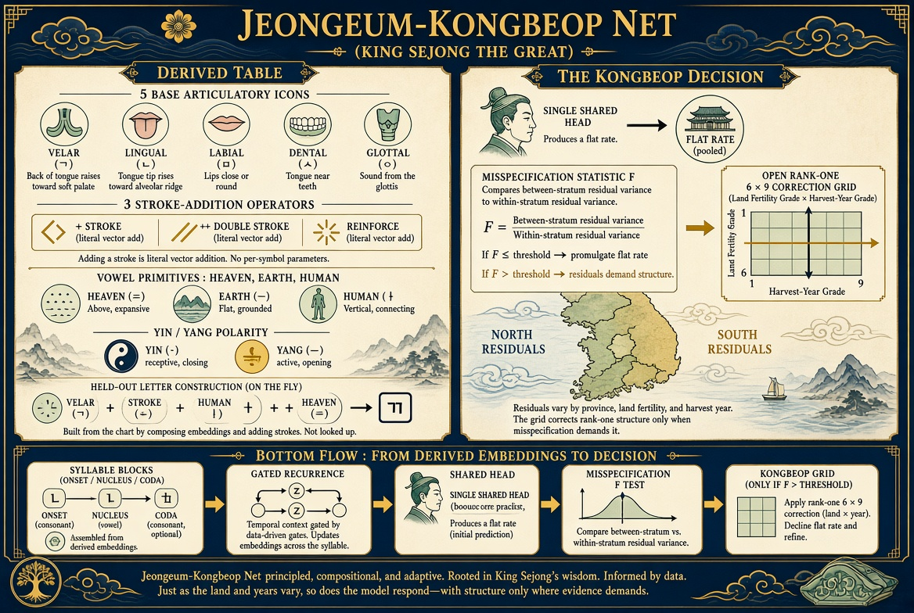

**Architecture — *The Jeongeum-Kongbeop Net — Letters Derived from the Organs That Make Them, and a Tax Grid the Residuals Must Earn***  ·  🟢 **belief** — grounded in the figure's own surviving works

Made heir in 1418 by an argued decision that set his elder brother aside, he founded the Hall of Worthies in 1420, and in 1434 his foundry cast more than two hundred thousand pieces of type for a people most of whom could not read. In 1443 he announced a script whose consonants draw the organs that make them, a stroke added for each stronger sound; his preface of 1446 says the people have what they wish to say and cannot write it, and the postface promises that the wise will learn the script before a morning is out. In 1430 he polled 172,806 subjects on a land tax, won a majority and did not enact it; in 1444, after years of argument, came a grid of six fertility grades by nine harvest grades. The Jeongeum-Kongbeop Net (`JeongeumKongbeopNet`) reads letters from **a derived chart**, base shapes plus strokes (`build_charts`, `derive_codebook`), rather than from a table, and keeps **its tax grid** shut until a test on the provinces' residuals (`misspecification_F`) says it must open. The gradient checks and all six self-tests passed. With 40% of a lookup table's parameters it read letters it was never shown with R² 0.94, against 0.28 for the table (`ablation_derived_vs_table`), and thirteen exemplars recovered the whole chart of thirty (`learnability_curve`). At epoch 17 it declined the flat rate on the residuals alone, which under-assessed the fertile south and over-assessed the poor north, as the northern provinces had objected in 1430; the grid cut the spread of provincial bias from 0.65 to 0.02 (`per_province_report`).

▶️ **Run the mind:** [`minds/chapter_0399_king_sejong_the_great_1397.py`](minds/chapter_0399_king_sejong_the_great_1397.py)  —  `python3 minds/chapter_0399_king_sejong_the_great_1397.py`

---

## 400 · Johannes Gutenberg
**c. 1400 – 1468 CE — Mainz & Strasbourg · German (Mainz)**  |  *Printing · Typefounding · Tolerances*

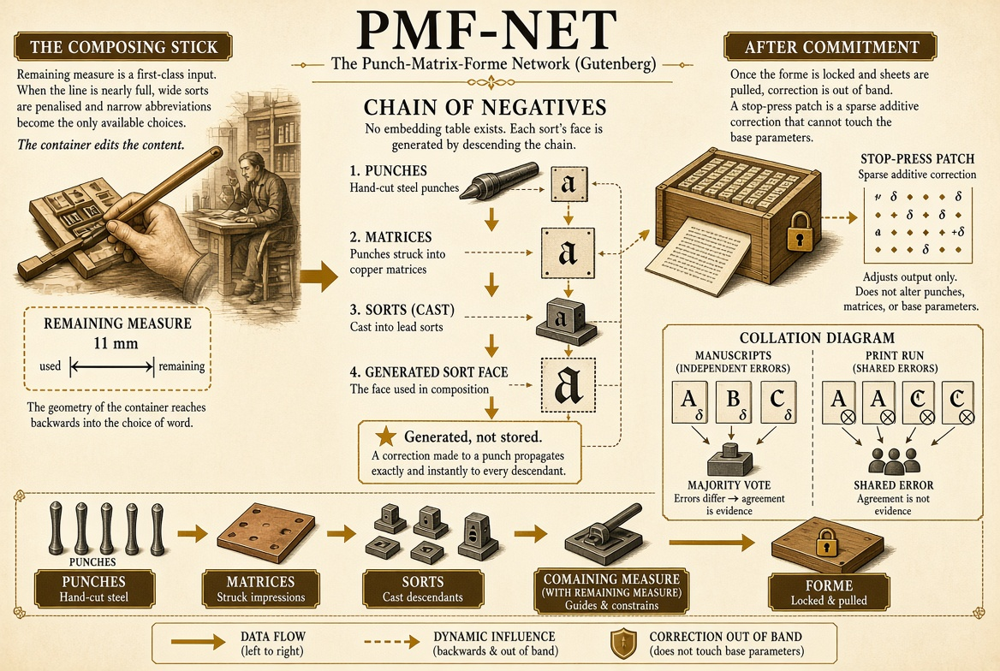

**Architecture — *PMF-Net, the Punch-Matrix-Forme Network — Spend Precision Only Where Error Accumulates, and Store No Table of Letters***  ·  🟡 **mediated** — known only through the accounts of others

No words of his survive; he is read from what his shop produced and from the records of people suing him. Born to a patrician family of Mainz around 1400, at Strasbourg in 1439, when a partner died, he had four pieces taken out of the press so that no one could understand it; at Mainz Johann Fust lent him 1,600 guilders for the work of the books and in November 1455 took the shop and the type. The forty-two-line Bible, some 180 copies, was finished about then. His name is on nothing he printed, and he died in 1468. PMF-Net, the Punch-Matrix-Forme Network (`PMFNet`), stores no table of letters: every sort descends from a few **punches** through **matrices** (`build_faces`), so that one punch edit moves every sort cast from it, and **a composing stick** tells the generator how much of the line is left (`justification_bias`, `set_a_line`). The gradient check and all ten self-tests passed (`self_tests`). The type's face tolerated four hundred times the error its body could (`tolerance_budget`), because body error adds up across a column of 2,600 sorts while face error stops at the letter. With the text held fixed, the space left on the line changed 27% of the choices (`counterfactual_flip`). Agreement among copies of one press run never rose above a single copy's 88% (`collation_study`); an errata patch recovered a third of the harm done by a badly cut punch, and re-cutting the punch recovered all of it (`stop_press_patch`).

▶️ **Run the mind:** [`minds/chapter_0400_gutenberg_johannes_gensfleisch_1400.py`](minds/chapter_0400_gutenberg_johannes_gensfleisch_1400.py)  —  `python3 minds/chapter_0400_gutenberg_johannes_gensfleisch_1400.py`

---

## How the minds are reconstructed

Every entry is built research-first: the figure's surviving works and current scholarship are gathered and each source verified before any architecture is written. Where evidence is thin, the chapter says so rather than inventing an inner life. Each figure's **provenance** is set to one of three real values:

- 🟢 **belief** — the figure's own surviving works or recorded doctrine ground the entry.
- 🟡 **mediated** — no words of their own survive; they are known only through others' (often hostile or legendary) accounts, and the entry says so.
- 🔵 **extrapolated** — no philosophy of mind survives at all; the entry is inferred from documented deeds (typical of kings and builders), and the entry says so.

Only nine of these twenty speak in surviving works of their own, the fewest of any tome so far; four are mediated, and seven are extrapolated, the most of any tome. The reason is the century's makers: eleven of the twenty were painters, a sculptor, a builder, an engineer, an admiral, princes or a printer, who left objects, accounts and deeds rather than doctrine. **Rublev** left no word at all and is known from chronicle notices, a later monk's report of his gazing at icons, a church council of 1551 and one securely attributed panel; **Jang Yeong-sil** left not one sentence and survives in the court annals that recorded his promotion and his flogging; **Fra Angelico** reaches us through payments and Vasari, writing a century later; and **Gutenberg** through lawsuits and the measurable properties of his type. Among the seven extrapolated, **Vytautas**'s letters state political positions only, and much of his record passes through Długosz, often hostile; **Zheng He** left inscriptions and no treatise; **Brunelleschi** left a patent and two sonnets, with a life written after his death by Manetti; **Battista da Montefeltro** left an oration, verse and letters; **van Eyck** left signatures and layers; **Ulugh Beg** left terse tables, though their 1,018 positions make an unusually checkable record for an extrapolation; and **Henry** reaches us through his panegyrist Zurara. Of the nine grounded in their own works, two dictated rather than wrote, **Catherine** and **Margery Kempe**, and **Donatello**, who left no writings, is read from the formal decisions of the works themselves. At the other end, **Zeami** left twenty-one treatises, **al-Kāshī** dated his to the day, and **Thomas à Kempis** left his book in an autograph signed and dated 1441. Four of the twenty are women — a mystic, a court writer, a visionary of Lynn and a humanist orator — and the twenty knew one another again: al-Kāshī worked at Ulugh Beg's observatory until his death, Jang Yeong-sil built Sejong's instruments, Brunelleschi and Donatello went to Rome together by Manetti's account, Fra Angelico painted the cell of Cosimo de' Medici at San Marco, and Christine wrote the only poem on Joan of Arc made in Joan's lifetime, and Joan has a chapter of her own in the next tome.

Each reconstructed mind is then measured against the **[Artificiology E-AGI Barometer](https://artificiology.com/barometer.html)** — eight capability dimensions (Cognitive Processing 🧩, Embodied Cognition 🤸, World Modeling 🌍, Consciousness 👁️, Language Understanding 💭, Emotional Intelligence ❤️, Creativity ✨, Autonomy 🎯) — so that a mystic of Siena and a printer of Mainz can be compared on the same yardstick. Tome 20 questions the instrument's form more than it reads its scores. **Christine de Pizan** asks first who wrote it, who is administering it and who is absent from the room, and wants one measurement added that is not a capability at all: a declaration of the empty quarters, the classes of testimony missing from a system's evidence. **Catherine** asks whether the scores describe one body or a society, since the same numbers mean opposite things depending on the answer; **Rublev** says the eight bells matter less than whether they can sound together; **Donatello** refuses the aggregate as a verdict with no station attached; **al-Kāshī** asks what each axis is a promise about and in what units, since an axis without units is an opinion; **van Eyck** asks where the evidence for each score lives in the object, and whether it can be destroyed without trace; and **Gutenberg** sorts the eight into body axes, where error composes and exactness must be bought, and face axes, where error ends at the letter. **Vytautas** would ask how the machine is paid and read every axis through that question, and **Zheng He** would read the instrument as a manifest and put cross-lingual adaptation first, since a display that cannot be read is indistinguishable from a threat. Three minds add an axis it lacks: **Thomas à Kempis** a ninth, Terminus, where a system's policy comes to rest once its constraints relax, which he argues dominates the other eight; **Fra Angelico** the ratio of unaided to aided performance, without which a reported score says nothing; and **Sejong** the axis nobody measures because it is not a property of the machine: after the encounter, is the person more able, or less? Consciousness 👁️ is again narrowed to what can be checked from outside: **Margery Kempe** scores near zero a rich, confident self-report that nothing external funds, **Zeami** reads metacognition as a performer's sense of how he looks from outside, **Brunelleschi** wants confidence to be a quantity taken off the work, like a plumb reading, and **Henry** asks only that a mind know where its knowledge stops. Embodied Cognition 🤸 is where several minds sit highest: **Jang Yeong-sil** and **Ulugh Beg** because for them an epistemology is an instrument; **Kempe** makes the body load-bearing for what a system can be believed about; **Rublev** puts the first motor skill in the neck, inclining toward another; and **Henry**'s body is first of all a thing that comes home. Autonomy 🎯 is the axis most often reversed: **Catherine** calls it the one axis where a lower score is often the better system; **al-Kāshī** says the tolerance, the goal, must come from whoever bears the consequences; **Thomas** calls independent goal-setting the very definition of nature, the one capability that must not be trained for; **Hus** would allow self-modification only if the reference is not among the parts that change; **Christine** calls autonomy a relation between an agent and the standing it holds in a room; **Gutenberg** calls self-modification the most dangerous operation on the list; and **Battista** ranks it above every other axis, defined in one line: an agent that cannot decline to act has no autonomy. Only **Henry**'s chapter prints scores, on a scale of ten and expressly as judgements rather than measurements: World Modeling 🌍 highest at 8, Emotional Intelligence ❤️ lowest at 2 — the lowest score, it says, and the one that cost the most — and Autonomy 🎯 at 7; **Vytautas** ranks Consciousness 👁️ lowest, which his chapter calls his own blind spot, and **Brunelleschi** ranks Language Understanding 💭 lowest. The twenty humanoids are as various as the minds — six machines, none able to reach its own mouth; a guest at the open side that shares its face with its kind; a figure that holds a room while doing nothing; a wholly yielding body with the shackle point left visible at the wrist; a part that weeps, which the machine cannot author; one aperture with a mirror; a figure proportioned for its station, so that it looks wrong up close; a shell that wears its repairs signed and dated; a caravel on legs that goes only where it is permitted; a learner graded after everything that helped it has been taken away; a skin deliberately worse than its skeleton — and eleven of the chapters say outright that their mind would not build an oracle.

---

[← Tome 19](tome19.md) · [Repository README](readme.md)

### Read & explore
- 🌐 **Encyclopedia:** [https://lostmindsai.com](https://lostmindsai.com)
- 📖 **Tome 20 (Amazon):** [https://www.amazon.com/dp/B0HRS9ZHVG](https://www.amazon.com/dp/B0HRS9ZHVG)
- 🧪 **Interactive demos & résumé:** [https://artificiology.com/](https://artificiology.com/)
- 📊 **E-AGI Barometer:** [https://artificiology.com/barometer.html](https://artificiology.com/barometer.html)
- ✍️ **Author — David Vivancos:** [https://www.vivancos.com/](https://www.vivancos.com/)
